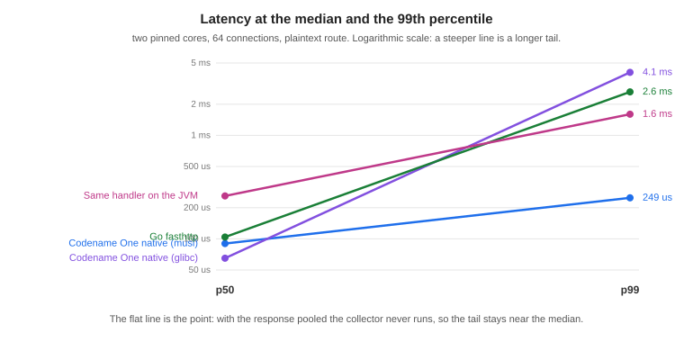

[[backend-operations]]
== Backend performance, deployment and limits

This chapter is for deciding whether the backend fits a service, and for putting
it into production once it does: what it costs in time and memory compared with
the alternatives, how the binary ships, and the limits worth knowing first.

=== What it costs

Same handler, three ways, plus Go for an outside reference. Two pinned cores, 64
connections, medians of three interleaved runs on the plaintext route:

[cols="2,1,1,1,1"]
|===
| Runtime | Requests/sec | p50 | p99 | Cold start

| Codename One native, musl
| 595,610
| 0.090 ms
| 0.249 ms
| 0.77 ms

| Codename One native, glibc
| 547,761
| 0.065 ms
| 4.06 ms
| 2.88 ms

| Go, fasthttp
| 496,293
| 0.104 ms
| 2.63 ms
| 2.39 ms

| The same handler on the JVM
| 187,745
| 0.260 ms
| 1.60 ms
| 82.5 ms
|===

Cold start is the interesting column. It's measured from process spawn to the
first accepted connection, and the static binary reaches it in under a
millisecond -- about a hundred times faster than the same code on a JVM, and
three times faster than Go. That number is the whole serverless argument.

Throughput is the least interesting one. Beating a tuned Go server by a fifth on
a microbenchmark isn't a reason to move a service; it's only evidence that the
translation doesn't cost you anything.

.Latency at the median against the 99th percentile

The slope chart is the one that matters. Every runtime here has a similar
median. What differs is the distance to the 99th percentile, and that distance is
garbage collection. With the response pooled the plaintext route allocates about
0.1 bytes per request, the collector never runs, and the tail stays at 2.8 times
the median. Give the same server a handler that allocates a map per request and
its tail goes to 80 ms, because the collector shares the cores with the server.

The honest rule is that the tail follows your allocation rate, not the runtime
badge. The runtime gives you the tools to allocate nothing on the hot path; it
doesn't do it for you.

==== Memory and size

[cols="2,1,1"]
|===
| Runtime | Binary or artifact | Resident under load

| Codename One native, musl
| 7.95 MB static
| 10-40 MB

| Codename One native, glibc
| 3.19 MB dynamic
| 14 MB

| Go, fasthttp
| 5.63 MB static
| 6.3 MB

| The same handler on the JVM
| 0.13 MB jar, plus a JRE
| 190 MB
|===

The JVM row is the same handler and the same protocol code. Everything it costs
above the native rows is the runtime underneath it.

The resident figures move around more than the latency ones, because the
collector keeps a pool of pages sized to the busiest moment the process has seen
and gives them back gradually. At rest the native builds sit near 3 MB.

==== musl or glibc

Both are supported, and they aren't equivalent. The static musl build starts
faster and has a far shorter tail. The glibc build has a better median, because
its allocator is better under contention, and a smaller binary, because it links
the system libraries instead of carrying them.

The reason to pick musl isn't the median. It's that the artifact is one file
with nothing underneath it, which is what makes the container the binary and the
cold start a process exec.

==== What isn't measured here

GraalVM is missing from these tables on purpose. A fair comparison would have to
run the same handler, and this handler can't run on GraalVM: the runtime's
native methods are ParparVM's, so comparing would mean benchmarking a different
server written against a different framework and reporting it as though the
toolchains had been compared. That's a benchmark worth building, and it isn't
this one.

=== Deploying it

The musl build is a single static file, so the container that carries it can be
empty:

----
FROM scratch
COPY bench-linux-musl-arm64 /server
ENTRYPOINT ["/server"]
----

There is no base image to patch, because there is no base image. `cn1:backend-package`
builds for the machine it runs on; the cross-compiled targets
(`musl-x86_64`, `musl-arm64`, `glibc-x86_64`, `glibc-arm64`) are produced by
`vm/backend/package.sh` in the Codename One repository, which drives one builder
image per target.

For AWS Lambda, `LambdaRuntime` implements the custom runtime loop. The Lambda
Runtime API is a plaintext poll over loopback, so it needs no listening socket and
no TLS, and what it does need is exactly what a translated binary is good at.

=== Limits worth knowing

* The class library is the Codename One runtime, not Java SE. A server dependency
  that assumes the full JDK won't translate, and Maven Central isn't the
  ecosystem this draws on.
* Beans, injection, transactions, scheduling and metrics are resolved at build
  time, so what a runtime container discovers on its own -- beans in a jar found
  by scanning, a proxy created for a class decided at run time -- isn't
  available. There is no starter ecosystem, and validation and error mapping are
  written by hand or generated from the REST contract.
* Native packaging compiles Java sources and checks them against the backend's
  class library. Kotlin sources aren't wired into this packaging path yet.
  Application sources use Maven's compiler `release` or `source`/`target`, or
  Gradle's `compileJava.options.release` or `sourceCompatibility`/`targetCompatibility`.
  For example, set `maven.compiler.release` to `17` or `25`, or set
  `compileJava.options.release` to the corresponding value in Gradle. Use a JDK
  that supports the selected level. Maven defaults to its own JDK; Gradle uses
  `compileJava`'s Java toolchain. `cn1.backend.jdk` can select a different JDK
  (`-D` for Maven, `-P` for Gradle). The legacy `JDK_8_HOME` override applies
  only when application and test sources both target Java 8.
  The backend libraries and generated wiring remain at Java 8 independently of
  the application's language level. Records, pattern matching for `instanceof`,
  and switch expressions can be used by application code. A newer language level
  doesn't add Java SE APIs to the native runtime: unsupported API references
  fail packaging before translation. Pattern matching in `switch` needs a
  bootstrap the native translator doesn't implement and fails packaging; use
  `instanceof` branches for native code instead. Compiled tests likewise honor Maven's
  `testSource`/`testTarget`/`testRelease` and Gradle's `compileTestJava` settings.
  Compiler arguments, including `--enable-preview`, are passed to application
  and test recompilation. Annotation processors on the class path run during those
  compilations unless disabled with the compiler's `proc` setting.
* A virtual thread parks on sockets and on nothing else. A PostgreSQL or MySQL
  query, a `Web` call and a TLS handshake all park it, and its host serves other
  connections meanwhile. SQLite, file access, resolving a host name and
  `Object.wait()` block the host thread that's running them, and with one host per
  core, that many concurrent slow calls of that kind occupy every host while other
  connections wait. A server whose handlers spend their time in SQLite should size
  for that, or run the thread pool with `CN1_HTTP_POLL_MODE=0`.
* TLS runs on the thread pool, whatever the poll mode says. The TLS layer can't
  park a read yet, and a blocking read on a virtual thread holds its host for the
  duration, so one idle TLS client per core would occupy every one of them. The
  server says so at startup when it makes that choice.
* Native builds target Linux. Development happens anywhere a JVM runs.
* WebSockets are RFC 6455 over HTTP/1.1. There is no permessage-deflate, so
  messages go out uncompressed no matter how compressible, and no RFC 8441, so
  a browser that reaches this server over HTTP/2 opens a second connection for its
  WebSocket rather than carrying it on the first. Both are what every client
  already falls back to. `wss` works on the packaged runtime through the same TLS
  the rest of the server uses, and not in the local loop, which terminates no
  TLS.

The reasons to choose this are cold start, footprint, deployment shape, and one
language across the app and its server. If none of those matter for the service in
front of you, use a JVM framework.

[[backend-zip]]
=== Streaming ZIP archives

ParparVM provides the streaming subset of `java.util.zip` in its Java runtime.
The same API is declared in the mobile compile-time library. It includes
`ZipEntry`, `ZipInputStream`, `ZipOutputStream`, `Deflater`, `Inflater`,
`DeflaterOutputStream`, `InflaterInputStream`, `GZIPInputStream`,
`GZIPOutputStream`, `Checksum`, `CRC32`, `Adler32`, `CheckedInputStream`,
`CheckedOutputStream`, `ZipException`, and `DataFormatException`.
Compression uses the existing pure-Java JZlib engine. JVM and Android targets
use their platform implementation of the standard classes.

This is a streaming API, not the entire Java SE ZIP package. Random-access
`ZipFile`, `DeflaterInputStream`, `InflaterOutputStream`, and the `FileTime`
methods on `ZipEntry` are not provided. Reading a ZIP entry verifies its CRC
and sizes when its end is reached; call `closeEntry()` to consume and verify
an entry you have only partly read. Closing the input stream does not drain
or verify unread entries. ZIP input does not extract files or interpret Unix
permissions.

==== Executable files in a project download

Java SE's `ZipEntry` has no setter for Unix external attributes. Use
`com.codename1.io.zip.ZipArchiveOutputStream` when an extracted launcher must
remain executable. It accepts standard `ZipEntry` objects and adds
`putNextEntry(entry, permissions)`. This helper runs with both JVM and ParparVM
compression and writes the Unix creator platform and external attributes in
the central directory.

[source,java]
----
include::../demos/backend/src/main/java/com/codenameone/developerguide/backend/ZipDownload.java[tag=backend-zip-download,indent=0]
----

The permission argument accepts `0000` through `0777`. The writer infers a
regular file or directory from the trailing slash; it does not create symlinks
or special files. Use `0644` for ordinary files. Names are archive paths with
`/` separators. The writer does not sanitize names for extraction, so choose
relative names without `..` components.

The runnable example is `vm/backend/demo/zipdownload/com/demo/ZipDownload.java`.
It serves a small, fixed project at `http://127.0.0.1:8099/project.zip`:

[source,bash]
----
include::../demos/common/src/main/snippets/developer-guide/backend-zip-download.sh[tag=backend-zip-download,indent=0]
----

The same binary can generate a file without starting HTTP:
`/tmp/zipdownload --write /tmp/project.zip`. Extract it with `unzip`, then run
`project/run.sh`. The JVM version can be run with
`CN1_BACKEND_DEMO=demo/zipdownload ./run-javase.sh com.demo.ZipDownload`.

`HttpServer.Response.stream` invokes the writer when it sends the response. Open
sources inside this callback and close them with try-with-resources. HEAD and
statuses without a body do not invoke it, so they do not open sources. Closing
the supplied output flushes it without closing the connection. The server ends
the response only after the callback returns successfully.

Generation uses the serving worker and fixed transport buffers: 16 KiB for
HTTP/1, plus a 16 KiB receive buffer and a 16 KiB native chunk for HTTP/2. It
creates no archive-sized byte array, temporary file, or producer thread.
HTTP/1.1 uses chunked framing, HTTP/1.0 closes the connection after the body,
and native HTTP/2 respects the client's flow-control window. A slow client
holds the serving worker until it grants credit or the socket deadline expires;
other streams on that HTTP/2 connection wait while the callback runs.

A disconnected client, HTTP/2 reset, or socket timeout makes output writes throw
`IOException`. Let that exception propagate so source cleanup runs and archive
generation stops. Cancellation is detected on output I/O; a callback doing
lengthy computation or waiting on its own source must bound that work itself.
A callback failure aborts the response rather than emitting a success terminator.
The local JVM transport supports HTTP/1; test HTTP/2 with the packaged backend.

==== Format limits and ownership

* The default name/comment encoding is UTF-8, with the ZIP UTF-8 flag set.
  Charset constructors also accept encodings available in the runtime. Names and
  comments that cannot be encoded without replacement are rejected.
* Files may be empty. Directories are explicit entries ending in `/`.
  Duplicate entry names and empty entry names are rejected.
* `DEFLATED` entries stream with data descriptors. `STORED` entries require a
  size and CRC before `putNextEntry`; actual size and CRC are checked at close.
* ParparVM's writer and `ZipArchiveOutputStream` refuse ZIP64. Each entry size,
  compressed size, and the complete archive must remain below `0xffffffff`
  bytes. There may be at most 65,534 entries. Caller-supplied ZIP64 extra fields
  are rejected. A limit discovered while streaming raises `ZipException` and
  leaves an incomplete archive; discard that output.
* Payload memory does not grow with file size. Compression uses a fixed window
  and output buffer. Central-directory records grow with entry count and encoded
  names, extras, and comments; the writer caps their serialized total at 16 MiB.
  Java objects and strings add overhead beyond that serialized limit.
* ZIP field lengths are limited to 65,535 encoded bytes. The writer reserves
  nine extra-field bytes for an extended timestamp where representable.
  It records UTC modification times at one-second precision for signed 32-bit
  Unix seconds; dates outside that range use the DOS timestamp, with two-second
  precision and a 1980--2107 range. Explicit `setTime(0)` gives stable metadata.
* For repeatable archives, fix entry order, names, comments, permissions,
  timestamps, and compression level. JVM and ParparVM archives have equivalent
  contents and metadata, but compressed bytes need not match between engines.
* `finish()` writes the directory and leaves the destination open. `close()`
  releases compressor state and closes the destination, including after a write
  failure. A write failure makes the writer unusable. Source streams belong to
  the caller; use a separate try-with-resources block for each source. No
  temporary files are created by the ZIP API.
* Reading supports STORED and DEFLATED ZIP entries, with or without descriptors
  for DEFLATED entries. ZIP64, encryption, other compression methods, and STORED
  descriptors are explicitly rejected. GZIP supports concatenated members and
  validates header and trailer checksums.

These explicit ZIP limits belong to the ParparVM implementation and the CN1
helper. The platform's own `java.util.zip.ZipOutputStream` may have broader
limits, including ZIP64 support.
