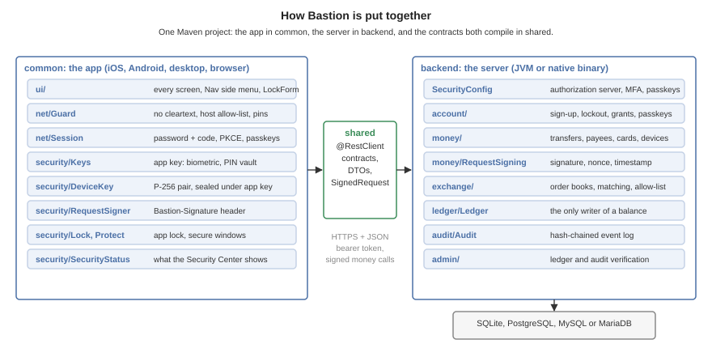
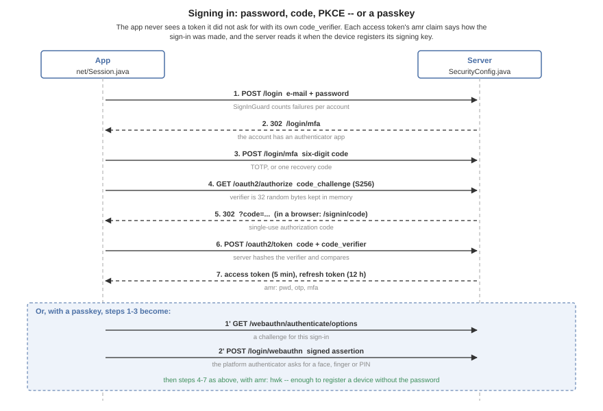
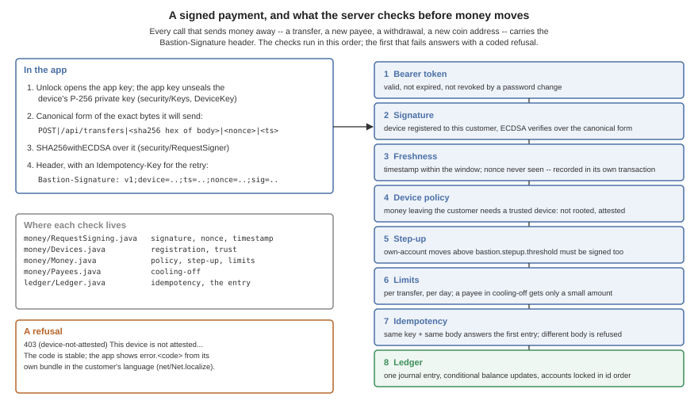
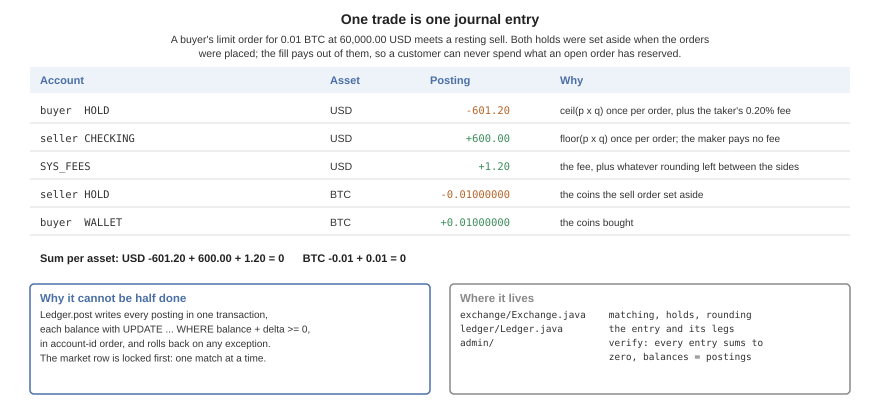
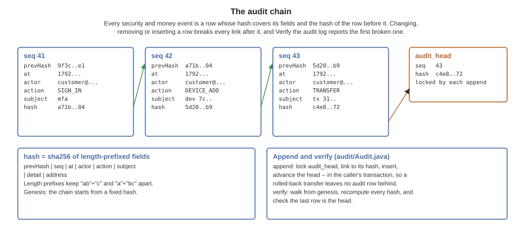

[[bastion-implementors-guide]]
== Bastion: Building on the sample

This chapter is for the developer who takes `scripts/bastion` as the start of a real banking or exchange app. It covers how the sample is put together, how sign-in, a signed payment, a trade and the audit chain work, every security feature with the file it lives in, the settings and the endpoints, the threats it's built against, what only a cloud build turns on, and the work that stands between the sample and a product.

=== Running it

The server runs on the development profile with an in-memory database:

[source,bash]
----
include::../demos/common/src/main/snippets/developer-guide/bastion.sh[tag=bastion-sh-impl-1,indent=0]
----

The app runs in the simulator from another terminal:

[source,bash]
----
include::../demos/common/src/main/snippets/developer-guide/bastion.sh[tag=bastion-sh-impl-2,indent=0]
----

`backend/server.sh run --native` runs the same server compiled to a native binary, and `--web` also builds the app for the browser and serves it from the server at `/`.

=== The modules

[cols="1,3",options="header"]
|===
|Module |What it holds
|`shared` |The transfer objects and the `@RestClient` contracts (`BankingApi`, `ExchangeApi`, `AccountApi`, `AdminApi`), `SignedRequest`, the canonical form both sides sign and verify, and `Refusal`, the stable codes of the server's refusals.
|`backend` |The Codename One Backend server: the ledger, accounts and sign-in, money movement, the exchange, the audit chain, and the administrator's checks.
|`common` |The app: every screen, the network guard, the app key, the device key and request signer, the app lock, the screen protections and the Security Center.
|===

The project has the minimal layout, with no platform modules: `common` builds the simulator, the desktop app, Android, iOS and the browser. The server's classes live under `backend/src/main/java/com/codenameone/examples/bastion` and the app's under `common/src/main/java/com/codenameone/examples/bastion`; the paths in this chapter are relative to those.

=== Signing in

The server is its own OAuth 2 authorization server (`SecurityConfig.java`). The app (`net/Session.java`) posts the password, answers the `/login/mfa` step when the account has an authenticator app, and then runs the authorization-code flow with PKCE. A passkey replaces the first three steps with a WebAuthn assertion, and the server asks for user verification on every one (`userVerification("required")`), so a passkey sign-in is always a fingerprint, a face or the device PIN as well as the key.

The sign-in screen (`ui/SignInForm.java`) offers the strongest factor the device has first: a passkey, then the stored sign-in a biometric opens (the app key the lock screen releases, which also seals the device's payment key), then the password and code. The server doesn't leave that to the app. `account/SignInGuard.java` holds an account to the strongest factor it has enrolled: for an account with a passkey, `POST /login` is answered 403 with `"stronger":"passkey"` before the password is checked, unless the account has an authenticator app, and then the `/login/mfa` step accepts a recovery code and refuses a six-digit code with the same answer. The password and a recovery code are the recovery path for a lost passkey; each code works once, and the sign-in is in the audit log. An account with a passkey and no authenticator app is recovered by the bank removing the passkey after checking who is asking. Every refusal is audited as `SIGNIN_REFUSED`. The answer tells whoever knows the e-mail that the account has a passkey, the same trade the lockout makes. In a browser the app runs the same steps from the page, with the browser's own session cookie, and reads its code from `/signin/code` on the server it came from.

Access tokens last five minutes and refresh tokens twelve hours, rotating on every use. Each access token carries an `amr` claim saying how the sign-in was made: `pwd`, `otp` and `mfa`, or `hwk` for a passkey. `money/Devices.java` reads it: a device key is registered only within ten minutes of a sign-in, and also needs the password unless the sign-in used a second factor or a passkey the authenticator verified the user for (`hwk` together with `user`); `hwk` alone proves only that the key was present. `account/SecondFactor.java` holds adding an authenticator app to the same rule, stricter: after a password-only sign-in both the start and the confirmation carry the password as well as being within those ten minutes, so a stolen token can't enroll the thief's app however fresh it is.

=== A signed payment

Every call that sends value away carries a `Bastion-Signature` header made by `security/RequestSigner.java`:

----
Bastion-Signature: v1;device=<id>;ts=<millis>;nonce=<random>;sig=<base64url r||s>
----

The signature is ECDSA P-256 with SHA-256 over `METHOD|target|hex(sha256(body))|idempotency-key|nonce|ts`, built by `SignedRequest` in `shared` so that both sides compute the same bytes. The app signs the exact JSON it sends. The `Idempotency-Key` is signed too (an empty field for a call without one): otherwise a captured request could be sent again under a fresh key and its fresh nonce, and the server would take it for a new payment. The server (`money/RequestSigning.java`) refuses an unknown device, a bad signature, a timestamp outside the window or a nonce it has seen, and commits the nonce in its own transaction before the money transaction starts, so a replay that races the original still loses.

A refusal is answered as `(code|value|value) English text`. The code is one of the `Refusal` constants; the app looks it up as `error.<code>` in its own bundle (`net/Net.java`), so the customer reads it in their language and a reworded English sentence never breaks a translation. `ui/DeviceSetup.java` reacts to the device codes: it offers to register a key and then sends the same request again, with a fresh nonce and the same idempotency key.

=== The ledger

Every amount is a `long` in the asset's smallest unit: cents for dollars and euros, satoshi for bitcoin. Ether is kept in units of 10^-9^ (gwei) rather than wei, so that a balance fits a `long`; a real ether product that needs wei precision has to widen the column and the arithmetic.

`ledger/Ledger.java` is the only code that changes a balance. It posts a double-entry journal entry, whose postings sum to zero in every asset, in one transaction:

* *Conditional updates.* A balance moves with one `UPDATE ... WHERE balance + :delta >= 0`, so two payments racing for the last dollar can't both succeed, and no balance is ever read, changed in Java, and written back.
* *Lock order.* The accounts an entry touches are updated in the order of their ids, so two entries over the same accounts can't deadlock each other.
* *Idempotency.* Every money request carries an `Idempotency-Key`. The key and a hash of the request are stored with the entry; a retry answers the first entry, and the same key with a different request is refused.
* *Rollback on any failure.* Every transaction is `@Transactional(rollbackFor = Exception.class)`. A checked exception would otherwise commit what was done before it.

A trade is the richest entry the ledger makes:

`exchange/Exchange.java` sets aside what an order could spend in a `HOLD` account when it's placed, and pays fills out of the holds. Each order keeps the exact running sum of price times quantity over its fills and rounds it once: up for what a buyer pays, down for what a seller gets, with the difference and the taker fee going to `SYS_FEES`. The market's row is locked before matching, so one market matches one order at a time.

`ledger/IsolationCheck.java` refuses to start the server on MySQL at its default REPEATABLE READ isolation. The ledger, the audit chain and the order book each serialize their writers on one row and then read what the previous writer committed, and REPEATABLE READ answers those reads from an older snapshot. Run MySQL at READ COMMITTED (`transaction-isolation = READ-COMMITTED` in its configuration). PostgreSQL runs at READ COMMITTED by default, and SQLite serializes every writer.

=== The accounting model

The ledger stores one signed number per posting. Read as accounting, a positive amount is a credit and a negative one a debit, so an entry that sums to zero is an entry whose debits equal its credits. A customer's deposit is money the bank owes, so customer accounts are liabilities; the cash that came in is an asset. `books/Chart.java` maps every account kind to its place in the chart of accounts, in code, so no row can put a customer's deposit among the bank's assets:

[cols="1,3,1,1,2",options="header"]
|===
|Code |Account |Class |Normal balance |Kind
|1000 |Cash and reserves |Asset |Debit |`SYS_CASH`
|1100 |Digital assets in custody |Asset |Debit |`SYS_CHAIN`
|2000 |Customer deposits, checking |Liability |Credit |`CHECKING`
|2010 |Customer deposits, savings |Liability |Credit |`SAVINGS`
|2100 |Customer digital asset custody |Liability |Credit |`WALLET`
|2200 |Order escrow |Liability |Credit |`HOLD`
|3000 |Paid-in capital |Equity |Credit |`SYS_EQUITY`
|3100 |Retained earnings |Equity |Credit |`SYS_RETAINED`
|4000 |Fee and trading revenue |Revenue |Credit |`SYS_FEES`
|5000 |Interest expense |Expense |Debit |`SYS_INTEREST`
|5100 |Operational adjustments |Expense |Debit |`SYS_ADJUST`
|9999 |Suspense |Asset |Debit |any kind the chart doesn't know, shown rather than hidden
|===

`books/Books.java` derives every report from the postings: the journal, the general ledger of one code, an account's T-account, the trial balance, the balance sheet (with the period's earnings as line 3900 until closing the period moves them to retained earnings) and the income statement. Each total is per asset and also valued in dollars at the index price.

* *Period close.* Closing a period posts one closing entry per asset that moves revenue and expense into retained earnings, and records the close. From then on the ledger refuses any entry dated inside a closed period, so a closed period's statements never change.
* *Reversals.* A posted entry is never edited. A reversal posts the opposite entry, and an entry can be reversed once; closing entries and reversals themselves can't be.
* *Reconciliation.* Each control account (customer deposits, escrow, custody) is compared with the sum of the accounts beneath it, every journal entry with zero, and every stored balance with the sum of its postings. Each difference is reported as a break naming the account and the amounts.
* *Roles.* An `AUDITOR` reads the books and the audit trail and can change nothing; an `ADMIN` operates. Every staff read is appended to the audit chain as `STAFF_READ` before it's answered, and `/api/audit/access-log` lists them.
* *Four eyes.* A manual adjustment or a reversal worth more than `bastion.approval.threshold-usd-cents` waits as a pending approval until a second administrator approves it; the maker can't approve their own request, and the refused attempt stays on the audit chain. The threshold counts what the same administrator posted without a checker in the last 24 hours, so a large change split into small ones still waits. A request in an asset with no dollar price can't be shown to be small, so it waits too. Every change also asks for the administrator's password again.
* *Evidence.* `/api/audit/evidence/{name}` exports the whole journal, the trial balance or the audit chain as CSV or JSON, with its SHA-256 digest, which is itself recorded on the chain. A CSV cell that a spreadsheet would run as a formula is quoted. The chain report names the first row whose link is broken.
* *Long ledgers.* The general ledger and a T-account list the latest 2000 postings and say when there are more; their totals and balances are summed over every posting in the period.

=== Charts, tables and the console

The app's screens are in `common/src/main/java/.../ui`. Three classes carry the data views:

* `Charts.java` draws every chart with `com.codename1.charts`: a filled line for a balance, paired bars for money in and out, a doughnut for the allocation, and candles for a market, made of a range bar from the low to the high under a body from the open to the close. Colors come from the foreground of the `BnChartLine`, `BnChartIn` and `BnChartOut` styles in `theme.css`, so dark mode and a re-skin reach the charts too.
* `Table.java` is a table of weighted columns over `TableLayout`, with numbers aligned to the end of their column. It mirrors in Hebrew, and on a phone a table wider than the screen scrolls sideways inside itself.
* `ConsoleForm.java` is the staff console. A window at least 165 mm wide gets a sidebar; anything narrower gets a section picker. Its buttons follow the roles: an auditor gets no action at all and an administrator's changes send the password with each request and a fresh `Idempotency-Key` with each adjustment or reversal. The server enforces both; the console only stops offering what would be refused.

`Nav.form` keeps one way out of every screen: a screen reached from the menu has the menu button, a screen pushed from another has a back arrow, never both. The sign-in, code and lock screens have no title bar; `Ui.landing` gives them the brand band as a header instead.

=== The audit chain

`audit/Audit.java` appends every security and money event as a row whose SHA-256 hash covers its own fields, length-prefixed, and the hash of the row before it. Appending a row locks `audit_head`, links to its hash and advances it, inside the caller's transaction, so a transfer that rolls back leaves no audit row behind. *Verify the audit log* (`/api/admin/audit/verify`) walks the chain from its fixed starting hash and reports the first row whose hash isn't its own, that doesn't link to the row before, or a head that doesn't match the last row.

=== Security features and where they live

The last column says whether the feature needs a build from the Codename One build server to be in force. Everything marked *No* works in the simulator, a local build and the browser too.

==== On the server

[cols="2,4,3,1",options="header"]
|===
|Feature |What it does |Where |Cloud build?
|Sign-in |The authorization server with the authorization-code flow and PKCE, five-minute access tokens, rotating twelve-hour refresh tokens and the `amr` claim. |`SecurityConfig.java`, `SignInCodePage.java` |No
|Second factor |TOTP enrolment and confirmation, ten single-use recovery codes, and the `/login/mfa` step that holds the session back until the code. |`account/SecondFactor.java`, `SecurityConfig.java` |No
|Passkeys |WebAuthn registration and sign-in with user verification required; listing and removing them. |`SecurityConfig.java`, `account/PasskeyList.java` |No
|Strongest factor enforced |An account with a passkey can't sign in with the password, or with the password and an authenticator code; only the password and a recovery code stand in for the passkey. |`account/SignInGuard.java` |No
|Lockout |Failed passwords counted per account in `login_failure`, locking it for a period after too many. |`account/SignInGuard.java` |No
|Rate limits |Per-address limits on sign-in, registration and transfers. |`SecurityConfig.java` |No
|Headers |`nosniff`, frame denial, `no-store`, a strict referrer policy and HSTS over TLS on every answer. |`SecurityConfig.java` |No
|Ending sessions |A password change ends every other sign-in by removing its grants, so a refresh token on a lost phone stops working. |`account/Grants.java` |No
|Device registration |A device's P-256 public key is registered only within minutes of a sign-in, and with the password again unless the sign-in had a second factor or a passkey. A registration without a platform attestation token is recorded as untrusted, and an untrusted device's signature is refused for any money leaving the customer's accounts. If the app locks while a registration is on its way, the app revokes the server's record of that device after the next unlock. |`money/Devices.java` |No
|Request signing |Signature, timestamp window and single-use nonce on every call that sends value away, and on the calls that would let a stolen token do so later: changing a payee or an address, issuing or unfreezing a card, raising its limit, revoking a device or removing a passkey. Placing an order is signed too: selling into a resting order moves value to its owner. |`money/RequestSigning.java`, `SignedRequest.java` |No
|Device policy |Money leaving the customer needs a signature from a trusted device: registered, not reported rooted, and passing the integrity check. |`money/Money.java`, `money/Devices.java` |No
|Integrity |The check of the platform's attestation token. The sample's verifier is simulated; see <<bastion-before-product>>. |`money/IntegrityVerifier.java`, `money/SimulatedIntegrityVerifier.java` |Token: yes
|Limits and step-up |Per transfer, per day, per new payee during its cooling-off; own-account moves above a threshold signed too; crypto counted in dollars at the index price. Orders count against the same per-payment and daily limits, valued in dollars at their worst case, and trade only within a price collar around the index (`bastion.exchange.collar-bps`, 10%). A card's own daily limit is in the card account's currency, as a card network counts it. |`money/Money.java`, `money/Payees.java` |No
|Allow-list |Coins leave only to a signed, cooled-off address. |`exchange/CryptoWallets.java` |No
|Audit chain |Hash-chained event rows appended under a lock on the head. |`audit/Audit.java` |No
|Ledger check |Every entry balances and every balance equals its postings. |`admin/AdminEndpoint.java` |No
|Administrators |No request makes one. Outside development, the only administrator comes from the environment. |`account/DemoAccounts.java` |No
|===

==== In the app

[cols="2,4,3,1",options="header"]
|===
|Feature |What it does |Where |Cloud build?
|Network guard |Installed before the first request: no cleartext, a host allow-list, and certificate pins, through `AppShield`. If the guard can't be installed the app shows a fatal screen and makes no request. A pinned host that presents no certificate chain, as a connection resumed from a TLS cache can, fails like a mismatch. The one exemption from cleartext is a server on this machine, and only in the simulator, under the tests or in a page served from this machine; an installed app never has it. |`net/Guard.java`, `AppConfig.java` |No
|Over-the-air pins and attestation tokens |`AppShield`'s attestation engine fetches pins and stamps requests with a token. |`net/Guard.java` |Yes
|Sign-in |The strongest way in first: a passkey, then the biometric unlock of a stored sign-in, then the password and second-factor step; then the authorization-code flow with PKCE, in a browser too. |`net/Session.java`, `ui/SignInForm.java` |No
|Copying values |One component for every value a user copies: selectable text and a copy button. Keys and account and card identifiers go through `Protect.copy`, a sensitive clip that clears itself after a minute. |`ui/Ui.java` (`copyable`), `security/Protect.java` |No
|Printing |Statements, receipts, transactions and the console's reports laid out as a page of monospaced lines, drawn on an image and handed to `com.codename1.printing.Printer`. No button where `Printer.isPrintingSupported()` is false. |`ui/Printout.java`, `ui/Table.java` |No
|App key |32 random bytes that seal the device key and the stored tokens, held in memory only while unlocked. Copies: one in the biometric tier of `SecureStorage` (an iOS Keychain item with biometric access control, an Android Keystore key that requires user authentication), one in a `Vault` opened by the unlock PIN through its `KdfProfile` with a pepper from the OS store, and a plain copy only while neither exists. Five wrong PINs wipe every copy. |`security/Keys.java`, `security/SealedStorage.java` |No (biometric binding: a device)
|Token storage |Tokens sealed under the app key in `SecureStorage`: the Keychain on iOS, the Keystore-backed store on Android. |`net/Session.java`, `security/SealedStorage.java` |No
|Device key |A P-256 pair from `KeyGenerator.ec(256)`, the private half sealed with AES-256-GCM in a `SecureEnvelope` under the app key. |`security/DeviceKey.java` |No
|Request signer |Signs the exact bytes the request sends, in the canonical form the server checks. |`security/RequestSigner.java` |No
|App lock |Locks on start with a stored session, after 30 seconds in the background and after two minutes idle; biometric, then PIN, then a fresh sign-in. Locking also drops the session's tokens from memory and ignores every answer still on its way; the unlock reads the tokens back from the sealed store. Signing out erases every key on the device, and a sign-in by another account starts the device over. |`security/Lock.java`, `ui/LockForm.java` |No
|Screen protection |Secure windows on sensitive screens, tapjacking protection, and a clipboard that clears itself after a minute, or as soon as the app can confirm the copy is still there, without reading the clipboard when the app goes to the background. Each copy is a `ClipboardContent` marked sensitive with `setClearAfter`, so Android 13 and newer keep it out of the preview and iOS keeps it local and expires it. On Android 10 and newer a clear that falls due while the app is in the background waits for the app to return, because only then can it confirm the clipboard still holds the copy rather than something the user copied from another app. That wait lives in the running process, so a killed app would leave the copy behind. On Android `Protect` covers it by keeping an HMAC-SHA256 of the copy (never the text) in `Preferences`, under a random key held in secure storage. Once the clear is due it reads the clipboard again as a screen shows, on resume and a moment after the clear: a match clears it, anything else copied since drops the record, and a read that answers nothing (an app without window focus, on Android 10 and newer) keeps the record for the next look. On iOS nothing is recorded or read back, because the pasteboard expires the copy itself and a read would show the paste banner. |`security/Protect.java` |No (a device)
|App switcher cover |A blank card in the iOS app switcher. |`codenameone_settings.properties` |Yes
|Root and jailbreak |Root signals reported to the server; a jailbroken iPhone refuses to start. |`security/DeviceKey.java`, `codenameone_settings.properties` |Jailbreak exit: yes
|Code hardening |Class renaming, string encryption, control-flow flattening and tamper checks. |`codenameone_settings.properties` |Yes
|Security Center |Every protection above with its real state on this device and build. |`security/SecurityStatus.java`, `ui/SecurityCenterForm.java` |No
|===

The app can't read its own build hints when it runs, so `SecurityStatus.DECLARED_HINTS` mirrors the hardening hints in `common/codenameone_settings.properties`, and `SecurityStatusTest` fails when the two disagree.

=== What only a cloud build turns on

Some protections are applied when the app is built, by the Codename One build server, and do nothing in the simulator, a local build or the browser. The Security Center marks each *Cloud build* there rather than claiming it's on.

[cols="1,2",options="header"]
|===
|Build hint |What it turns on
|`cn1.hardenLevel=aggressive` |Code hardening: class renaming, string encryption, control-flow flattening and tamper checks in the built app.
|`android.playIntegrity=true` |Play Integrity: the app obtains an attestation token for the server to check.
|`ios.detectJailbreak=true` |The iOS jailbreak checks; the app exits on a jailbroken iPhone.
|`ios.blockScreenshotsOnEnterBackground=true` |A cover over the app in the iOS app switcher.
|===

A hardware-backed keystore, secure windows and biometrics need a real device; the simulator reports them as unavailable.

=== Settings

The server reads these at start-up. A system property of the same name wins, then the environment variable the key maps to (`bastion.payee.cooloff-hours` is read from `BASTION_PAYEE_COOLOFF_HOURS`), then `application-<profile>.properties`, then `application.properties`. Amounts are in cents.

[cols="2,1,3",options="header"]
|===
|Key |Default |What it controls
|`cn1.datasource.url` (`DATABASE_URL`) |none |The database: SQLite, PostgreSQL, MySQL or MariaDB.
|`cn1.security.authorizationserver.issuer` |none |The server's public `https` address, written into every token.
|`cn1.security.authorizationserver.jwk.keys` |a key made at start-up |The key tokens are signed with. Without it, every token stops verifying when the process ends.
|`cn1.security.mfa.encryptionKey` |a fixed development key |The key authenticator secrets are sealed under.
|`bastion.admin.email`, `bastion.admin.password` |none |The one administrator outside the development profile.
|`bastion.webauthn.rp-id` |`localhost` |The domain passkeys belong to.
|`bastion.webauthn.origins` |`http://localhost:8080` |The origins passkeys are accepted from, comma separated.
|`bastion.lockout.attempts`, `bastion.lockout.window-seconds`, `bastion.lockout.seconds` |5, 900, 900 |Failed passwords before the account locks, the window they're counted in, and how long it stays locked.
|`bastion.signin.per-minute`, `bastion.register.per-hour`, `bastion.transfer.per-minute` |10, 20, 20 |Rate limits per address.
|`bastion.device.fresh-minutes` |10 |How recent a sign-in must be to register a device key.
|`bastion.device.policy.enforce` |`true` |Whether money leaving a customer needs a trusted device. Turn it off only for development and screenshots.
|`bastion.stepup.threshold` |100000 |Own-account moves above this are signed by the device too.
|`bastion.exchange.collar-bps` |1000 |How far from the index price, in basis points, an order may trade: the server refuses a limit price outside it and a market order stops at its edge.
|`bastion.limit.per-transfer`, `bastion.limit.daily` |500000, 1000000 |Transfer limits.
|`bastion.payee.cooloff-hours`, `bastion.payee.cooloff-limit` |24, 10000 |How long a new payee cools off and what it can receive meanwhile.
|`bastion.address.cooloff-hours` |24 |How long a new coin address waits.
|`bastion.crypto.limit.per-withdrawal`, `bastion.crypto.limit.daily` |1000000, 2000000 |Coin withdrawal limits, in dollar cents at the index price.
|`bastion.exchange.taker-fee-bps` |20 |The taker fee in basis points.
|`bastion.markets` |BTC-USD and ETH-USD |The markets, as `id:base:quote:lot:index` entries.
|`bastion.approval.threshold-usd-cents` |100000 |Adjustments and reversals worth more than this, in dollar cents, need a second administrator.
|`bastion.demo.history-days` |42 |Days of demo history the development profile posts; above 35 the first four weeks are closed.
|`bastion.market-maker.enabled` |`true` (development only) |The random-walk market maker.
|===

In the app, `AppConfig.java` holds the address a release talks to, `RELEASE_SERVER`, the development server the simulator talks to, `ALLOWED_HOSTS` and the certificate `PINS`. The pins in the sample are placeholders, and the Security Center warns about them until they're the SHA-256 digests of the real server's public keys.

=== The API

Every endpoint but registration and sign-in needs a bearer token. *Signed* marks the calls that also need the `Bastion-Signature` header; *Idempotent* marks those that take an `Idempotency-Key`.

[cols="2,3,2",options="header"]
|===
|Endpoint |What it does |Needs
|`POST /api/account/register` |Opens an account. |Rate limited
|`GET /api/me` |The signed-in customer. |
|`POST /api/account/password` |Changes the password and ends every other sign-in. |The current password, held to the lockout
|`POST /api/account/mfa/totp`, `.../totp/confirm` |Starts and confirms the authenticator app. |
|`POST /api/account/mfa/recovery-codes` |New recovery codes. |
|`GET /api/account/passkeys`, `POST .../{id}/remove` |Lists and removes passkeys. |Removing: signed by a device, or the password in the body
|`GET /api/assets` |The currencies and coins and their decimals. |
|`GET`, `POST /api/accounts` |Lists and opens accounts. |
|`GET /api/accounts/{id}/postings` |An account's history. |
|`POST /api/transfers` |Moves money. |Signed, idempotent
|`POST /api/accounts/{id}/deposit` |The demo deposit. |Idempotent
|`POST /api/accounts/{id}/withdraw` |A withdrawal to the outside. |Signed, idempotent
|`GET`, `POST`, `PUT`, `DELETE /api/payees[/{id}]` |Lists, adds, renames and removes payees. |Adding, renaming, removing: signed
|`GET /api/cards`, `POST /api/accounts/{id}/card` |Lists and issues cards. |Issuing: signed by a trusted device
|`POST /api/cards/{id}/freeze`, `.../unfreeze`, `PUT .../limit` |Freezes, unfreezes and limits a card. |Unfreezing and raising the limit: signed by a trusted device
|`POST /api/cards/{id}/spend` |The demo card spend. |Idempotent
|`GET`, `POST /api/devices` |Lists and registers device keys. |Registering: recent sign-in
|`POST /api/devices/{id}/revoke` |Removes a device key. |Signed by a device, or the password in the body
|`GET /api/exchange/markets`, `.../{id}/book`, `.../{id}/ticker` |Markets, order book and ticker. |
|`POST`, `GET`, `DELETE /api/exchange/orders[/{id}]` |Places, lists and cancels orders. |Placing: signed by a trusted device, idempotent
|`GET /api/exchange/trades` |The customer's trades. |
|`GET`, `POST`, `DELETE /api/crypto/addresses[/{id}]` |The coin address allow-list. |Adding and removing: signed
|`POST /api/accounts/{id}/crypto-withdraw` |Sends coins to an allowed address. |Signed, idempotent
|`GET /api/accounts/{id}/balance-history?days`, `GET /api/insights/cashflow?asset&days`, `GET /api/insights/allocation` |Chart data over the customer's own accounts. |
|`GET /api/exchange/markets/{id}/candles?interval&limit` |Price candles from the trade tape. |
|`GET /api/books/chart`, `.../journal`, `.../journal/{id}`, `.../ledger?code&asset`, `.../accounts/{id}/t-account` |The chart of accounts, the journal, the general ledger and a T-account. |Administrator or auditor, audited
|`GET /api/books/trial-balance?asOf`, `.../balance-sheet?asOf`, `.../income-statement?from&to` |The statements, per asset and in dollars. |Administrator or auditor, audited
|`GET /api/books/reconciliation`, `.../periods`, `.../volume?days` |Reconciliation breaks, closed periods, trading volume. |Administrator or auditor
|`GET /api/audit/chain`, `.../events?after&limit`, `.../trail?subject`, `.../access-log` |The chain report, the events, one entity's trail, and the staff reads. |Administrator or auditor
|`GET /api/audit/evidence/{name}?format&asOf` |Exports `journal`, `trial-balance` or `audit-chain` as `csv` or `json`. |Administrator or auditor, audited
|`POST /api/admin/periods/close` |Closes the books through a time. |Administrator, password
|`POST /api/admin/adjustments`, `POST /api/admin/journal/{id}/reverse` |A manual adjustment or a reversal. |Administrator, password, idempotent; a second administrator above the threshold
|`GET /api/admin/approvals`, `POST .../{id}/approve`, `.../{id}/reject` |The pending approvals and the second administrator's decision. |Administrator, password, not the maker
|`GET /api/admin/audit/verify`, `GET /api/admin/ledger/verify` |The administrator's checks. |Administrator
|===

The contracts are the interfaces in `shared/.../api`; the app calls them through the generated `@RestClient` implementations, so a changed path is a compile error on both sides.

=== Threat model

Bastion is built against these, the likeliest first:

[cols="2,4,3",options="header"]
|===
|Threat |What stops it |Where
|Stolen or guessed passwords |A second factor or a passkey, a password that stops being a way in once a passkey is enrolled, a lockout per account, rate limits per address, and a password minimum checked on the server. |`SecurityConfig.java`, `account/SignInGuard.java`
|A stolen session |Five-minute access tokens; a password change ends every other sign-in; money leaving the account, and every order, also needs a device signature, so a token alone moves nothing out; the step-ups that ask for the password again are held to the sign-in lockout. |`account/Grants.java`, `money/RequestSigning.java`
|Account takeover that adds a mule |A new payee or address cools off for a day with a small limit, and adding one is signed by the device. |`money/Payees.java`, `exchange/CryptoWallets.java`
|A tampered or replayed request |The signature covers the body and the path; each nonce is accepted once within a short time window. |`money/RequestSigning.java`
|An attacker in the network path |No cleartext, a host allow-list and certificate pins in the app; HSTS on the server. |`net/Guard.java`, `SecurityConfig.java`
|A lost or stolen phone |The app lock, keys sealed under an app key that only a biometric or PIN opens (five wrong PINs erase the keys, and the count is kept in the OS secure store beside the PIN's pepper rather than in a preferences file a copy of the phone's storage could reset), removal of the device from another sign-in, and secure windows that keep balances out of screenshots and the app switcher. |`security/Lock.java`, `security/Keys.java`, `security/Protect.java`
|A rooted device or a repackaged app |Root and jailbreak signals, platform attestation, and code hardening in a cloud build. None is proof; the server treats them as signals that decide whether a device is trusted. |`money/Devices.java`, `codenameone_settings.properties`
|A careless or malicious insider |The audit chain makes changing history detectable, the ledger check makes a wrong balance detectable, and no request creates an administrator. |`audit/Audit.java`, `admin/AdminEndpoint.java`
|Races and retries |Conditional balance updates, ordered locks and idempotency keys keep money exact under concurrent and repeated requests. |`ledger/Ledger.java`
|===

Out of scope for the sample: a compromised server or database host, an attacker who can read the device's memory while it's unlocked, and denial of service beyond the rate limits.

=== Tests

[source,bash]
----
include::../demos/common/src/main/snippets/developer-guide/bastion.sh[tag=bastion-sh-impl-3,indent=0]
----

The server's tests cover the ledger's invariants under concurrent transfers and trades, idempotency, sign-in with each factor, the access rules of every endpoint, signing and replay, the device policy, limits and cooling-off, the matching engine and its rounding, and the audit chain's detection of a changed row. `run-e2e.sh` registers two customers, enrols an authenticator and signs in with it, registers device keys, makes a signed payment and checks that the unsigned and replayed copies are refused, fills an order between the two, and checks that a withdrawal is refused until its address is allowed and cooled off. `run-web-e2e.sh` does it in a headless browser, through the app's own screens: it opens an account, turns on the authenticator app, creates a passkey, signs in again with the password and a code and checks that the server refuses the code because the account has a passkey, signs in with the passkey instead, moves money between two accounts, then signs in with the passkey alone and registers the browser as a device without the password. With `--guide` it runs the server on the development profile with the device policy off, then signs in as the demo customer and the administrator and photographs each screen; run it after changing a screen so the user's guide stays true.

=== Making it yours

* *Name, icon and colors.* The name and package come from the Initializr, the icon is `common/icon.png`, and the colors are the variables at the top of `common/src/main/css/theme.css`, with a dark set below them.
* *Server address and pins.* Set `AppConfig.RELEASE_SERVER` to your API's `https` address, `AppConfig.ALLOWED_HOSTS` to its host and `AppConfig.PINS` to its key digests before the first release build.
* *Languages.* The bundles are in `common/src/main/l10n`; `BundleTest` checks that every bundle has every key and every server refusal code.
* *Markets and assets.* `bastion.markets` lists the markets; the assets are rows in the ledger's migrations (`V2__ledger.sql`), served to the app by `/api/assets`.
* *Limits.* Every limit and cooling-off period is a setting in the table above.

[[bastion-before-product]]
=== Before it's a product

The sample is complete as a demonstration and stops where a real bank's own systems begin. A product needs at least:

* *Identity verification.* Opening an account takes an e-mail and a password. A bank verifies who the customer is (know your customer) through a vendor, screens them against sanctions lists, and keeps the evidence.
* *Payment rails and core banking.* Deposits are a counter and transfers stay inside the sample's ledger. Real money arrives and leaves through card networks, bank transfers and instant payment schemes, and a bank's core banking system is usually the ledger of record, which this ledger would then mirror or replace.
* *Keys in a hardware security module.* The server's token-signing key, the key that seals authenticator secrets, and any card or custody keys belong in an HSM or a cloud key service, never in the server's configuration.
* *Real custody of coins.* The coins are entries in the ledger, and a withdrawal moves them to a holding account. A product needs wallets on the real chains, with the keys in custody, deposit addresses per customer, confirmations, and the chain's fees.
* *A real integrity check.* `SimulatedIntegrityVerifier` believes the device. Production verifies the Play Integrity token with Google and the App Attest assertion with Apple, on the server.
* *A real market.* The market maker is a development-only random walk. A product takes its prices from a market data provider and its liquidity from real counterparties, and runs the exchange's own surveillance.
* *Regulatory reporting.* Suspicious activity reports, transaction reporting, statements and tax documents, and records kept for as long as the law asks.
* *Audit anchoring off the database.* The audit chain shows that history was changed, but whoever controls the database can rewrite the whole chain. Publishing the chain's head at intervals to a store the database's administrators can't write, such as write-once storage or a timestamping service, closes that.
* *Reviewed translations.* The non-English bundles are machine translations; have them reviewed before release.
* *A PIN checked off the device.* The attempt counter is in the OS secure store beside the pepper, so restoring the app's files doesn't reset it, and the pepper keeps a copy of those files from being tried offline. Both still sit on the device: someone who controls the OS store controls the counter too. A product that must hold against that checks the PIN on the server or in a secure element.
* *Biometric-bound keys on the web and desktop.* Only iOS and Android bind a key to a biometric in the OS. In a browser and on the desktop the lock offers the PIN, and the Security Center says so.
* *Your own origin for passkeys.* A deployment sets `bastion.webauthn.rp-id` and `bastion.webauthn.origins` to its own domain, and adds the Android app's `android:apk-key-hash:` origin and the iOS app's associated domain.
* *Operations.* Monitoring and alerting on the audit and ledger checks, fraud scoring on transfers, a support console with its own access controls and audit, backups and disaster recovery, and penetration testing.
