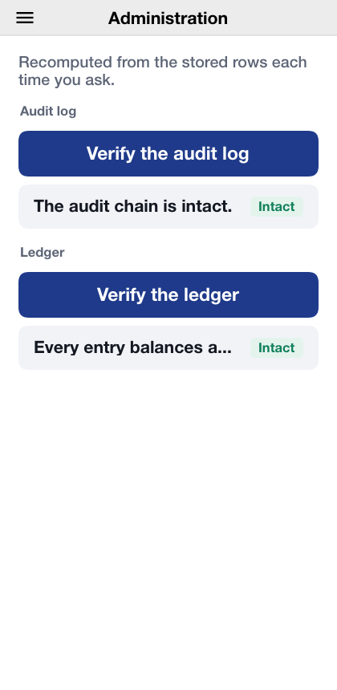

[[bastion-users-guide]]
== Bastion: A bank that shows its locks

Bastion is a virtual bank written in Codename One from end to end: a phone and desktop app, and the server it talks to. It holds money in several currencies and coins, moves it between accounts and people, issues cards, and runs a small exchange where customers trade bitcoin and ether against dollars. It's built to show the security a financial app needs, and every protection it has is listed, with its real state, on one screen of the app.

The sample lives in `scripts/bastion`. This chapter is about using it: what a customer and an administrator see and do. The next chapter, <<bastion-implementors-guide>>, is about how it's built and what a real bank would still have to add.

Nothing in Bastion is real money. Deposits are a counter, cards spend nowhere, coins never touch a blockchain, and the exchange trades against a simulated market. The security is real: the passwords, codes, passkeys, signatures and audit chain work exactly as they would in production.

=== Trying it

The server runs on the JVM with an in-memory database and demo accounts, with nothing to install but a JDK 17:

[source,bash]
----
cd scripts/bastion
CN1_PROFILE=dev backend/server.sh run
----

The app then runs in the simulator from another terminal:

[source,bash]
----
cd scripts/bastion
mvn verify -Psimulator -DskipTests -Dcodename1.platform=javase
----

`CN1_PROFILE=dev backend/server.sh run --web` also builds the app for the browser and serves it at the server's own address, `http://localhost:8080/`. The screenshots in this chapter come from that browser build, at a phone's width.

The development profile creates three demo accounts, all with the password `bastion-demo-password`:

[cols="1,2",options="header"]
|===
|Account |What it's for
|`customer@bastion.example` |A customer with $2,500.00 in a checking account
|`customer2@bastion.example` |A second customer with $1,200.00, to pay and to trade with
|`admin@bastion.example` |The administrator
|===

On the development profile a small market maker also keeps the exchange's books moving, so that there is something to trade against.

=== Opening an account

image::img/bastion-sign-in.png["The sign-in screen with fields for e-mail and password and buttons to sign in, sign in with a passkey and open an account",scaledwidth=40%]

*Open an account* on the sign-in screen walks through the steps a new customer takes:

. *Name, e-mail and password.* The password has to be at least twelve characters and can't be the e-mail address; the server checks it too, not only the app.
. *Authenticator app.* The app shows a QR code and the same secret as text. Scanning the code with any authenticator app and typing the six digits it shows turns on the second factor. Adding the app asks for the password again after a sign-in made with the password alone, so a stolen session can't put somebody else's app on the account. The secret can be copied instead; the copy is marked sensitive, which keeps it out of the keyboard's suggestions on Android and off the user's other devices on iOS, and it's wiped from the clipboard after a minute, or at the next start if the app was closed before then. Bastion then shows ten recovery codes, once, to write down or copy into a password manager the same way. Each opens the account once if the phone is lost; keep them somewhere other than the phone.
. *Passkey.* Where the device or browser supports passkeys, one can be added now, so that later sign-ins need no password at all.
. *Unlock with biometrics.* An option on a phone with a fingerprint or face enrolled: the key that opens the stored sign-in and the payment key is released only by the biometric.
. *Unlock PIN.* An option: six to twelve digits that open the lock when a biometric isn't available or isn't wanted. Five wrong PINs in a row erase the keys on the device, and the way back is signing in again.
. *This device.* The app makes a signing key that never leaves the device and registers it with the bank. Payments to other people are signed with this key, so the device itself is a second proof of who is paying.

image::img/bastion-totp-enrolment.png["The second-factor step with a QR code, the secret as text, buttons to copy it or open an authenticator app, a field for the six-digit code and a Turn on button",scaledwidth=40%]

A new account starts with a dollar checking account. Others, in euros or as coin wallets, are opened from the dashboard.

=== Signing in

Signing in takes the e-mail and password, then a code from the authenticator app when the account has one. A passkey replaces both where one is set up. Five wrong passwords in a row lock the account for fifteen minutes; the lock is per account, so guessing from many places at once doesn't help.

image::img/bastion-sign-in-code.png["The second step of signing in, asking for the six-digit code from the authenticator app",scaledwidth=40%]

=== The lock

The app locks itself after half a minute in the background and after two minutes without a touch. Locked, it shows nothing of the account and can't sign a payment or read its stored sign-in until it's unlocked again: with biometrics when they're turned on, then with the unlock PIN when one is set, and otherwise by signing in again. Signing in again from the lock sets the device up from the start when a biometric or PIN was set up, so its payment key is registered again the next time a payment needs it. Signing out from the menu does the same, so whoever signs in next on the device starts with none of the previous account's keys.

image::img/bastion-lock.png["The lock screen: Bastion is locked, a PIN field, an Unlock with PIN button and a Sign in again button",scaledwidth=40%]

=== The dashboard

The dashboard shows the total of every account in dollars, at the exchange's current prices, and lists each account with its balance. Until the device has a payment key, a banner above says so and offers to register it; registering asks for the password again, because only a recent sign-in may add a key.

image::img/bastion-dashboard-unregistered.png["The dashboard with a banner saying this device can't sign payments yet and a Register this device button",scaledwidth=40%]

image::img/bastion-dashboard.png["The dashboard with the total balance, buttons to move money, pay someone and trade, and the checking account",scaledwidth=40%]

Tapping an account opens it: its balance, what can be done with it, and its history, every posting newest first, with what it was for.

image::img/bastion-account-history.png["A checking account with buttons to move, add and withdraw money and to order a card, and its history",scaledwidth=40%]

Balances, card numbers and codes are on *sensitive screens*. On Android those screens can't be captured or recorded, and the recent-apps list shows them blank; on iOS the app switcher shows a cover instead of the screen.

=== Moving money

*Move money* moves money between your own accounts in the same currency. *Pay someone* sends it to a payee: another Bastion customer, added by e-mail on the *Payees* screen.

image::img/bastion-payees.png["The payees screen with one payee, Robin, marked Cooling off with the time the limit ends",scaledwidth=40%]

image::img/bastion-transfer.png["The pay someone form with the account to pay from, the payee, an amount and a Review button",scaledwidth=40%]

*Review* shows what's about to happen, and *Send* sends it. The receipt shows the reference of the entry it made in the ledger.

image::img/bastion-transfer-confirm.png["A confirmation dialog: Send $20.00 from Checking to Robin, with Cancel and Send",scaledwidth=40%]

image::img/bastion-receipt.png["The receipt with the amount, the ledger reference and the time",scaledwidth=40%]

Every transfer carries a key that makes it happen once: a payment retried after a dropped connection isn't paid twice. Some transfers ask for more:

* A payment to someone else is signed with this device's key. On a device that has no key yet, the app offers to register one first, then sends the same payment.
* By default, money leaves your accounts only from a device the bank trusts: a phone that passed the platform's integrity check and doesn't look rooted or jailbroken. A browser or the simulator can't prove that, so there the server refuses the payment, explaining that the device can move money only between your own accounts. The screenshots above were taken with that policy turned off on the development server (<<bastion-implementors-guide>> has the setting).
* A new payee is in a cooling-off period for its first day, in which it can receive only $100.00. Someone who has taken over a session can't add an account of their own and empty yours into it.
* A move between your own accounts above $1,000.00 is signed with the device key too.
* Every transfer is held to a limit per transfer ($5,000.00) and per day ($10,000.00); one past either is refused.

=== Cards

*Order a card* on a checking account issues a card on it. *Cards* lists them, freezes and unfreezes each, and sets its daily spending limit. A frozen card is refused at once. Freezing works from any signed-in session; unfreezing a card or raising its limit needs this device's approval, so somebody holding only your session can't undo a freeze. The card number is on a sensitive screen.

image::img/bastion-cards.png["The cards screen with a card, its masked number, its daily limit and buttons to freeze it and change the limit",scaledwidth=40%]

=== The exchange

*Exchange* lists the markets, BTC-USD and ETH-USD, with their last price and the index price the bank values coins at, and the customer's recent trades.

image::img/bastion-order-book.png["The BTC/USD market: the last price, the bid and ask, the order book in red and green, and the order ticket",scaledwidth=40%]

A market opens its order book, its recent trades and a ticket:

* A *limit order* names a price and a quantity, and rests on the book until another order meets it, or until it's cancelled.
* A *market order* takes what the book offers now, up to a budget for a buy or a quantity for a sell.

Placing an order sets aside what it could spend; the rest of the balance stays free. Fills move both sides and the fee in one ledger entry, so a trade is never half done. The *Open orders* list shows what's still resting, each with a cancel button, and a bought coin lands in a wallet account of its own.

image::img/bastion-order-filled.png["The market after a market buy: the order book, the order ticket and the customer's filled order",scaledwidth=40%]

=== Sending coins

Coins leave the bank only to an address on the account's *allow-list*, and the list is guarded:

* Adding an address is signed by this device.
* A new address waits a day before anything can be sent to it.
* Every withdrawal is signed by this device, and is held to a limit per withdrawal and per day, counted in dollars.

image::img/bastion-withdraw.png["The send crypto screen with the wallet to send from and an address on the allow-list, usable only from tomorrow",scaledwidth=40%]

=== Security Center

*Security Center* lists every protection the app has and whether it's in force on this device, in this build, now: the connection rules and certificate pins, where the keys and the sign-in are kept, the app lock, the screen protections, whether the device looks rooted or jailbroken, whether it passed the platform's integrity check, and the hardening the build applied.

image::img/bastion-security-center.png["The Security Center listing network protections with Warning and Cloud build badges",scaledwidth=40%]

It's honest by design. A protection the simulator or a browser can't provide, such as a hardware keystore, says so. One that only a build from the Codename One build server applies, such as code hardening or Play Integrity, is marked *Cloud build* instead of claiming to be on. A development exemption in use, such as the unpinned connection to a server on this machine, is a *Warning*.

=== Settings

*Settings* turns biometric unlock on and off, sets, changes or removes the unlock PIN, turns on the authenticator app and makes new recovery codes, lists and removes passkeys and adds new ones, shows this device's payment key, and chooses the language: English, Spanish, French, German or Hebrew, which lays the app out right to left.

image::img/bastion-settings.png["The settings screen with the unlock options, the authenticator app, passkeys, this device's payment key and the languages",scaledwidth=40%]

=== The administrator

An administrator signs in like a customer and lands on *Administration*. It runs the two checks a bank's auditors ask for, recomputed from the stored rows each time:

* *Verify the audit log*: every security and money event is a link in a hash chain, and the check reports any row that was changed, removed or inserted out of order.
* *Verify the ledger*: every entry sums to zero in each currency, and every balance equals the sum of its postings.

No request can make an administrator. Outside the development profile, the one administrator account comes from the server's environment when it starts.
