[[bastion-users-guide]]
== Bastion: A bank that shows its locks

Bastion is a virtual bank written in Codename One from end to end: a phone and desktop app, and the server it talks to. It holds money in several currencies and coins, moves it between accounts and people, issues cards, and runs a small exchange where customers trade bitcoin and ether against dollars. It's built to show the security a financial app needs, and every protection it has is listed, with its real state, on one screen of the app.

The sample lives in `scripts/bastion`. This chapter is about using it: what a customer and an administrator see and do. The next chapter, <<bastion-implementors-guide>>, is about how it's built and what a real bank would still have to add.

Out of the box nothing in Bastion is real money. Deposits are a counter, cards spend nowhere, and the exchange trades against a simulated market. Ether can be made real: connected to an Ethereum node, the app shows a deposit address under *Receive crypto*, and deposits and withdrawals settle on the chain. The security mechanisms are the ones a production bank would use: the passwords, codes, passkeys and signatures work as they would there. The audit chain is hashed the same way, but its head isn't anchored anywhere outside the server's own database, so someone who controls that database could rewrite it and the chain along with it.

=== Trying it

The server runs on the JVM with an in-memory database and demo accounts, with nothing to install but a JDK 17:

[source,bash]
----
include::../demos/common/src/main/snippets/developer-guide/bastion.sh[tag=bastion-sh-users-1,indent=0]
----

The app then runs in the simulator from another terminal:

[source,bash]
----
include::../demos/common/src/main/snippets/developer-guide/bastion.sh[tag=bastion-sh-users-2,indent=0]
----

`CN1_PROFILE=dev backend/server.sh run --web` also builds the app for the browser and serves it at the server's own address, `http://localhost:8080/`. The screenshots in this chapter come from that browser build, at a phone's width.

The development profile creates three demo accounts, all with the password `bastion-demo-password`:

[cols="1,2",options="header"]
|===
|Account |What it's for
|`customer@bastion.example` |A customer with $2,500.00 in a checking account
|`customer2@bastion.example` |A second customer with $1,200.00, to pay and to trade with
|`admin@bastion.example` |The administrator
|===

On the development profile a small market maker also keeps the exchange's books moving, so that there is something to trade against.

=== Opening an account

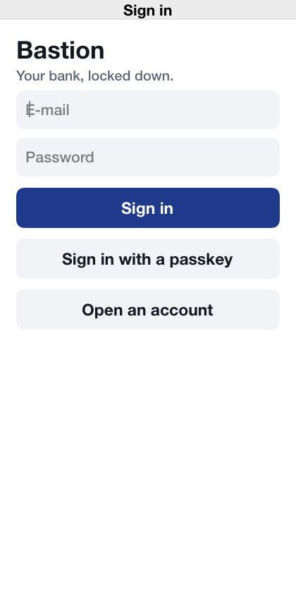

*Open an account* on the sign-in screen walks through the steps a new customer takes:

. *Name, e-mail and password.* The password has to be at least twelve characters and can't be the e-mail address; the server checks it too, not only the app.
. *Authenticator app.* The app shows a QR code and the same secret as text. Scanning the code with any authenticator app and typing the six digits it shows turns on the second factor. Adding the app asks for the password again after a sign-in made with the password alone, so a stolen session can't put somebody else's app on the account. The secret can be copied instead; the copy is marked sensitive, which keeps it out of the keyboard's suggestions on Android and off the user's other devices on iOS, and it's wiped from the clipboard after a minute, or at the next start if the app was closed before then. Bastion then shows ten recovery codes, once, to write down or copy into a password manager the same way. Each opens the account once if the phone is lost; keep them somewhere other than the phone.
. *Passkey.* Where the device or browser supports passkeys, one can be added now, so that later sign-ins need no password at all.
. *Unlock with biometrics.* An option on a phone with a fingerprint or face enrolled: the key that opens the stored sign-in and the payment key is released only by the biometric.
. *Unlock PIN.* An option: six to twelve digits that open the lock when a biometric isn't available or isn't wanted. Five wrong PINs in a row erase the keys on the device, and the way back is signing in again.
. *This device.* The app makes a signing key that never leaves the device and registers it with the bank. Payments to other people are signed with this key, so the device itself is a second proof of who is paying. The bank adds a device only after a sign-in made with an authenticator code or a passkey; after a sign-in with the password alone, the app asks for one of those to be set up first.

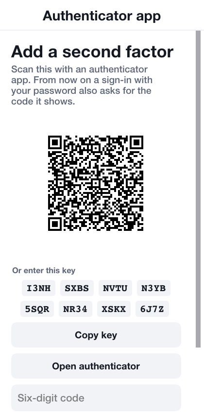

A new account starts with a dollar checking account. Others, in euros or as coin wallets, are opened from the dashboard.

=== Signing in

The sign-in screen offers the strongest way in the device has first. Where the device or browser supports passkeys, *Sign in with a passkey* is the main button: the passkey sheet asks for a fingerprint, a face or the device PIN, and that one step is both factors. On a phone that keeps a sign-in behind biometric unlock, *Unlock with fingerprint or face* comes next. The e-mail and password, then a code from the authenticator app when the account has one, are the last way in.

Once an account has a passkey, the server holds it to the passkey. The password is refused, and the code step after it takes a recovery code and nothing else; a six-digit code from the authenticator app no longer signs in. That's the way back for a customer whose passkey is gone: the password and one of their recovery codes, each of which works once. An account with a passkey and no authenticator app has no recovery codes, so its way back is the bank. Five wrong passwords in a row lock the account for fifteen minutes; the lock is per account, so guessing from many places at once doesn't help.

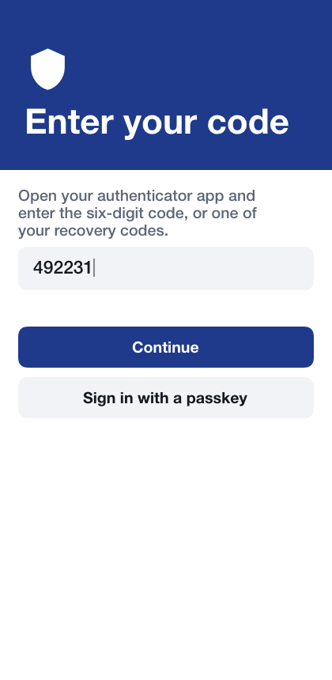

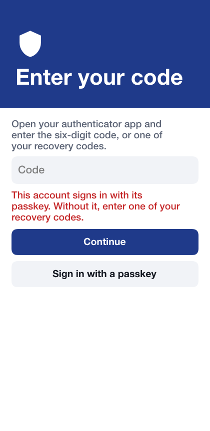

=== The lock

The app locks itself after half a minute in the background and after two minutes without a touch. Locked, it shows nothing of the account and can't sign a payment or read its stored sign-in until it's unlocked again: with biometrics when they're turned on, then with the unlock PIN when one is set, and otherwise by signing in again. Signing in again from the lock sets the device up from the start when a biometric or PIN was set up, so its payment key is registered again the next time a payment needs it. Signing out from the menu does the same, so whoever signs in next on the device starts with none of the previous account's keys.

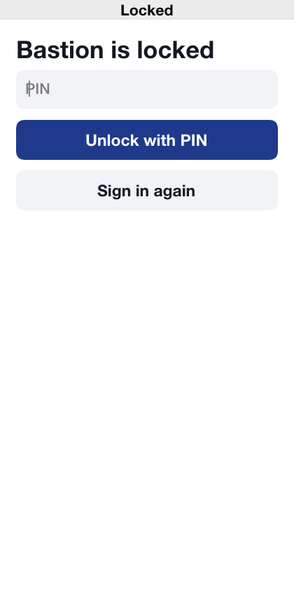

=== The dashboard

The dashboard shows the total of every account in dollars, at the exchange's current prices, the cash in dollar accounts over the last 30 days, how the money is spread across currencies and coins, and each account with its balance. Until the device has a payment key, a banner above says so and offers to register it; registering asks for the password again, because only a recent sign-in may add a key.

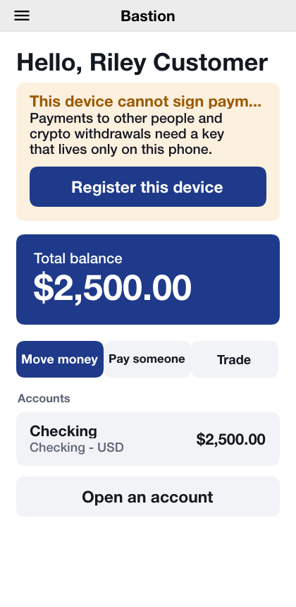

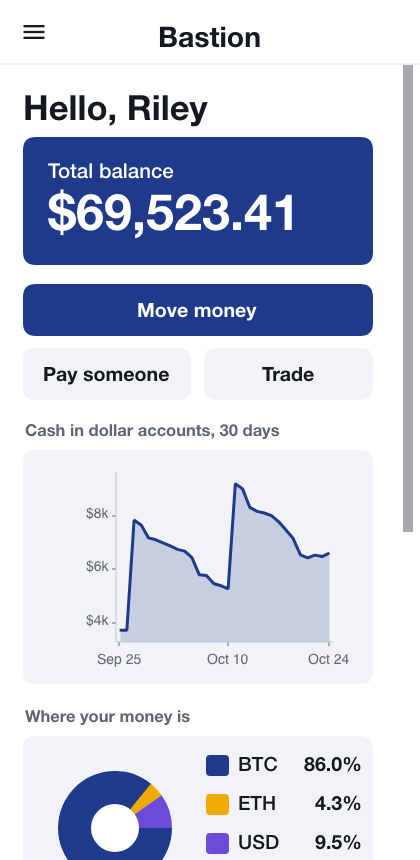

Screens reached from the menu are top-level and have the menu button; a screen opened from another one has a back arrow instead. No screen has both.

Tapping an account opens it: its balance, what can be done with it, a chart of the balance over 30 days, the money in and out each day, and its history, every posting newest first.

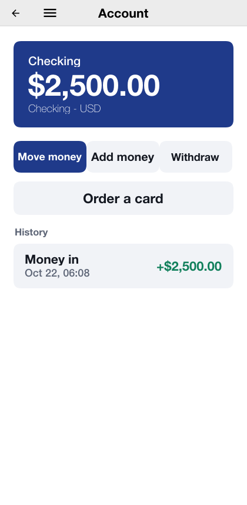

Tapping a line of the history shows that posting in full: the side of the entry it's (a credit to the account or a debit from it), the balance it left and the ledger entry it belongs to. *Statement* lists every posting oldest first with the running balance between an opening and a closing balance, the way a bank statement does.

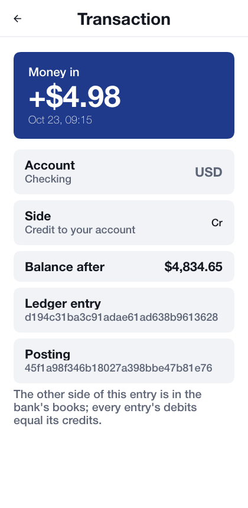

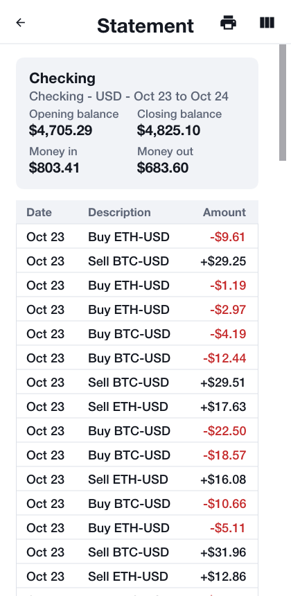

The app follows the device's dark mode, charts included:

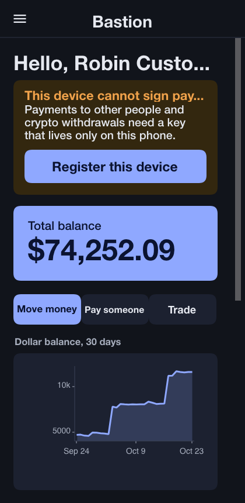

Balances, card numbers and codes are on *sensitive screens*. On Android those screens can't be captured or recorded, and the recent-apps list shows them blank; on iOS the app switcher shows a cover instead of the screen.

=== Moving money

*Move money* moves money between your own accounts in the same currency. *Pay someone* sends it to a payee: another Bastion customer, added by e-mail on the *Payees* screen.

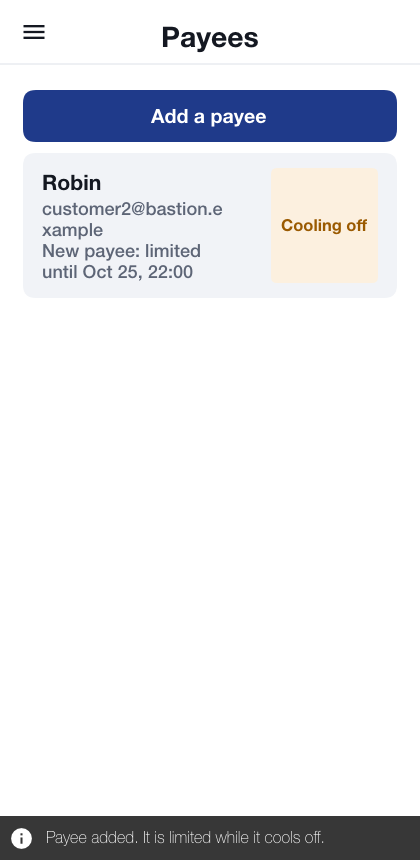

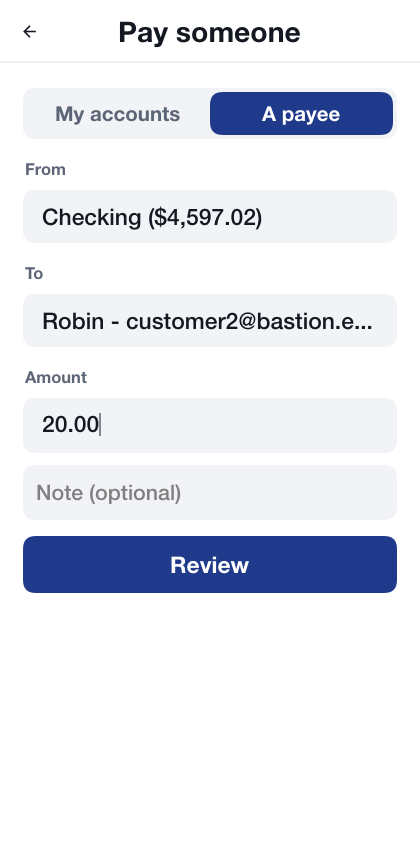

*Review* shows what's about to happen, and *Send* sends it. The receipt shows the reference of the entry it made in the ledger.

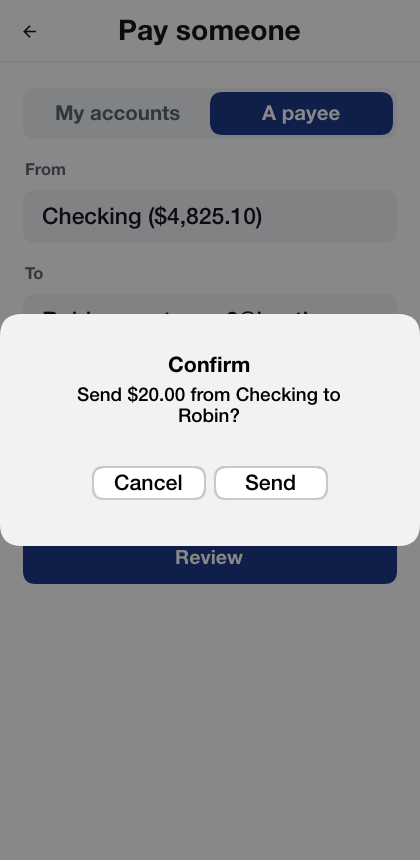

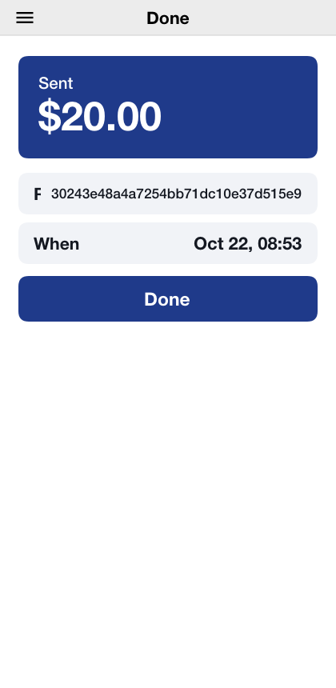

Every transfer carries a key that makes it happen once: a payment retried after a dropped connection isn't paid twice. Some transfers ask for more:

* A payment to someone else is signed with this device's key. On a device that has no key yet, the app offers to register one first, then sends the same payment.
* By default, money leaves your accounts only from a device the bank trusts: a phone that passed the platform's integrity check and doesn't look rooted or jailbroken. A browser or the simulator can't prove that, so there the server refuses the payment, explaining that the device can move money only between your own accounts. The screenshots above were taken with that policy turned off on the development server (<<bastion-implementors-guide>> has the setting).
* A new payee is in a cooling-off period for its first day, in which it can receive only $100.00. Someone who has taken over a session can't add an account of their own and empty yours into it.
* A move between your own accounts above $1,000.00 is signed with the device key too.
* Every transfer is held to a limit per transfer ($5,000.00) and per day ($10,000.00); one past either is refused.

=== Cards

*Order a card* on a checking account issues a card on it. *Cards* lists them, freezes and unfreezes each, and sets its daily spending limit. A frozen card is refused at once. Freezing works from any signed-in session; unfreezing a card or raising its limit needs this device's approval, so somebody holding only your session can't undo a freeze. The card number is on a sensitive screen.

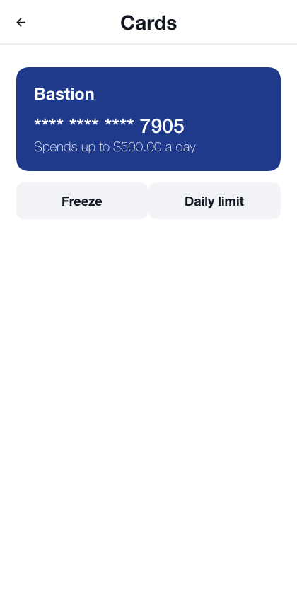

=== The exchange

*Exchange* lists the markets, BTC-USD and ETH-USD, with their last price and the index price the bank values coins at, and the customer's recent trades.

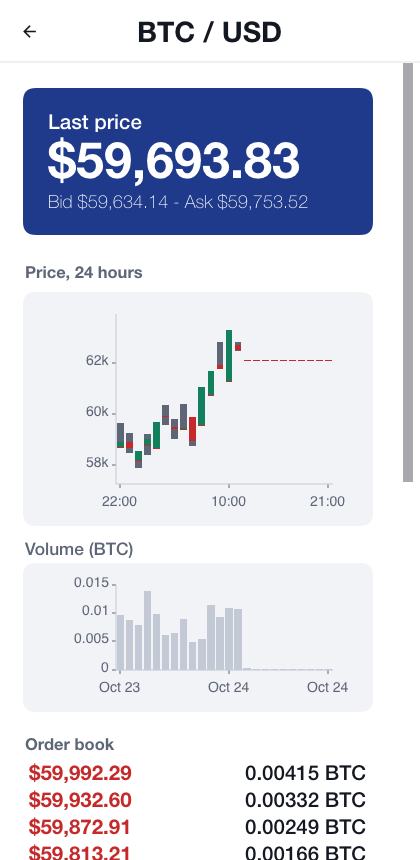

A market opens the last day in hourly candles, a rising hour in green and a falling one in red over its high-low range, the volume traded each hour, its order book and a ticket:

* A *limit order* names a price and a quantity, and rests on the book until another order meets it, or until it's cancelled.
* A *market order* takes what the book offers now, up to a budget for a buy or a quantity for a sell.

Placing an order sets aside what it could spend; the rest of the balance stays free. Fills move both sides and the fee in one ledger entry, so a trade is never half done. The *Open orders* list shows what's still resting, each with a cancel button, and a bought coin lands in a wallet account of its own.

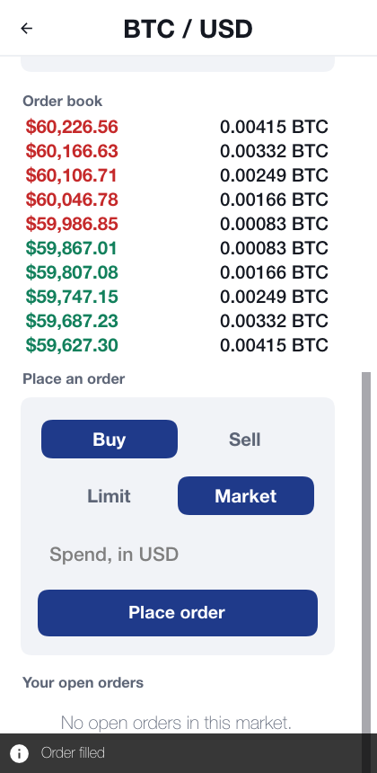

=== Sending coins

Coins leave the bank only to an address on the account's *allow-list*, and the list is guarded:

* Adding an address is signed by this device.
* A new address waits a day before anything can be sent to it.
* Every withdrawal is signed by this device, and is held to a limit per withdrawal and per day, counted in dollars.

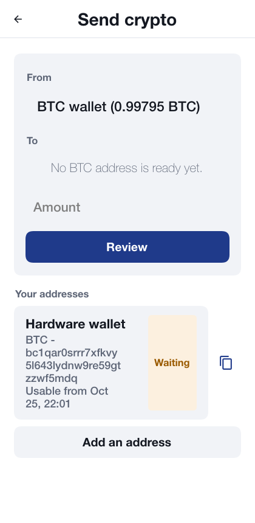

=== Security Center

*Security Center* lists every protection the app has and whether it's in force on this device, in this build, now: the connection rules and certificate pins, where the keys and the sign-in are kept, the app lock, the screen protections, whether the device looks rooted or jailbroken, whether it passed the platform's integrity check, and the hardening the build applied.

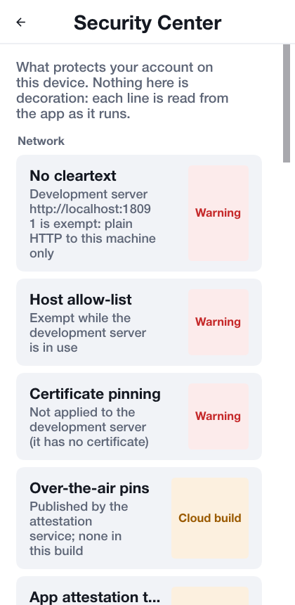

It's honest by design. A protection the simulator or a browser can't provide, such as a hardware keystore, says so. One that only a build from the Codename One build server applies, such as code hardening or Play Integrity, is marked *Cloud build* instead of claiming to be on. A development exemption in use, such as the unpinned connection to a server on this machine, is a *Warning*.

=== Settings

Every value a customer may need somewhere else has a copy button beside it, and the value itself can be selected: a receipt's reference, a transaction's ledger entry and posting, an account and a card identifier, a coin address, a passkey's ID, this device's key ID, the authenticator key, and on the console an entry's ID and the audit and evidence hashes. Keys and account and card identifiers are copied as sensitive clips that clear themselves after a minute, the same as the authenticator key; a short message confirms each copy.

Statements, receipts and transactions have a *Print* button, as do the console's reports: the general ledger, the trial balance, the balance sheet, the income statement, the audit chain, the audit trail, the access log and an evidence export. The printout has the bank's name, the report, the account and period it covers and when it was made, then the table, then the totals, and goes to the platform's print dialog. Where the platform can't print, there is no button.

*Settings* turns biometric unlock on and off, sets, changes or removes the unlock PIN, turns on the authenticator app and makes new recovery codes, lists and removes passkeys and adds new ones, shows this device's payment key, and chooses the language: English, Spanish, French, German or Hebrew, which lays the app out right to left. Tables mirror, so the debit side of a T-account is on the right as a Hebrew ledger writes it; charts keep time running left to right.

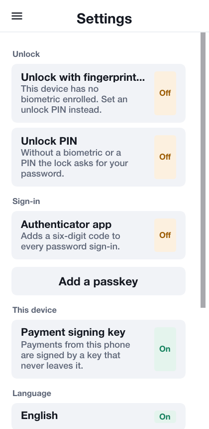

=== The back office

Staff sign in like customers and land on the console: *Administration* for an administrator, *Audit* for an auditor. On a wide window, a desktop or a tablet on its side, the sections are a sidebar beside the page and the tables use the width; on a phone the sections are a picker over one column, and a wide table scrolls sideways. A customer's statement on a phone keeps three columns instead: the date, the amount signed in or out, and the running balance.

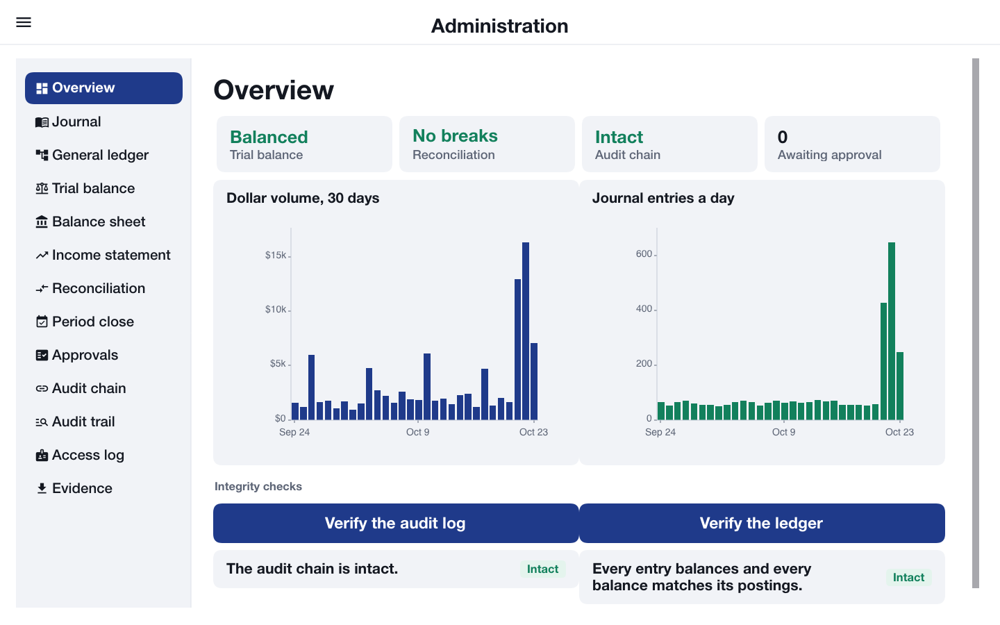

The *Overview* shows whether the trial balance balances, whether reconciliation found breaks, whether the audit chain is intact and how many requests wait for approval, with the dollar volume and the number of journal entries a day. Order holds and their releases are left out of both: they move a customer's own money into escrow and back, and no value changes hands. An administrator also runs the two checks, recomputed from the stored rows each time:

* *Verify the audit log*: every security and money event is a link in a hash chain, and the check reports any row that was changed, removed or inserted out of order.
* *Verify the ledger*: every entry sums to zero in each currency, and every balance equals the sum of its postings.

The *Journal* lists every entry with its debit (Dr) and credit (Cr) legs, credits indented under the debits. Tapping an entry shows it in full, with a total per currency that proves its debits equal its credits, the entry it reverses or the one that reversed it, and its audit trail.

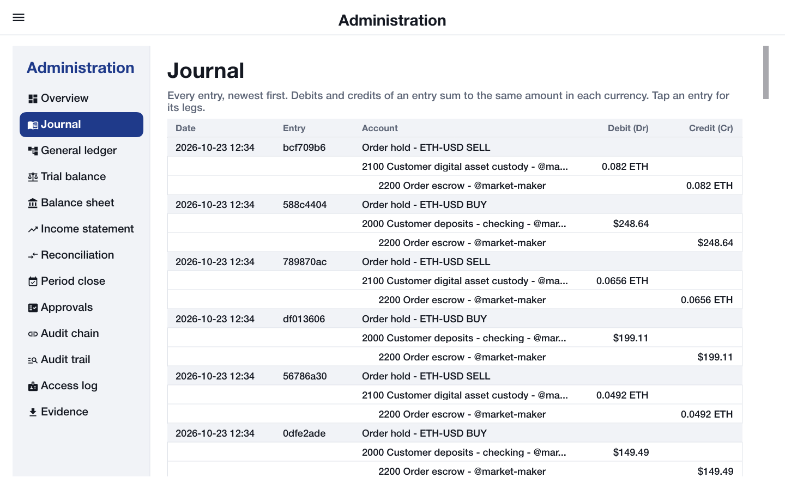

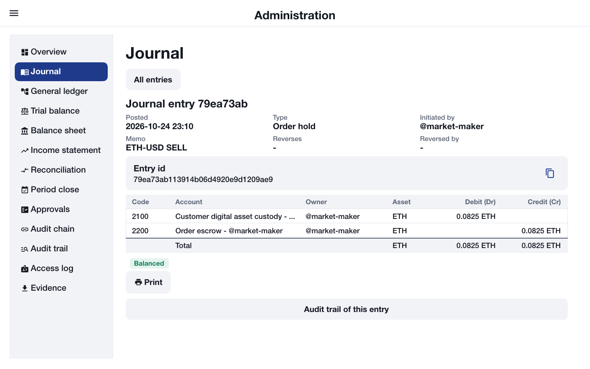

The *General ledger* lists the lines of one account code in one currency with a running balance, and shows the account as a T-account, debits on one side and credits on the other, between its opening and closing balances.

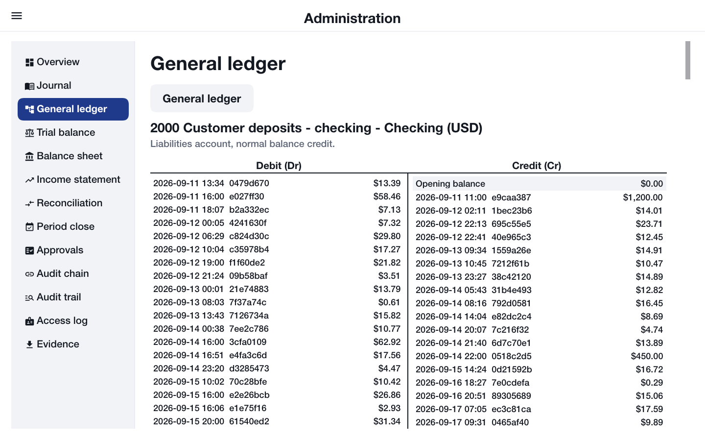

The statements follow from the same postings. The *Trial balance* lists the debit or credit balance of every account code and currency, with totals that must agree. The *Balance sheet* shows assets, liabilities and equity, and that the first equals the sum of the other two. The *Income statement* shows revenue and expenses for the period and the net income, all valued in dollars as well as in their own currency.

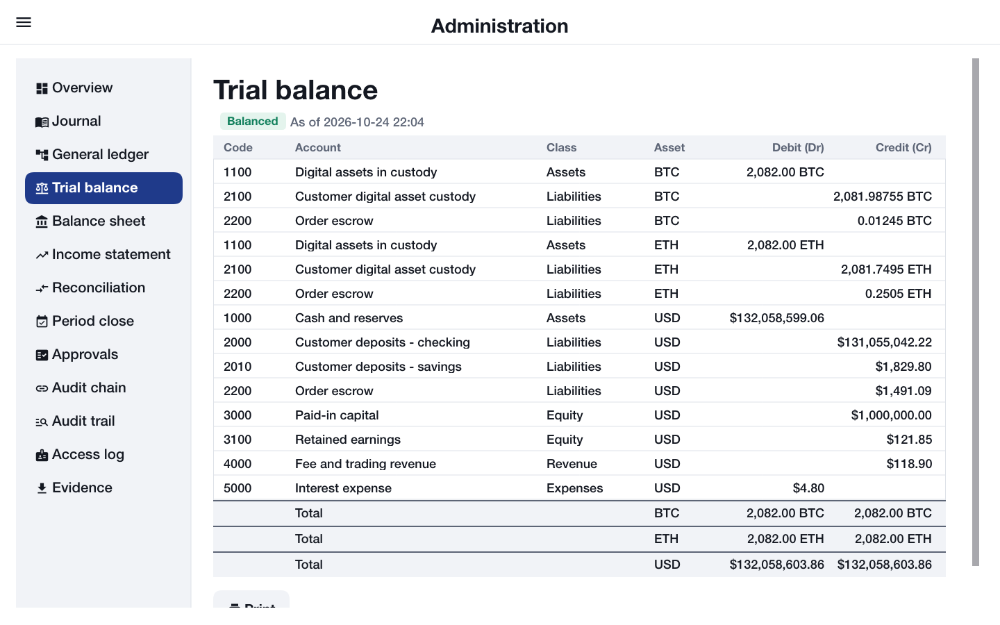

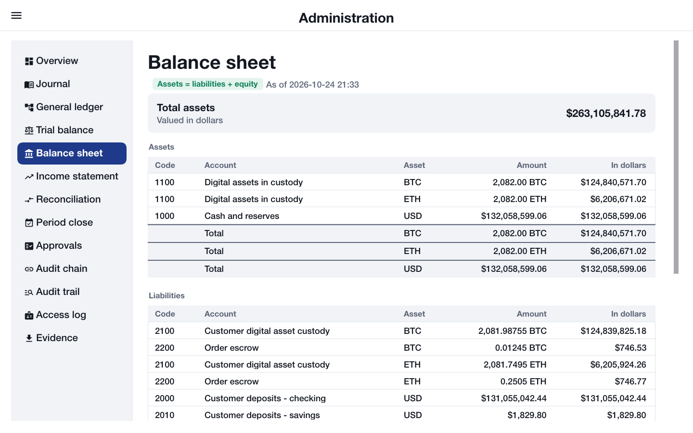

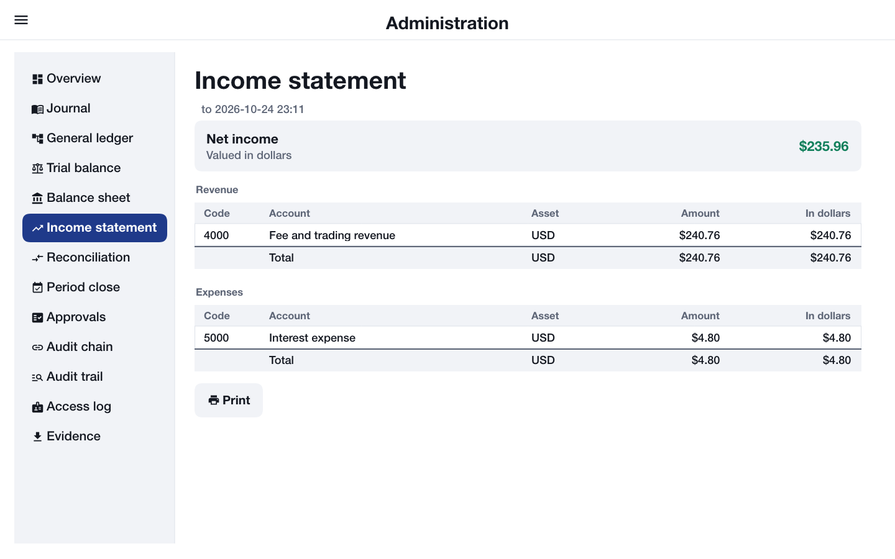

*Reconciliation* compares each control account with the sum of the customer accounts under it. A difference is a break, and its row is red.

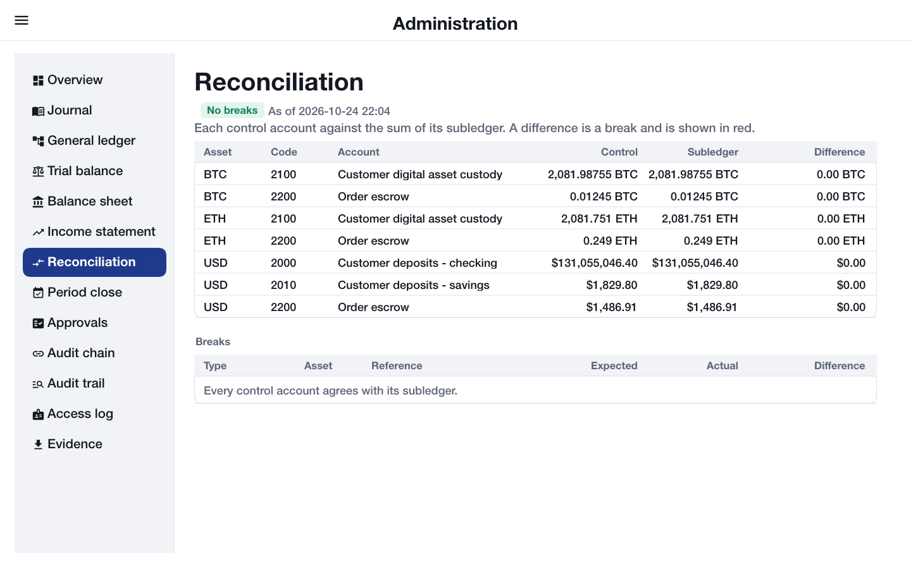

*Period close* lists the closed periods. Closing one moves revenue and expense into retained earnings and locks every entry up to its date, so its statements never change again.

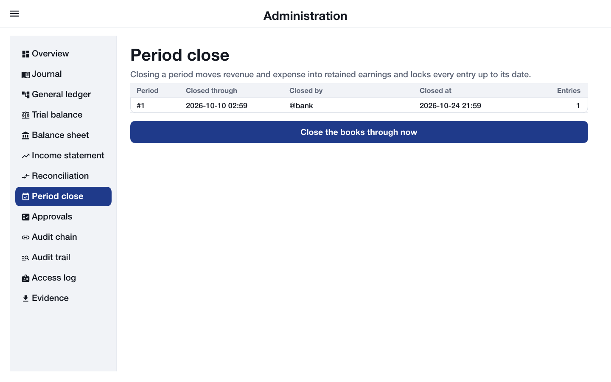

Changes need two administrators. An administrator can ask for an adjustment to a customer account or for an entry to be reversed; above the approval threshold it waits in *Approvals* until a second administrator approves or rejects it. Every change asks for the administrator's password again.

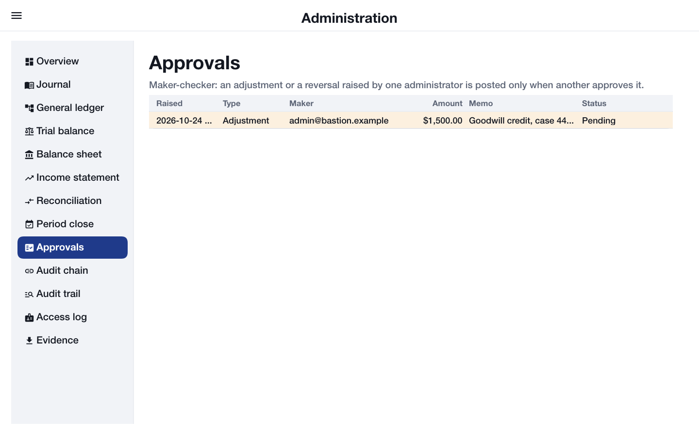

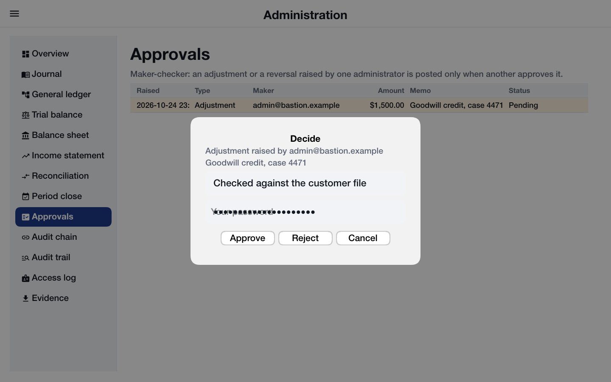

*Audit chain* reports how many links were checked and the head of the chain, and lists the latest events with their hashes; if a link is broken, the first broken row is red. *Audit trail* lists every event that names one entry, account or person, and *Access log* lists every time staff read the books.

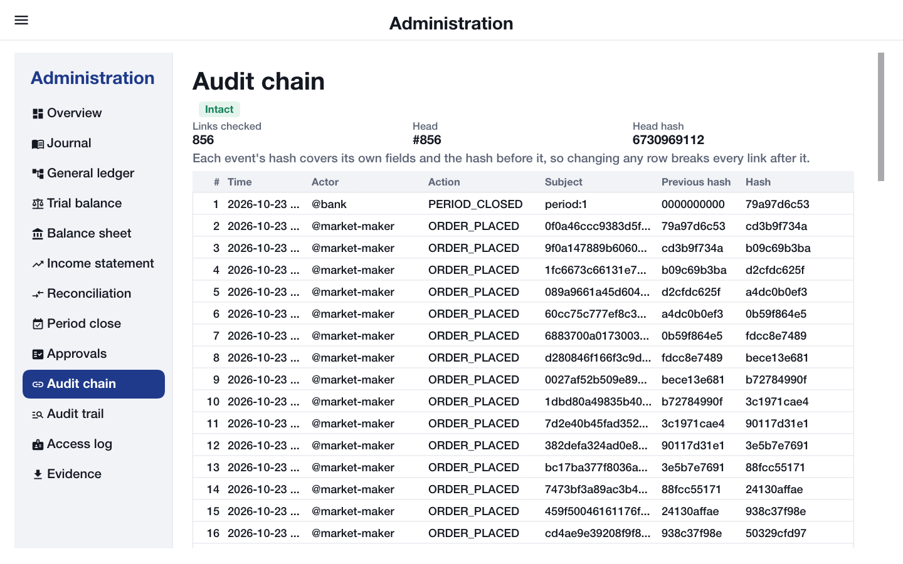

*Evidence* exports the journal, the trial balance or the audit chain as CSV or JSON for an external auditor. The file is saved, a browser downloads it, and the screen shows who made it, when, and its SHA-256 digest so the copy can be checked later.

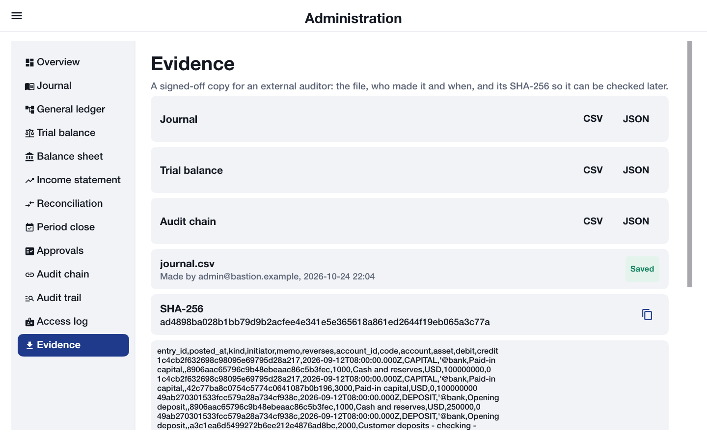

An auditor sees the same console marked *Read-only*, without the approvals queue and without any button that changes something. The server refuses those changes to an auditor whatever the app shows.

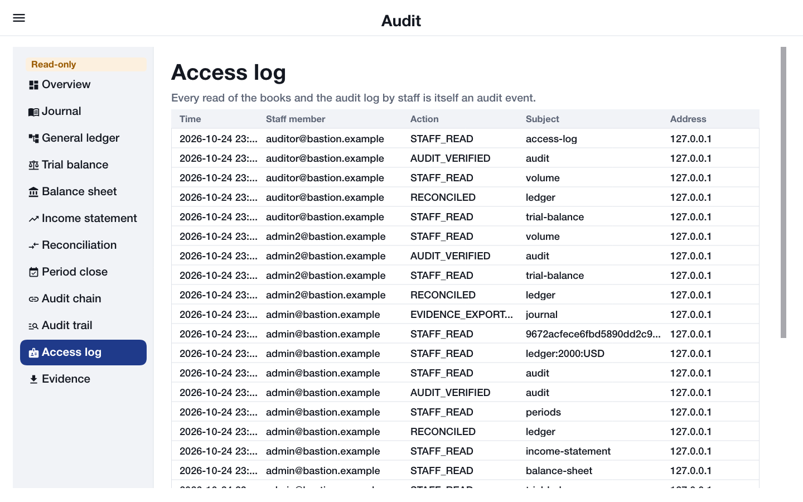

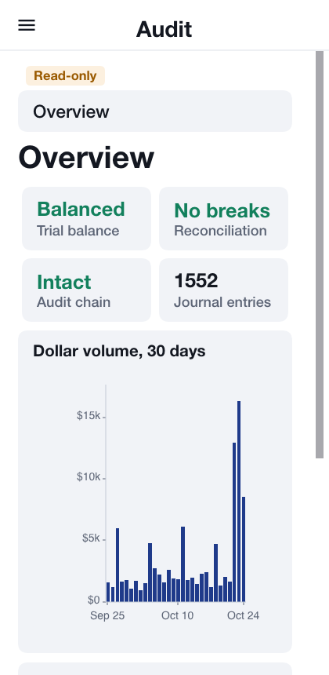

No request can make an administrator. Outside the development profile, the one administrator account comes from the server's environment when it starts.
