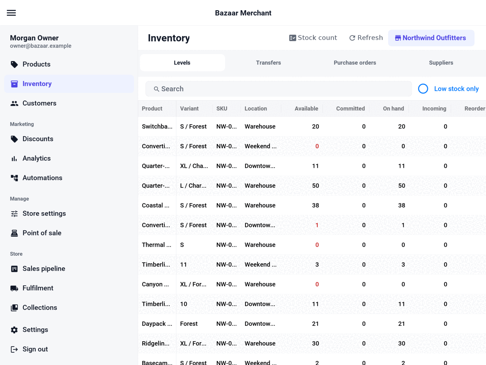
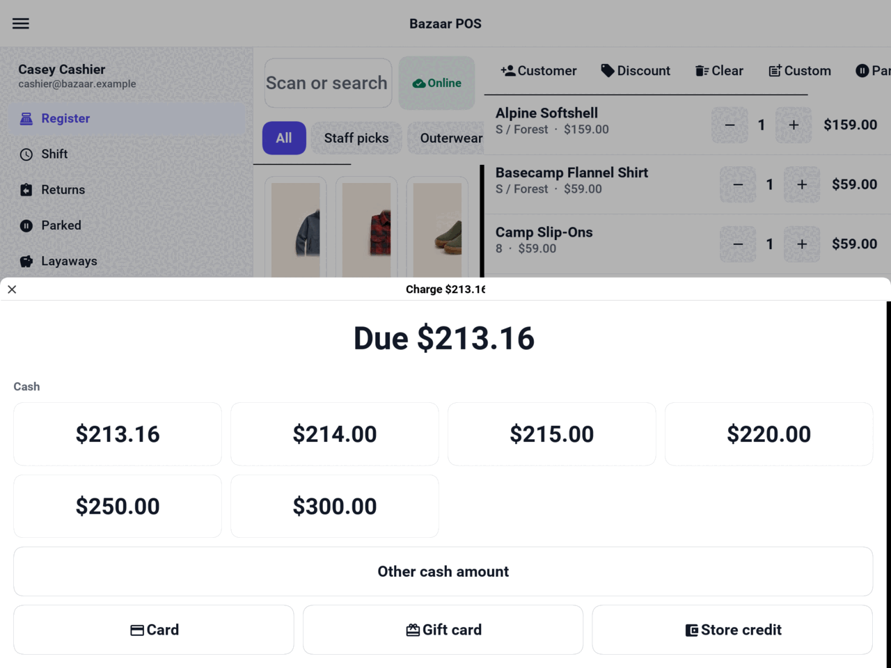
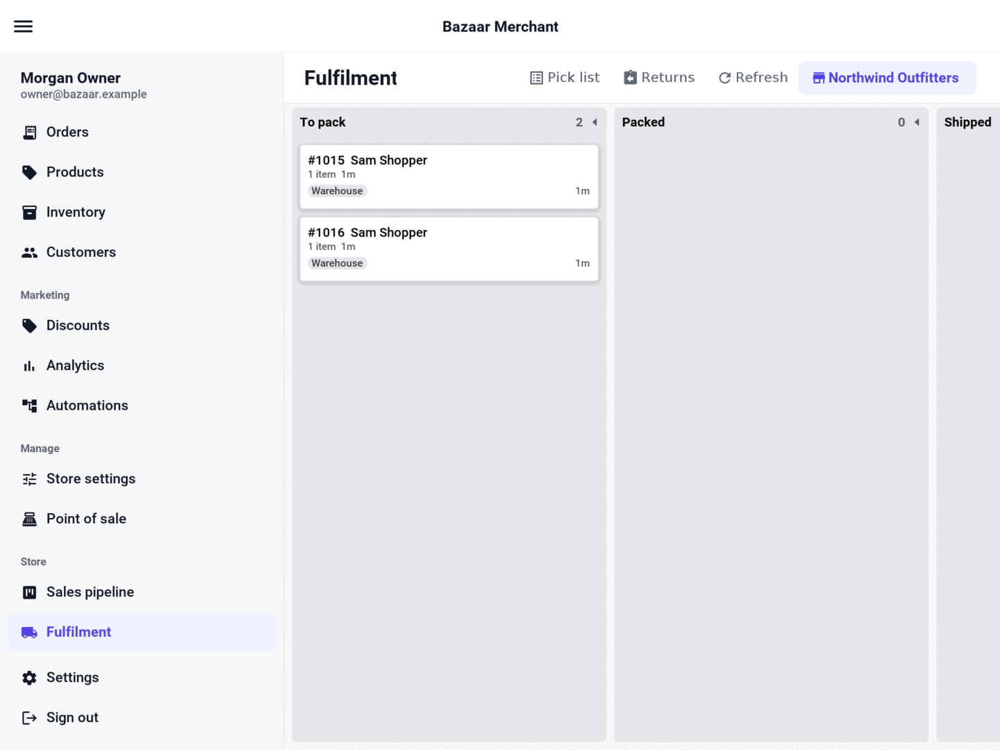
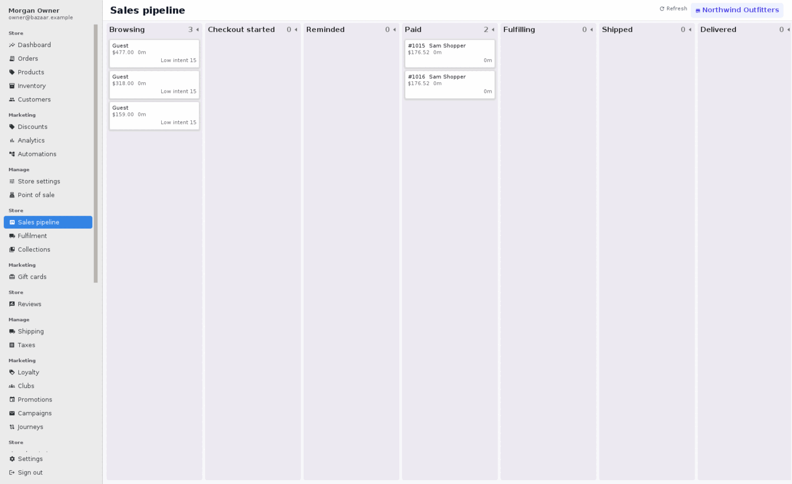
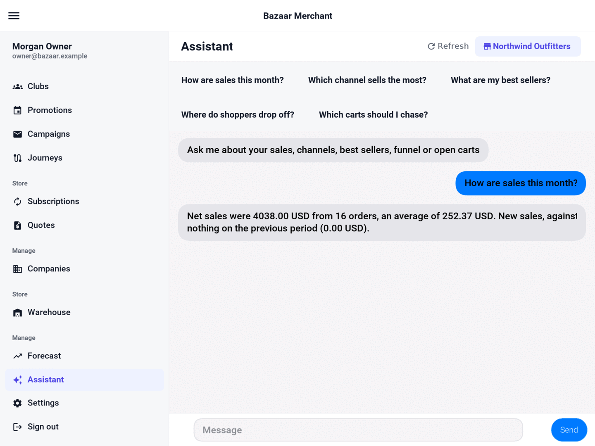
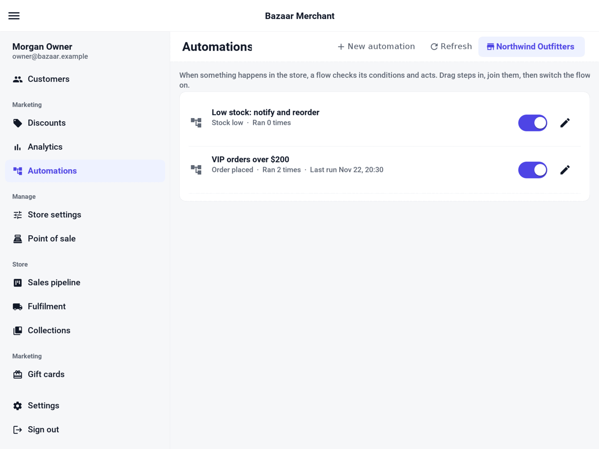
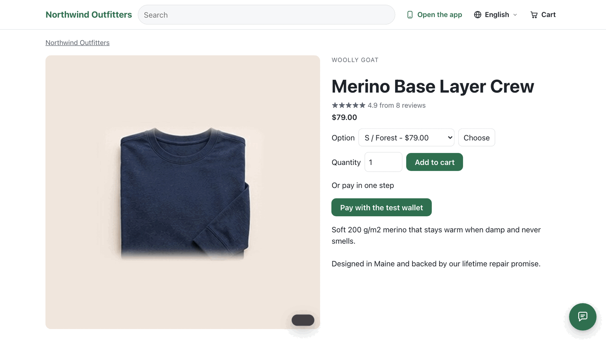
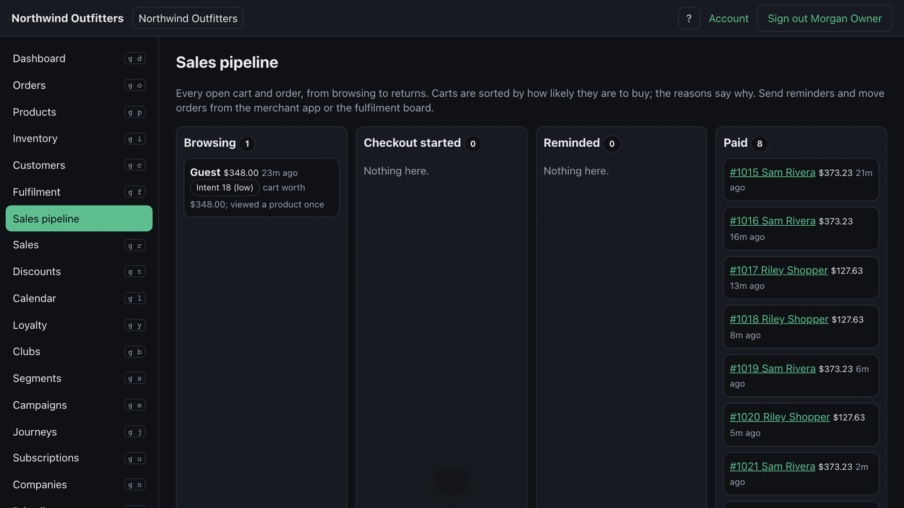

[[bazaar-implementors-guide]]
== Bazaar: Building on the sample

Bazaar began as a copy of <<savor-implementors-guide,Savor>> and kept what a
store needs from it: the module layout, the accounts and sign-in, the cards and
the payment provider, text messages, push notifications, the live channel, the
operations console and hosting the app in a browser. This chapter covers what a
commerce platform adds: a catalog with variants, an inventory ledger that never
oversells, orders paid in two steps, a point of sale that keeps selling with no
network, fulfilment, signed webhooks, automations drawn as graphs, documents
rendered as PDF files and a storefront that search engines can read.
<<bazaar-feature-comparison>> lists what Bazaar has and lacks, next to
other commerce platforms.

[[bazaar-launch]]
=== Running it

The project is in `scripts/bazaar`. Start the server on the development profile,
which seeds the demo accounts, two stores with their products and stock, and
simulates the cards:

[source,bash]
----
include::../demos/common/src/main/snippets/developer-guide/bazaar.sh[tag=bazaar-sh-server,indent=0]
----

Then run the app in the simulator, from the project's directory:

[source,bash]
----
include::../demos/common/src/main/snippets/developer-guide/bazaar.sh[tag=bazaar-sh-simulator,indent=0]
----

`backend/server.sh run --web` builds the app for a browser as well and serves it at
`http://localhost:8080/`. The same server also serves the HTML storefront under
`/s/<handle>`, described in <<bazaar-storefront>>.

=== The modules

`shared` holds the contract: the data transfer objects and the `@RestClient`
interfaces both sides compile against. `common` is the app, one adaptive app for
phones, tablets, desktops and browsers. `backend` is the server. Its packages
follow the domain:

[cols="1,3"]
|===
| Package | What it holds

| `catalog`, `store`
| Stores, their staff and locations, products, options, variants and collections.

| `inventory`
| Stock per variant and location, the move ledger, counts, transfers, suppliers
  and purchase orders.

| `cart`, `checkout`, `pricing`, `rates`
| Carts for guests and accounts, the quote (discounts, tax, shipping) and placing
  an order.

| `order`, `fulfil`, `returns`, `giftcard`
| Orders and their events, fulfilments and tracking, refunds and returns, gift
  cards.

| `pay`
| The payment provider: holds, captures, voids and refunds.

| `pos`
| Registers, shifts, cash moves and the offline sale sync.

| `webhook`, `automation`
| Signed outgoing webhooks and the automation engine.

| `docs`
| Invoices, packing slips, labels, purchase orders, credit notes, shift reports
  and receipts as PDF files.

| `web`
| The server-rendered storefront.

| `analytics`, `admin`
| Store statistics and the platform console.
|===

The app's packages split the same way by audience: `shop` for shoppers,
`merchant` for store staff, `pos` for the register, `admin` for the platform, and
`ui` for the shell they share. Which of them a person sees follows the roles the
server returns: a shopper opens on the storefront, store staff on the merchant
dashboard, a cashier on the register, an administrator on the platform console.

Money is a `long` count of minor units everywhere, on both sides and in every
transfer object. Nothing stores or adds money as a floating point number.

=== The inventory ledger

Stock is one `InventoryLevel` row per variant and location, holding what's on
hand, what's committed to placed orders, and what's incoming on purchase
orders. What can be sold is on hand less committed. No code writes a level
without writing an `InventoryMove` in the same transaction, with a reason
(`SALE`, `RESERVE`, `RELEASE`, `RETURN`, `RESTOCK`, `COUNT`, `DAMAGE`,
`TRANSFER_OUT`, `TRANSFER_IN`, `RECEIVE`, `CORRECTION` or `POS_SYNC`), so the
history of every number is in the moves and the levels can be rebuilt from them.

Checkout reserves stock through `Inventory.reserve`, a conditional update that
names the version of the level it read and retries a lost race. Two shoppers
buying the last unit at the same moment therefore can't both succeed:

[source,java]
----
include::../../scripts/bazaar/backend/src/main/java/com/codenameone/examples/bazaar/inventory/Inventory.java[tag=bazaar-reserve,indent=0]
----

Shipping a fulfilment takes the units off hand and off committed together;
cancelling an order releases what it reserved. A return that's restocked writes
a `RETURN` move. Counting a shelf writes the difference as a `COUNT` move rather
than overwriting the number.

The one exception to "never below zero" is the register. A sale made offline has
already happened: the customer left with the goods. The sync records it with a
`POS_SYNC` move even when that takes a level negative, marks the sale as
oversold, and raises a low-stock alert for a person to sort out.

Two more kinds of stock sit beside on hand. `inventory_unavailable` holds units
set aside with a reason, which `InventoryStates` subtracts from available, and
`Tracking` keeps serials and lots: a sale that takes a lot-tracked level down
calls `pickLots`, which draws from the lot that expires first. A variant that
continues selling reserves with `reserveCounted`, which answers how many units
it could not cover; the order line keeps that as `backorderedQty`.

[[bazaar-order-tools]]

=== Pay links, returns and templates

A pay link (`PayLinks`) is a row in `pay_link` holding a token of the link id,
its expiry and an HMAC of both, so a link cannot be forged or extended and a new
link replaces the old. Paying claims the link first and reverts the claim if the
card fails, so two tabs cannot pay twice. The invoice reads the stored token
rather than calling `PayLinks`, which keeps `Documents` free of a dependency on
email.

Returns read their rules from `OrderSettings`. `Resolutions` settles a received
return by the resolution the shopper picked: every path goes through the order's
own refund, with the fees and any exchange credit kept back, so the order's
totals and the card agree. An exchange creates a replacement order, pays it with
the credit as an `EXCHANGE` tender, and mails a pay link when money is still
owed.

`Templates` keeps a store's rewording of a `mail.*` key per language. `Emails`
looks a key up there before the built-in text; a template may only use the
placeholders the built-in text has, and is filled as plain text, never markup.

A bundle has no level of its own. `Bundles` keeps its components (variant and
quantity per unit, in `bundle_component`), and a product is a bundle exactly
when it has component rows. Every stock call (reserve, release, ship, restock,
the register's sale and a marketplace order) expands a bundle line into moves
on its components, so the ledger stays the one record of stock. What a bundle
can sell is the fewest bundles its components make at each location, summed
over the locations; an untracked component never limits it. A product that is a
component can't itself be a bundle, and a component variant can't be deleted.

Each product also has a publishing window per channel in `channel_schedule`:
`ONLINE`, `POS`, or a marketplace channel's id, with publish and unpublish times
in UTC. `Schedules.set` applies a window at once, and a scheduled job flips the
`visible` flag as times pass. The storefront (lists, search, the product page,
the sitemap and the feeds), carts and checkout read `ONLINE`; the register's
catalog reads `POS`; and marketplace sync pushes a hidden listing with no stock.
A product with no window follows its status alone.

A variant's `digital` flag means it ships nothing: it weighs nothing in a
quote, holds no stock, and a cart of digital variants only needs no address or
delivery option. Uploaded files (downloads, videos and models) live in
`catalog_file`, capped by `bazaar.catalog.max-file-bytes`; a video or model is
checked by its leading bytes, not its declared type. `Downloads` keeps each
variant's `digital_asset` and, once an order is paid, one `download_grant` per
digital line. When an order is placed, `StoreEvents` marks its digital lines
fulfilled, which takes a held card payment the same way shipping does, so the
confirmation mail already carries the links. A link is the grant id, its expiry
and an HMAC of both under the grant's own random secret; a forged, foreign,
expired, used-up or revoked link answers the same 404. Each fetch is counted by
one conditional update, so the limit holds under concurrent requests, and a
download is never served in byte ranges. Licence keys are claimed one by one
with an update that only a free key passes, so two sales never share one; a pool
with five or fewer keys left mails the store's low-stock alert. A line refunded
in full, or a cancelled order, revokes its grants.

Gallery rows in `product_photo` have a `kind`: `IMAGE`, `VIDEO` or `MODEL`. An
uploaded video or model is served at `/media/file/{id}` with single byte ranges
and a year of caching; a linked video is a link out, since the page policy only
allows `media-src 'self'`. The product's main photo is always its first picture.
A product page with a model loads Google's `<model-viewer>` from
`web-src/model-viewer.js` (licenses in `web-src/MODEL-VIEWER-NOTICE.txt`) as a
module script from `/static`; no other page loads it. Its policy adds `blob:` to
`img-src` and `connect-src` (`WebHeaders.allowModelViewer`), since the viewer
decodes a model's textures from URLs it makes itself, and nothing else. The
viewer fetches Draco and KTX2 decoders from Google's servers, which the policy
refuses, so a model compressed that way shows its poster.

`product.category_id` is an id from the first two levels of Google's product
taxonomy, read from `taxonomy/google-product-taxonomy.txt` by `Taxonomy`; the
app searches it through `GET /api/shop/taxonomy`. Variants carry `hs_code`,
`origin_country` and unit pricing: `unit_quantity` in thousandths of
`unit_name`, priced per `unit_reference` of `unit_reference_name`.
`UnitPricing` in `shared` computes the unit price in cents, half up, and answers
-1 for no measure, two kinds of unit or a result too large to compute.

[[bazaar-payments]]
=== Authorize at checkout, capture at shipping

An online order holds its total on the card when it's placed and takes the
money when the first fulfilment ships. A cancelled order voids the hold, and
refunds can be partial, line by line or by amount. Point of sale orders and
pickup orders capture at once.

[source,java]
----
include::../../scripts/bazaar/backend/src/main/java/com/codenameone/examples/bazaar/pay/Payments.java[tag=bazaar-authorize,indent=0]
----

Everything provider specific sits behind `PaymentProvider`. The development
profile uses a simulated provider; the Stripe implementation adds a card on
Stripe's own page, so a card number never reaches the app or this server.

[source,java]
----
include::../../scripts/bazaar/backend/src/main/java/com/codenameone/examples/bazaar/pay/PaymentProvider.java[tag=bazaar-payment-provider,indent=0]
----

Wallets, pay-later and bank methods use the same provider:

* *Express checkout* (`ExpressCheckouts`, `ExpressPages`) creates a manual
  capture intent for the cart, re-prices it through the `Quoter` on every
  address or shipping change the wallet sheet reports, and places the order
  once with the idempotency key `express-<id>`. A repeated confirm answers the
  order already placed; a cart that changed since the last quote is refused.
  Stripe.js is allowed in the page's policy (`WebHeaders.allowStripe`) only on
  pages that show the button and only when the provider is Stripe.
* *Payment method types* (`PaymentTypes`) are a table of Stripe method types
  with the currencies and countries each one accepts. A store enables some in
  `CheckoutSettings`; checkout offers those the order's currency and country
  allow. An asynchronous method leaves the order payment pending, and
  `PaymentEvents` settles it from the signed webhook at
  `/api/payments/webhooks/payments`: paid, or cancelled with its stock
  released.
* *Tips and checkout fields* also live in `CheckoutSettings`. A tip is stored in
  `tip_cents` beside the total, so tax and discounts never see it, and is
  charged with the order. Answers are kept per order with the label as it read
  when the order was placed.

=== Who may call what

The security configuration is the one place that says which routes are public,
which need a signed-in account, and which need a role. The storefront's reads
and the guest cart are open; the merchant routes need staff of the store, which
each service checks again against the store's staff list; the platform routes
need an administrator.

[source,java]
----
include::../../scripts/bazaar/backend/src/main/java/com/codenameone/examples/bazaar/SecurityConfig.java[tag=bazaar-api-rules,indent=0]
----

[[bazaar-pos]]
=== The offline register

The register is built to keep selling with no network. When a cashier opens a
shift, the app keeps a snapshot of the catalog, the prices, the tax rates and the
customers it may need. A sale is priced on the device from that snapshot, written
to the outbox with an id the register made for it, and only then is the receipt
shown:

[source,java]
----
include::../../scripts/bazaar/common/src/main/java/com/codenameone/examples/bazaar/pos/Outbox.java[tag=bazaar-outbox-add,indent=0]
----

The outbox sends what's waiting in batches, and backs off from two seconds to
five minutes while the server can't be reached. A register restarted in the
middle of a request finds the sale still waiting and sends it again. That's
safe because the server keys every sale by the store and the register's id for
it, and answers a sale it already has as a duplicate instead of recording it
twice:

[source,java]
----
include::../../scripts/bazaar/common/src/main/java/com/codenameone/examples/bazaar/pos/Outbox.java[tag=bazaar-outbox-answer,indent=0]
----

On the server, `PosSales.sync` records each sale of a batch in its own
transaction, so one bad sale doesn't hold back the rest. It prices the sale
again with the server's own rates and accepts the register's total when the two
differ by no more than a currency unit or 1%, whichever is larger: a
stale tax rate moves a total by cents. A larger gap, or a gift card that ran dry
while the register was offline, is answered as an error that the outbox screen
shows for a person to retry or settle.

The tenders are held against the server's total like this; a stale tax rate
moves a total by cents, so only a shortfall past `tolerance()` is refused:

[source,java]
----
include::../../scripts/bazaar/backend/src/main/java/com/codenameone/examples/bazaar/pos/PosSales.java[tag=bazaar-pos-sync,indent=0]
----

=== Fulfilment

The merchant's fulfilment board shows every open order as a card in To pack,
Packed, Shipped, or Delivered. On a wide screen it's a `KanbanBoard`: dragging a
card one column to the right does what that column means on the server (packs
it, buys the cheapest label and ships it, or marks it delivered), and any other
move is put back. On a phone it shows one column at a time, with a button on each
card that moves it on. The live channel reloads the board when an order changes. The pick
list for the cards in the first column is made on the device, with the same
`com.codenameone.pdf` package the server renders invoices with:

[source,java]
----
include::../../scripts/bazaar/common/src/main/java/com/codenameone/examples/bazaar/merchant/PickListPdf.java[tag=bazaar-picklist-pdf,indent=0]
----

=== Sales pipeline, insights and the merchant AI

The sales pipeline (`pipeline/Pipeline`, `PipelineApi`) is worked out, never
stored. A cart with lines that was touched in the last 30 days is Browsing, or
Checkout started once it has an email or an account to write to, and Reminded
once its recovery mail went. Orders take their column from the fulfilment
board, and an open return moves an order to Return requested. The legal moves
live in the shared `ops/SalesPipeline`, which the app checks before a drop and
the server checks again. Checkout to Reminded claims the cart's reminder the
way the abandoned-cart sweep does, so the mail goes once whichever sends it;
the order moves call `Fulfillments.moveCard`. Each column pages by 20 cards.

Product views are recorded one row per view in `product_view_event`, keyed by
the cart token or the account, from both the storefront and the app's catalog
API. Those rows give the purchase-intent signals (views, visits split at a
30-minute gap, minutes between views in a visit) that `SalesPipeline.score`
turns into 0 to 100, and the views step of the insights funnel. An order's
`source` column tells a website checkout from an app one, so
`Analytics.insights` can split the channel mix with one grouped query.

The merchant AI uses `com.codename1.ai` in the app and keeps the key on the
server. The app makes an OpenAI-compatible client with
`LlmClient.localOpenAiCompatible` pointed at
`/api/merchant/stores/{storeId}/ai/v1`, with no key: the session's bearer token
authorizes it. `MerchantAiController` accepts only a first system message of
`bazaar:assistant` or `bazaar:description`, replaces it with the server's own
instructions, fixes the model and the reply length, and forwards to the
configured provider:

[source,properties]
----
# openai, anthropic, gemini, or url
bazaar.ai.provider=openai
bazaar.ai.key=...
# optional; each provider has a default
bazaar.ai.model=gpt-4o-mini
# for "url": any OpenAI-compatible server
bazaar.ai.url=
----

The assistant's tools (`AssistantTools`) run in the app over the dashboard,
insights and pipeline it already fetched; the model calls them and
`AssistantRun` sends the results back until it answers in words. Every tool
result carries a `summary` sentence. With no provider, `AiFallback` answers in
the same response shape: it picks the tool a question's words point to, then
answers with the tool's summary, and drafts descriptions from the product's
fields. The tests run against that fallback.

=== Profiles, routing and fulfilment services

A shipping zone may belong to a shipping profile; `ShippingCalculator` prices
each profile's lines against that profile's zones and adds the matching
options up, so a mixed cart pays the sum. Line locations come from
`routing.OrderRouting`, which feeds the store's rules to the pure
`routing.Router`: locations that hold a line's units always come first, and
each rule only breaks the ties the earlier ones left. Without rules, the first
location in the store's order that holds a line's units ships it.

A third-party warehouse is a `routing.FulfilmentService`: `submit` hands it an
order's lines at the location it runs, and `status` reports what it has done.
`ThirdPartyFulfilment` polls on a schedule under a cluster lock, records every
hand-over once in `fulfilment_service_order`, and turns a shipment into an
ordinary fulfilment, so the shopper's mail and the `orders/fulfilled` webhook
come from the usual path. A real integration replaces
`SimulatedFulfilmentService` with calls to the warehouse's API.

`CarrierProvider.buyReturnLabel` buys a return label; EasyPost marks the
shipment `is_return`. `ReturnLabels` calls it when a return is approved and
never fails the approval: without a label the shopper is told to send the
parcel back themselves.

=== Documents on the server and on the device

The PDF package is shared with the backend, so the server renders invoices,
packing slips, shipping labels with a Code 128 barcode, purchase orders, credit
notes, shift reports and receipts with the same API the app uses. Each is a
`GET` under the store's merchant routes ending in `.pdf`; a shopper gets the
invoice of their own order from `/api/orders/{orderId}/invoice.pdf`. The app shows
them with the PDF viewer, prints them where the platform has a printer, shares
them, and on a desktop lets the user drag the file out of the window.

=== Webhooks

A store can register addresses to be told about `orders/create`, `orders/paid`,
`orders/fulfilled`, `orders/cancelled`, `refunds/create`, `inventory/low`,
`products/update` and `customers/create`. Every delivery is a `POST` of the event
as JSON, signed with the webhook's secret in the `X-Bazaar-Signature` header. A
receiver computes the same value over the exact bytes it received and compares
the two in constant time before trusting the body:

[source,java]
----
include::../../scripts/bazaar/backend/src/main/java/com/codenameone/examples/bazaar/webhook/Webhooks.java[tag=bazaar-webhook-signature,indent=0]
----

 A delivery not answered with a 2xx status
is retried after 1, 2, 4, 8 and 16 minutes, and is marked failed after six
attempts. The merchant's webhooks page lists every delivery with its status and
response, and can send one again.

[[bazaar-automations]]
=== Automations

An automation is a graph drawn in the app's NodeGraph editor and stored as JSON
in `Automation.graphJson`. Each node is a trigger, a condition or an action. A
node's data is a map of its parameters with its type repeated under `type`, and
every value is kept as text, whole numbers for money and counts. Ports are named
`in`, `out`, `yes` and `no`:

[source,java]
----
include::../../scripts/bazaar/common/src/main/java/com/codenameone/examples/bazaar/merchant/AutomationCodec.java[tag=bazaar-automation-encode,indent=0]
----

The server's `NodeCatalog` is the list of node types, which the editor reads to
build its palette, so a new type needs no app release. Each entry names its
kind, title, description and parameters:

[source,java]
----
include::../../scripts/bazaar/backend/src/main/java/com/codenameone/examples/bazaar/automation/NodeCatalog.java[tag=bazaar-node-catalog,indent=0]
----

The full set:

[cols="1,3"]
|===
| Kind | Types

| Trigger
| `order.created`, `order.paid`, `order.fulfilled`, `inventory.low`,
  `customer.created`, `cart.abandoned`

| Condition
| `if.total_over`, `if.customer_tag`, `if.product_tag`, `if.channel`,
  `if.country`; each has a `yes` and a `no` output

| Action
| `tag.order`, `tag.customer`, `notify.staff`, `email.customer`,
  `discount.create_code`, `inventory.reorder`, `webhook.send`, `wait.minutes`
|===

`AutomationGraph` parses a graph and says what's wrong with it: no trigger,
triggers of more than one kind, an unknown type, a connection to a missing step
or a port the step lacks, or a connection into a trigger. An active automation
must validate before it's saved; an inactive one is a draft and may be
incomplete. When an event fires, after the change that fired it has committed,
the engine walks the graph from the matching trigger, following `yes` or `no` at
each condition, and performs each action in turn. Every action leaves an audit
event, which is the automation's activity log, and an automation that fails is
logged without undoing the change. A `wait.minutes` node stores the rest of its
branch as a run that resumes when the wait is over.
The development profile seeds two examples in every store: tagging
orders over a set amount as VIP, and notifying staff and drafting a purchase
order when stock runs low.

[[bazaar-storefront]]

=== A storefront search engines can read

The app is a Codename One application, and a crawler that doesn't run
JavaScript sees nothing of it in a browser. The backend therefore also serves
the storefront as server-rendered HTML, from templates in
`backend/src/main/resources/templates`: a store's home page at `/s/<handle>`, its
collections, search, product pages, a cart that works with plain form posts, and
order tracking at `/track/<number>`.

Each page carries its title, description, a canonical link (also sent as a
`Link` header) and link preview tags. `/robots.txt` keeps the API, the sign-in
pages and the per-visitor pages out of indexes, and `/sitemap.xml` lists every
active store, published collection and active product with when it last changed.
Pages that are the same for every visitor are sent with
`Cache-Control: public, max-age=60, stale-while-revalidate=600`, so a cache in
front of the server can absorb a crawl. Checkout runs on the same pages; see <<bazaar-web>>.

[[bazaar-web]]

=== The web application

Beside the server-rendered storefront, the backend serves a full web version of
the account area, the back office and checkout. The code is under
`backend/src/main/java/.../bazaar/web`: `account` (the shopper's account), `admin`
(the back office, one `*Pages` controller per area: commerce, B2B accounts,
marketing, global selling, online store, operations), `auth` (sign-in and sign-up),
`slots` (app slots and consent), `table` (the sortable, exportable data table) and
`security`. Pages are compiled templates; small interactions, such as moving a
card on a board or refreshing delivery rates, use htmx and fall back to a plain
form post. Every page calls the same services the app's REST endpoints call, so a
rule is enforced once.

*Security.* `WebSecurity` adds three filter chains beside the app's own:
fingerprinted assets under `/static/**` cached as immutable; signed-in pages with
a session cookie, CSRF tokens, session id rotation at sign-in, an optional TOTP
second step, sign-out by POST only, and rate limits per address plus a lockout per
account (`Throttle`); and the public storefront. Signed-in pages carry a
per-request CSP nonce. Public pages carry none, so they can be cached: their one
inline style is allowed by its hash, which the build writes into `InlineHashes`.
`ErrorPages` answers every failure, including a CSRF refusal or a rate limit, with
a constant page that echoes nothing of the request. `Uploads` sniffs an image's
format from its bytes, caps size and dimensions before decoding, and keeps only
the re-encoded pixels. `UrlGuard` refuses webhook targets on private or loopback
addresses.

*Bot guard.* `BotGuard` protects sign-in and placing an order without a
third-party CAPTCHA: a hidden honeypot field, a form timestamp signed with a
per-process key that must be older than `bazaar.bot.min-fill-ms` and younger
than six hours, and the throttle.

*App slots.* `Slots` lets the store owner, and only the owner, place script
snippets and widgets at named places of the storefront. A page widens its CSP by
exactly the hosts of the snippets it prints, never a wildcard or
`'unsafe-inline'`, and mixes the slot version into its ETag. A widget's HTML is
framed from `/w/{id}` in a sandbox, never in the storefront's origin. Each slot
names a consent category, and `Consent` (the `bz_consent` cookie) decides whether
it loads. Every edit is audited.

*Checkout.* `/s/{handle}/checkout` calls `Checkouts.place` with an idempotency key
from the page, so a double submit places one order. The confirmation page opens
for the account that placed the order, or with a link token derived from the
order, which is how a guest returns to it. A cart reminder links back with a
recovery token that `Carts.recover` turns into that cart in the new session.

[[bazaar-online-store]]

=== The online store

The `content` package holds what a merchant edits about the storefront itself:

* `Themes`: a draft and a live theme. Every value is a key from a safe list or a
  checked `#rrggbb` color, mapped to classes in `web-src/shop.css`, because the
  public pages allow no inline style; nothing a merchant types reaches CSS. A
  preview is an address signed with the store and an expiry, valid for an hour.
* `Pages` and `RichText`: pages, the four policies and blog posts, sanitized when
  saved, so what is stored is already clean.
* `Navigation`: the `main` and `footer` menus, two levels deep, and the redirect
  table. `web.StorefrontRedirects` follows a redirect only where the storefront
  would answer 404, so a redirect never hides a live page, and only within the
  store named in the path. Chains and loops are refused when saved.
* `Metafields`: typed fields on products, variants, collections, customers and
  orders, and metaobject types whose entries a field can reference. Values are
  checked when written and stored as text plus a number, so they sort without
  parsing.

`web.StorefrontFeeds` serves product feeds per market as Google Merchant RSS and
CSV, priced exactly as that market's storefront, and the blog as Atom and RSS,
each with an ETag. `web.StorefrontMarkets` chooses the market from `?market=`
(a cacheable address of its own, advertised with `hreflang`) or the shopper's
cookie (which makes the page private), and the language from the market or
`Accept-Language`.

[[bazaar-markets]]
=== Markets, tax and risk

`market.Markets` prices a variant for a market from a fixed price, or else the
store price at the merchant's own exchange rate plus an adjustment in basis
points, rounded as the market asks, all in integer cents. Only two-decimal
currencies are supported. When a shopper checks out in a market, prices are
worked out in the store's currency and the amount due is converted at the rate
the page showed, locked for the order. The order keeps both its totals in the
store's currency and the presentment currency, total and rate, and refunds go
back in what was charged. `market.Translations` answers each field from the exact
locale, then its language, then the original. Product text is translated where
it is shown, by `market.ProductText`, never where it is stored: an order line
and the merchant's editor keep the original, and cart, checkout, order pages and
mail translate the line's name in the order's language. Option ids change on
every product save, so `OPTION` translations are keyed by the product and the
option's position (`name1`, `values1`), and a values translation applies only
when it has as many values as the original. Each translation stores a hash of
the original it was made from (`source_hash`); a different hash today is what
the sheet calls outdated. The storefront's interface text
(`web.StoreText`, read in templates as `${page.t['key']}`) follows the market's
language when there is text for it, else the visitor's `Accept-Language`, and
falls back to English key by key; a Hebrew page is drawn right to left. A page
whose language came from the header says `Vary: Accept-Language`, and a
market's copy has an address of its own, so a shared cache never serves one
language for another. Duty estimates come from customs
codes and the longest matching prefix in the merchant's duty table.

`taxes.TaxExemptions` removes tax from a quote to a region a customer's
certificate covers, and records the certificate on the order for the tax report.
A store whose prices include tax refunds the tax portion instead, so lines and
totals still agree.

`taxes.TaxRules` applies, in order, a product's override, its collection's, the
EU VAT table for the product's tax category when the store has EU VAT on, and
the US provider for a US address. The VAT table (`vat_rate`, seeded by
migration) is data, not code: rates change, and keeping them current is the
operator's job. The OSS report sums goods lines by country and rate from the
rate each line was charged; shipping keeps the cart's own rates and is not in
it. US sales tax goes through `taxes.SalesTaxProvider`; the sample ships
`SimulatedSalesTaxProvider` with a few state rates. A production store
implements the interface over a real service such as Avalara, TaxJar or Stripe
Tax, adds it to the providers listed in the `TaxRules` constructor, and picks
its name in the store's tax settings. A provider that cannot answer returns -1, and the store's
own rates apply.

`staff.StaffSecurity`, `staff.SsoProviders` and `platform.StoreApiKeys` cover
staff sign-in and machine access. Two-factor codes are TOTP with recovery codes,
and a store that requires them refuses staff who have not enrolled. Single
sign-on is OpenID Connect with PKCE; the ID token is checked against the
provider's JWKS, the email must be verified, and its domain picks the role. An
account owned by one store's provider cannot be added to another store. API
keys are 256 random bits, stored only as SHA-256 hashes and found by that hash;
only their prefix is shown again. `platform.BulkJobs` runs export and import jobs
in the background and requeues a job left running by a stopped server.

`risk.Fraud` scores each online order once its payment is held: order value,
velocity, recent refused payments, an unusual delivery country, and a mismatch
between delivery country and the client's country, read from a header a trusted
proxy sets (`bazaar.risk.country-header`). Sixty points or more holds the order,
and `RiskHolds` makes fulfilment refuse it until a manager approves or cancels.
No single rule holds an order. `dispute.Disputes` takes the processor's signed,
idempotent webhook events and moves a dispute from needs-response through review
to won or lost, refusing evidence after the deadline.

[[bazaar-growth]]
=== Marketing, subscriptions and B2B

The jobs in these packages share one pattern: each step is a conditional update
on the state it starts from, so a restart or a second server never repeats one.

* `marketing.Campaigns` writes one send row per consenting member of a segment,
  claims each before it sends, and runs an optional A/B subject test before
  sending the winner to the rest. `marketing.Audiences` builds a segment's SQL from
  a fixed list of rules. Consent is a row per customer and store; a confirmed
  signup sets it and unsubscribing clears it.
* `journey.Journeys` keeps one enrollment per customer and journey pointing at its
  next step, and counts the customers passing each node for the flowchart.
* `loyalty.Loyalty` records every movement of points in a ledger whose reference
  is unique per store, so an event told twice moves nothing. `club.Clubs` derives
  each renewal's charge id from the member and period, so a renewal run twice
  charges once.
* `sale.SaleEvents` snapshots the prices a sale replaces and puts them back when
  it ends.
* `subscribe.Subscriptions` charges the first delivery and every renewal the same
  way, retries a failed renewal after one day and then three, and pauses on the
  third failure. Resuming starts a fresh schedule.
* `trade.Trade` covers companies, price lists with quantity rules, quotes and net
  terms; `trade.LineOrders` places orders priced by the caller, reserving stock
  all or nothing. `trade.VatIds` checks the format of EU VAT numbers only.

Pre-orders are decided in `cart.Quoter`: a line short of stock on a variant that
allows pre-orders is sold ahead of stock and reserves nothing, counted against
the variant's pre-order allowance.

[[bazaar-ops]]
=== Customer data, credit and automatic mail

* *Merge and erasure* live in `customer/CustomerData`. A merge moves every row
  keyed by the duplicate's id through each repository's `moveCustomer` query, and
  the account rows (reviews, wishlist, product views) by username, then deletes
  the duplicate and writes a `CUSTOMER_MERGED` audit event. Erasure blanks
  personal fields on the customer and its orders but never an amount, so the
  books still add up.
* *Exports* are a zip of JSON files built in memory: `customers.json` (the store's
  records) and `account.json` (the account's own rows).
* *Store credit* is a ledger of grants (`store_credit_grant`) and uses
  (`store_credit_use`). The customer's `storeCreditCents` is a cached sum. The
  pure arithmetic is in `customer/CreditMath`: grants are spent in order of
  expiry, never-expiring ones last. A refund puts credit back on the grants it
  came from.
* *Bulk codes* (`rates/DiscountCodes`) are copies of a discount with a usage
  limit of one and `batchId` set, hidden from the discount list and deleted with
  it.
* *Automatic mail* is in `marketing/MarketingMails`, on scheduled jobs. Browse
  mail is decided by `shouldMail` (an hour of quiet, a day at most, a week
  between mails). Review requests are rows written at delivery and sent when
  due, with `bazaar.reviews.requestDays` as the delay. Gift cards with a future
  `deliverAt` go out from `GiftCards.deliveryJob`. Each send claims its row
  with a conditional update first, so two instances never mail twice. The
  review link and the browse unsubscribe link are HMAC-signed with the store's
  campaign secret. The review page only displays on GET; the POST writes.

=== Operations and the register's tools

The `ops` package holds the warehouse board (`Warehouse`, stage moves checked by
`WarehouseFlow` and made conditionally), transfer and purchase order timelines
(`Timelines`, written by `Stock`), forecasts (`Forecasts`, whose drafts go through
`Stock`), the report builder and cohorts (`Reports`, where every dimension and
metric is matched against a fixed list and never written into SQL), UTM and
referral attribution (`Attribution`, first and last touch carried from the landing
page through the cart to the order, held in the session only when there is a
touch so plain visits stay cacheable), permission sets (`Permissions`, per area
and per location; the owner is never restricted), the chat inbox (`ChatInbox`,
rate limited before anything is stored or mailed; the floating storefront chat
reaches it over `/ws/chat`, where `ChatSocket` takes a single-use visitor
ticket from `POST /s/<handle>/chat/session` or a staff `LiveTickets` ticket,
re-checks the inbox rights on every frame that names a conversation and refuses
handshakes from other origins; `ChatLive` keeps the connections, presence and
WebRTC call signalling in memory, with STUN from `bazaar.ice.stun` and TURN
credentials minted per connection from `bazaar.ice.turn`, `bazaar.ice.secret` and
`bazaar.ice.ttl`) and combined listings with
marketplace import (`Listings`, which validates every row before making any
product).

The merchant app's inbox (`merchant.InboxPane`) joins the same socket as one
more member of staff: `ChatChannel` asks for a `LiveTickets` ticket over the
authenticated API and connects with `?staff=<ticket>&store=<id>`, so the app
and the web inbox share conversations, presence and calls. The REST list gives
each conversation an `unread` count (shopper lines newer than the staff read
mark), and the open thread sends `seen` with the newest message's server time.
An incoming call is answered with Codename One's WebRTC package
(`com.codename1.webrtc`): `ShopperCall` holds the signalling (it keeps the
offer and the shopper's early candidates, and sends its own candidates only
after the ANSWER that claims the call, since the server drops them before),
and `RtcMedia` builds the peer connection from the ICE servers in the socket's
`hello` frame. Candidates travel as `{candidate, sdpMid, sdpMLineIndex}`
objects, the shape a browser's `toJSON()` makes.

STUN alone connects most calls; behind symmetric NAT or a strict firewall a
call needs a TURN relay. Run one with a shared secret (coturn's
`use-auth-secret` and `static-auth-secret`) and set `bazaar.ice.turn` to its
URLs (comma separated, for example `turn:turn.example.com:3478?transport=udp`
and a `turns:` URL on 443), `bazaar.ice.secret` to the same secret, and
optionally `bazaar.ice.ttl` to the credential lifetime in seconds. Browsers
and the app then receive time-limited TURN credentials per connection; the
secret never leaves the server.

On the register side, `pos.PosTools` holds the store's register policy (tip
presets, approval thresholds), commissions, manager approvals, parked carts and
the product grid. An approval is a manager's PIN, checked with the sign-in
lockout, exchanged for a single-use approval id; the sale carries the id, never
the PIN, because it may wait offline. `pos.Layaways` keeps a layaway as an open
order with its units reserved, and `order.OrderEdits` recomputes totals and tax,
moves reservations and settles the difference.

The counter's hardware and its links to the online store live beside it.
`pay.CardTerminal` is the reader interface, written after Stripe Terminal's
server-driven integration: register a reader with its pairing code, create a
`card_present` PaymentIntent, hand it to the reader, then poll it (or take the
`terminal.reader.action_*` webhook through `pay.PaymentEvents`).
`pay.StripeTerminal` makes those API calls over the same transport as
`StripePayments` and needs `bazaar.payments.stripe.terminal-location`;
`pay.SimulatedTerminal` answers in development and tests, declining amounts that end
in 01. `pos.CardReaders` keeps readers per register and payments per register
`clientId`; a sale names the payment as its card tender's reference, and the
payment is claimed with a conditional update so it pays one sale only. Refunds of
such a sale go back through the processor. The app's `pos.EscPos` builds ESC/POS
bytes (text, alignment, bold, size, cut, the `ESC p` drawer kick) and
`pos.SocketPrinter` writes them to the printer's raw port with
`com.codename1.io.Socket`; both are plain classes behind `pos.PrinterSink`, so the
bytes are tested without a printer.

Checkout keeps a pickup rate only where its location has every stocked line on the
shelf (`cart.Quoter`), titled "Pick up at" the location. `pos.Pickups` is the
register's queue of those orders; making one ready creates the pickup fulfilment
and marks it packed, which mails the shopper (`Emails.pickupReady`). A sale shipped
from the counter (`PosSales.shipSale`) is priced with the chosen rate and the
destination's tax, stays open and unfulfilled with its units reserved at the
register's location, and goes through `fulfil.Fulfillments` like an online order.
A counter sale records the seller's commission rate on the order
(`commission_bp`), so the report in `PosTools` pays each sale at the rate of its
day.

=== Tests

[source,bash]
----
include::../demos/common/src/main/snippets/developer-guide/bazaar.sh[tag=bazaar-sh-tests,indent=0]
----

The first two lines run the server's tests on the JVM and then compiled to a
native binary, which is how the server ships. `run-e2e.sh` starts a server and
drives the app's real screens against it in the simulator; `run-web-e2e.sh`
builds the browser version, has the server host it, and drives it in a headless
browser.

[[bazaar-before-product]]
=== Marketplace sync

The back office's Channels page (and the app's Channels section) connects a
store to a marketplace, lists variants on it and shows a per-channel sync log
and error state. `channel.ChannelSync` runs every 30 seconds: it pulls orders
(every two minutes, or at once when a notification arrives), pushes each listed
variant's available quantity and price when it changed and held still for 20
seconds, and pushes shipments with their carrier and tracking. A pushed listing
carries `listing-id:version` as its idempotency key; a pulled order becomes one
`MARKETPLACE` order per external id, however often it is replayed. A pulled
order the store cannot cover is still accepted, as an offline register sale is:
the units go below zero, the order and an audit event (`CHANNEL_OVERSOLD`) say
so, and every listing of the variant is pushed at once. Failures back off from
30 seconds to an hour and never touch checkout.

Marketplace notifications go to `POST /api/channels/notifications?channel=ID`,
signed `sha256=<HMAC-SHA256 hex of the body>` in `X-Bazaar-Channel-Signature`
with the secret entered when the channel was connected. An unknown channel and
a bad signature both get 401.

Every marketplace sits behind `channel.MarketplaceConnector`. Without
configuration every channel runs `SimulatedConnector`, an in-memory marketplace.
The eBay-style connector is enabled by the application's credentials:

[source,properties]
----
bazaar.channels.ebay.client-id=...
bazaar.channels.ebay.client-secret=...
# optional
bazaar.channels.ebay.api-base=https://api.ebay.com
bazaar.channels.ebay.identity-base=https://api.ebay.com
bazaar.channels.ebay.marketplace-id=EBAY_US
----

The seller's refresh token, from the marketplace's consent flow, is entered per
channel; access tokens are refreshed and stored by the sync.

An order in another currency than the store's is imported at the store's rate
for that currency, locked at import: the source an active market selling in it
chose, otherwise the ECB feed when it has a rate, otherwise the merchant's own
rate. Lines, shipping, tax and total are converted to the store's currency
(half up, in integer millionths) for the books, and the order keeps the
marketplace's currency, its original total, the rate and the rate's source, as
a checkout in another market does. A refund of such an order records what goes
back in the buyer's currency at that locked rate. An order in a currency the
store has no rate for is logged as an error, not imported.

=== Live services: carrier, VIES, exchange rates and geolocation

Each of these talks to an outside service through a small interface, so the
tests answer from canned replies and never reach the network. Each one is off,
or simulated, until configured.

*Carrier.* `bazaar.carrier.provider=easypost` selects `EasyPostCarrier`, which
quotes rates, buys labels and tracks parcels through EasyPost's API. It needs
`bazaar.carrier.easypost.key` and `bazaar.carrier.easypost.webhook-secret`;
with either missing, the server logs what is absent and refuses to buy labels.
`bazaar.carrier.origin.country`, `.postal`, `.city` and `.region` give the
ship-from address. Point EasyPost's tracker webhook at
`/api/carrier/webhooks/easypost`: the server checks the `X-Hmac-Signature`
header against the secret and records the scans the way polling does. Polling
stays on as a backstop, once per parcel every
`bazaar.carrier.easypost.poll.minutes` (30 by default). A bought label keeps its
printable URL on the shipment. Development profiles keep the simulated carrier.
A parcel whose destination country differs from the origin's goes with
`customs_info`: one item per line with its HS code (the variant's, else the
product's), country of origin, quantity, value and weight, certified by the
origin's name.

The same carrier prices checkout. A shipping rate of type `CARRIER` in a zone
asks the carrier, for the cart's weight from the store's first active location
that fulfils online orders to the shipping address, and offers one option per
service: the rate's services field lists the services to offer (comma
separated, blank for all), the markup is added as a percentage of the carrier's
price (stored in hundredths of a percent, half up), and the rate's price is a
flat handling fee on top. The REST quote, `Checkouts` and the web checkout share
this path. An option's id is the rate id, `~`, and the service code; placing an
order prices the chosen id again on the server, so a client names a rate and
never an amount, and an id the address was not offered is refused. Quotes are
cached for ten minutes per cart, weight, origin and address, so the form does
not call the carrier per keystroke. When the carrier fails or is not
configured, the rate offers its fallback price if it has one, and otherwise
nothing, while the zone's other rates stand: a carrier outage never blocks
checkout. The simulated carrier's rates are deterministic, and it refuses
postal code `00000` so the fallback can be seen in development.

*VAT numbers.* When a company is saved, the server asks the European
Commission's VIES service whether its VAT number is issued, and stores the
outcome, the trader's name and the date on the company. A number VIES says is
not issued is refused. When VIES or the member state's service is down, the
company is saved as `unverified` and the next save asks again. Answers are
cached for `bazaar.vat.cache-days` days (7 by default); outages are never
cached. `bazaar.vat.registry=none` checks the format only, which is the default
under the `test` profile, and `bazaar.vat.vies.url` points at another endpoint.

*Exchange rates.* Each market chooses its rate source: the rate the merchant
enters, or the European Central Bank's daily reference rates. A scheduled job
fetches the ECB file every six hours, converts each rate to millionths, and
derives the store's cross rates in integer arithmetic. The merchant's own rate
stays beside the feed's, with the feed's source and publication date, and every
order records which source priced it. `bazaar.fx.feed=off` stops the job, and
`bazaar.fx.ecb.url` names another copy of the file.

*Geolocation.* `bazaar.geo.trusted-headers` lists country headers a CDN in front
of the server sets, such as `CF-IPCountry`, `CloudFront-Viewer-Country` or
`X-Country-Code`. The list is empty by default, because without a proxy that
overwrites them anyone can send those headers. `bazaar.geo.ranges` names an
optional CSV file of IPv4 ranges (`first,last,country`) loaded at start. The
storefront uses the country only to offer the matching market in a banner on
the product page. A `?market=` link or the shopper's `market` cookie always
wins, crawlers never see the banner, and the page's address and canonical URL
stay the same. The fraud rule keeps its own header, `bazaar.risk.country-header`.

=== Before it's a product

Bazaar runs a store end to end, but several parts are stand-ins for services a
business contracts for. Plan for these before taking real orders:

* *A real payment service provider.* The Stripe provider has to be tried against
  a test account before it handles money, and a deployment may need another
  provider, wallets or local payment methods behind the same `PaymentProvider`.
* *A tax engine.* The tax rates are a table the merchant edits. Real sales tax and
  VAT depend on the product category, the destination, thresholds per
  jurisdiction and filing obligations, which a tax service tracks.
* *Carrier rates at checkout.* Checkout still charges the merchant's own
  shipping table. The live rates of a carrier account reach the back office's
  label screen only.
* *PCI scope.* Keep card entry on the provider's hosted page or SDK so card data
  never touches the app or the server, and confirm the deployment's
  self-assessment with the provider.
* *Mail transport.* Receipts, invoices and automation emails need a mail
  service, with a sending domain that has SPF, DKIM and DMARC set up.
* *Hardware terminals and printers.* The register takes card payments as a
  simulated tender and prints through the platform's print service. Card readers
  and receipt or label printers each need their vendor's SDK, wrapped as a
  native interface.
* *Currency conversion for platform totals.* Each store sells in its own
  currency. The platform console adds store totals unconverted, which is only
  right while every store uses the same currency; reporting gross merchandise
  value across currencies needs exchange rates recorded at the time of each sale.
* *Tax for B2B orders.* Quotes and B2B orders are priced net of tax. Reverse
  charge and per-company tax treatment need the tax engine above.
* *Currencies with other than two decimals.* Only two-decimal currencies are
  supported.
* *Storefront interface text.* The storefront's own text (buttons, cart,
  checkout labels and errors, the consent banner, chat, sign-in and sign-up,
  and the signed-in account pages: orders, returns, addresses, wishlist,
  reviews, loyalty, subscriptions, two-step sign-in and the company buyer's
  quick order, quotes and invoices) ships in English, Spanish, French, German
  and Hebrew, generated into `web.StoreText` from `backend/storetext.py`.
  Hebrew pages are drawn right to left. The translations were written for the
  sample and need a native speaker's review. A language picker on every
  storefront and account page posts to `/lang` and keeps the choice in a
  `lang` cookie; the choice comes first, then the market's locale, then the
  browser's `Accept-Language`, then English. A page drawn from the cookie is
  the shopper's private copy, every shared page says `Vary: Cookie`, and each
  language also has an address of its own (`?lang=fr`) that crawlers find as
  an `hreflang` alternate. The back office and platform admin stay English,
  and messages that come from the services (validation errors, refusals)
  arrive in English. Shopper mail, SMS and push follow the shopper
  (`notify.ShopperLanguage`): the order and the cart record the language they
  were placed or filled in (the storefront's resolved language, or an API
  client's `Accept-Language`), the store's customer record keeps the
  language of the last order, and the account keeps the language it signed up
  in, the one picked on the storefront while signed in, or the one the app
  sends with its settings (the device's, when the shopper never picked one).
  A message uses the order's language, then the customer's, then the
  account's, then the language of the store's first market, then English;
  Hebrew mail is drawn right to left. That covers the order confirmation,
  shipping and delivery notices, review requests, returns and refunds,
  receipts, cart reminders, gift cards, back-in-stock alerts, signup
  confirmations and codes, phone verification codes, shipment pushes and the
  till receipt texted from the POS (the till's own copy stays English).
  Text a merchant writes can be translated per language. A campaign's
  subject, A/B subject and body are translations of kind `CAMPAIGN`
  (`market.Translations`), edited on the back office's translations page
  (linked from the campaign) and in the app's campaign editor; a campaign's
  translations never decide a storefront's language. A journey or automation
  message step keeps its translations in the step itself, as `body@es` beside
  `body`, edited in the app's journey and automation editors and, for
  journeys, on the back office journey page. The reader gets their language's
  version only when every text the message needs is translated (body, plus
  that recipient's A or B subject for e-mail), else the whole original, so a
  translated body never goes out under an untranslated subject; the frame
  (the unsubscribe link, the default subject, the page direction) follows the
  shopper either way. Staff messages (the low-stock mail, automation pushes to
  staff) follow the staff member's account language, else English; the
  store's own address gets English.
* *Fraud scoring.* The fraud rules are a fixed point table. A store with real
  volume would add the payment provider's risk signals or a fraud service.
* *Form signing keys.* The bot guard's and the theme preview's signing keys are
  held per process, so a restart invalidates open forms and preview links, and
  several servers behind a load balancer need a shared key.
