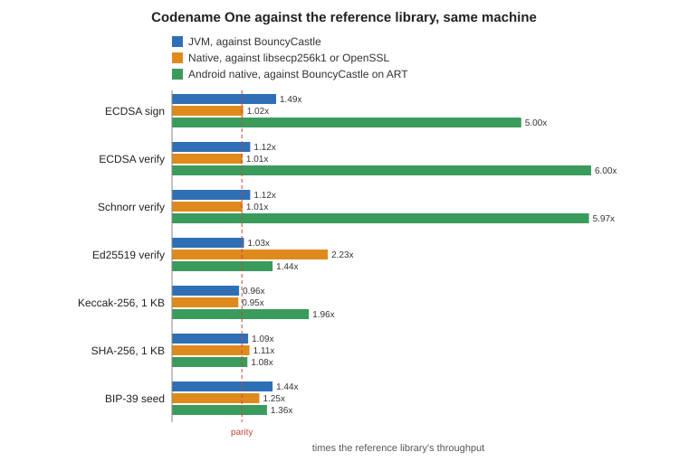
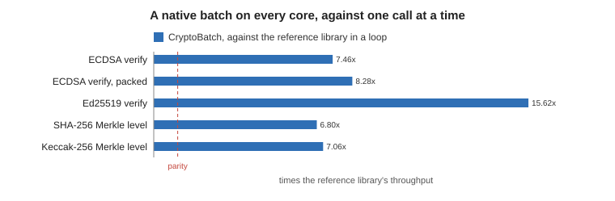
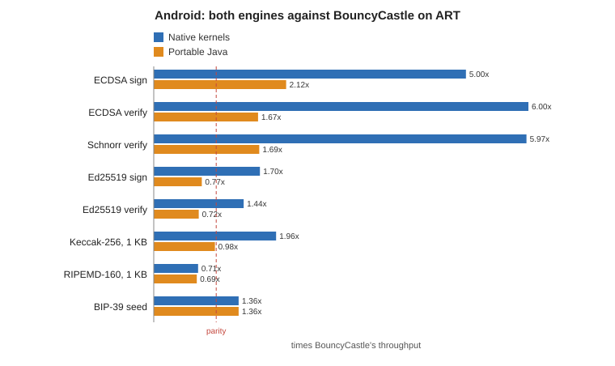
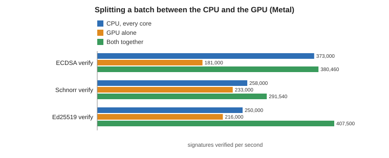
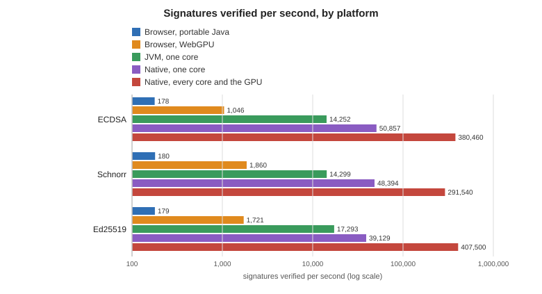

[[crypto-wallets]]
== Crypto wallets

The `com.codename1.crypto` packages hold everything a wallet, an exchange or a payment backend needs to work with Ethereum and the other EVM chains, Bitcoin, and Solana. That covers recovery phrases and key derivation, addresses, transactions, signing, the node APIs that broadcast transactions and read balances, and price feeds. There are no third-party libraries to add, and the same classes run in the app and in a Codename One backend.

The heavy parts run as native code wherever the platform allows it: secp256k1, Schnorr, Ed25519, the hashes and the PBKDF2 behind a recovery phrase. Elsewhere they fall back to an optimized pure-Java engine. A benchmark in CI compares every kernel against libsecp256k1, libsodium, OpenSSL and BouncyCastle on the same machine, and fails a pull request whose crypto changes fall behind.

The packages, from the bottom up:

[cols="1,3",options="header"]
|===
| Package | What it holds
| `crypto.encoding` | Hex, Base58 and Base58Check, Bech32 and Bech32m, RLP, Base64
| `crypto.hd` | BIP-39 recovery phrases (`Mnemonic`), BIP-32 and SLIP-10 key derivation, `DerivationPath`
| `crypto.evm` | `EvmAddress` (EIP-55), legacy, EIP-2930 and EIP-1559 transactions, EIP-191 and EIP-712 signing, the Solidity ABI
| `crypto.bitcoin` | P2PKH, P2SH, P2WPKH, P2WSH and Taproot addresses, scripts, transactions, PSBT, WIF
| `crypto.solana` | Addresses and program-derived addresses, legacy and v0 messages, transactions, System, Token and Compute Budget instructions
| `crypto.wallet` | The `Signer` interface, `SeedSigner`, `VaultSigner`, and the `Wallet` entry point
| `crypto.rpc` | JSON-RPC for EVM nodes, Esplora for Bitcoin, Solana JSON-RPC
| `crypto.market` | `PriceFeed`, CoinGecko, any JSON price API, and a caching decorator
|===

=== The building blocks

A handful of algorithms do all the work underneath, and the names come up throughout this chapter and in every chain's documentation. You never call most of them directly, but knowing what each one is for makes the rest easier to follow, and it explains why their speed matters.

*Elliptic curves and signatures.* A private key is a large random number. The public key is a point on an elliptic curve, computed from it in a way that's easy forward and infeasible to reverse. A signature proves that the holder of the private key approved a message, and anyone with the public key can check it.

* *secp256k1* is the curve Bitcoin and Ethereum use. *ECDSA* is the signature scheme they sign transactions with. Ethereum also recovers the sender's public key from a signature, which is why an Ethereum transaction carries no sender address.
* *Schnorr* signatures (BIP-340) are the newer scheme on the same curve, used by Bitcoin's Taproot addresses. They're simpler than ECDSA and can be combined, which is what makes multi-party Taproot spends compact.
* *Ed25519* is a signature scheme on a different curve, Curve25519. Solana uses it, as do many protocols outside crypto currency. It was designed to be fast and hard to implement wrongly.

Verifying is the expensive direction. A wallet signs a handful of transactions, but a node, an exchange or an indexer verifies every signature it receives, which is where batches and the GPU come in.

*Hash functions.* A hash turns any input into a short fixed-size fingerprint. Changing one bit of the input changes the whole fingerprint, and nobody can find two inputs with the same one.

* *SHA-256* is Bitcoin's hash: transaction IDs, block headers and the Merkle trees that commit to a block's transactions. Bitcoin addresses take *RIPEMD-160* of the SHA-256 of the public key, which gives a shorter 20-byte fingerprint.
* *Keccak-256* is Ethereum's hash: addresses, transaction hashes, the selectors of contract functions and the keys of contract storage. It's the algorithm that became SHA-3, but with the original padding, so a SHA-3 library gives different answers.
* *SHA-512* and *HMAC-SHA512* (a keyed hash) are what key derivation is built on.

A *Merkle tree* hashes a list of items in pairs, then hashes the pairs, until one root remains. Changing any item changes the root, so a block header commits to all its transactions in 32 bytes. Building a level of one is a batch of independent hashes, which is what the Merkle rows in the benchmarks measure.

*From a recovery phrase to keys.* *BIP-39* turns random bytes into a phrase of 12 or 24 words and back. It stretches the phrase into a 64-byte seed with *PBKDF2*, which runs HMAC-SHA512 2,048 times on purpose, so that guessing phrases is slow for an attacker. It's also the one step a user waits for when they restore a wallet. *BIP-32* derives a tree of keys from that seed, so one phrase yields every account on every chain, and *SLIP-10* does the same for Ed25519. A *derivation path* such as `m/44'/60'/0'/0/0` names one key in the tree.

*Engines, kernels, and batches.* The public classes are plain Java and the same everywhere. Underneath, a *crypto engine* supplies the compute-heavy *kernels*, which are the signature and hash operations above. On iOS, macOS, Android, Windows, Linux and a production backend the engine is native C, which uses the processor's vector and hash instructions where it has them. On the JVM and in the browser it's an optimized pure-Java engine. A *batch* hands many independent operations to the engine at once, so it can spread them across every CPU core and, for large batches, the GPU.

=== From a recovery phrase to a wallet

A wallet starts as a recovery phrase. Every key on every chain is derived from it, so the phrase is the only thing a user ever needs to back up.

[source,java]
----
include::../demos/common/src/main/java/com/codenameone/developerguide/snippets/CryptoWalletSnippets.java[tag=crypto-mnemonic,indent=0]
----

`Mnemonic.isValid` checks the words against the English list and verifies the checksum the last word carries, so a typo is caught before it turns into an empty wallet with a different address.

`Wallet` answers addresses on the paths other wallets use. A phrase restored here shows the same accounts it shows in MetaMask, Electrum, Sparrow or Phantom:

[source,java]
----
include::../demos/common/src/main/java/com/codenameone/developerguide/snippets/CryptoWalletSnippets.java[tag=crypto-addresses,indent=0]
----

For Bitcoin, the purpose picks the address type: `Wallet.BIP44` for legacy `1...` addresses, `BIP49` for P2SH-wrapped SegWit, `BIP84` for native SegWit `bc1q...` and `BIP86` for Taproot `bc1p...`. The same network object also selects testnet, signet, or regtest.

=== Sending a transaction

The pattern is the same on every chain. You read what the transaction needs from a node, build it, sign it on the device, and hand the signed bytes back to the node. Private keys never leave the `Signer`.

The node clients are blocking calls over an `RpcTransport`. In the app that's `NetworkTransport`, which goes through the `NetworkManager` queue and keeps the UI responsive when called from the EDT. In a backend, `com.codename1.backend.WebRpcTransport` does the same over the backend's HTTP client. A provider's API key goes in a header: `new NetworkTransport().header("Authorization", "Bearer ...")`.

==== Ethereum and EVM chains

[source,java]
----
include::../demos/common/src/main/java/com/codenameone/developerguide/snippets/CryptoWalletSnippets.java[tag=crypto-evm-send,indent=0]
----

Amounts are `UInt256`, an exact unsigned 256-bit integer, so wei never passes through a `double`. `parseUnits("0.01", 18)` and `formatUnits(18)` convert to and from the decimal amount a person reads. `suggestFees` sets the fee cap at twice the next base fee plus the tip, which stays valid through several full blocks. The chain ID comes from the node and goes into the signature, so a transaction signed for one chain can't be replayed on another.

Token transfers, contract calls and EIP-712 typed data use the same flow. Look at `Erc20`, `Abi` and `TypedData` in `crypto.evm`, and at `Wallet.signTypedData` and `Wallet.personalSign` for sign-in messages.

==== Bitcoin

A Bitcoin transaction spends earlier outputs ("coins") rather than debiting a balance, and a signer has to know the value of each coin it signs for. A PSBT (BIP-174) carries that information, and it's also the format hardware wallets and multisig co-signers exchange:

[source,java]
----
include::../demos/common/src/main/java/com/codenameone/developerguide/snippets/CryptoWalletSnippets.java[tag=crypto-btc-send,indent=0]
----

`EsploraClient` speaks the REST API of mempool.space and Blockstream, or of your own Esplora server. `getFeeEstimates` returns sats per virtual byte by confirmation target. Multiply that by the size of the transaction to get `feeSats`. Every output the snippet doesn't spend is paid as a fee, so a real wallet adds a change output back to one of its own addresses.

`Wallet.signPsbt(psbt)` signs any input whose BIP-32 origin matches the wallet's own fingerprint. That lets a PSBT built elsewhere, by a coordinator or a watch-only wallet, be signed without being told which keys to use. Taproot inputs are signed with BIP-340 Schnorr signatures automatically.

==== Solana

[source,java]
----
include::../demos/common/src/main/java/com/codenameone/developerguide/snippets/CryptoWalletSnippets.java[tag=crypto-sol-send,indent=0]
----

Amounts are in lamports (a billionth of a SOL). A blockhash expires after about a minute, so fetch it right before signing. `TokenProgram` builds SPL token transfers, and `SolanaAddress.associatedTokenAddress` finds the account a token is held in. `ComputeBudget.setComputeUnitPrice` adds a priority fee when the network is busy.

=== Prices

`PriceFeed` answers one question: the price of one asset in another. `CoinGeckoFeed` works without a key at the public rate limit, and takes a demo or pro key for more. `JsonPriceFeed` turns any JSON price API into a feed from a URL template and the path to the price. Wrap either in `CachingPriceFeed`, so a screen that prices twenty balances makes one request:

[source,java]
----
include::../demos/common/src/main/java/com/codenameone/developerguide/snippets/CryptoWalletSnippets.java[tag=crypto-price,indent=0]
----

A cached quote stays fresh for the first window. After that it's still returned when a refresh fails, until the second window ends. That keeps a balance screen useful through a brief outage without showing a price that's hours old.

=== Verifying many signatures at once

A backend that scans a block for deposits, or an indexer that checks every transaction it stores, verifies thousands of signatures at a time. `CryptoBatch` takes them as arrays and answers one `boolean` per entry:

[source,java]
----
include::../demos/common/src/main/java/com/codenameone/developerguide/snippets/CryptoWalletSnippets.java[tag=crypto-batch,indent=0]
----

With native kernels the whole batch crosses into native code once and runs on every CPU core, which makes it several times faster than the same calls in a loop. `verifySchnorr`, `verifyEd25519`, `sha256` and `keccak256` work the same way. Every entry gets exactly the answer a single call would give, and a malformed entry, such as a key that doesn't parse, is invalid rather than an exception, so one bad entry never stops the rest.

For the largest batches, every method also has a packed form that takes flat arrays at a fixed stride: 32-byte hashes one after another, 64-byte signatures one after another, and the public keys likewise, with one result byte per entry. On a native target the kernels read those arrays in place, so nothing is copied and no object is created per entry. Allocate them with `Simd.get().allocByte(int)` and they're also aligned for the vector units:

[source,java]
----
include::../demos/common/src/main/java/com/codenameone/developerguide/snippets/CryptoWalletSnippets.java[tag=crypto-batch-packed,indent=0]
----

On iOS, macOS, Android, Windows and Linux, a large enough batch is shared between the CPU cores and the GPU, through Metal on Apple platforms and Vulkan elsewhere. The split follows the measured speed of each: the CPU and the GPU work on their parts at the same time, and a device whose GPU is slower than its CPU keeps the whole batch on the CPU. In a browser the GPU is reached through WebGPU, with the same kernels. The GPU only ever sees public data, meaning signatures, public keys and messages, and never a private key. Your code doesn't change, and the results are the same either way.

==== Asynchronous batches

Every `CryptoBatch` method has an asynchronous form with `Async` added to its name. It takes the same arguments plus a `CryptoBatch.Callback`, returns at once, and runs the batch on a background thread:

[source,java]
----
include::../demos/common/src/main/java/com/codenameone/developerguide/snippets/CryptoWalletSnippets.java[tag=crypto-batch-async,indent=0]
----

In the app the callback runs on the EDT, so it can update the UI directly. In a backend it runs on the thread that did the work. The arguments are checked before the call returns, so a malformed batch, such as arrays of different lengths, throws right away instead of reaching the callback. The callback gets exactly what the synchronous form would have returned, or the exception it would have thrown. A packed form hands back the results array you passed in. The batch reads your arrays directly rather than copying them, so until the callback runs they belong to the batch: change one before then and you change what's being verified.

In a browser, use the asynchronous forms. A large batch there goes to the GPU through WebGPU, which answers only asynchronously. The synchronous form still works, but it holds the calling thread until the GPU is done, and on the EDT that means the UI waits too. When the browser has no WebGPU adapter, both forms run on the CPU. The GPU kernels are about 460 KB of JavaScript, and they're included only in apps that call `CryptoBatch`, loaded the first time a batch is large enough to use them.

=== Performance

Every operation is benchmarked against the library a project would otherwise use for it, in the same process run, on the same machine. The figures below are ratios: 2.00x means Codename One did twice the work of the reference library in the same time, and anything above 1.00x is faster. Ratios stay steady from one machine to the next where absolute speeds don't, so they're also what CI checks. A run fails when any ratio drops below the floor recorded for it in `scripts/crypto-bench/floors.json`.

These numbers come from an Apple M4 Max (12 performance cores, 40-core GPU), and the Android ones from an arm64 API 36 emulator on the same machine.

==== On the JVM

The simulator, JavaSE desktop apps and the backend in development run the portable Java implementation. It's compared with BouncyCastle 1.84 and, for Ed25519, with the JDK's own provider, on JDK 25. CI runs the same benchmark on JDK 17.

[cols="3,2,2,1",options="header"]
|===
| Operation | Codename One (ops/s) | Reference (ops/s) | Ratio
| secp256k1 public key | 30,583 | 17,391 | 1.76x
| ECDSA sign | 24,109 | 16,220 | 1.49x
| ECDSA verify | 14,252 | 12,748 | 1.12x
| Schnorr sign | 15,297 | 16,051 | 0.95x
| Schnorr verify | 14,299 | 12,816 | 1.12x
| Ed25519 sign | 49,360 | 45,707 | 1.08x
| Ed25519 verify | 17,293 | 16,865 | 1.03x
| Ed25519 sign, against the JDK | 49,946 | 2,484 | 20.10x
| Ed25519 verify, against the JDK | 7,599 | 2,469 | 3.08x
| Keccak-256, 1 KB | 484,694 | 503,524 | 0.96x
| SHA-256, 1 KB | 238,253 | 218,499 | 1.09x
| SHA-512, 1 KB | 339,664 | 297,983 | 1.14x
| RIPEMD-160, 1 KB | 139,370 | 96,919 | 1.44x
| HMAC-SHA512 (a BIP-32 step) | 679,117 | 473,458 | 1.43x
| BIP-39 seed (PBKDF2, 2048 rounds) | 802 | 558 | 1.44x
|===

Ed25519 verification rewrites its check with two scalars of half the length, found by a lattice reduction, so the multiplication needs half the doublings. The rewrite gives exactly the answer of the direct check for every input, including keys with a small-order component. On x86-64 the field multiplication also takes a Karatsuba split, which needs 75 products instead of 100. arm64 has the registers to keep the direct form faster, so each architecture gets the form that's faster on it. The CI runners are x86-64, and they're held to the same floors.

==== Native targets

On iOS, macOS, Windows, Linux and the production backend the same operations run as C, compared with Bitcoin Core's libsecp256k1 for the secp256k1 curve and OpenSSL 3.6 for everything else, both built with the same compiler and flags.

[cols="3,2,2,1",options="header"]
|===
| Operation | Codename One (ops/s) | Reference (ops/s) | Ratio
| secp256k1 public key | 95,819 | 93,050 | 1.03x
| ECDSA sign | 60,770 | 59,453 | 1.02x
| ECDSA verify | 50,857 | 50,302 | 1.01x
| Schnorr sign | 46,180 | 44,659 | 1.03x
| Schnorr verify | 48,394 | 47,835 | 1.01x
| Ed25519 sign | 105,161 | 43,155 | 2.44x
| Ed25519 verify | 39,129 | 17,521 | 2.23x
| Keccak-256, 1 KB | 614,062 | 647,427 | 0.95x
| SHA-256, 1 KB | 1,675,236 | 1,507,576 | 1.11x
| SHA-512, 1 KB | 1,055,920 | 834,025 | 1.27x
| RIPEMD-160, 1 KB | 429,239 | 318,439 | 1.35x
| HMAC-SHA512 (a BIP-32 step) | 2,174,970 | 889,725 | 2.44x
| BIP-39 seed (PBKDF2, 2048 rounds) | 2,105 | 1,679 | 1.25x
|===

A batch runs on every core, so it's measured against the reference library verifying the same entries one at a time, which is what an application without `CryptoBatch` would do. The figures are batches of 1,024 signatures, or Merkle levels of 4,096 nodes, per second:

[cols="3,2,2,1",options="header"]
|===
| Batch | Codename One | Reference, one at a time | Ratio
| ECDSA verify | 333 | 45 | 7.46x
| ECDSA verify, packed | 374 | 45 | 8.28x
| Ed25519 verify | 261 | 17 | 15.62x
| SHA-256 Merkle level | 7,164 | 1,053 | 6.80x
| Keccak-256 Merkle level | 5,613 | 796 | 7.06x
|===

==== Android

Android has no curve secp256k1 in its platform, so apps there would otherwise ship BouncyCastle. The table shows both the native kernels and the portable Java implementation, each against BouncyCastle on the same device. The two engines ran separately, each beside its own BouncyCastle run, so each ratio is against the BouncyCastle figure from its own run; the column shows the one from the native run, and the two agree to within 4%.

[cols="3,2,2,2",options="header"]
|===
| Operation | Native kernels | Portable Java | BouncyCastle on ART
| secp256k1 public key | 116,210 (8.44x) | 45,203 (3.40x) | 13,770
| ECDSA sign | 71,125 (5.00x) | 31,338 (2.12x) | 14,232
| ECDSA verify | 59,615 (6.00x) | 16,757 (1.67x) | 9,940
| Schnorr verify | 60,243 (5.97x) | 17,163 (1.69x) | 10,094
| Ed25519 sign | 117,185 (1.70x) | 53,194 (0.77x) | 69,038
| Ed25519 verify | 39,721 (1.44x) | 19,633 (0.72x) | 27,571
| Keccak-256, 1 KB | 762,149 (1.96x) | 384,908 (0.98x) | 388,709
| SHA-256, 1 KB | 292,535 (1.08x) | 287,546 (1.08x) | 270,445
| RIPEMD-160, 1 KB | 214,766 (0.71x) | 205,703 (0.69x) | 304,410
| BIP-39 seed | 1,037 (1.36x) | 1,033 (1.36x) | 761
|===

SHA-256 and the BIP-39 seed go through the platform's own native implementation in both columns, which is why they match. With the native kernels, RIPEMD-160 is the one row where BouncyCastle stays ahead; it's hashed once per Bitcoin address, so it's never the bottleneck. The portable Java column trails BouncyCastle on Ed25519 and RIPEMD-160 and matches it on Keccak-256.

==== The GPU

A GPU verifies signatures in parallel by the thousand, but each entry first needs some preparation on the CPU, and the GPU's work has to be dispatched and collected. A batch is therefore split, with the CPU cores and the GPU each taking a share in proportion to their measured speed, and a batch smaller than the crossover stays on the CPU. With Metal on the M4 Max:

[cols="2,2,2,2,2",options="header"]
|===
| Kernel | CPU, every core | GPU alone | Both together | Crossover
| ECDSA verify | 373,000/s | 181,000/s | 1.02x the CPU alone | 784 entries
| Schnorr verify | 258,000/s | 233,000/s | 1.13x | 539 entries
| Ed25519 verify | 250,000/s | 216,000/s | 1.63x | 552 entries
| Keccak-256 | 7.1 GB/s | 3.6 GB/s | 1.01x | 3 MB
|===

The chart shows the signature rows; Keccak-256 is measured in bytes rather than signatures, so it appears only in the table.

On this machine the gain is modest, because sixteen CPU cores with vector units are already fast. The split is worked out from the speeds measured on each device, so a GPU that's strong relative to its CPU takes a larger share, and one that's slower takes none. SHA-256 has no GPU row: in this run no SHA-256 batch reached the GPU's minimum size, so they all ran on the CPU.

==== In the browser

The JavaScript port runs the portable Java implementation, translated to JavaScript. Large batches go to the GPU through WebGPU and arrive through the asynchronous forms. In headless Chromium on the same machine, with batches of 4,096 signatures:

[cols="3,2,2,1",options="header"]
|===
| Batch | WebGPU | Portable Java | Ratio
| ECDSA verify | 2,174/s | 255/s | 8.5x
| Schnorr verify | 2,698/s | 258/s | 10.5x
| Ed25519 verify | 2,070/s | 240/s | 8.6x
| SHA-256 | 28.3 MB/s | 8.1 MB/s | 3.5x
| Keccak-256 | 174.8 MB/s | 1.9 MB/s | 92x
|===

In the browser most of the time a WebGPU batch takes is the preparation in JavaScript, not the GPU work, and the browser's figures move more from run to run than the native ones: across three runs SHA-256 on WebGPU ranged from 4 to 34 MB/s, and in the slowest it trailed the CPU. The answers never differed: the first run compared a sample of the signatures, and the later runs compared every entry and every hash. Given records prepared in advance, the kernels alone verified about 164,000 ECDSA, 119,000 Schnorr and 146,000 Ed25519 signatures a second there.

The chart puts the ways a signature can be verified side by side, on a logarithmic scale. They don't measure the same thing: the browser bars are batches on one JavaScript thread, the JVM and native bars are one signature at a time on one core, and the last bar is a native batch across every core and the GPU. Read it as what each setup delivers, not as one benchmark run across platforms.

==== Running the benchmarks

The harnesses are in `scripts/crypto-bench` and `scripts/crypto-gpu` of the Codename One repository:

[source,bash]
----
include::../demos/common/src/main/snippets/developer-guide/crypto-wallets.sh[tag=crypto-wallets-bash-001,indent=0]
----

Each prints the compiler, JDK and reference library versions above its numbers. `scripts/crypto-bench/charts.py` draws the two charts above from the saved results.

=== Where the keys live

Whoever holds the recovery phrase holds the funds. Decide where it lives before you write the first screen.

*On the device, in a vault.* `VaultSigner` keeps the phrase sealed in a vault (see "Vaults: One password, every device" in the security chapter) and opens it only while the vault is unlocked, by biometrics or the vault password. It works anywhere `Wallet` expects a signer:

[source,java]
----
include::../demos/common/src/main/java/com/codenameone/developerguide/snippets/CryptoWalletSnippets.java[tag=crypto-vault,indent=0]
----

This is the model for a self-custody wallet. A lost device loses nothing as long as the user kept the phrase, and `revealMnemonic` shows it again for a backup. A signer whose vault is locked throws rather than signing, so a stolen, locked phone can't move funds.

*On a server, behind your own controls.* An exchange or a custodial app derives its deposit addresses and signs its withdrawals in the backend, where the same classes run. Keep the phrase out of the database and the source tree: load it from a secret store or an HSM at startup, and keep withdrawals behind an approval step. The Bastion sample does exactly this. Its implementor's guide walks through hot and deposit wallets, confirmation depth and reorg handling.

`SeedSigner` holds the derived master key in memory. Call `destroy()` when you're done with it, and the key bytes are overwritten. Strings can't be wiped, which is why `VaultSigner.revealMnemonic` answers a `char[]`.
