[[dash-implementors-guide]]
== Dash: Making the runner your own

Dash shares the module layout, the accounts and sign-in, push notifications and the
operations console with <<skirmish-implementors-guide,Skirmish>>. What it adds is a
different kind of game: an endless runner whose levels are data, whose camera can
start side on and swing into 3D halfway down the track, whose leaderboards hold only
runs the server played again, and whose races put friends on the same track at the
same moment with their voices in each other's ears. This chapter shows where each of
those lives and what to change to make the game yours.

[[dash-launch]]
=== Running it

The project is in `scripts/dash`, and the Initializr generates it under your own
package and name. Start the server on the development profile, which keeps its
database in memory, seeds the demo accounts and simulates purchases and push
notifications:

[source,bash]
----
include::../demos/common/src/main/snippets/developer-guide/dash.sh[tag=dash-sh-server,indent=0]
----

Then run the app in the simulator:

[source,bash]
----
include::../demos/common/src/main/snippets/developer-guide/dash.sh[tag=dash-sh-simulator,indent=0]
----

The demo accounts are `player@`, `rival@`, `trouble@` and `admin@dash.example`, each
with the password `dash-demo`. For the native iOS app, generate the Xcode project on a
Mac and open it:

[source,bash]
----
include::../demos/common/src/main/snippets/developer-guide/dash.sh[tag=dash-sh-ios,indent=0]
----

The tests run in three layers: the rules on their own, the server with whole races
over its rooms, and the app in the simulator against a real server:

[source,bash]
----
include::../demos/common/src/main/snippets/developer-guide/dash.sh[tag=dash-sh-tests,indent=0]
----

[[dash-what-it-does]]
=== What the sample does

A new player is taken straight into *First Steps*, a short level in which a coach
introduces one move at a time: jump the hurdle, slide under the barrier, change lanes
around the hauler. Swipes, taps and the keyboard (arrows, WASD and space) all drive
the same four inputs.

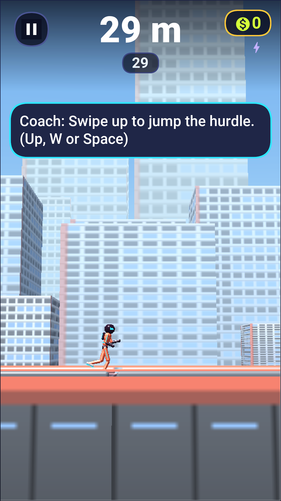

The home screen leads to the *Levels*. Each official level shows its stars and has
three buttons: *Run* plays this week's track for it, *Race the best* runs it against
the ghost of the week's best run, and *Scores* opens its boards -- all time, this
week, today, friends, and one per crew. Any row on a board opens that run's replay,
with a scrubber, a pause, speeds, and a choice of whom the camera follows.

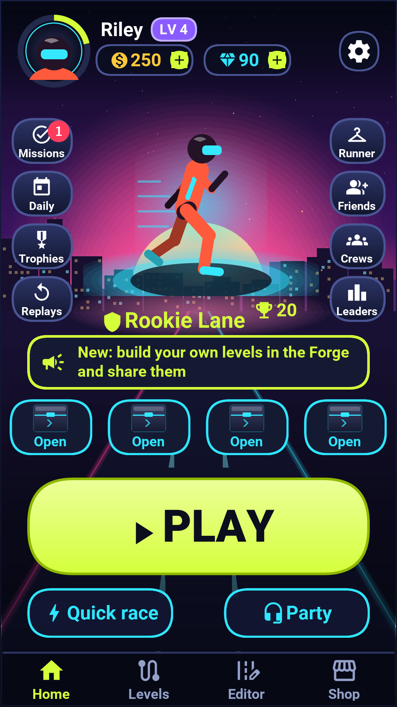
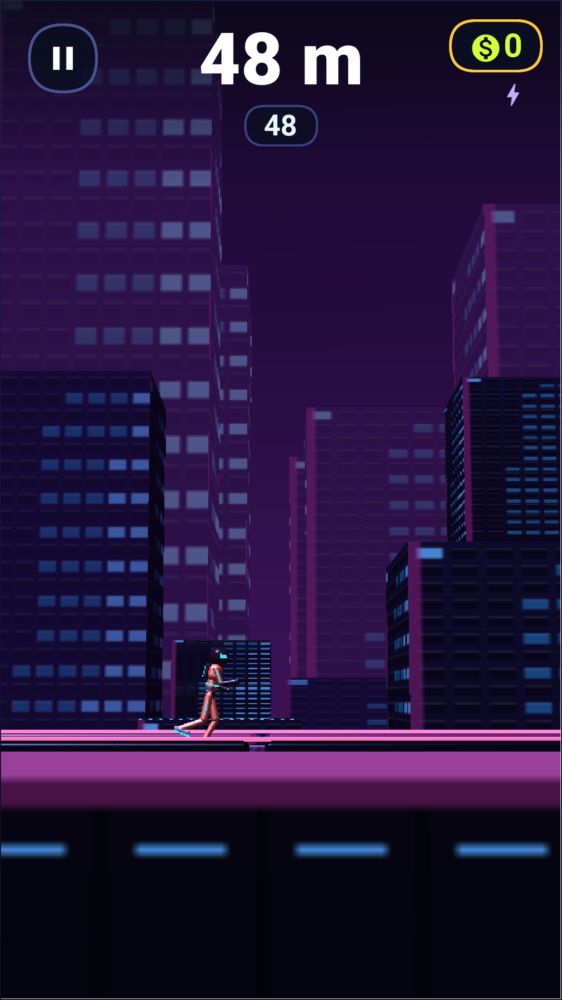
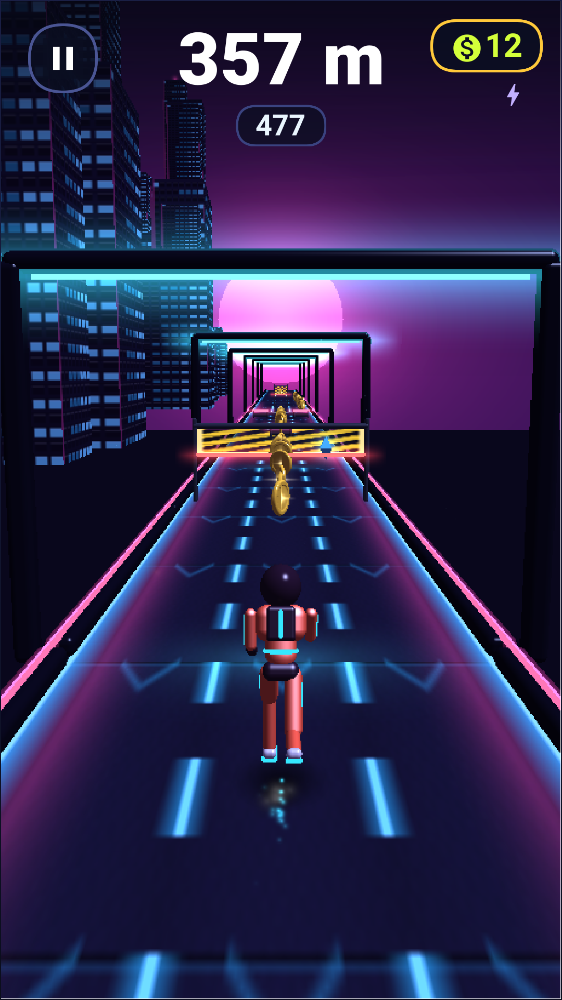
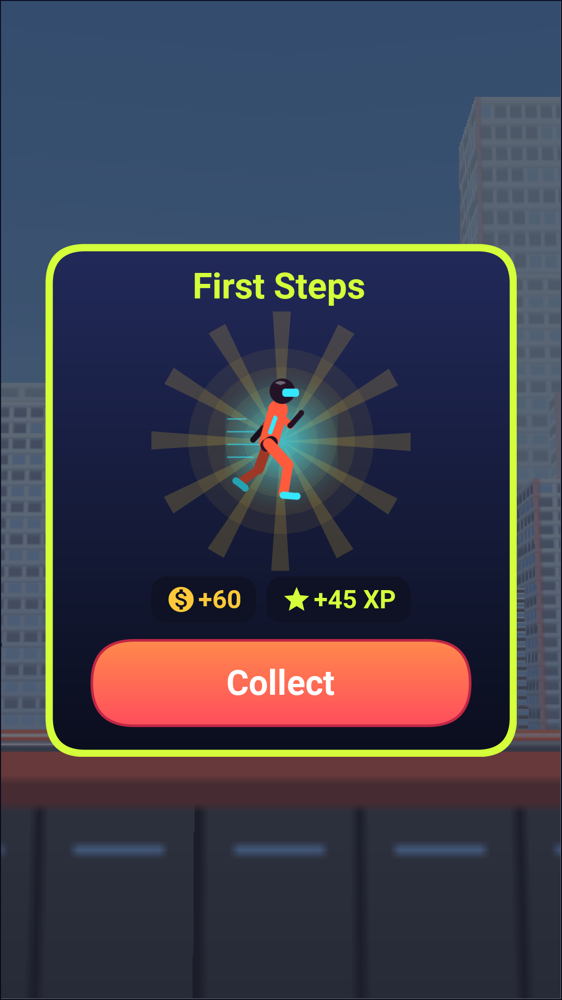
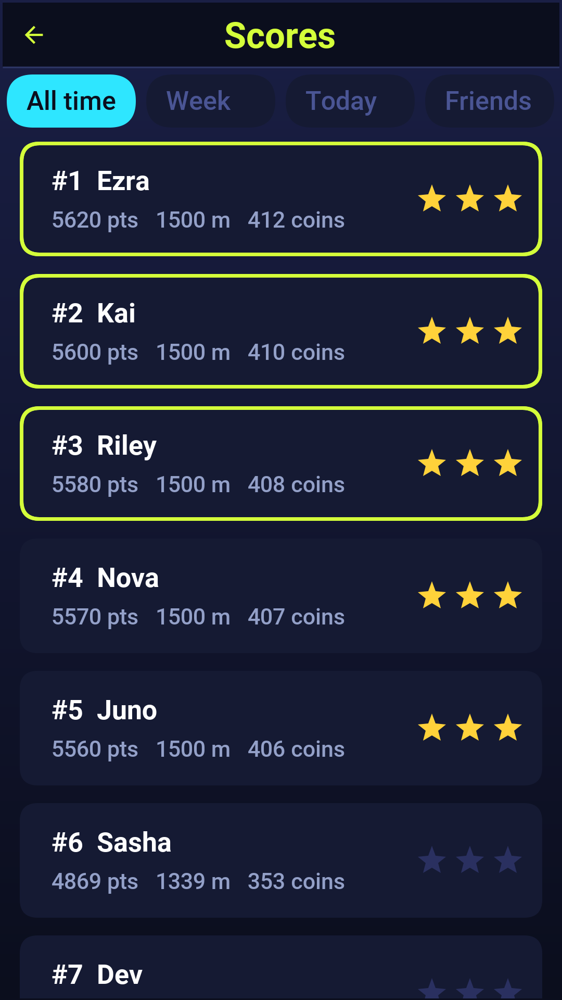

*Quick race* drops the player into a race with whoever is waiting for that level, and
fills the empty lanes with bots after a few seconds. *Race friends* opens a party with
a code and a link to share. Everyone in a party can talk: the microphone button
connects each pair of players directly, and a muted player shows as muted to the
rest. When the host starts, every phone runs the same seed in lockstep, the other
runners appear in their own lanes, and the result screen ranks the places and pays
out trophies and coins. The *Daily dash* is one endless track a day, the same for
everyone, with its own board.

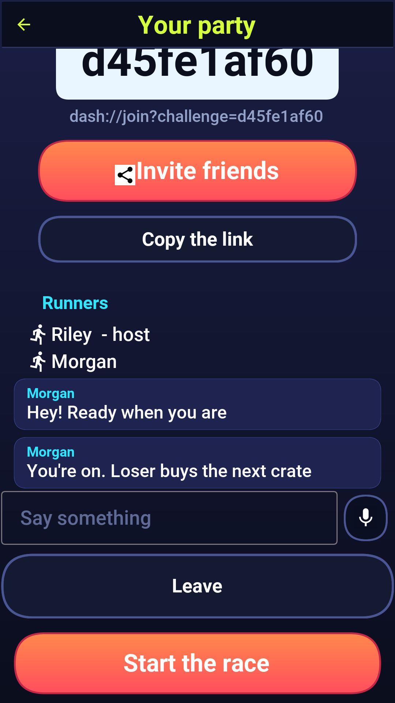
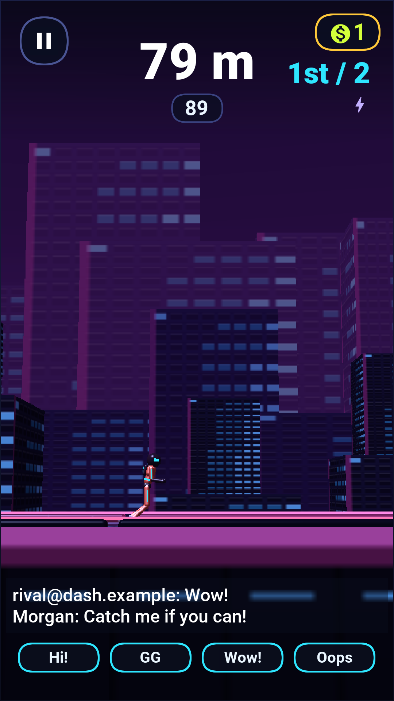

*Track editor* is where players make levels. A pack holds levels and the pieces they
use, and is published for others to play, rate, race and remix. Every level in a pack
has its own board.

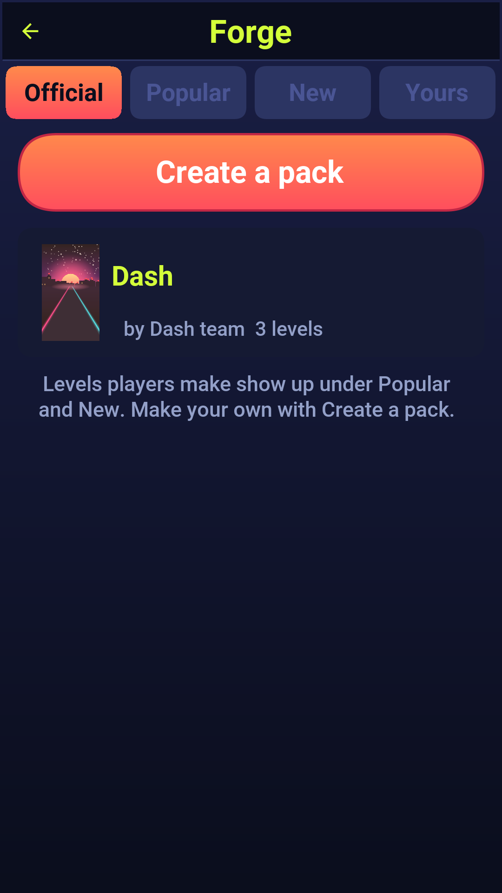
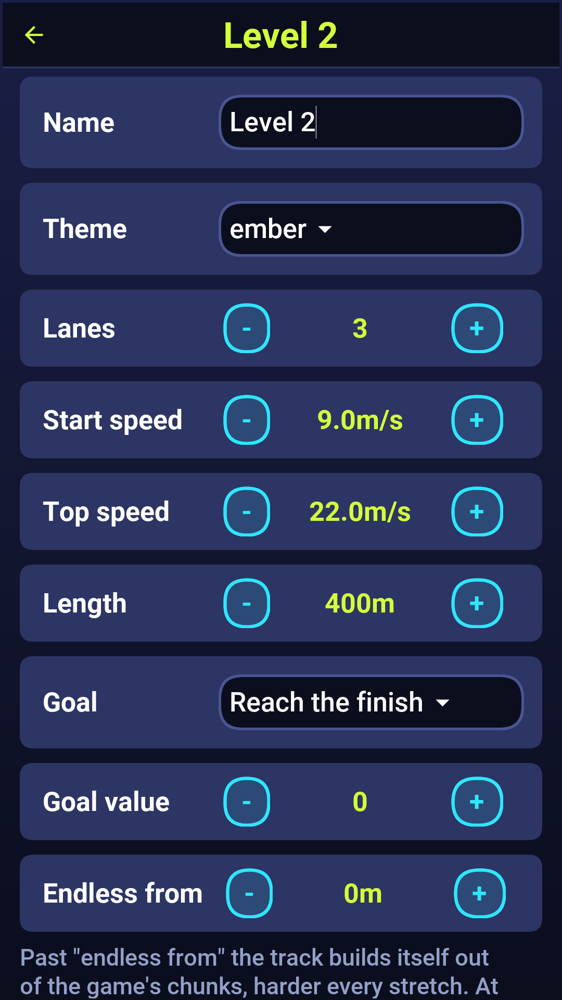
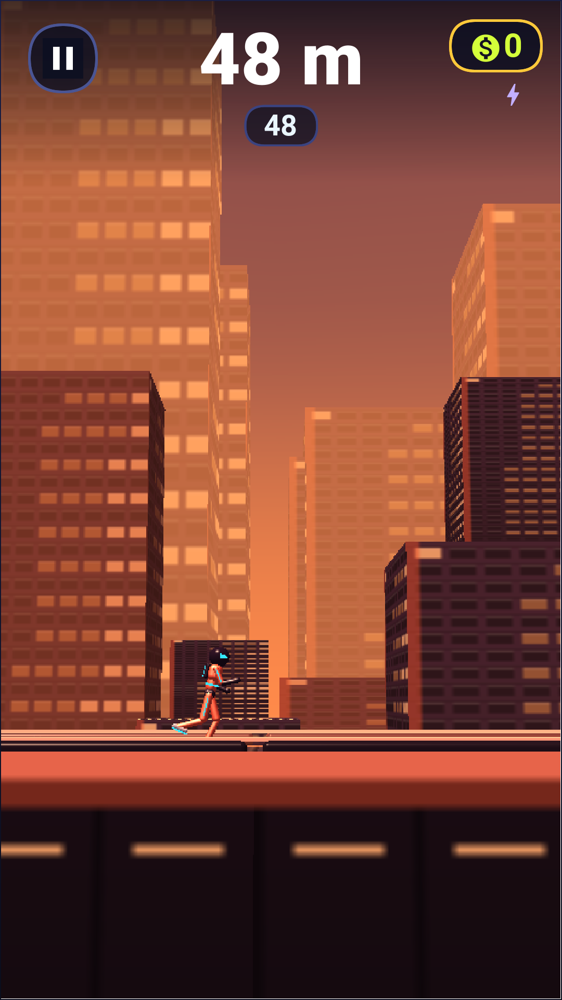

The rest -- crews, friends and invitations, the shop, trophies, the runner choice and
the settings -- is the same kind of screen as the rest of the app, styled by one CSS
file.

[[dash-modules]]
=== The modules

[cols="1,3"]
|===
| Module | What it holds

| `rules` | The deterministic simulation: tracks, runners, obstacles, pickups, camera
  cues, the bot, replays and level packs. No floating point, no clock, no
  `java.util.Random`.
| `shared` | The data transfer objects and `@RestClient` interfaces.
| `common` | The app: the 3D track, the menus, the track editor, the race lobby and
  voice, the store, the admin console.
| `backend` | The server: accounts, re-simulated scores and leaderboards, the
  lockstep race rooms, level packs and moderation, progression, receipts, push.
|===

[[dash-rules]]
=== One simulation, two cameras

A level is a `LevelDef`: a number of lanes, a speed curve, a length or a goal, the
obstacles and pickups placed along it, a procedural tail built from chunks that get
harder with distance, the coach's lines, and *camera cues*. Here is the official level
that starts as a side-scroller and becomes a 3D runner:

[source,java]
----
include::../../scripts/dash/rules/src/main/java/com/codenameone/examples/dash/rules/Content.java[tag=dash-causeway,indent=0]
----

The cues never reach the simulation. A runner always has a lane, a height and a
distance, and a hurdle is cleared the same way whether the player sees it from the
side or from behind. The camera is the renderer's business: `RunView` reads the cue
under the runner, eases between the two framings, and leaves the rules alone. Because
of that, a level can change its view anywhere without changing who wins.

[source,java]
----
include::../../scripts/dash/common/src/main/java/com/codenameone/examples/dash/run/RunView.java[tag=dash-camera-blend,indent=0]
----

The view runs the rules on a fixed tick of 60 per second, whatever the frame rate,
and draws between ticks by interpolating. A slow phone drops frames, never ticks, so
the run stays the same run:

[source,java]
----
include::../../scripts/dash/common/src/main/java/com/codenameone/examples/dash/run/RunView.java[tag=dash-fixed-tick,indent=0]
----

Gestures and keys become the four input bits in one place, and the same bits reach
every kind of run -- solo, race, replay and playtest -- through a `Driver`:

[source,java]
----
include::../../scripts/dash/common/src/main/java/com/codenameone/examples/dash/run/RunView.java[tag=dash-controls,indent=0]
----

[[dash-referee]]
=== The server is the referee

A run is never reported as a number. When it ends, the app sends the seed and the
input log -- a few hundred bytes for a long run -- and the server builds the same
level, plays the log through the same rules, and reads the score off its own
simulation. A score that was typed in, or a log edited to dodge an obstacle the
player hit, simply doesn't reproduce:

[source,java]
----
include::../../scripts/dash/backend/src/main/java/com/codenameone/examples/dash/forge/Forge.java[tag=dash-forge-result,indent=0]
----

The verified run is then entered on every board it qualifies for. The endless
stretch of a level is built from the seed, so no board takes a seed the app picked
for itself: `all` takes only the seeds the server hands out, and `week` and `day`
count only the board's own seed, so everyone is running the same track there:

[source,java]
----
include::../../scripts/dash/backend/src/main/java/com/codenameone/examples/dash/forge/Scores.java[tag=dash-scores,indent=0]
----

A better score on the `all` board tells the friends whose best it just passed, and
only them, with a push that opens that level's board:

[source,java]
----
include::../../scripts/dash/backend/src/main/java/com/codenameone/examples/dash/forge/Scores.java[tag=dash-beaten-push,indent=0]
----

[[dash-races]]
=== Races in lockstep

A race is run by the server in rooms. Every phone sends its inputs as they happen;
the room collects them per tick, steps its own copy of the run, and broadcasts each
tick's inputs to every seat. A phone only advances when it has the server's tick, so
they all see the same race, and the server's copy is the one that decides the
places:

[source,java]
----
include::../../scripts/dash/backend/src/main/java/com/codenameone/examples/dash/game/RaceRoom.java[tag=dash-race-room,indent=0]
----

On the phone, `RaceDriver` is the other half. It also sends a hash of its state every
second. A phone whose hash disagrees with the server's is sent the race's log to catch
up, and one that keeps disagreeing is flagged for a moderator -- a modified client
can't stay in a race unnoticed:

[source,java]
----
include::../../scripts/dash/common/src/main/java/com/codenameone/examples/dash/run/RaceDriver.java[tag=dash-lockstep,indent=0]
----

Voice is peer to peer. The game's own socket carries the offers, answers and ICE
candidates, and Codename One's WebRTC API connects each pair of players in the party
directly; the server never carries audio:

[source,java]
----
include::../../scripts/dash/common/src/main/java/com/codenameone/examples/dash/run/Voice.java[tag=dash-voice,indent=0]
----

A mesh suits a party of four. For larger groups, put a media server (an SFU) behind
the same signalling messages; the client code above doesn't change.

[[dash-editor]]
=== The track editor

The editor draws the level as a strip: distance runs left to right, one row per lane,
an all-lanes row on top, and the camera cues as flags along the bottom. Tapping a cell
puts the selected piece there:

[source,java]
----
include::../../scripts/dash/common/src/main/java/com/codenameone/examples/dash/forge/TrackTimeline.java[tag=dash-timeline,indent=0]
----

The palette is every piece the pack can place -- the game's own and the pack's custom
obstacles and pickups -- plus one tool per camera mode and an eraser:

[source,java]
----
include::../../scripts/dash/common/src/main/java/com/codenameone/examples/dash/forge/LevelEditor.java[tag=dash-level-palette,indent=0]
----

*Playtest* runs the draft as a player would, on the same rules, and is never
submitted. Publishing runs the validator the server runs too, and that includes
sending the bot down the level: a level that the bot can't finish can't be
published, so every published level can be beaten.

[[dash-city-runs]]
=== City runs

*Run your city* on the levels screen opens a street map. The player taps a start
and a finish, a routing service finds the way between them, and the route becomes
a level: every street a stretch of track, every turn a corner taken on the side it
turns to, with the next street's name called out before it. What lies between the
corners is drawn from the game's own chunks, harder as the run goes on.

The map is Codename One's `MapView`, which draws OpenStreetMap data itself on every
platform, and the route comes from `Routing`. `CityForm` reduces the route to
streets and turns (`CityForm.toRoute`), reading each turn off the geometry where
two streets meet, and hands the result to the rules as a `CityRoute`:

[source,java]
----
CityRoute route = new CityRoute("Old Harbour")
        .leg(420, CityRoute.STRAIGHT, "Quay Street")
        .leg(310, CityRoute.LEFT, "Rope Walk");
LevelDef level = route.level();
----

`level()` is deterministic, so the server needs no map. A city run's result
carries the encoded route next to its replay; the server builds the same level
from it and plays the replay on it as it would any other. The level's id is a hash
of the route, so each route has a board of its own, and editing a route into an
easier one names a different level with a different board. Since any edit makes a
new level, a city run's coins and experience both come out of the community
levels' daily allowance; a new route never pays beyond it.

==== Street names and landmarks

The run follows the map, not just its turns. The street the runner is on sits under
the score and changes at every corner, a green street sign spans the track where a
new street begins, and the places along the way -- churches, museums, stations,
parks, monuments -- stand beside the track with their names on a board as the
runner passes, and the coach calls them out ("Passing Guildhall."). The minimap in
the corner shows how far along the route the runner is.

The places come from OpenStreetMap through the Overpass API: `Landmarks` asks for
named tourist, historic, religious, station and park features within 70 metres of
the route, projects each onto the line, keeps them at least 60 metres apart and at
most twelve, and adds them to the `CityRoute`. They are part of the route the server
receives, so they are part of the level and its hash, and the server places the
same boards:

[source,java]
----
CityRoute route = new CityRoute("Old Harbour")
        .leg(420, CityRoute.STRAIGHT, "Quay Street")
        .landmark(180, CityRoute.MUSEUM, "Maritime Museum");
----

The public Overpass server is shared and rate limited. A game with players points
`Landmarks.setSource` at an Overpass instance of its own, or at any other source of
places: the interface is one method that takes the route's path.

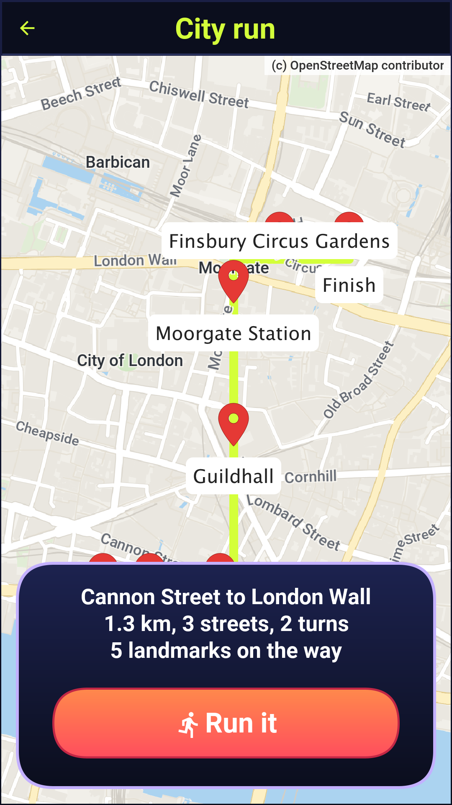
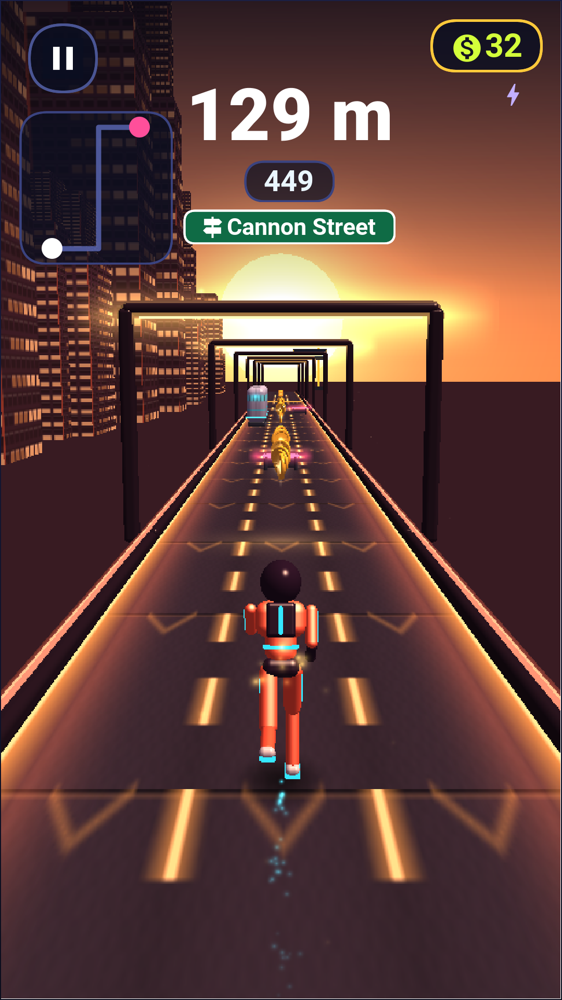
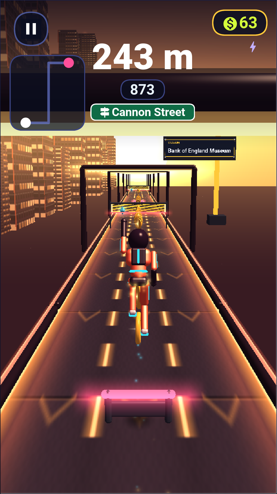

Before you ship this, point `Routing` at a routing server of your own:
`Routing.setService(new OsrmRouteService("https://osrm.example.com"))`. The
default is OSRM's public demo server, which is rate limited, has no service
guarantee and serves only its car profile, whatever travel mode the request
asks for. The map data is OpenStreetMap's, whose licence
asks for credit wherever it is shown; the city screen carries that line, and a
reskin has to keep it.

[[dash-engagement]]
=== Engagement and live operations

Players come back for what changes: three quests a day, picked per player from
`Goals` (run 500 metres, collect 100 coins, win a race...), a daily dash with one
track for everyone and its own board, chests that open over time, a level and
trophies to climb, achievements, and boards that reset every week. Rivals already
on the boards from the first run keep a new player company: on a development server
`DemoAccounts` seeds a field of runners whose scores are the rules' bot playing each
week's track, submitted and verified like anyone's.

The operator's side is in the admin console:

* *Reports* chart players, runs, races, purchases and invitations over time.
* *Query* finds players by what the game knows about them -- days away, races,
  purchases, invitations, trophies -- with conditions such as `daysAway >= 7`.
* *Pipelines* turn a query into an action that runs every hour: a push to players
  away for a week that opens the shop, 20 gems to a player who reached 300 trophies
  and never bought anything. Each player is acted on once per cool-down, and a push
  carries the campaign `pipeline-<name>`, so its opens show in Codename One
  analytics.
* *Promote* sends a push to a segment (*broadcast*) and sets the banner on every
  player's home screen (*spotlight*), which can open a level, the shop or the
  editor.

[source,java]
----
include::../../scripts/dash/backend/src/main/java/com/codenameone/examples/dash/social/Pipelines.java[tag=dash-pipelines-schedule,indent=0]
----

On a phone the console is a list of pages; on a desktop or a tablet it is a side bar
and a page, and the *Promote* tab is shown:

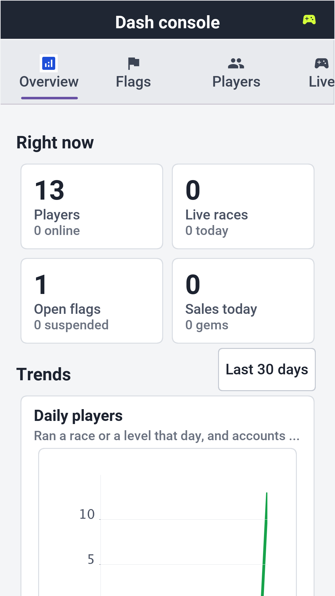
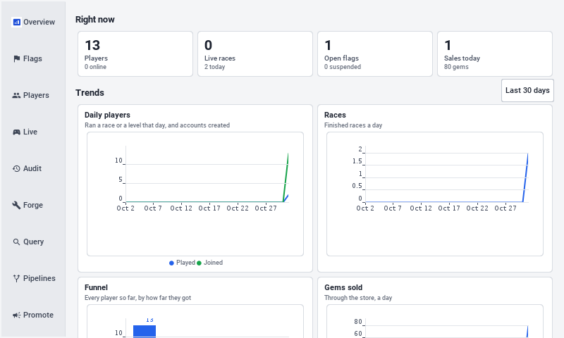
image::img/dash-desktop-admin-reports.png["Reports: players, runs and purchases over time",scaledwidth=70%]
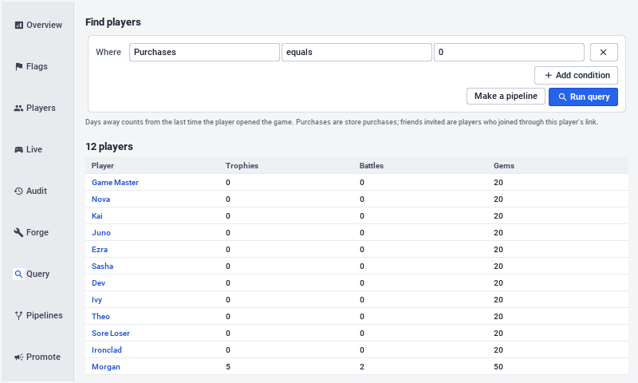
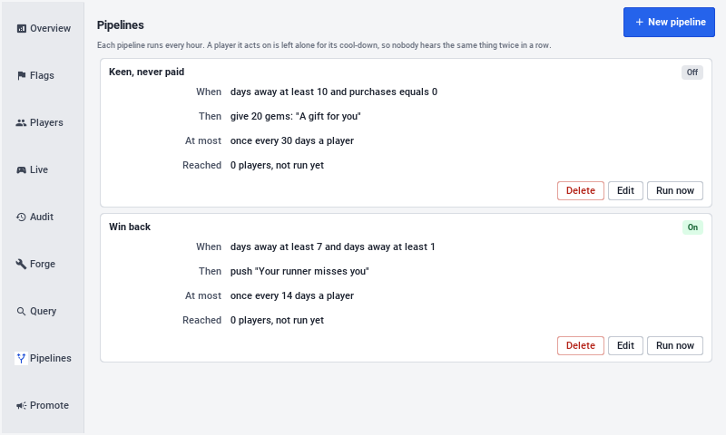
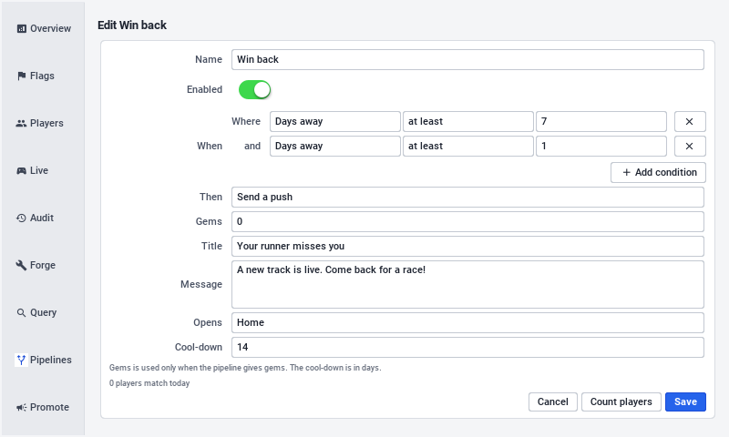
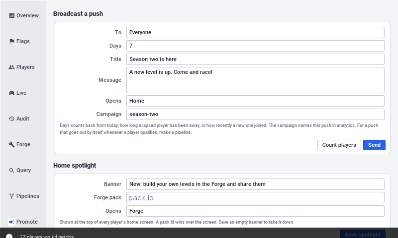
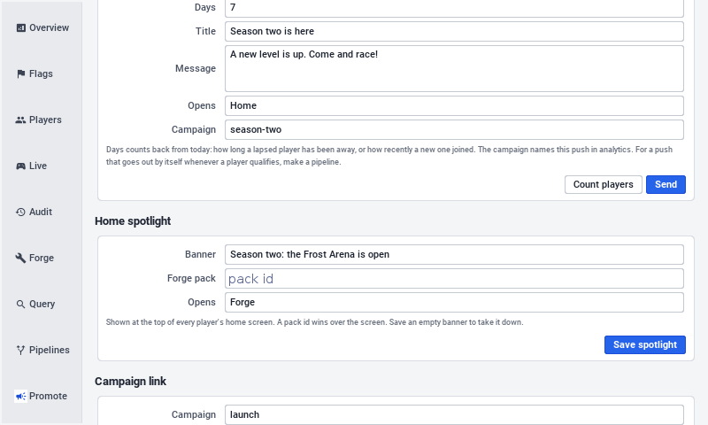
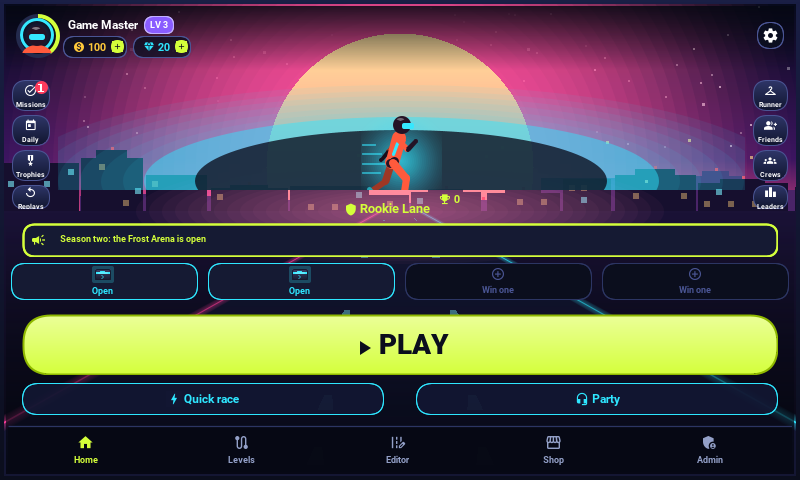

[[dash-moderation]]
=== Moderation

Published packs, reports and automatic flags -- a run that doesn't re-simulate, a
race hash that disagrees -- land in the admin console. A moderator can hide, restore
or promote a pack, look at its files, and act on a player:

[source,java]
----
include::../../scripts/dash/backend/src/main/java/com/codenameone/examples/dash/admin/Moderation.java[tag=dash-moderation,indent=0]
----

The console also lists every race being run, and any of them can be watched live
from the same lobby a player uses to spectate.

[[dash-reskin]]
=== Making it yours

* *Levels*: `Content` in `rules` holds the official levels and the chunks the
  procedural tails are built from. Change one and run `mvn -pl rules test`: the
  golden replays will tell you which recorded runs no longer end the same way, and
  the bot test whether every level can still be finished. Bump `RulesVersion.ID`
  when you change the rules themselves, so old replays aren't judged by new rules.
* *Obstacles and pickups*: add a definition in `Content.catalog()`, a colour or a
  model in `RunView`, and the editor offers it at once.
* *Runners*: there are no model files. `Rig` builds every runner from capsules,
  rounded boxes and glowing trim and poses each joint in code, and `Portraits` paints the same figure flat
  for the menus. Both take their colours from an `Outfit`, so a new runner is one
  line:
+
[source,java]
----
include::../../scripts/dash/common/src/main/java/com/codenameone/examples/dash/run/Outfit.java[tag=dash-outfits,indent=0]
----
* *The track*: `Theme` holds each level theme's sky, light, surface, rails and
  skyline, and paints the textures it needs at startup.
* *The look*: every colour is a variable at the top of `theme.css`:
+
[source,css]
----
include::../../scripts/dash/common/src/main/css/theme.css[tag=dash-palette,indent=0]
----
* *Store, ads and push*: these work as they do in Skirmish. The product ids are in
  `AppConfig`, the receipt validator is chosen in `Services`, and the push key is
  read the same way:
+
[source,java]
----
include::../../scripts/dash/common/src/main/java/com/codenameone/examples/dash/AppConfig.java[tag=dash-monetization-ids,indent=0]
----
+
[source,java]
----
include::../../scripts/dash/backend/src/main/java/com/codenameone/examples/dash/Services.java[tag=dash-receipt-choice,indent=0]
----

The engagement tools -- campaign links, invitations, the home screen spotlight,
pushes to an audience and scheduled pipelines -- are the ones
<<skirmish-implementors-guide,the Skirmish chapter>> walks through step by step, and
they work in Dash unchanged.
