[[data-grid]]
== Data grids and tree tables

A list of orders, an inventory, a log, a file browser: each is rows of records
under a row of column titles, and users expect to sort them, filter them, resize
the columns and edit a value where it stands. `DataGrid` in
`com.codename1.ui.table` is that component, and it shows a tree as well as a
flat list.

.Orders in a data grid: a frozen order column, formatted dates and amounts, a progress bar per row and unpaid amounts in red
image::img/generated/datagrid-renderers.png["A grid of sales orders with columns Order, Customer, Region, Placed, Amount, Shipped and Paid; the shipped column draws bars and some amounts are red",scaledwidth=70%]

The grid paints its cells itself, the way the scheduler and the Gantt chart do.
There is no component per cell or per row, so a model with a million rows
scrolls the way one with a hundred does. Sorting and filtering reorder an array
of row numbers and never copy your data, and a node of a tree costs what it
shows when it opens.

`Table`, in the same package, lays out one component per cell. It suits a small
form arranged in rows and columns, where each cell may be any component; use
`DataGrid` for data.

=== A first grid

Any `TableModel` works. Each of its columns gets a `GridColumn` with the
model's title, and the grid reads the values it shows straight from the model.

[source,java]
----
include::../demos/common/src/main/java/com/codenameone/developerguide/datagrid/DataGridSnippets.java[tag=grid-first,indent=0]
----

.The first grid
image::img/generated/datagrid-first.png["Five players in a grid with columns Name, Team, Score and Active; the scores align right and Active is a checkbox",scaledwidth=30%]

Nothing else was configured. Each column took its width from its title and
first rows, numbers align to the right and a `Boolean` shows a checkbox. Every
other row is shaded.

What a user can already do:

* A tap on a title sorts by that column, a second tap reverses the order and a
  third restores the model's order. Shift with a tap adds the column as a
  further sort key.
* A drag on a title moves the column; a drag on the line between two titles
  resizes it.
* A tap selects a row, and a double tap edits a cell.
* A checkbox toggles with a tap.

The examples that follow use a model of sales orders with seven columns:
order number, customer, region, the date it was placed, the amount, how much has
shipped and whether it's paid.

=== Columns

A `GridColumn` decides how its values look and how they're edited. Its kind,
`TEXT`, `NUMBER`, `BOOLEAN`, `DATE` or `CHOICE`, is read from each value when
you leave it at `AUTO`, which is the default.

[source,java,role=cn1-no-try]
----
include::../demos/common/src/main/java/com/codenameone/developerguide/datagrid/DataGridSnippets.java[tag=grid-columns,indent=0]
----

.Column widths, a flexible column and a frozen first column
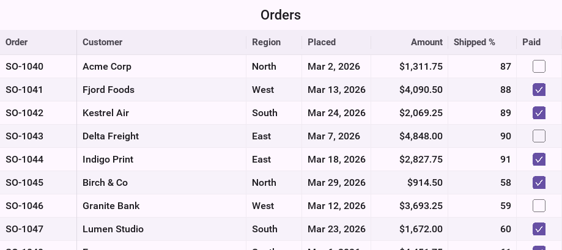

The width of a column comes from one of three places:

* `setWidthMM` asks for a width in millimetres, which stays the same physical
  size on every screen.
* With no width, the column is measured from its title and its first rows, up
  to `setMaxWidthMM`.
* `setFlex` shares out the width that's left over when the columns are
  narrower than the grid. Two columns with flex 1 and 2 take a third and two
  thirds of it.

`setFrozenColumns(1)` keeps the first column in place while the others scroll
sideways, so the order number stays beside its row on a narrow screen. A column
hidden with `setVisible(false)` keeps its place for when it comes back, and
`moveColumn` reorders them from code.

`setChoices` makes a column a `CHOICE`: it's edited with a picker of those
values. A `DATE` column is edited with a date picker.

==== Formatting values

A `GridFormatter` turns a value into the text a cell shows and, for an edit,
the text a user typed back into a value. The model keeps the value; only its
picture changes.

[source,java,role=cn1-no-try]
----
include::../demos/common/src/main/java/com/codenameone/developerguide/datagrid/DataGridSnippets.java[tag=grid-formatter,indent=0]
----

[source,java,role=cn1-no-try]
----
include::../demos/common/src/main/java/com/codenameone/developerguide/datagrid/DataGridSnippets.java[tag=grid-formatter-use,indent=0]
----

`parse` gets the cell's previous value so it can keep it when the text makes no
sense, as `Money` does. Sorting still compares the values, not the text: the
amounts sort as numbers whatever sign they're shown with.

=== Painting cells

A column's `GridCellRenderer` paints its cells. It's handed the `Graphics`, the
cell's bounds and a `GridCell` with the value, the row and the style of the row,
and it draws; it creates no component. That's what lets the grid show a million
rows: only what's on the screen is painted.

This renderer draws a shipped percentage as a bar:

[source,java,role=cn1-no-try]
----
include::../demos/common/src/main/java/com/codenameone/developerguide/datagrid/DataGridSnippets.java[tag=grid-renderer,indent=0]
----

To change one thing about the default painting, such as a color, a font or
the text, extend `DefaultGridCellRenderer` and override `textColor`, `font` or
`text`:

[source,java,role=cn1-no-try]
----
include::../demos/common/src/main/java/com/codenameone/developerguide/datagrid/DataGridSnippets.java[tag=grid-renderer-use,indent=0]
----

.The bar renderer in the Shipped column and unpaid amounts in red
image::img/generated/datagrid-renderers.png["The orders grid: the Shipped column draws a blue bar per row, green when complete, and unpaid amounts are red",scaledwidth=70%]

The row's background is already painted when `paint` is called, in the row's
normal, alternate or selected style. Take colors from `cell.getStyle()`, as both
renderers do for everything but their accents, and the cells follow the theme,
the dark appearance and the selection. `getPreferredWidth` is what a column with
no width is measured with.

An `Image` value is drawn as an image by the default renderer, scaled
to the row.

=== Sorting

`sortBy` sorts by one column and `addSort` adds the next key, which breaks the
ties of the ones before it. The headers show the order with an arrow.

[source,java,role=cn1-no-try]
----
include::../demos/common/src/main/java/com/codenameone/developerguide/datagrid/DataGridSnippets.java[tag=grid-sort,indent=0]
----

.Sorted by date, newest first, then by customer
image::img/generated/datagrid-sorted.png["The orders grid sorted with the newest orders at the top and an arrow on the Placed header",scaledwidth=70%]

The sort is stable: rows that compare equal keep the order they had, so sorting
by one column and then by another groups the second without scrambling the
first. A null value sorts before any other. Each sort key is read from the model
once per row, never once per comparison, which matters when a model computes its
values.

By default numbers compare by value, dates by time, booleans false first and
everything else by its text, ignoring case. A `Comparator` sorts a column in an
order of its own:

[source,java,role=cn1-no-try]
----
include::../demos/common/src/main/java/com/codenameone/developerguide/datagrid/DataGridSnippets.java[tag=grid-comparator,indent=0]
----

The comparator is never given a null. `setSortable(false)` stops a column from
sorting when its title is tapped.

=== Filtering

A `GridFilter` decides row by row which rows show. It's handed a `GridRow`,
which reads any column of the model by its model index, whether the column is
shown or not. A search field is a filter that changes as the user types:

[source,java,role=cn1-no-try]
----
include::../demos/common/src/main/java/com/codenameone/developerguide/datagrid/DataGridSnippets.java[tag=grid-search,indent=0]
----

.A search field over the grid, showing the customers that contain "co"
image::img/generated/datagrid-search.png["A text field reading co above the orders grid, which shows only the orders of Acme Corp, Birch & Co and Cobalt Labs",scaledwidth=70%]

`setFilter(null)` shows every row again. Filtering keeps the sort, the grouping
and the selection of the rows that are still shown.

=== Grouping and totals

`setGroupColumn` puts the rows that share a value under a row of their own. A
group row opens and closes with a tap, and shows each column's
`GridAggregate`: `SUM`, `AVERAGE`, `MIN`, `MAX` or `COUNT`.

[source,java,role=cn1-no-try]
----
include::../demos/common/src/main/java/com/codenameone/developerguide/datagrid/DataGridSnippets.java[tag=grid-group,indent=0]
----

.Orders grouped by region, with the count, total, average and unpaid count of each
image::img/generated/datagrid-grouped.png["The orders grid with a bold row per region showing a count, a total amount, an average shipped bar and how many are unpaid, each followed by its orders",scaledwidth=70%]

The groups are ordered by their value, in the column's sort direction when
it's sorted by, and the rows of each group keep the grid's sort. An aggregate of
your own folds the values one at a time and turns the result into what's shown:

[source,java,role=cn1-no-try]
----
include::../demos/common/src/main/java/com/codenameone/developerguide/datagrid/DataGridSnippets.java[tag=grid-aggregate,indent=0]
----

`setGroupColumn(null)` stops grouping. A tree grid is never grouped.

=== Selection and actions

[source,java,role=cn1-no-try]
----
include::../demos/common/src/main/java/com/codenameone/developerguide/datagrid/DataGridSnippets.java[tag=grid-selection,indent=0]
----

.Several rows selected
image::img/generated/datagrid-selection.png["The orders grid with rows two to four and row seven highlighted",scaledwidth=70%]

`SelectionMode` is `NONE`, `SINGLE_ROW` or `MULTIPLE_ROWS`. A selection is kept
as ranges, so selecting every row of a million costs one range.

Rows the grid reports are view rows, counted in what's on the screen after
sorting, filtering, grouping and opening nodes. `getModelRow` turns one into a
row of your model, `getViewRow` goes the other way, and in a tree `getNode`
answers the node. A group row has no model row: `isGroupRow` tells them apart.

The selection follows its records. After a sort, a filter or a change to the
model, the same orders are selected wherever they now are.

With a keyboard, the arrows move between cells, Page Up and Page Down move a
screen at a time, Home and End go to the first and last row, Left and Right
close and open a node, and Enter edits the cell or, on a cell that isn't
editable, fires the action. With a mouse or a finger, a press selects, Shift
extends, Control or Command adds and removes, and a drag selects a range.

=== Editing

A cell is edited when its column and its model both allow it:
`GridColumn.setEditable` and `TableModel.isCellEditable`. A boolean cell toggles with
a tap. Any other value is edited in place: a double tap or Enter lays an editor
over the cell, and the cell is painted again when the edit ends.

.The third order after its customer was edited in place
image::img/generated/datagrid-editing.png["The orders grid with the third row selected and its customer changed to Kestrel Aviation",scaledwidth=70%]

The editor is a component of the form's layered pane, not a child of the grid,
and it lives only while the cell is edited. Tapping elsewhere, moving to another
cell, scrolling or pressing Enter stores the value; `cancelEdit()` drops it.
`editCellAt(row, column)` starts an edit from code.

The default editor is a text field for text and numbers, a date picker for a
`DATE` column and a picker of the choices for a `CHOICE` column. A number is
read back as the type the cell held, an `Integer` as an `Integer`, and text that
isn't a number leaves the cell as it was. A column with a formatter reads the
text back through its `parse`.

A `GridCellEditor` edits a column with a component of your own:

[source,java,role=cn1-no-try]
----
include::../demos/common/src/main/java/com/codenameone/developerguide/datagrid/DataGridSnippets.java[tag=grid-editor,indent=0]
----

[source,java,role=cn1-no-try]
----
include::../demos/common/src/main/java/com/codenameone/developerguide/datagrid/DataGridSnippets.java[tag=grid-editing,indent=0]
----

An editor calls `commitEdit()` when the user is done with it. The grid then
reads `getEditorValue`, writes it to the model when it changed and throws the
component away.

=== Changes to the model

The grid listens to its `TableModel`. A changed value repaints its cell, unless
the column is sorted, grouped or filtered by, in which case the rows are sorted,
filtered and grouped again. An added row is placed where the sort puts it, and
the selection stays on its records.

A `TableModel` has no event that says which row was removed, so a removal clears
the selection rather than leave it on whichever record moved into its place. An
edit in progress ends without writing whenever the rows are rebuilt.

`refresh()` reads the whole model again. Call it after a change your model
didn't report.

=== A million rows

The grid reads a value when it paints it, and paints only the rows on the screen. A
model can therefore compute its rows instead of storing them, or page them in
from a database, and the grid never asks for more than it shows.

[source,java,role=cn1-no-try]
----
include::../demos/common/src/main/java/com/codenameone/developerguide/datagrid/DataGridSnippets.java[tag=grid-million,indent=0]
----

[source,java,role=cn1-no-try]
----
include::../demos/common/src/main/java/com/codenameone/developerguide/datagrid/DataGridSnippets.java[tag=grid-million-use,indent=0]
----

.Half a million rows down a model of a million
image::img/generated/datagrid-million.png["A ledger grid scrolled to entry 500,001 and further, with account numbers and balances",scaledwidth=70%]

Sorting such a model reads each sort column once per row, a million reads for a
million rows, and sorts an array of row numbers. Filtering reads what the filter
asks for. A column with no width is measured from its first rows only.

=== Trees

Built on a `TreeTableModel`, the grid is a tree table. The model answers a
node's children and its value in each column; `getChildren(null)` answers the
roots.

[source,java,role=cn1-no-try]
----
include::../demos/common/src/main/java/com/codenameone/developerguide/datagrid/DataGridSnippets.java[tag=grid-tree,indent=0]
----

[source,java,role=cn1-no-try]
----
include::../demos/common/src/main/java/com/codenameone/developerguide/datagrid/DataGridSnippets.java[tag=grid-tree-use,indent=0]
----

.A project's files in a tree grid
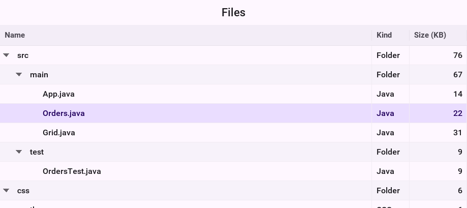

The first visible column, or the one passed to `setTreeColumn`, indents each
node under its parent and draws the arrow that opens it. A tap on the arrow,
or Left and Right on the keyboard, closes and opens a node. `setExpanded`,
`setNodeExpanded` and `expandAll` do it from code.

The grid asks for a node's children the first time it opens and keeps them, so
a large or remote tree loads as it's browsed. `isLeaf` is asked of every node
shown, to decide whether it has an arrow, and has to answer without loading
the children. Opening a node costs what it shows and not what the tree holds.

Sorting orders the children of each node, and a filter shows every path that
leads to a match. A tree model has no listeners: call `refresh()` after the tree
changes, or `refreshNode(node)` after one node's children change; both keep
which nodes are open.

Nodes are told apart by `equals`, so two equal nodes are one node to the grid.
A tree that repeats a value, such as two files named `README.md` in different
folders, should hand out node objects of its own, as `Item` is here, rather
than the bare names.

=== Appearance

[source,java,role=cn1-no-try]
----
include::../demos/common/src/main/java/com/codenameone/developerguide/datagrid/DataGridSnippets.java[tag=grid-appearance,indent=0]
----

.Taller rows, vertical lines and no stripes
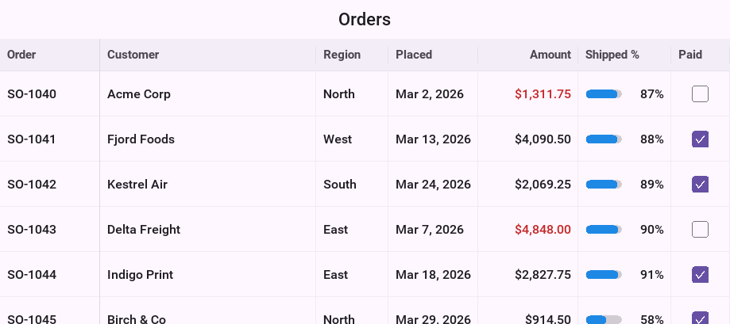

`setStriped` shades every other row, `setGridLines` draws the lines between
rows and between columns, and `setRowHeightMM` sets the height of a row, which
is measured from the font when you leave it alone. `setHeaderVisible(false)`
hides the titles, and `setEmptyText` is what an empty grid says.

==== Styles

Only colors, fonts and paddings are read; nothing has a border.

[cols="1,3",options="header"]
|===
|UIID |What it styles

|`DataGrid` |The background behind the rows
|`DataGridHeader` |The row of column titles
|`DataGridRow` |A row, and its `selected` state for a selected row
|`DataGridRowAlt` |Every other row, when the grid is striped
|`DataGridGroupRow` |The row heading a group
|`DataGridLine` |The grid lines, in its foreground color
|`DataGridCheck` |A checkbox: its background when checked, its foreground for the tick
|`DataGridEditor` |The text field an edit lays over a cell
|===

These rules give the grid a teal header and selection:

[source,css]
----
include::../demos/common/src/main/css/guide-snippets-theme.css[tag=datagrid-css,indent=0]
----

.The grid under those rules
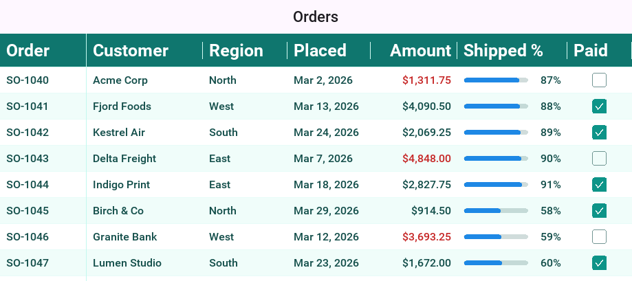

The native themes style all these for light and dark mode, and for each
platform:

.The grid in the dark appearance
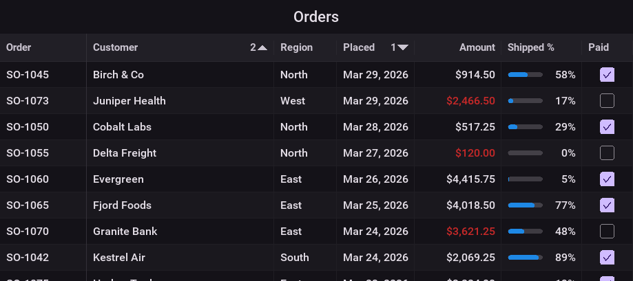

.The grid in the iOS theme
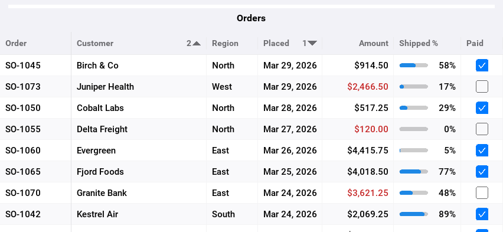

=== Spreadsheet files

A grid reads and writes spreadsheets through the `com.codename1.spreadsheet` package.
A `Workbook` is an Excel `.xlsx` file, an OpenDocument `.ods` file or separated text
such as CSV, and each of its `Sheet` objects is a `TableModel`:

[source,java,role=cn1-no-try]
----
include::../demos/common/src/main/java/com/codenameone/developerguide/datagrid/DataGridSnippets.java[tag=grid-sheet-open,indent=0]
----

`setHeaderRow(true)` takes the column names from the first row of the sheet.
`createColumns()` then builds a `GridColumn` for each column: its kind comes from
the values the column holds, and its formatter from the number format of its
cells, so a price shows as `1,234.50` and a date the way the file formats it.

Cells keep their types. A number is a `Double`, a date is a `java.util.Date`, a
logical value is a `Boolean` and an error such as `#DIV/0!` is a `CellError`.
`Sheet.getCellText` answers the text a spreadsheet would show for a cell.

`Workbook.Format.detect` picks the format from a file name and the first bytes
of the file, for a file the user chose.

A file the user chose is a file someone else wrote. `Workbook.read` throws an
`IOException` for one that's damaged or that isn't a spreadsheet. It also
throws for a file larger than the cell limit, because a few hundred compressed
bytes can describe millions of cells. The limit is one million cells, about
75 MB of numbers. A formula counts as eight cells or more, and the rows above
the last cell, the shared text and the column widths count as well.
`Workbook.setCellLimit` raises the limit for an application that reads larger
files on a device with the memory for them.

==== A whole workbook

A workbook usually has several sheets that read one another. The samples that
follow open `regional-sales.xlsx`, a file LibreOffice saved, from the
application's resources. It has a sheet of orders, a sheet of commission rates
and sales targets for each region, and a summary that reads both:

[source,java,role=cn1-no-try]
----
include::../demos/common/src/main/java/com/codenameone/developerguide/datagrid/DataGridSnippets.java[tag=grid-sheet-resource,indent=0]
----

Each sheet is a model of its own, so a grid for each one in a `Tabs` component
is the workbook the way a spreadsheet shows it:

[source,java,role=cn1-no-try]
----
include::../demos/common/src/main/java/com/codenameone/developerguide/datagrid/DataGridSnippets.java[tag=grid-sheet-workbook,indent=0]
----

.The Orders sheet. The dates, prices and discounts are formatted by the number formats of the file, and Net is a formula
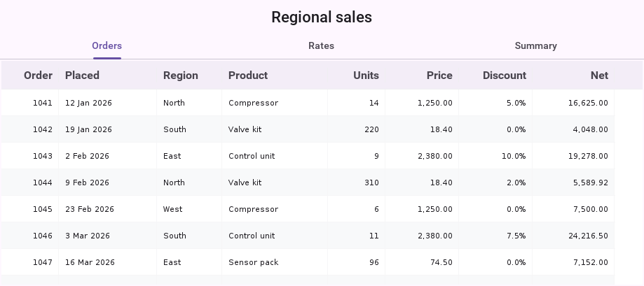

The Summary sheet has no values of its own. Every cell after the first column
is a formula: `COUNTIF`, `SUMIF` and `SUMIFS` over the orders, `VLOOKUP` and
`INDEX` with `MATCH` into the rates, and an `IF` that names the standing of
each region:

.The Summary sheet, calculated from the other two
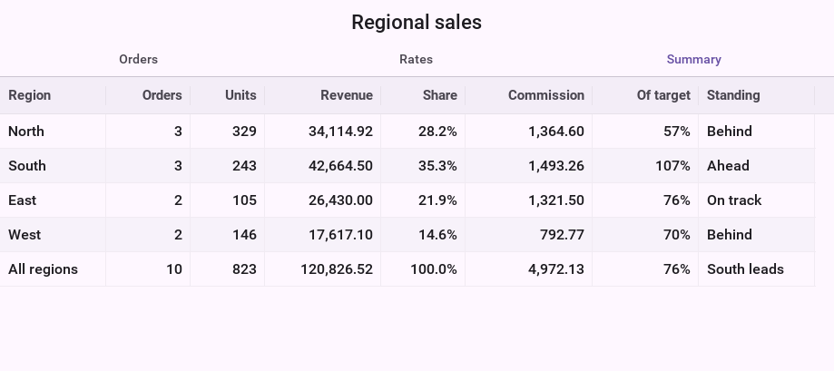

==== Formulas

Formulas are live. A formula reads other cells by their address in the sheet, so
sorting or filtering the grid never changes what `B2` means. When a cell changes,
every formula that reads that cell is calculated again and the grid repaints
the cells that changed:

[source,java,role=cn1-no-try]
----
include::../demos/common/src/main/java/com/codenameone/developerguide/datagrid/DataGridSnippets.java[tag=grid-sheet-formula,indent=0]
----

An edit reaches other sheets the same way. This corrects one order on the
Orders sheet:

[source,java,role=cn1-no-try]
----
include::../demos/common/src/main/java/com/codenameone/developerguide/datagrid/DataGridSnippets.java[tag=grid-sheet-edit,indent=0]
----

The grid of the Summary sheet repaints the cells that depend on that order, and
nothing in the application asks it to:

.The Summary sheet after the correction: the row for West, the totals and the leading region have changed
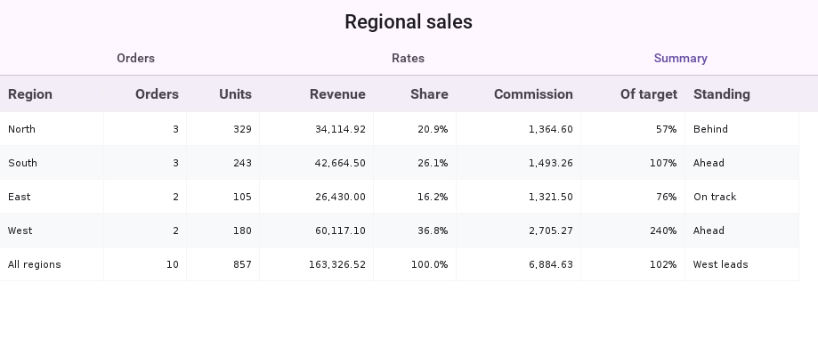

A formula can also read a cell through a defined name. `loan-schedule.ods` is
an OpenDocument file whose Schedule sheet calculates every payment with `PMT`,
`IPMT`, `PPMT` and `EDATE` from four names on its Terms sheet:

.A loan schedule read from an OpenDocument file
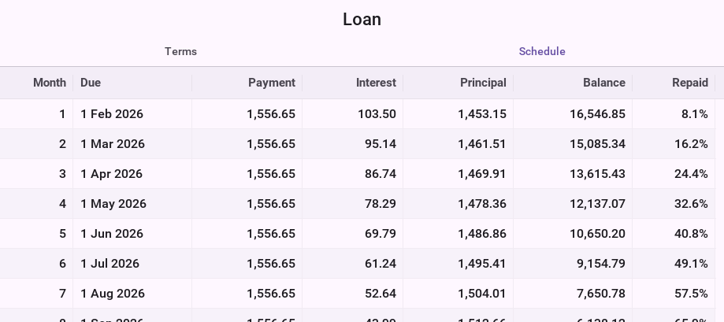

Changing the cell a name stands for calculates the whole schedule again:

[source,java,role=cn1-no-try]
----
include::../demos/common/src/main/java/com/codenameone/developerguide/datagrid/DataGridSnippets.java[tag=grid-sheet-name,indent=0]
----

.The same schedule at the higher rate
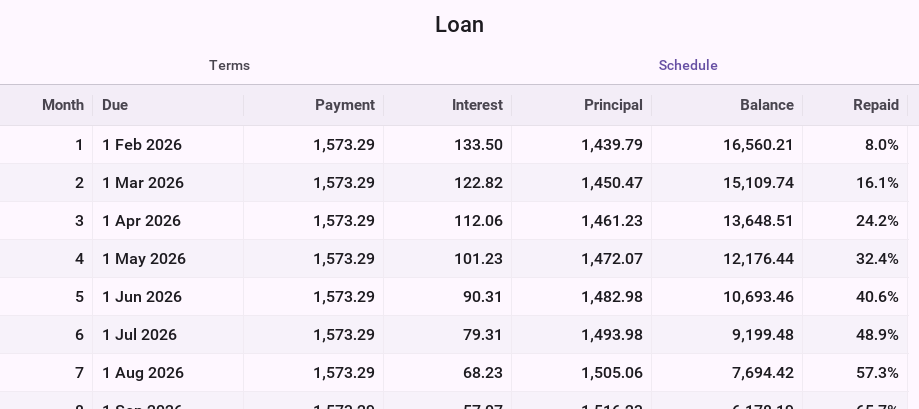

Text given to `setValueAt` is read the way a spreadsheet reads what's typed into
a cell, which is what the grid's editor does: `=B2*C2` is a formula, `25%` is the
number 0.25, `2024-02-29` is a date and `'=B2` is the text `=B2`. Give it a
`Double`, a `Date` or a `Boolean` to store a value unchanged.

The columns `createColumns()` builds edit a cell the way a spreadsheet does. The
field opens with the formula of a cell that has one, and otherwise with the whole
value and not its formatted text, so a price shown as `1,234.50` opens as
`1234.5`. A field that's closed unchanged writes nothing. Each cell is also
painted in its own number format, which matters for a total in a currency
format under a column of plain numbers. Sorting, filtering and grouping use the
column's formatter, which is the format most of its cells have.

Formulas are written the way Excel writes them, in English and with commas
between arguments, whichever format the file is in. They can use ranges, whole
rows and columns, other sheets, defined names and array constants. A formula
that refers to itself, directly or through other cells, shows a `CellError` for
a circular reference instead of looping, and so does every cell of the circle.

The following functions are available. `Workbook.getSupportedFunctions()` returns
the same list.

[cols="1,4",options="header"]
|===
|Category |Functions

|Math and trigonometry
|`ABS`, `ACOS`, `ACOSH`, `ACOT`, `ACOTH`, `ARABIC`, `ASIN`, `ASINH`, `ATAN`, `ATAN2`, `ATANH`, `BASE`, `CEILING`, `CEILING.MATH`, `CEILING.PRECISE`, `COMBIN`, `COMBINA`, `COS`, `COSH`, `COT`, `COTH`, `CSC`, `CSCH`, `DECIMAL`, `DEGREES`, `EVEN`, `EXP`, `FACT`, `FACTDOUBLE`, `FLOOR`, `FLOOR.MATH`, `FLOOR.PRECISE`, `GCD`, `INT`, `ISO.CEILING`, `LCM`, `LN`, `LOG`, `LOG10`, `MDETERM`, `MINVERSE`, `MMULT`, `MOD`, `MROUND`, `MULTINOMIAL`, `MUNIT`, `ODD`, `PERMUT`, `PERMUTATIONA`, `PI`, `POWER`, `PRODUCT`, `QUOTIENT`, `RADIANS`, `RAND`, `RANDBETWEEN`, `ROMAN`, `ROUND`, `ROUNDDOWN`, `ROUNDUP`, `SEC`, `SECH`, `SERIESSUM`, `SIGN`, `SIN`, `SINH`, `SQRT`, `SQRTPI`, `SUM`, `SUMIF`, `SUMIFS`, `SUMPRODUCT`, `SUMSQ`, `SUMX2MY2`, `SUMX2PY2`, `SUMXMY2`, `TAN`, `TANH`, `TRUNC`

|Statistics
|`AGGREGATE`, `AVEDEV`, `AVERAGE`, `AVERAGEA`, `AVERAGEIF`, `AVERAGEIFS`, `BETA.DIST`, `BETA.INV`, `BETADIST`, `BETAINV`, `BINOM.DIST`, `BINOM.DIST.RANGE`, `BINOM.INV`, `BINOMDIST`, `CHIDIST`, `CHIINV`, `CHISQ.DIST`, `CHISQ.DIST.RT`, `CHISQ.INV`, `CHISQ.INV.RT`, `CHISQ.TEST`, `CHITEST`, `CONFIDENCE`, `CONFIDENCE.NORM`, `CONFIDENCE.T`, `CORREL`, `COUNT`, `COUNTA`, `COUNTBLANK`, `COUNTIF`, `COUNTIFS`, `COVAR`, `COVARIANCE.P`, `COVARIANCE.S`, `CRITBINOM`, `DEVSQ`, `EXPON.DIST`, `EXPONDIST`, `F.DIST`, `F.DIST.RT`, `F.INV`, `F.INV.RT`, `F.TEST`, `FDIST`, `FINV`, `FISHER`, `FISHERINV`, `FORECAST`, `FORECAST.LINEAR`, `FREQUENCY`, `FTEST`, `GAMMA`, `GAMMA.DIST`, `GAMMA.INV`, `GAMMADIST`, `GAMMAINV`, `GAMMALN`, `GAMMALN.PRECISE`, `GAUSS`, `GEOMEAN`, `HARMEAN`, `HYPGEOM.DIST`, `HYPGEOMDIST`, `INTERCEPT`, `KURT`, `LARGE`, `LOGINV`, `LOGNORM.DIST`, `LOGNORM.INV`, `LOGNORMDIST`, `MAX`, `MAXA`, `MAXIFS`, `MEDIAN`, `MIN`, `MINA`, `MINIFS`, `MODE`, `MODE.MULT`, `MODE.SNGL`, `NEGBINOM.DIST`, `NEGBINOMDIST`, `NORM.DIST`, `NORM.INV`, `NORM.S.DIST`, `NORM.S.INV`, `NORMDIST`, `NORMINV`, `NORMSDIST`, `NORMSINV`, `PEARSON`, `PERCENTILE`, `PERCENTILE.EXC`, `PERCENTILE.INC`, `PERCENTRANK`, `PERCENTRANK.EXC`, `PERCENTRANK.INC`, `PHI`, `POISSON`, `POISSON.DIST`, `QUARTILE`, `QUARTILE.EXC`, `QUARTILE.INC`, `RANK`, `RANK.AVG`, `RANK.EQ`, `RSQ`, `SKEW`, `SKEW.P`, `SLOPE`, `SMALL`, `STANDARDIZE`, `STDEV`, `STDEV.P`, `STDEV.S`, `STDEVA`, `STDEVP`, `STDEVPA`, `STEYX`, `SUBTOTAL`, `T.DIST`, `T.DIST.2T`, `T.DIST.RT`, `T.INV`, `T.INV.2T`, `T.TEST`, `TDIST`, `TINV`, `TRIMMEAN`, `TTEST`, `VAR`, `VAR.P`, `VAR.S`, `VARA`, `VARP`, `VARPA`, `WEIBULL`, `WEIBULL.DIST`, `Z.TEST`, `ZTEST`

|Logic and information
|`AND`, `CHOOSE`, `COLUMN`, `ERROR.TYPE`, `FALSE`, `FORMULATEXT`, `IF`, `IFERROR`, `IFNA`, `IFS`, `INDIRECT`, `ISBLANK`, `ISERR`, `ISERROR`, `ISEVEN`, `ISFORMULA`, `ISLOGICAL`, `ISNA`, `ISNONTEXT`, `ISNUMBER`, `ISODD`, `ISREF`, `ISTEXT`, `LET`, `N`, `NA`, `NOT`, `NOW`, `OFFSET`, `OR`, `RAND`, `RANDARRAY`, `RANDBETWEEN`, `ROW`, `SWITCH`, `T`, `TODAY`, `TRUE`, `TYPE`, `XOR`

|Text
|`CHAR`, `CLEAN`, `CODE`, `CONCAT`, `CONCATENATE`, `DOLLAR`, `EXACT`, `FIND`, `FIXED`, `LEFT`, `LEN`, `LOWER`, `MID`, `NUMBERVALUE`, `PROPER`, `REPLACE`, `REPT`, `RIGHT`, `SEARCH`, `SUBSTITUTE`, `TEXT`, `TEXTAFTER`, `TEXTBEFORE`, `TEXTJOIN`, `TRIM`, `UNICHAR`, `UNICODE`, `UPPER`, `VALUE`

|Date and time
|`DATE`, `DATEDIF`, `DATEVALUE`, `DAY`, `DAYS`, `DAYS360`, `EDATE`, `EOMONTH`, `HOUR`, `ISOWEEKNUM`, `MINUTE`, `MONTH`, `NETWORKDAYS`, `NETWORKDAYS.INTL`, `NOW`, `SECOND`, `TIME`, `TIMEVALUE`, `TODAY`, `WEEKDAY`, `WEEKNUM`, `WORKDAY`, `WORKDAY.INTL`, `YEAR`, `YEARFRAC`

|Lookup and reference
|`ADDRESS`, `AREAS`, `COLUMNS`, `HLOOKUP`, `INDEX`, `INDIRECT`, `LOOKUP`, `MATCH`, `OFFSET`, `ROWS`, `SHEET`, `SHEETS`, `TRANSPOSE`, `VLOOKUP`, `XLOOKUP`, `XMATCH`

|Financial
|`CUMIPMT`, `CUMPRINC`, `DB`, `DDB`, `DOLLARDE`, `DOLLARFR`, `EFFECT`, `FV`, `FVSCHEDULE`, `IPMT`, `IRR`, `ISPMT`, `MIRR`, `NOMINAL`, `NPER`, `NPV`, `PDURATION`, `PMT`, `PPMT`, `PV`, `RATE`, `RRI`, `SLN`, `SYD`, `VDB`, `XIRR`, `XNPV`

|Engineering
|`BIN2DEC`, `BIN2HEX`, `BIN2OCT`, `BITAND`, `BITLSHIFT`, `BITOR`, `BITRSHIFT`, `BITXOR`, `CONVERT`, `DEC2BIN`, `DEC2HEX`, `DEC2OCT`, `DELTA`, `ERF`, `ERF.PRECISE`, `ERFC`, `ERFC.PRECISE`, `GESTEP`, `HEX2BIN`, `HEX2DEC`, `HEX2OCT`, `OCT2BIN`, `OCT2DEC`, `OCT2HEX`

|Database
|`DAVERAGE`, `DCOUNT`, `DCOUNTA`, `DGET`, `DMAX`, `DMIN`, `DPRODUCT`, `DSTDEV`, `DSTDEVP`, `DSUM`, `DVAR`, `DVARP`

|Arrays
|`CHOOSECOLS`, `CHOOSEROWS`, `DROP`, `EXPAND`, `FILTER`, `HSTACK`, `RANDARRAY`, `SEQUENCE`, `SORT`, `SORTBY`, `TAKE`, `TOCOL`, `TOROW`, `UNIQUE`, `VSTACK`, `WRAPCOLS`, `WRAPROWS`
|===

A formula that uses anything else isn't lost. Its text is kept and written back
to the file, and its cell shows the value the file stored for it. The cell shows
`#NAME?` once a cell it reads has changed, because the stored value is stale by
then.

A few things work differently from Excel:

* A formula that returns an array shows its first value, and that value is
  what another cell reads from it. Results don't spill into the neighboring
  cells: a formula that needs the whole array wraps the call that makes it, as
  in `=SUM(SEQUENCE(3))`.
* Text is read as a date when it's written `2026-01-12` or names its month,
  as in `12-Jan-2026`. A date of digits and slashes isn't: `1/2/2026` is a
  different day in different countries.
* Functions of complex numbers, such as `IMSUM`, and the regression functions
  that return an array, such as `LINEST` and `TREND`, aren't included.
* Formulas use `A1` references. The `R1C1` style isn't read.

==== Saving a grid

`Workbook.fromGrid` copies what a grid shows: its rows in the order they're
sorted and filtered to, and its visible columns in the order they're arranged in.
Values keep their types, so a number is a number in the file and never the text
the grid formatted it to:

[source,java,role=cn1-no-try]
----
include::../demos/common/src/main/java/com/codenameone/developerguide/datagrid/DataGridSnippets.java[tag=grid-sheet-save,indent=0]
----

The depth of a row in a tree grid becomes its outline level, and the grid's
frozen columns stay frozen. `Workbook.fromModel` copies a `TableModel` without a
grid.

A workbook also keeps number formats, column widths, frozen panes, merged cells,
outline levels and defined names between reading and writing. It doesn't keep
charts, images, fonts, colors or conditional formatting, and it doesn't read the
older binary `.xls` format or a file protected with a password.

Writing XLSX fails fast on what Excel can't open unchanged: a sheet name longer
than 31 characters, a formula longer than 8,192 or a cell of text longer than
32,767. The write throws `IOException` naming the sheet or the cell, because
Excel would otherwise open the file only by repairing it and dropping or cutting
what's over the limit. `setExcelLimitsEnforced(false)` writes the file unchanged,
for a spreadsheet without those limits. OpenDocument has none of them.

==== Separated text

Text has no types, so reading CSV guesses them: a cell that reads as a number, a
date or a logical value becomes one, cell by cell. Numbers are the exception,
because a column of postal codes or part numbers would otherwise lose the zeros
at the start of `00420`: where any cell of a column would lose digits as a
number, the whole column stays text. The separator is detected from the first
lines when the file uses a semicolon, a tab or a bar instead of a comma.

A cell that starts with `=` stays text when it's read from CSV. A file from
somewhere else doesn't get to run a formula.

Writing CSV applies the same care in the other direction. Text that a
spreadsheet would run as a formula when it opens the file, such as `=1+1` or
`@SUM(A1)`, is written with an apostrophe in front, which tells the spreadsheet
that it's text. Numbers aren't touched, so `-5` stays a number.

`CSVParser` and `CSVWriter` in `com.codename1.io` read and write the text itself,
without a workbook:

[source,java,role=cn1-no-try]
----
include::../demos/common/src/main/java/com/codenameone/developerguide/datagrid/DataGridSnippets.java[tag=grid-csv,indent=0]
----

=== The row engine

The sort and the tree flattening are public, for a view of your own that needs
rows. `GridSorter` orders positions by keys read once each, with the grid's
stable order and its handling of nulls. `TreeRows` flattens a `TreeTableModel`
into rows of a node and a depth, and opening or closing a row returns how many
rows it inserted or removed after it.

An imported Swing application uses the same engine. Its `JTable`, `JXTable` and
`JXTreeTable` keep Swing's painting, renderers and editors, but a `JTable` or
`JXTable` sorted through a `TableRowSorter` orders its rows with `GridSorter`,
and a `JXTreeTable` takes its rows from `TreeRows`, so expanding a node inserts
only the rows under it.
