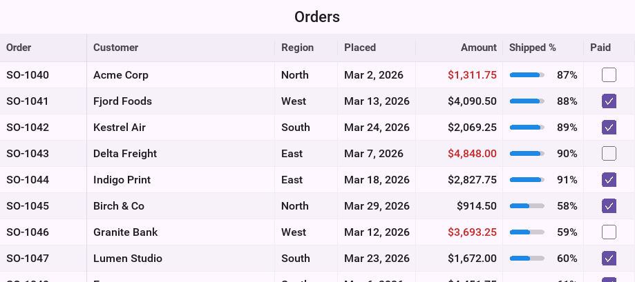
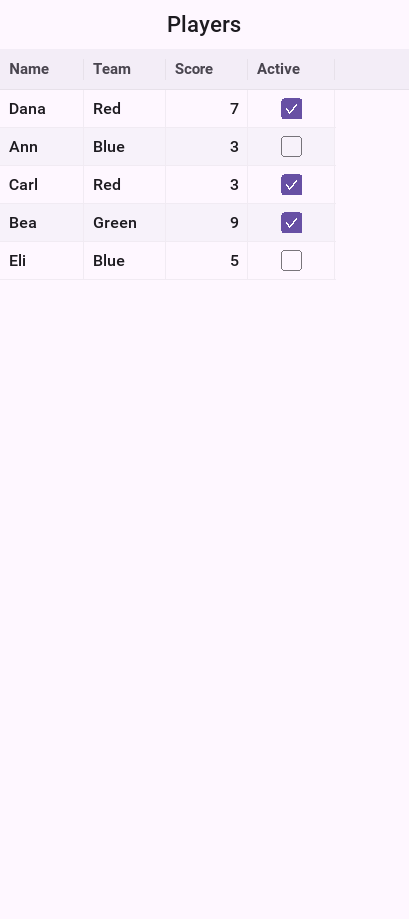
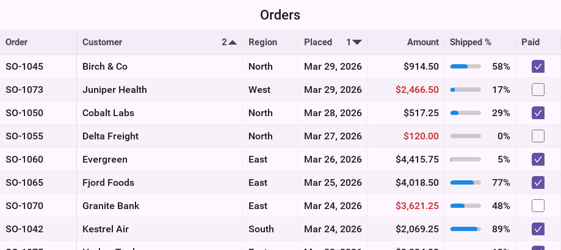
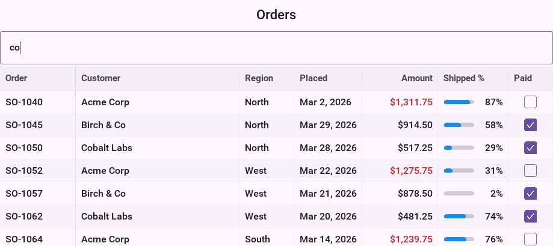
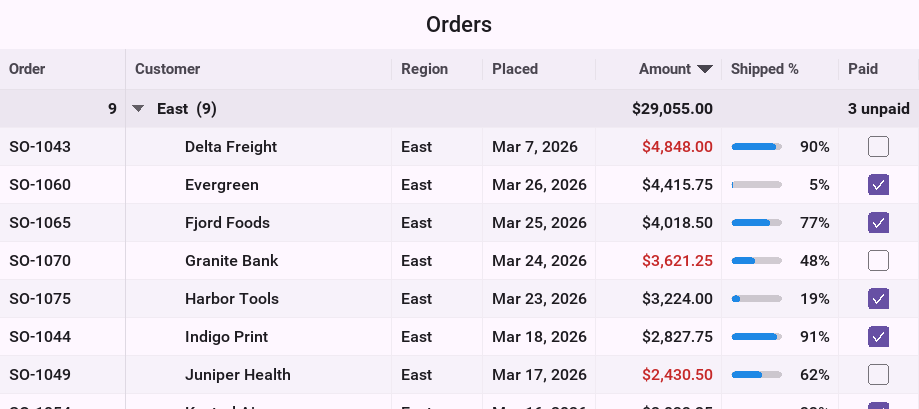
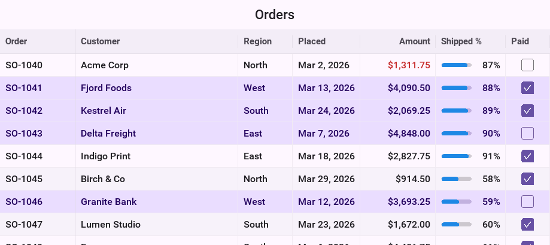
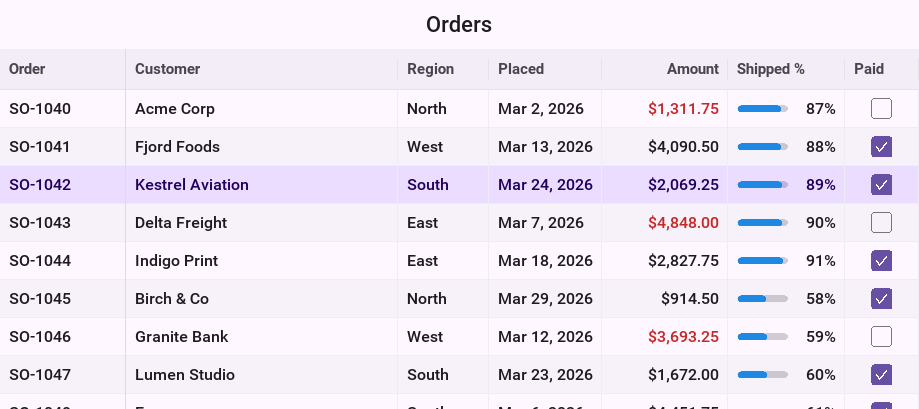
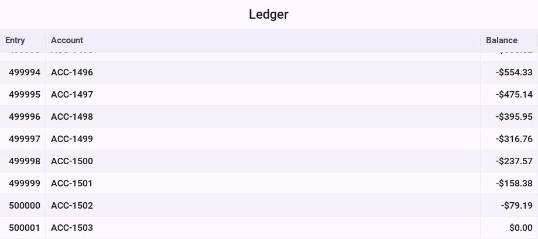

[[data-grid]]
== Data grids and tree tables

A list of orders, an inventory, a log, a file browser: each is rows of records
under a row of column titles, and users expect to sort them, filter them, resize
the columns and edit a value where it stands. `DataGrid` in
`com.codename1.ui.table` is that component, and it shows a tree as well as a
flat list.

.Orders in a data grid: a frozen order column, formatted dates and amounts, a progress bar per row and unpaid amounts in red

The grid paints its cells itself, the way the scheduler and the Gantt chart do.
There is no component per cell or per row, so a model with a million rows
scrolls the way one with a hundred does. Sorting and filtering reorder an array
of row numbers and never copy your data, and a node of a tree costs what it
shows when it opens.

`Table`, in the same package, lays out one component per cell. It suits a small
form arranged in rows and columns, where each cell may be any component; use
`DataGrid` for data.

=== A first grid

Any `TableModel` works. Each of its columns gets a `GridColumn` with the
model's title, and the grid reads the values it shows straight from the model.

[source,java]
----
include::../demos/common/src/main/java/com/codenameone/developerguide/datagrid/DataGridSnippets.java[tag=grid-first,indent=0]
----

.The first grid

Nothing else was configured. Each column took its width from its title and
first rows, numbers align to the right and a `Boolean` shows a checkbox. Every
other row is shaded.

What a user can already do:

* A tap on a title sorts by that column, a second tap reverses the order and a
  third restores the model's order. Shift with a tap adds the column as a
  further sort key.
* A drag on a title moves the column; a drag on the line between two titles
  resizes it.
* A tap selects a row, and a double tap edits a cell.
* A checkbox toggles with a tap.

The examples that follow use a model of sales orders with seven columns:
order number, customer, region, the date it was placed, the amount, how much has
shipped and whether it's paid.

=== Columns

A `GridColumn` decides how its values look and how they're edited. Its kind,
`TEXT`, `NUMBER`, `BOOLEAN`, `DATE` or `CHOICE`, is read from each value when
you leave it at `AUTO`, which is the default.

[source,java,role=cn1-no-try]
----
include::../demos/common/src/main/java/com/codenameone/developerguide/datagrid/DataGridSnippets.java[tag=grid-columns,indent=0]
----

.Column widths, a flexible column and a frozen first column
image::img/generated/datagrid-columns.png["The orders grid with a narrow order column, a wide customer column and right aligned amounts",scaledwidth=70%]

The width of a column comes from one of three places:

* `setWidthMM` asks for a width in millimetres, which stays the same physical
  size on every screen.
* With no width, the column is measured from its title and its first rows, up
  to `setMaxWidthMM`.
* `setFlex` shares out the width that's left over when the columns are
  narrower than the grid. Two columns with flex 1 and 2 take a third and two
  thirds of it.

`setFrozenColumns(1)` keeps the first column in place while the others scroll
sideways, so the order number stays beside its row on a narrow screen. A column
hidden with `setVisible(false)` keeps its place for when it comes back, and
`moveColumn` reorders them from code.

`setChoices` makes a column a `CHOICE`: it's edited with a picker of those
values. A `DATE` column is edited with a date picker.

==== Formatting values

A `GridFormatter` turns a value into the text a cell shows and, for an edit,
the text a user typed back into a value. The model keeps the value; only its
picture changes.

[source,java,role=cn1-no-try]
----
include::../demos/common/src/main/java/com/codenameone/developerguide/datagrid/DataGridSnippets.java[tag=grid-formatter,indent=0]
----

[source,java,role=cn1-no-try]
----
include::../demos/common/src/main/java/com/codenameone/developerguide/datagrid/DataGridSnippets.java[tag=grid-formatter-use,indent=0]
----

`parse` gets the cell's previous value so it can keep it when the text makes no
sense, as `Money` does. Sorting still compares the values, not the text: the
amounts sort as numbers whatever sign they're shown with.

=== Painting cells

A column's `GridCellRenderer` paints its cells. It's handed the `Graphics`, the
cell's bounds and a `GridCell` with the value, the row and the style of the row,
and it draws; it creates no component. That's what lets the grid show a million
rows: only what's on the screen is painted.

This renderer draws a shipped percentage as a bar:

[source,java,role=cn1-no-try]
----
include::../demos/common/src/main/java/com/codenameone/developerguide/datagrid/DataGridSnippets.java[tag=grid-renderer,indent=0]
----

To change one thing about the default painting, such as a color, a font or
the text, extend `DefaultGridCellRenderer` and override `textColor`, `font` or
`text`:

[source,java,role=cn1-no-try]
----
include::../demos/common/src/main/java/com/codenameone/developerguide/datagrid/DataGridSnippets.java[tag=grid-renderer-use,indent=0]
----

.The bar renderer in the Shipped column and unpaid amounts in red

The row's background is already painted when `paint` is called, in the row's
normal, alternate or selected style. Take colors from `cell.getStyle()`, as both
renderers do for everything but their accents, and the cells follow the theme,
the dark appearance and the selection. `getPreferredWidth` is what a column with
no width is measured with.

An `Image` value is drawn as an image by the default renderer, scaled
to the row.

=== Sorting

`sortBy` sorts by one column and `addSort` adds the next key, which breaks the
ties of the ones before it. The headers show the order with an arrow.

[source,java,role=cn1-no-try]
----
include::../demos/common/src/main/java/com/codenameone/developerguide/datagrid/DataGridSnippets.java[tag=grid-sort,indent=0]
----

.Sorted by date, newest first, then by customer

The sort is stable: rows that compare equal keep the order they had, so sorting
by one column and then by another groups the second without scrambling the
first. A null value sorts before any other. Each sort key is read from the model
once per row, never once per comparison, which matters when a model computes its
values.

By default numbers compare by value, dates by time, booleans false first and
everything else by its text, ignoring case. A `Comparator` sorts a column in an
order of its own:

[source,java,role=cn1-no-try]
----
include::../demos/common/src/main/java/com/codenameone/developerguide/datagrid/DataGridSnippets.java[tag=grid-comparator,indent=0]
----

The comparator is never given a null. `setSortable(false)` stops a column from
sorting when its title is tapped.

=== Filtering

A `GridFilter` decides row by row which rows show. It's handed a `GridRow`,
which reads any column of the model by its model index, whether the column is
shown or not. A search field is a filter that changes as the user types:

[source,java,role=cn1-no-try]
----
include::../demos/common/src/main/java/com/codenameone/developerguide/datagrid/DataGridSnippets.java[tag=grid-search,indent=0]
----

.A search field over the grid, showing the customers that contain "co"

`setFilter(null)` shows every row again. Filtering keeps the sort, the grouping
and the selection of the rows that are still shown.

=== Grouping and totals

`setGroupColumn` puts the rows that share a value under a row of their own. A
group row opens and closes with a tap, and shows each column's
`GridAggregate`: `SUM`, `AVERAGE`, `MIN`, `MAX` or `COUNT`.

[source,java,role=cn1-no-try]
----
include::../demos/common/src/main/java/com/codenameone/developerguide/datagrid/DataGridSnippets.java[tag=grid-group,indent=0]
----

.Orders grouped by region, with the count, total, average and unpaid count of each

The groups are ordered by their value, in the column's sort direction when
it's sorted by, and the rows of each group keep the grid's sort. An aggregate of
your own folds the values one at a time and turns the result into what's shown:

[source,java,role=cn1-no-try]
----
include::../demos/common/src/main/java/com/codenameone/developerguide/datagrid/DataGridSnippets.java[tag=grid-aggregate,indent=0]
----

`setGroupColumn(null)` stops grouping. A tree grid is never grouped.

=== Selection and actions

[source,java,role=cn1-no-try]
----
include::../demos/common/src/main/java/com/codenameone/developerguide/datagrid/DataGridSnippets.java[tag=grid-selection,indent=0]
----

.Several rows selected

`SelectionMode` is `NONE`, `SINGLE_ROW` or `MULTIPLE_ROWS`. A selection is kept
as ranges, so selecting every row of a million costs one range.

Rows the grid reports are view rows, counted in what's on the screen after
sorting, filtering, grouping and opening nodes. `getModelRow` turns one into a
row of your model, `getViewRow` goes the other way, and in a tree `getNode`
answers the node. A group row has no model row: `isGroupRow` tells them apart.

The selection follows its records. After a sort, a filter or a change to the
model, the same orders are selected wherever they now are.

With a keyboard, the arrows move between cells, Page Up and Page Down move a
screen at a time, Home and End go to the first and last row, Left and Right
close and open a node, and Enter edits the cell or, on a cell that isn't
editable, fires the action. With a mouse or a finger, a press selects, Shift
extends, Control or Command adds and removes, and a drag selects a range.

=== Editing

A cell is edited when its column and its model both allow it:
`GridColumn.setEditable` and `TableModel.isCellEditable`. A boolean cell toggles with
a tap. Any other value is edited in place: a double tap or Enter lays an editor
over the cell, and the cell is painted again when the edit ends.

.The third order after its customer was edited in place

The editor is a component of the form's layered pane, not a child of the grid,
and it lives only while the cell is edited. Tapping elsewhere, moving to another
cell, scrolling or pressing Enter stores the value; `cancelEdit()` drops it.
`editCellAt(row, column)` starts an edit from code.

The default editor is a text field for text and numbers, a date picker for a
`DATE` column and a picker of the choices for a `CHOICE` column. A number is
read back as the type the cell held, an `Integer` as an `Integer`, and text that
isn't a number leaves the cell as it was. A column with a formatter reads the
text back through its `parse`.

A `GridCellEditor` edits a column with a component of your own:

[source,java,role=cn1-no-try]
----
include::../demos/common/src/main/java/com/codenameone/developerguide/datagrid/DataGridSnippets.java[tag=grid-editor,indent=0]
----

[source,java,role=cn1-no-try]
----
include::../demos/common/src/main/java/com/codenameone/developerguide/datagrid/DataGridSnippets.java[tag=grid-editing,indent=0]
----

An editor calls `commitEdit()` when the user is done with it. The grid then
reads `getEditorValue`, writes it to the model when it changed and throws the
component away.

=== Changes to the model

The grid listens to its `TableModel`. A changed value repaints its cell, unless
the column is sorted, grouped or filtered by, in which case the rows are sorted,
filtered and grouped again. An added row is placed where the sort puts it, and
the selection stays on its records.

A `TableModel` has no event that says which row was removed, so a removal clears
the selection rather than leave it on whichever record moved into its place. An
edit in progress ends without writing whenever the rows are rebuilt.

`refresh()` reads the whole model again. Call it after a change your model
didn't report.

=== A million rows

The grid reads a value when it paints it, and paints only the rows on the screen. A
model can therefore compute its rows instead of storing them, or page them in
from a database, and the grid never asks for more than it shows.

[source,java,role=cn1-no-try]
----
include::../demos/common/src/main/java/com/codenameone/developerguide/datagrid/DataGridSnippets.java[tag=grid-million,indent=0]
----

[source,java,role=cn1-no-try]
----
include::../demos/common/src/main/java/com/codenameone/developerguide/datagrid/DataGridSnippets.java[tag=grid-million-use,indent=0]
----

.Half a million rows down a model of a million

Sorting such a model reads each sort column once per row, a million reads for a
million rows, and sorts an array of row numbers. Filtering reads what the filter
asks for. A column with no width is measured from its first rows only.

=== Trees

Built on a `TreeTableModel`, the grid is a tree table. The model answers a
node's children and its value in each column; `getChildren(null)` answers the
roots.

[source,java,role=cn1-no-try]
----
include::../demos/common/src/main/java/com/codenameone/developerguide/datagrid/DataGridSnippets.java[tag=grid-tree,indent=0]
----

[source,java,role=cn1-no-try]
----
include::../demos/common/src/main/java/com/codenameone/developerguide/datagrid/DataGridSnippets.java[tag=grid-tree-use,indent=0]
----

.A project's files in a tree grid
image::img/generated/datagrid-tree.png["A tree grid with the folders src, css and images opened under arrows, their files indented beneath them, with Kind and Size columns",scaledwidth=70%]

The first visible column, or the one passed to `setTreeColumn`, indents each
node under its parent and draws the arrow that opens it. A tap on the arrow,
or Left and Right on the keyboard, closes and opens a node. `setExpanded`,
`setNodeExpanded` and `expandAll` do it from code.

The grid asks for a node's children the first time it opens and keeps them, so
a large or remote tree loads as it's browsed. `isLeaf` is asked of every node
shown, to decide whether it has an arrow, and has to answer without loading
the children. Opening a node costs what it shows and not what the tree holds.

Sorting orders the children of each node, and a filter shows every path that
leads to a match. A tree model has no listeners: call `refresh()` after the tree
changes, or `refreshNode(node)` after one node's children change; both keep
which nodes are open.

Nodes are told apart by `equals`, so two equal nodes are one node to the grid.
A tree that repeats a value, such as two files named `README.md` in different
folders, should hand out node objects of its own, as `Item` is here, rather
than the bare names.

=== Appearance

[source,java,role=cn1-no-try]
----
include::../demos/common/src/main/java/com/codenameone/developerguide/datagrid/DataGridSnippets.java[tag=grid-appearance,indent=0]
----

.Taller rows, vertical lines and no stripes
image::img/generated/datagrid-appearance.png["The orders grid with tall rows, lines between both rows and columns and a white background throughout",scaledwidth=70%]

`setStriped` shades every other row, `setGridLines` draws the lines between
rows and between columns, and `setRowHeightMM` sets the height of a row, which
is measured from the font when you leave it alone. `setHeaderVisible(false)`
hides the titles, and `setEmptyText` is what an empty grid says.

==== Styles

Only colors, fonts and paddings are read; nothing has a border.

[cols="1,3",options="header"]
|===
|UIID |What it styles

|`DataGrid` |The background behind the rows
|`DataGridHeader` |The row of column titles
|`DataGridRow` |A row, and its `selected` state for a selected row
|`DataGridRowAlt` |Every other row, when the grid is striped
|`DataGridGroupRow` |The row heading a group
|`DataGridLine` |The grid lines, in its foreground color
|`DataGridCheck` |A checkbox: its background when checked, its foreground for the tick
|`DataGridEditor` |The text field an edit lays over a cell
|===

These rules give the grid a teal header and selection:

[source,css]
----
include::../demos/common/src/main/css/guide-snippets-theme.css[tag=datagrid-css,indent=0]
----

.The grid under those rules
image::img/generated/datagrid-css.png["The orders grid with a teal header row, pale teal stripes and teal lines",scaledwidth=70%]

The native themes style all these for light and dark mode, and for each
platform:

.The grid in the dark appearance
image::img/generated/datagrid-dark.png["The sorted orders grid on a dark background",scaledwidth=70%]

.The grid in the iOS theme
image::img/generated/datagrid-ios.png["The sorted orders grid with the colors of the iOS theme",scaledwidth=70%]

=== The row engine

The sort and the tree flattening are public, for a view of your own that needs
rows. `GridSorter` orders positions by keys read once each, with the grid's
stable order and its handling of nulls. `TreeRows` flattens a `TreeTableModel`
into rows of a node and a depth, and opening or closing a row returns how many
rows it inserted or removed after it.

An imported Swing application uses the same engine. Its `JTable`, `JXTable` and
`JXTreeTable` keep Swing's painting, renderers and editors, but a `JTable` or
`JXTable` sorted through a `TableRowSorter` orders its rows with `GridSorter`,
and a `JXTreeTable` takes its rows from `TreeRows`, so expanding a node inserts
only the rows under it.
