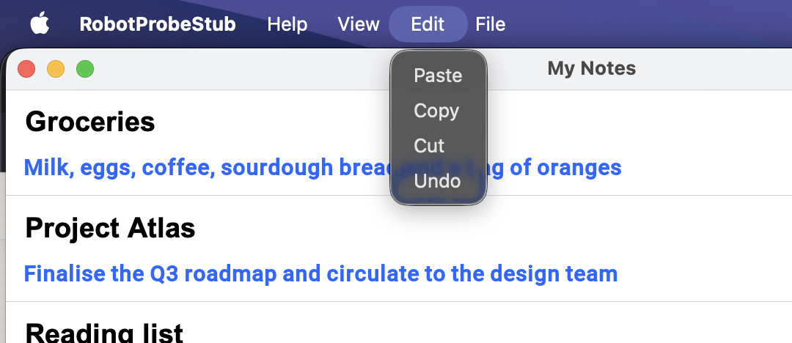
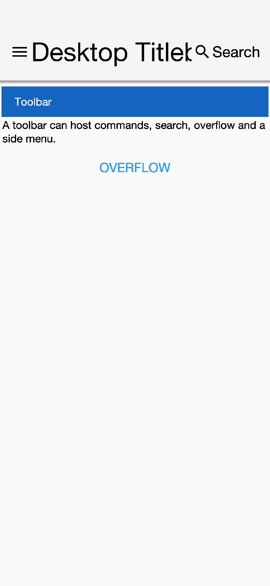

== Desktop Integration

Codename One is mobile-first, but the same app can run on the desktop: as a Java SE
"`Run as desktop app`" / executable jar, and as a native macOS app via the local
`mac-source` (native macOS) build target. By default a desktop build looks like a phone
app in a window - a mobile-style `Toolbar` at the top of every `Form`, fading touch
scrollbars, and commands tucked into a hamburger side menu.

The desktop integration features make a desktop build *feel* like a desktop app:

* A native window title bar that shows the `Form` title (instead of the in-app `Toolbar`).
* A native menu bar populated from your `Command` objects, with per-command placement hints
  (About, File, Edit, Quit, ...).
* Interactive scrollbars - a draggable thumb that highlights on hover and while dragged,
  click-to-page on the track, a minimum thumb size so it stays easy to grab on long content, a
  reserved gutter so content isn't drawn under the bar, and an always-visible (rather than
  fading) scrollbar.
* Keyboard accelerators on the native menu items (a Save shortcut, a Quit shortcut).
* Native desktop notifications driven by the standard `LocalNotification` API.

These behaviors are *opt-in*. They're switched on by default for newly generated projects
(both the Maven archetype and the start.codenameone.com initializr) and stay completely
inert on phones/tablets - all the new behavior is gated on `CN.isDesktop()`, so a mobile
build of the same project is unaffected.

Alongside them a desktop build also gets, without asking for anything:

* Keyboard conventions. Tab and Shift-Tab move focus through the form, Enter fires the
  default command, and Escape fires the back command - or closes a dialog or window that has
  no back command, the same thing the platform's own close control does. On a phone none of
  these keys exist, so every one of them is gated on `CN.isDesktop()`.
* A right-click menu. Give a component its commands with
  `Component.setContextMenuCommands(Command...)` and one opens on a secondary mouse button,
  a stylus barrel button or a long press. Where the commands depend on what was clicked,
  register a `Component.addContextMenuListener(ActionListener)` and call
  `ContextMenu.show(...)` from it.
* Dialogs in a window of their own, when the installed theme asks for it. The three desktop
  native themes do; see <<native-window-dialogs>>.
* Three controls that only make sense here: `Separator`, `GroupBox` and `Stepper`.

=== Title-bar modes

The window chrome is selected by the `desktop.titleBar` setting, which takes one of three values:

[cols="1,4"]
|===
|`native` |Hide the CN1 `Toolbar`. The `Form` title goes into the OS window title bar and the
toolbar's commands are bridged to a native menu bar. This is the default for newly generated apps.
|`custom` |Application-drawn title content where the CN1 `Toolbar` acts as the window's
title bar: it shows the `Form` title and side menu, dragging it moves the window, and the window is
resized by dragging its edges. The commands are bridged to the native menu bar *and* remain in the
toolbar's side menu.
|`toolbar`|Legacy behavior - the in-app CN1 `Toolbar` is shown exactly as on mobile.
|===

The screenshots below show the same notes app, with File / Edit / View / Help commands, in each
mode on macOS.

.`native` mode: the `Form` title is in the OS window title bar, the commands populate the native menu bar, and there is no in-app `Toolbar`

.`custom` mode: the window is undecorated and the CN1 `Toolbar` (title + hamburger side menu) is the window's title bar; the commands are also in the native menu bar

.`toolbar` mode: the legacy look - the in-app `Toolbar` sits below a generic OS title bar and the commands live in the hamburger side menu
image::img/desktop-titlebar-toolbar.png[Desktop legacy toolbar mode,scaledwidth=60%]

==== Enabling it on the Java SE desktop build

For the desktop (Java SE) target the mode is a build hint that the generated desktop launcher
applies for you. In `codenameone_settings.properties`:

[source,properties]
-----
include::../demos/common/src/main/snippets/developer-guide/desktop-integration.properties[tag=desktop-integration-properties-001,indent=0]
-----

Newly generated projects already contain these lines. The generated `<MainName>Stub` reads them
at startup, so no code is required. Because the stub is the desktop entry point, the settings only
ever take effect on the desktop.

==== Enabling it on the native macOS build

The local `mac-source` build runs through ParparVM, where the chrome is the application's own
`NSWindow` and `NSMenu`. Set `codename1.arg.desktop.titleBar=custom` in
`codenameone_settings.properties` to draw title content in the toolbar, or use `native` for the
standard OS title bar. The generated launcher applies the build hint before calling the
application's `init()` method, so the first toolbar uses the requested mode. Without a hint the
installed theme chooses the mode: the bundled Aqua theme requests `native`. If the theme doesn't
specify a mode, the port supplies its fallback.

In `custom` mode, macOS retains its native close, minimize and zoom controls and window resizing.
Dragging an empty part of the toolbar uses the OS window drag operation. Double-clicking it follows
the user's macOS title-bar preference. Buttons (including disabled buttons), editable titles,
scrollable regions and other interactive descendants are excluded from the drag area. The toolbar
publishes these regions to the native port after layout; applications don't need their own window
drag listeners. The native Windows and Linux ports use the same toolbar contract, as described below.

The setting can also be supplied as a runtime property before constructing the first `Form`:

[source,java]
-----
include::../demos/common/src/main/java/com/codenameone/developerguide/snippets/generated/DesktopIntegrationJava001Snippet.java[tag=desktop-integration-java-001,indent=0]
-----

NOTE: On a phone or tablet iOS build these properties are ignored. The legacy Mac Catalyst target
also honors them, through `UIWindowScene` and `UIMenuBuilder` rather than AppKit; see
<<_working_with_mac_catalyst>>.

==== Integrated title content on native desktops

Use `desktop.titleBar=custom` when document actions, a search field, or other application controls
belong in the title area. Configure the toolbar with `setTitleComponent()` and the usual left/right
bar commands. The framework reserves space for the operating system's window controls; don't add
fixed padding for traffic lights or caption buttons. Theme padding is additional application spacing.

[source,java]
-----
include::../demos/common/src/main/java/com/codenameone/developerguide/snippets/DesktopTitleContent.java[tag=desktop-title-content,indent=0]
-----

The example belongs in the normal application lifecycle, after Codename One has initialized the
display. Applications don't call `Display.init()`. The build hint can select the mode before
`init()` runs; a runtime property must be set before constructing the first form.

[cols="1,3"]
|===
|Native port |Window behavior in `custom` mode
|macOS |AppKit retains the real traffic-light buttons, resizable frame and native menu bar.
The toolbar occupies the full-size content area. Empty title space uses AppKit dragging and the
user's configured double-click action.
|Windows |The Desktop Window Manager retains the caption buttons. Native hit testing routes empty
title space to caption dragging and routes the edges to resizing. Windows handles maximize,
restore, minimize, close and the system menu. Application controls remain client input targets.
Caption metrics follow the window DPI; caption appearance follows the system light/dark setting.
|Linux |A `GtkHeaderBar` hosts the toolbar's rendered content beside real GTK window controls.
GTK chooses their arrangement from the desktop settings and handles title gestures and window
commands. The header and document share one Java component tree and rendering surface.
|===

On Windows, the integrated mode omits the separate Win32 menu row, which would overlap the custom
caption. Toolbar commands remain available through their application controls and side menu, and
native command accelerators remain registered. Use `native` mode for the traditional Win32 menu
bar. On Linux, the native GTK menu row remains below the integrated header. The macOS menu stays
in the system menu bar. If an application hides the toolbar's side menu, it must provide another
visible way to invoke those commands, such as its ribbon.

Reserved space uses physical left/right edges, independent of a document's text direction. The
framework accounts for native controls while measuring and laying out the toolbar, and restores
the application's padding values and units afterward. Resize, DPI and native theme changes can
change this space. Avoid forcing the toolbar below its preferred height.

Interactive children, including disabled buttons, are excluded from native dragging. Plain
`Label` and `Container` instances allow window gestures on their passive backgrounds. Pointer,
long-press, context-menu and stylus listeners keep their input. Subclasses and other component
types retain input by default, including those that override pointer methods. For a custom
component that only draws a title background, call `Toolbar.setTitleBarDragRegion(component, true)`
to allow dragging there; interactive children and listeners remain excluded. Passing `false`
also excludes a plain label or container. Hiding or removing the toolbar clears its drag regions; the Windows and Linux ports
restore their ordinary title area. When DWM composition is unavailable, Windows retains its
standard decorated frame instead of removing the user's window controls.

This integration applies to the main application form in native desktop builds. Separate
`Window` and dialog peers retain their own native decorations. Phone/tablet UI and browser pages
use their existing toolbar behavior: this feature doesn't open browser popup windows or attempt
to control browser chrome. The Java SE desktop port retains its existing custom-title behavior.

For port implementers, `getNativeWindowTitleBarInsets(Component)` supplies physical left, right,
top and bottom insets followed by the minimum title-band height, all in component pixels.
`setNativeWindowTitleBarRegions(Component, int[])` receives the full band followed by interactive
exclusion rectangles. An empty array clears the regions. These calls originate on the EDT;
ports must copy arrays before asynchronous native work and must not call Java UI code from a
synchronous native geometry query. The AppKit port reads a cached geometry snapshot so layout
can't deadlock against the native rendering thread.

=== Native menu bar and command placement hints

In `native` and `custom` title-bar modes, the commands you add through the
`Toolbar` / `Form` command API are bridged to the platform's native menu bar - a Swing `JMenuBar`
(which becomes the macOS screen menu) on the Java SE build, and an `NSMenu` on the native macOS build.
Selecting a menu item runs the command's `actionPerformed` on the Codename One EDT, exactly as a
button press would.

By default every command lands under a single *Commands* menu. To place commands into the
conventional desktop menus, tag them with a desktop-menu hint using `Command.setDesktopMenu(String)`
and the `Command.DESKTOP_MENU_*` constants:

[source,java]
-----
include::../demos/common/src/main/java/com/codenameone/developerguide/snippets/generated/DesktopIntegrationJava002Snippet.java[tag=desktop-integration-java-002,indent=0]
-----

The recognized values are (case-insensitive):

[cols="1,3"]
|===
|`DESKTOP_MENU_APP`, `DESKTOP_MENU_ABOUT`, `DESKTOP_MENU_PREFERENCES`, `DESKTOP_MENU_QUIT`
|Placed in the application menu (the macOS app menu / a leading menu).
|`DESKTOP_MENU_FILE`, `DESKTOP_MENU_EDIT`, `DESKTOP_MENU_VIEW`, `DESKTOP_MENU_WINDOW`, `DESKTOP_MENU_HELP`
|Placed in the matching standard top-level menu.
|Any other string |Becomes a top-level menu with that literal title.
|Unset |Grouped under a default *Commands* menu.
|===

Each port maps the hint to its native structure: on the native macOS build the command is inserted
into the application's real `NSMenu` under the application, File, Edit, View, Window and Help
submenus; on the Java SE build a top-level `JMenu` is created per hint group.

All four desktop ports have one: a Swing `JMenuBar` on the Java SE build, an `NSMenu` on the
native macOS build, a Win32 `HMENU` on the Windows port and a `GtkMenuBar` on the Linux port.
The three ParparVM ports encode a command the same way, so one format serves every one.

NOTE: A port with no native menu bar is handled rather than assumed away. `Form` keeps its
Toolbar there instead of hiding it - hiding it would take away the only place the commands are
drawn - and `Display.COMMAND_BEHAVIOR_NATIVE` normalizes back to the default rather than
dropping every command without a word. Nothing in application code branches on this.

TIP: The hint is a plain client property (`Command.DESKTOP_MENU`), so it's inert on platforms that
don't have a native menu bar - it's safe to set it unconditionally in shared code.

==== Keyboard accelerators

Give a command a keyboard accelerator with `Command.setDesktopShortcut(...)`. The shortcut is shown
next to the menu item and triggers the command from the keyboard:

[source,java]
-----
include::../demos/common/src/main/java/com/codenameone/developerguide/snippets/generated/DesktopIntegrationJava003Snippet.java[tag=desktop-integration-java-003,indent=0]
-----

The single-argument form uses the platform's *primary* modifier - Command on macOS, Control on
Windows/Linux - which is the right default for most menu shortcuts. The
two-argument form takes a bit-mask of `Command.DESKTOP_SHORTCUT_MODIFIER_PRIMARY`,
`Command.DESKTOP_SHORTCUT_MODIFIER_SHIFT` and `Command.DESKTOP_SHORTCUT_MODIFIER_ALT`. On the
Java SE build the accelerator becomes a Swing `KeyStroke`; on the native macOS build it becomes the
menu item's `keyEquivalent` and `keyEquivalentModifierMask`.
Like the placement hint, the accelerator is inert on platforms without a native menu bar, so it's
safe to set unconditionally.

==== Submenus, separators, check items and icons

The same `Command` carries the rest of a menu item's structure:

[cols="1,3"]
|===
|`setDesktopMenu("File/Open Recent")`
|A path: each `/` nests a submenu, created on demand. The first segment is the placement hint
from the table above. Write `//` for a slash that belongs in a title.
|`setDesktopMenuGroup(int)`
|Orders the items of a menu by group, keeping the order you added them in within a group, and
draws a separator wherever the group changes. `Command.createDesktopSeparator(menu)` adds one
at an exact spot instead.
|`setDesktopChecked(boolean)`
|Makes the item a check item. Choosing it flips the state *before* the action runs, so the
action reads the new value from `isDesktopChecked()`.
|`setDesktopRadioGroup(String)`
|Makes the item one of a radio group: checking one unchecks the others.
|`setEnabled(boolean)`
|A disabled command is greyed out in the menu and can't be chosen.
|`setIcon(...)`, `setMaterialIcon(...)`
|Shown beside the item where the platform draws menu icons.
|===

[source,java]
-----
include::../demos/common/src/main/java/com/codenameone/developerguide/snippets/DesktopMenuStructure.java[tag=desktop-menu-structure,indent=0]
-----

Changing a command's enabled or checked state updates the menu that's on screen. After changing
anything else about a published command, such as its name or icon, call
`Display.getInstance().refreshNativeMenu()`.

Each platform draws these its own way. macOS and Mac Catalyst show a radio item with the same
checkmark as a check item, as every Mac application does. Windows draws a bullet. The Windows
and Linux menus show no icons: Win32 menu bitmaps need a decoder that port doesn't have, and GTK 3
deprecated menu item images, so no GNOME application shows them.

=== Interactive scrollbars

Enabling `desktop.interactiveScrollbars` turns the scrollbar from a fading touch indicator into a
desktop-style control:

* The thumb can be grabbed and dragged, and it *highlights* while the pointer hovers it and while
  it's being dragged (the `DesktopScrollThumb` selected / pressed styles).
* Clicking the track pages toward the pointer by about one viewport.
* The thumb has a *minimum size* so it stays easy to grab even when the content is far taller than the
  viewport. The minimum (in pixels) is the `scrollThumbMinSizeInt` theme constant; when unset it
  defaults to the equivalent of 4mm.
* A *gutter* is reserved for the scrollbar so content isn't laid out underneath it. The gutter width
  comes from the `DesktopScroll` / `DesktopHorizontalScroll` UIID padding (see below).
* The scrollbar stays visible rather than fading out.

This is a cross-platform core feature driven by the `interactiveScrollBool` theme constant, which
the desktop ports inject only when `CN.isDesktop()` is true. Mouse-wheel scrolling continues to work
as before.

[#desktop-theme-uiids]
=== Theme UIIDs

When interactive scrollbars are active, the desktop scrollbar is styled through dedicated UIIDs so the
mobile `Scroll` / `ScrollThumb` styling is never affected:

[cols="1,3"]
|===
|`DesktopScroll`, `DesktopScrollThumb`, `DesktopHorizontalScroll`, `DesktopHorizontalScrollThumb`
|The interactive desktop scrollbar track and thumb. The horizontal-/vertical-scroll UIID's padding
sets the scrollbar gutter width. The thumb UIID's `.selected` and `.pressed` styles render the
hover and drag highlight respectively.
|===

All the native themes ship platform-conventional defaults for these UIIDs, including the
`.selected` / `.pressed` thumb highlight states; see <<native-modern-themes>>. The three desktop
themes also turn `interactiveScrollBool` on themselves, so a desktop build using one gets the
real scrollbar without setting the build hint. Override the UIIDs in your app's `theme.css` like
any other UIID.

WARNING: The highlight states are `.selected` and `.pressed`, not `.hover`. The interactive
thumb reads its selected style while the pointer is over it and its pressed style while it's
being dragged, so a `.hover` rule on `DesktopScrollThumb` compiles and is never painted. For the
same reason, don't write these UIIDs as `cn1-derive: ScrollThumb`: a derive produces the whole
state family by copying the base, so the highlight ends up identical to the resting colour -
present in the compiled theme and invisible on screen.
The minimum thumb length is the `scrollThumbMinSizeInt` theme constant (pixels). In `custom` mode the
title bar is just the regular CN1 `Toolbar`, so it's themed through the usual `Toolbar` / `Title`
UIIDs.

=== Desktop notifications

The standard `com.codename1.notifications.LocalNotification` API works on the desktop. On the
Java SE desktop build a scheduled notification surfaces as a native OS notification through the
system tray (Notification Center on macOS, the notification area on Windows/Linux); on the
native macOS build it goes through the same `UNUserNotificationCenter` path as iOS. Clicking
the notification delivers it to your app's `LocalNotificationCallback`, exactly as on mobile, so the
same scheduling and handling code is shared across phone and desktop:

[source,java]
----
include::../demos/common/src/main/java/com/codenameone/developerguide/snippets/generated/DesktopIntegrationJava004Snippet.java[tag=desktop-integration-java-004,indent=0]
----

NOTE: On the Java SE build desktop notifications require an OS with system-tray support
(`java.awt.SystemTray`); where it's unavailable the notification is logged and skipped.
