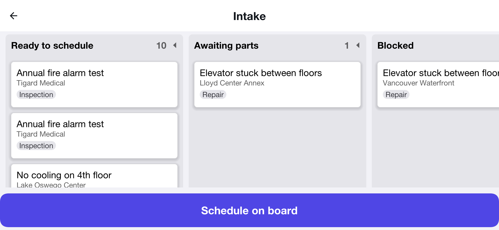

[[fieldline-implementors-guide]]
== Fieldline: Building on the sample

Fieldline shares its shape with <<pulse-implementors-guide,Pulse>> and
<<slate-implementors-guide,Slate>>: one Maven project, a Codename One app for every
platform, a Codename One Backend server and the contract between them, written in
Java on both sides. This chapter covers what a field service business changes: a
scheduling engine that plans a crew's routes, a plan that's repaired rather than
rebuilt when the day changes, and the clock and the pay rules behind a timesheet.

<<fieldline-users-guide>> describes what each kind of user sees. This chapter
explains how the project is built and what to change to make it yours.

[[fieldline-launch]]
=== Running it

The project is in `scripts/fieldline`. Start the server on the development
profile, which creates an in-memory database, seeds the demo company and its
accounts, prints push notifications on the console and lets the assistant answer
from built-in rules:

[source,bash]
----
include::../demos/common/src/main/snippets/developer-guide/fieldline.sh[tag=fieldline-sh-server,indent=0]
----

Then run the app in the simulator:

[source,bash]
----
include::../demos/common/src/main/snippets/developer-guide/fieldline.sh[tag=fieldline-sh-simulator,indent=0]
----

The server prints `listening on http port N` once it accepts connections. Every
demo account has the password `fieldline-demo`: `dispatch@fieldline.example` is
the dispatcher, `tech@fieldline.example` and `tech2@fieldline.example` are
technicians, and `admin@fieldline.example` is the admin.

=== The modules

The project has three modules:

[cols="1,3"]
|===
| Module | What it holds

| `shared`
| The data classes (`api/*Dto`) and the `@RestClient` interfaces, such as
  `AdminApi` and `GeoApi`, that both sides build from, and the scheduling
  engine, package `scheduler`, which depends on nothing outside `java.lang` and
  `java.util`.

| `common`
| The app, for every platform. Its pom depends on `shared`.

| `backend`
| The server. It depends on `shared`, and runs the engine.
|===

The server is in packages by subject:

[cols="1,3"]
|===
| Package | What it holds

| `account`
| Accounts, preferences, closing an account and the demo accounts.

| `field`
| Jobs, the crew, the catalog of skills and equipment, the planner, timekeeping
  and the demo company.

| `ai`
| The assistant: photo diagnosis, report drafting, the chat and the equipment
  manuals its answers cite.

| `geo`
| Address lookup, behind the `Geocoder` interface.

| `live`, `push`
| The WebSocket and push notifications.

| `admin`
| The admin's endpoint.

| `domain`, `repository`
| The tables and their repositories.
|===

Roles are `TECHNICIAN`, `DISPATCHER` and `ADMIN`, in `Roles`. A technician works the
jobs assigned to them, a dispatcher plans everybody's work, and an admin manages
accounts. The app opens on the mode of the strongest role the account holds and
offers the others from its menu.

=== The scheduling engine

The engine is in `shared`, in `com.codenameone.examples.fieldline.scheduler`. Start
at `Problem`, `Solver` and `Reoptimizer`. It uses integer arithmetic throughout, so
the same seed and problem give the same plan on the server, in the app and in the
tests.

`Problem` is an immutable planning instance: the technicians, the jobs, the shifts
cut from each technician's availability once time off is removed, and every travel
time the solver will read. Everything the inner loops need is precomputed into
arrays indexed by position, so the search never touches a map or an id string.

*Hard constraints* are what a plan may never break. A job goes only to a
technician who holds its skills, on a shift with the time for it, after the jobs
that must finish before it starts. On top of that, `Problem.blocked` refuses a
technician the customer excluded, a certification the technician lacks or that
lapses before the shift ends, and, when territories are strict, a site outside the
technician's territories. Work that has already started is pinned and exempt.

*Soft constraints* are costs, and the plan with the lower total wins. They're the
fields of `Weights`, each an integer so two runtimes always agree on which of two
schedules is better:

[cols="1,1,3"]
|===
| Field | Default | Charged

| `travel` | 10 | Per minute of driving.
| `overtime` | 15 | Per minute past a technician's regular hours.
| `unassigned` | 20000 | Times priority squared, per job left unplaced.
| `continuity` | 300 | Per job not given to its preferred technician.
| `disruption` | 800 | Per job moved off the technician that held it before a re-plan.
| `waiting` | 1 | Per minute of idle waiting before a window opens.
| `balance` | 40 | Times the squared deviation, in hours, from the mean workload.
| `lateness` | 30 | Per minute a job finishes past its deadline, times its priority.
| `outOfTerritory` | 400 | Per job outside the technician's territories, when territories are a preference.
|===

`strictTerritories` turns the territory cost into a hard constraint.

`Solver` builds and improves a schedule with Adaptive Large Neighborhood Search, in
four steps:

. *Construction.* Pinned work first, then regret-2 insertion: the job whose best
  placement is most ahead of its second best goes first, so jobs with one realistic
  technician aren't crowded out by flexible ones.
. *Search.* Each iteration removes 10 to 35 percent of the placed jobs with one of
  four destroy operators (random, worst, related and whole route) and puts them
  back with greedy or regret insertion. Operators that produce better schedules are
  chosen more often.
. *Acceptance.* A worse candidate is kept while it's within a threshold that
  shrinks linearly to zero, which lets the search walk out of a local optimum early
  and settles it at the end.
. *Route polish.* 2-opt and or-opt on every route the iteration touched.

A run is bounded by its iteration count and seeded, so it's repeatable.

`Reoptimizer` re-plans after something changed: a sick call, approved time off, an
emergency job or a visit that overran. It keeps as much of the published plan as it
can. Work that started by now is pinned to the same technician and start. Every
other job remembers its previous technician, and moving it costs the `disruption`
weight, so a job changes hands only when that buys more than a phone call to the
customer costs. The search starts from the old plan, replayed onto the new
availability, and repairs only what no longer fits. It also reports the plan's
changes, job by job, with the reason for each, which is what a dispatcher reads
before approving a plan.

==== Travel times

`TravelModel` is one method: the driving minutes between two points given in
microdegrees. The solver only ever reads the matrix `Problem` precomputes from it.
The default, `GeoTravel`, is offline: straight-line distance stretched by a road
factor and driven at a fixed speed, plus a parking allowance per leg. `Planner`
creates it.

To use a routing service, implement `TravelModel` over it and pass that where
`Planner` creates `GeoTravel`. The search doesn't change. Rush hours are separate:
`Problem` makes drives that set off inside the morning and evening windows take a
set percentage longer, so the same route can be feasible at ten and not at five.

==== Changing the rules

The defaults in `Weights` are what the engine and its tests use. The server reads
its own from `PlannerPolicy`, one row of the company's planning rules that admins
edit on the Rules page and every run reads. It holds the meal break (30 minutes,
taken between three and five hours into a shift), the travel, overtime, lateness,
continuity, balance and territory weights, strict territories, the deadlines a new
urgent and routine job gets (4 and 72 hours), the rush-hour windows and their extra
percentage, and the clock's rounding and automatic clock-out. `Planner` copies the
row into `Weights` before each run.

A new soft rule is a field in `Weights`, a cost where `Schedule.evaluate` adds up a
schedule and, if admins should tune it, a column of `PlannerPolicy` and a migration. A new
hard rule is a reason in `Problem.blocked`, which the plan's explanations then
report. `SolverTest`, `ConstraintTest` and `ReoptimizerTest` test the engine by
itself, and `PlanChecker` re-checks every hard rule on a plan without
sharing code with `Schedule.evaluate`.

=== The planner

`Planner` in `field` is the bridge between the database and the engine. It builds
the problem the next few working days pose, runs the search, writes the plan back
onto the jobs, and keeps a record of every run and what it changed. The plan
reaches a week ahead, so it always holds five working days.

Every change to the plan goes through `Planner.publish`, one at a time. A run reads
the published plan, so two runs at once would each repair the same old plan, and
the second would undo the first. The plan is always repaired, never thrown
away. Optimizing from scratch is tried as well and kept only when it's cheaper
after paying for the disruption.

The engine counts whole minutes from a midnight in the service's time zone, and
`Horizon` converts between those and the database's milliseconds. A minute is a
minute of real time, so a day when the clocks change is 23 or 25 hours long, and
8:00 is still 8:00 on that day. `fieldline.zone` sets the zone. Left empty, it's
the server machine's zone, which suits a demo on one machine; a deployment sets it
to the crew's. `fieldline.scheduler.iterations` is the number of improvement steps
a run takes: 2500, about a second for the demo crew.

==== Holding a job at intake

Two states sit beside `UNASSIGNED` before a job is planned: `AWAITING_PARTS`
and `BLOCKED` (`Catalog.isHeld`). The planner leaves a held job out of every
run, and a move on the board refuses it. `POST /api/dispatch/jobs/{id}/intake`
moves a job between the three, as `Jobs.intake`, under `Planner.publish` like
any other change to the plan. It never schedules: asking it for any other
state is refused, as are a job that has started or is closed and releasing a
scheduled job, which is the board's to unassign. Holding a scheduled job takes
it off its technician's route. Like the rest of `/api/dispatch`, it is for
dispatchers only.

The app's intake board, `IntakeBoard` in `dispatch`, is a `KanbanBoard` over
those states. A drop calls that endpoint, and the card goes back to where the
server says the job is when it refuses or can't be reached. Undo, adding,
renaming and reordering columns are turned off, so the board can only make
the transitions the server allows. `FieldTest` covers the role, an illegal
transition and a held job surviving an optimize.

=== Time and pay

`Timekeeping` holds the labor rates, the clock and the timesheets. A technician
clocks a shift in and out, and the job flow records the rest without being asked:
setting off opens a travel span, arriving closes it and opens a job span, and
finishing closes that. A technician who sets off without clocking in is clocked in then.

Times are rounded to the company's increment when they're written, 15 minutes by
default. A shift left open longer than the company allows, 12 hours by default,
is read as ending there.

A week's cost follows simple rules, and `Timekeeping` is the place to change them
for local law:

* Overtime is the weekday time past the technician's regular weekly hours.
* Weekend time is paid at its own premium and doesn't count toward overtime. A
  shift that crosses midnight into or out of a weekend is split there.
* The unpaid meal break comes off any shift long enough to owe one.
* A shift belongs to the week it starts in.
* There's no daily overtime threshold.

A rate someone is paid at can't be removed, because their cost would
become zero.

=== The live channel

The app keeps a WebSocket open, and `LiveHub` sends three kinds of frame down it,
each a small JSON object:

* `job`, with the job's id and status, when a job changed. It goes to the job's
  technician and the dispatchers, who then read the job from the API. The frame
  carries no more than that on purpose: a client that missed one is put right by
  its next read.
* `schedule`, when a new plan was published. It goes to everyone connected.
* `tech`, with a position, when a technician moved. It goes to the dispatchers.

A browser's WebSocket can't carry a bearer token, and a token in the address ends up
in access logs. The app therefore asks for a ticket over the authenticated API and presents
that instead (`LiveTickets`). A ticket is random, names nothing, opens one
connection and goes stale in half a minute.

The connections are those of one process. Running more than one server instance
needs a channel between them, such as a database's `LISTEN` and `NOTIFY` or a
message broker, feeding the same three methods.

=== Settings and services

The server reads `backend/application.properties`, then
`application-<profile>.properties` for the profile in `CN1_PROFILE`, then the
environment, then system properties, each winning over the one before. A setting's
environment name is the key in upper case with `_` for each `.`, so
`fieldline.ai.key` is `FIELDLINE_AI_KEY`; that's where secrets belong.
`cn1.datasource.url` is also read from `DATABASE_URL`, and `PORT` wins over the
port in the file, which is what platforms set.

The `dev`, `test` and `local` profiles are development profiles and need nothing
else. `application-dev.properties` sets `fieldline.push.provider=console`, and
`application-test.properties` sets the `demo` assistant, the `recording` push
provider and 400 search steps.

`Services` chooses each outside service from one setting. When it isn't set, a
development profile gets the one that needs no account and any other profile gets
the real one. A server whose settings for a real provider are missing still starts
and logs a configuration error naming each missing setting.

[cols="1,1,3"]
|===
| Setting | Values | Notes

| `fieldline.ai.provider`
| `anthropic`, `demo`
| `anthropic` when `fieldline.ai.key` holds a key, `demo` otherwise.
  `fieldline.ai.model` overrides the model, `claude-opus-5-5`. The demo answers
  from rules in the server, and every answer says which of the two produced it.

| `fieldline.geocoder`
| `photon`, `stub`
| Photon, at `fieldline.geocoder.url`, `https://photon.komoot.io` by default.
  `stub` knows ten places and asks nobody; the `test` profile gets it.

| `fieldline.push.provider`
| `cloud`, `console`, `recording`
| `cloud` sends through the Codename One push service and needs
  `fieldline.push.app` and `fieldline.push.key`. `console` prints and `recording`
  keeps notifications for the tests; both are refused outside a development
  profile.
|===

A deployment also sets `cn1.security.authorizationserver.issuer`, the server's
public address, and `cn1.security.authorizationserver.jwk.keys`, the key tokens are
signed with. A development profile makes a signing key at start-up.

==== The database

On a development profile the database is SQLite in memory. Point
`cn1.datasource.url` at a file path to keep the data between runs, or at a
`postgres://` or `mysql://` address for a real deployment; the same code runs
against all three. The migrations are in `backend/src/main/resources/db/migration`
and create the tables at start-up. Most are shared, and those that differ by
database have a copy each under `postgresql`, `mysql` and `sqlite`. A schema change
is a new migration with the next number, never an edit to one that has shipped.

==== Demo data

`DemoAccounts` creates the accounts a server starts with. On a development profile
it creates the four demo accounts and, through `DemoField`, a twelve-person crew
based in Portland, their customers' sites around the city and a working week of
jobs, planned. `DemoField` uses a fixed random seed, so every checkout starts from
the same board. One technician's gas certificate lapses in three days, so the
planner stops sending them to boilers then.

Anywhere else, `DemoAccounts` creates at most one account: the admin named by
`fieldline.admin.email` and `fieldline.admin.password`, who grants the first roles.
It's created once, and changing the setting later doesn't change that account's
password. The equipment manuals are seeded on every profile, because they're what
the assistant's answers cite.

=== The app

The screens are in `common/src/main/java/com/codenameone/examples/fieldline`:

[cols="1,3"]
|===
| Package | What it holds

| `field`
| The technician: today's route, a job and its actions, the sign-off, the
  assistant, availability, time off and the calendar sync.

| `dispatch`
| The dispatcher: the board, a plan run and its changes, a new job, the time-off
  queue, labor and reports.

| `ui`
| Sign-in, registration, consent, settings, the profile and the shared pieces they
  are built from.

| `map`, `live`, `net`, `notify`
| The maps, the live channel, the API session and notifications.
|===

The board's views are the framework's <<scheduling-and-gantt,`Scheduler`>> and
`Gantt`.

Colors are CSS variables at the top of `common/src/main/css/theme.css`: `--brand`
and its pressed, contrast and tint variants, the surfaces, the text, the lines and
`--success`, `--warning` and `--danger`. Each has a `-dark` twin for dark mode.
Text is in `common/src/main/l10n`, in `Bundle.properties` and a bundle each for
English, German, Spanish, French, and Hebrew.

=== Tests

[source,bash]
----
include::../demos/common/src/main/snippets/developer-guide/fieldline.sh[tag=fieldline-sh-tests,indent=0]
----

`run-e2e.sh` starts the server on the `test` profile and runs the app's tests in
the simulator against it. They sign in as a technician and a dispatcher, register
and change settings while a second user acts through the API, and hold a few
captured screens against `screenshots/`. `run-web-e2e.sh` builds the browser
version, serves it from the server and drives it in a headless browser through
sign-in to the technician's day, with the live channel open. It needs Node with
Playwright. `check-template.sh` generates a project from the Initializr template
under another name and package and builds it. The server's own tests run with
`@BackendTest` on the `test` profile, which takes fewer search steps so a run stays
quick. CI runs them in `.github/workflows/fieldline.yml`.

=== Making it yours

* *Your name and package.* Start from the Fieldline template in the Initializr,
  which generates the project under your name and package. `check-template.sh`
  is what proves a generated project builds. The app's name and icon are
  `codename1.displayName` and `codename1.icon` in
  `common/codenameone_settings.properties`, and the icon is `common/icon.png`.
* *Your brand.* Change `--brand` and its variants in `theme.css`, and the text in
  the bundles.
* *Your trade.* Skills, certifications, territories and kinds of job are lists in
  `Catalog`, in the server's `field` package. Each row of `Catalog.ASSETS` is a kind
  of equipment, the skill its work needs and the lines its checklist inspects. An
  elevator or solar contractor replaces those rows, the calls in `DemoField` and the
  equipment manuals the assistant cites.
* *Your crew.* Replace the crew and sites in `DemoField`, or start on an empty
  database with the admin from `fieldline.admin.email` and add people from the app.
* *A real assistant.* Set `FIELDLINE_AI_KEY` in the server's environment, never
  in a file. Photo diagnosis, report drafting and the chat then go to the Claude
  API.
* *Real push notifications.* Set `fieldline.push.app` and `FIELDLINE_PUSH_KEY`
  from the Push section of the Codename One console.
* *Your rules.* Planning weights, breaks, deadlines and rush hours are on the
  admin's Rules page; pay rules are in `Timekeeping`.

A deployment's environment looks like this, with the values replaced by yours:

[source,bash]
----
include::../demos/common/src/main/snippets/developer-guide/fieldline.sh[tag=fieldline-sh-production,indent=0]
----

==== Hosting it in a browser

The server can serve the app itself. Build the browser version once, and again
when the app changes, which takes about a minute:

[source,bash]
----
include::../demos/common/src/main/snippets/developer-guide/fieldline.sh[tag=fieldline-sh-web,indent=0]
----

Then open `http://localhost:8080/`. `server.sh web` stages the app in
`backend/target/webapp`, and a server that finds it there serves it at `/`, after
its own routes. In the browser the app takes the page's address as the server's.
To deploy it, put `backend/target/webapp` beside the server binary as `webapp`.
`server.sh run --native` runs the server compiled to a native binary, which is how
it ships.

[[fieldline-before-product]]
=== Before it's a product

The sample is complete as a demonstration. A product needs at least:

* *A real routing service.* `GeoTravel` estimates drives from straight lines.
  Plug a routing service into `TravelModel` before customers are promised arrival
  times.
* *Pay rules for your jurisdiction.* The rules in `Timekeeping` are a starting
  point, without daily overtime or local meal-break law.
* *A channel between server instances* before you run more than one, for the live
  channel.
* *Your own geocoder.* The public Photon server is for moderate use. Run your own,
  or point `fieldline.geocoder.url` at another Photon
server, before it carries a real service's traffic.
* *Reviewed translations.* Have the non-English bundles reviewed before release.
* *Operations.* Monitoring, backups that have been restored in a test, and a
  support process.
