[[fieldline-users-guide]]
== Fieldline: A field service app from every side

Fieldline is a sample app with a server behind it, for any contractor that sends
people to customers' sites: HVAC, electrical, plumbing, elevators, solar, fire
safety, and inspection teams. A scheduling engine plans every technician's day
around skills, working hours, time off and travel. Technicians work the day from
their phone. Dispatchers see the whole crew and move work between people. The app
and the server are one Maven project, written in Java on both sides.

This chapter is the user's guide: what each kind of user sees and can do.
<<fieldline-implementors-guide>> is the other half. It explains how the project is
built and what to change to make it yours.

One app serves everyone. The server gives every account a set of roles, and the
app opens on the screens for the role the account holds.

[cols="1,3"]
|===
| Role | What it adds

| Technician
| Follow the day as a route, check in on site, work a job's checklist, take
  photos the assistant diagnoses, and finish with a report and the customer's
  signature. Clock in and out, set working hours and limits, and ask for time off.

| Dispatcher
| See the crew on a timeline, a Gantt chart and a map, reassign jobs, add new
  ones, cover an absence, decide time-off requests and run the optimizer.

| Administrator
| Everything a dispatcher does, plus each technician's limits, the labor rates,
  rush hours, time tracking and timesheets, and the roles of every account.
|===

=== Trying it

Start the server on the development profile. It needs
nothing installed: the database is in memory, push notifications are printed on
the console, and the assistant answers from rules built into the server:

[source,bash]
----
include::../demos/common/src/main/snippets/developer-guide/fieldline.sh[tag=fieldline-sh-server,indent=0]
----

Then run the app in the simulator, from another terminal:

[source,bash]
----
include::../demos/common/src/main/snippets/developer-guide/fieldline.sh[tag=fieldline-sh-simulator,indent=0]
----

The demo is a contractor with a crew of twelve based in Portland and a planned
working week of jobs. Every demo account has the password `fieldline-demo`:

[cols="2,3"]
|===
| `tech@fieldline.example` | a technician with a day of jobs
| `tech2@fieldline.example` | a second technician
| `dispatch@fieldline.example` | runs the board and the planner
| `admin@fieldline.example` | also runs the back office
|===

Sign in as the technician in one simulator and as the dispatcher in another: a
change made on one reaches the other as it happens.

=== The technician

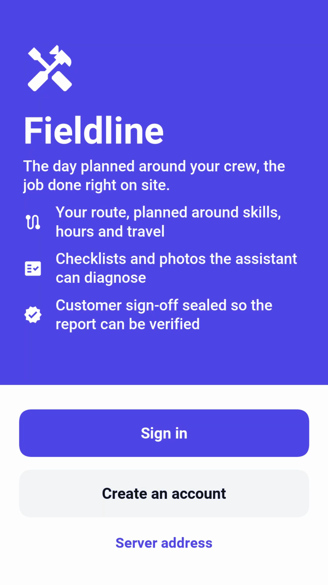

A technician signs in with the account the office set up. The app remembers the
session, so the next time it opens straight on the day.

==== The day

The day opens on a map of the area with a sheet over it. The sheet greets the
technician by name and says how many jobs are left, how long the driving takes
and how much of the day is done. Below that are the clock and the next job, with
a button to start driving to it.

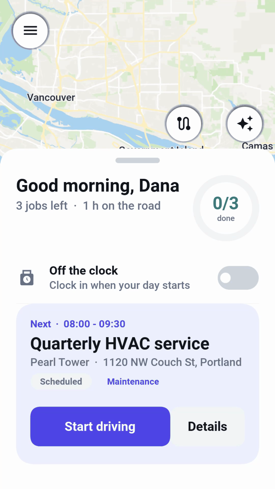

Dragging the sheet up shows the whole route: the number of jobs, the time on the
road and how full the day is, then every stop in order with the drive between
each one. The same stops are numbered on the map, and the route button above the
sheet fits them all on the screen.

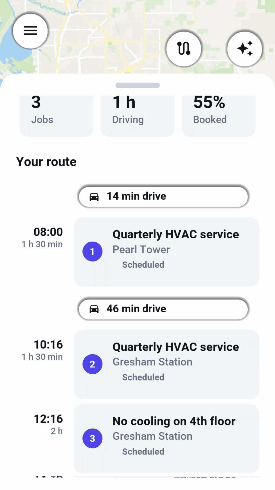

The switch on the sheet clocks the technician in and out. The time worked goes to
the timesheet, and the unpaid meal break comes off it by the company's pay rules.
A finished job drops off the count, and the ring fills.

==== A job

Opening a job shows what the dispatcher knows about it: the site and its address,
the window it's booked for, the customer with a button to call them, directions,
and the problem as it was reported. The steps along the bottom show how far the job
has gone, from scheduled to completed.

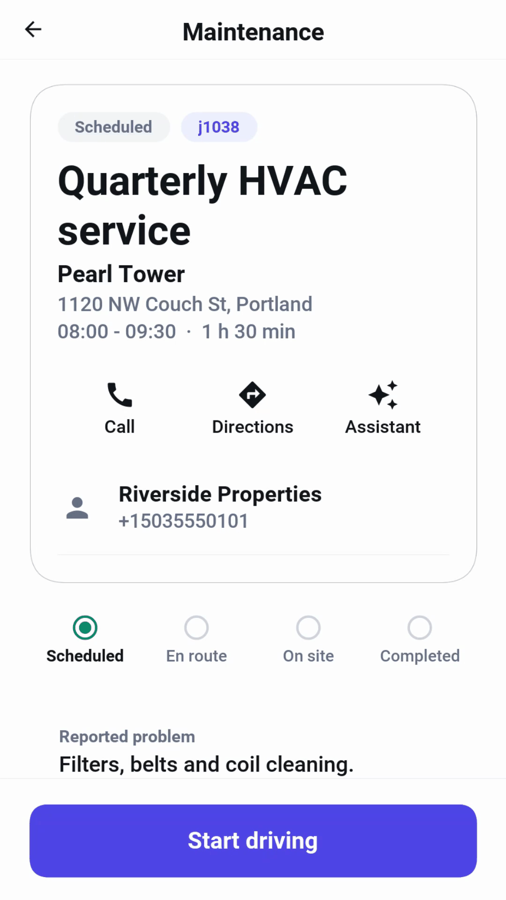

*Start driving* tells the dispatcher the technician is on the way. On arrival,
*Check in* records the time and how far the phone is from the site, and the job
moves to on site.

The checklist comes from the kind of job: a quarterly HVAC service checks
different things than a fire alarm test. Every item is a pass, a fail or not
applicable, and each answer is saved the moment it's given, so a phone that loses
signal or runs out of battery loses nothing. The job can't be completed while
an item is unanswered, and the button says how many are left.

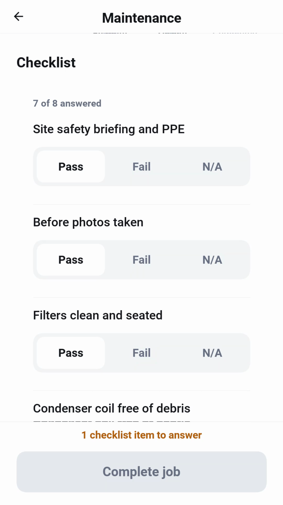

A photo taken from the job goes to the assistant, which says what it sees: the
likely issue, its severity, the probable cause, what to do and the parts
it needs. The diagnosis shows as a card on the job.

==== The assistant

The assistant answers from the manuals for the equipment the crew services. Asked
from a job, it knows the job, its checklist and its photos, so a question about a
fault is answered from the manual for that unit, never from one for something
else. Each answer names the manual it came from.

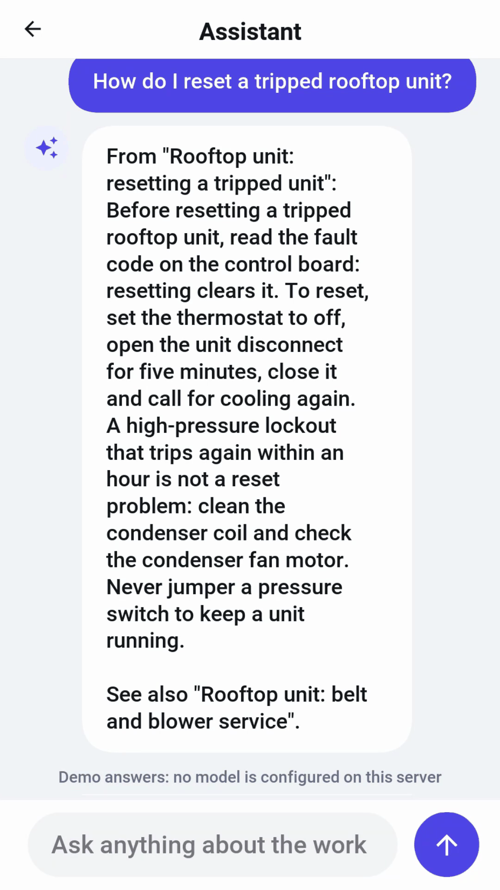

On a server with no model configured, the assistant answers from rules and a
search of the manuals, and says so under the conversation. A model configured
on the server makes the answers conversational. Nothing else changes.

When the work is done, *Draft report* writes up the visit from the checklist,
the findings and the follow-up, and the button under it puts the draft into the
report for the technician to edit.

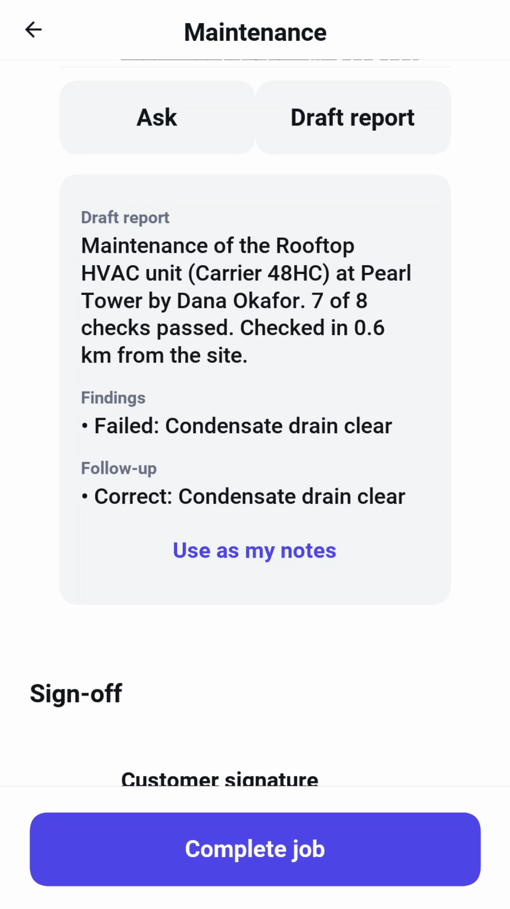

==== Sign-off

The customer signs on the screen, under a summary of what passed, what failed
and how many photos were taken.

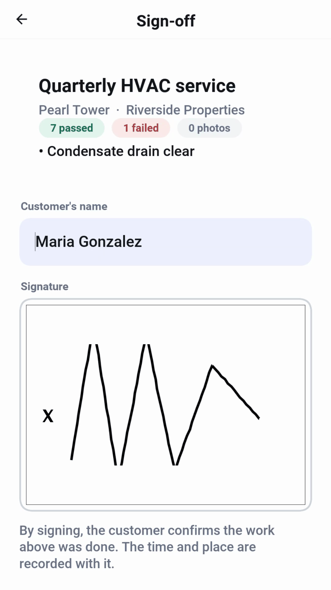

The signature is sealed with a hash of the signature, the checklist, the photos,
the notes, the time and the place. The job shows the hash and checks it again
each time it opens: if anything in the report has changed since the customer
signed, it's no longer marked verified.

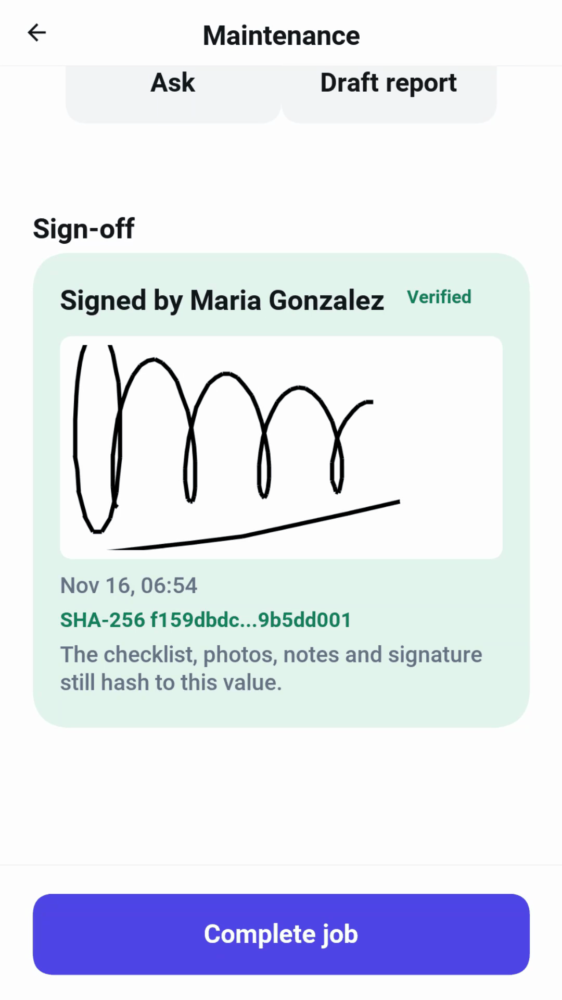

==== Hours and time off

The menu holds everything besides the day's work.

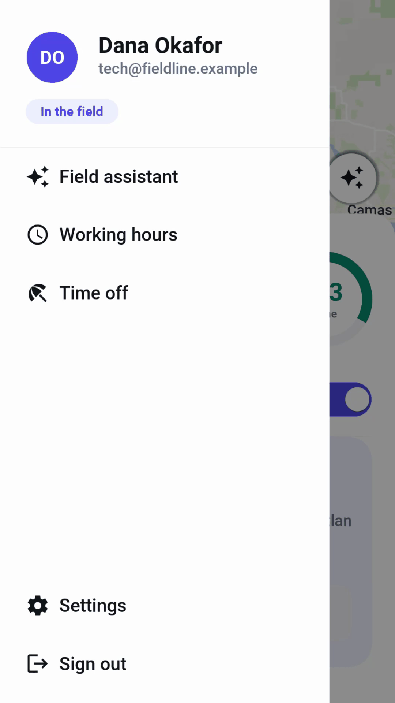

*Working hours* is the week the planner books into: the days the technician
works, the hours on each, the longest drive they accept between jobs and the
most hours in a week. The planner never books outside them, and saving them
re-plans the week at once.

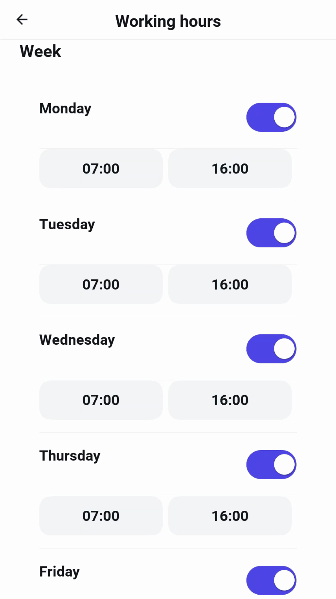

*Time off* asks the dispatcher for days away, with a reason. The request shows as
waiting until the dispatcher decides, and then as approved or declined. The
day's jobs can also be added to the phone's calendar from the settings.

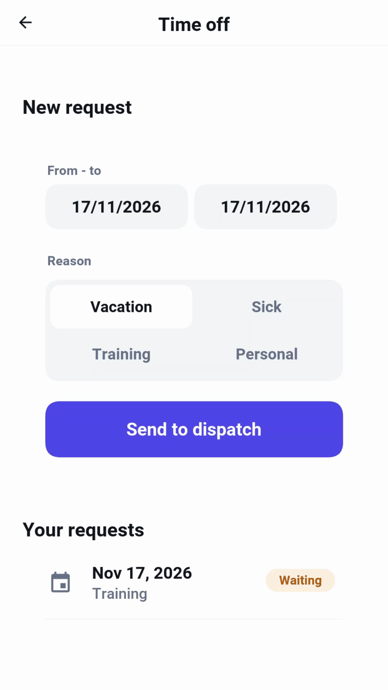

=== The dispatcher

The dispatcher works at a desk, so the screens are laid out for a wide window
with the places down the side. The same screens fit a tablet, and on a phone
they stack.

==== The board

The board opens on today's numbers: jobs scheduled, jobs no one can take, jobs
past their deadline, the hours on the road and how much of the crew's time is
booked. Below them, the crew is one row each on a timeline, with the breaks
striped. Beside it, *Needs attention* lists the time-off requests waiting and
each unassigned job with the reason the planner couldn't place it.

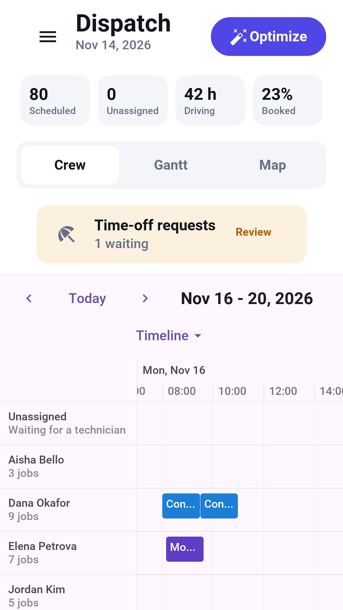

Tapping a job opens it. Dragging it to another row or time moves it, and the
move is checked against every rule before it goes through: the technician's
skills and certificates, their hours and time off, the job's window and the
drive from the job before. A move that breaks one is refused with the reason. A
new job goes to the planner, which finds it a place.

The Gantt view shows every technician's jobs as bars against the plan before the
last change, so what moved stands out.

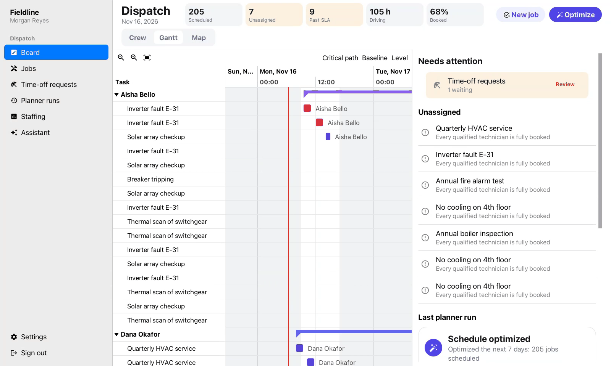

The map view shows where every technician is and the jobs no one has yet.

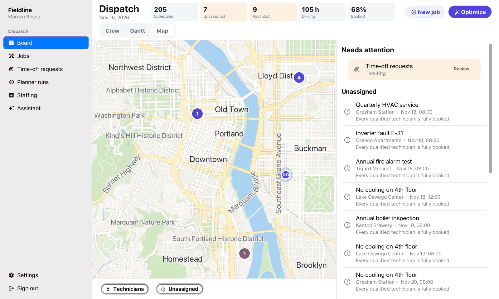

==== The planner

*Optimize* plans the week again. The result shows how the numbers changed and
every job that moved, with where it went and why. Each run is kept under
*Planner runs*, so a change can be traced to the run that made it.

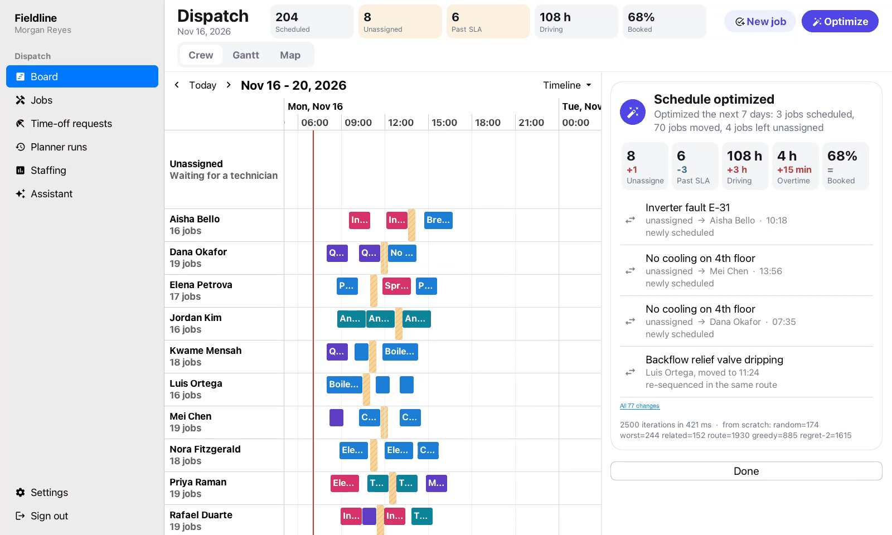

The planner keeps to the same rules as a move, and then weighs the rest: less
driving, fewer missed deadlines, less overtime, each technician's preferences,
an even share of work, and the same technician for a site they visited before.
When something changes in the middle of a week, it repairs the plan instead of
starting again, and moves as few jobs as it can. Work already started is never
moved.

==== Intake

*Intake* in the menu shows the jobs by why they aren't on a route yet:
ready to schedule, awaiting parts or blocked, with the scheduled jobs in a
last column. Dragging a card to another column holds or releases the job. The
server checks every move, and a move it refuses, or one made without a
connection, puts the card back with the reason. Nothing is scheduled from
here: a held job stays out of the planner's runs and can't be dragged onto the
board, and *Schedule on board* opens the board to place a released one. On a
phone the board shows one column at a time.

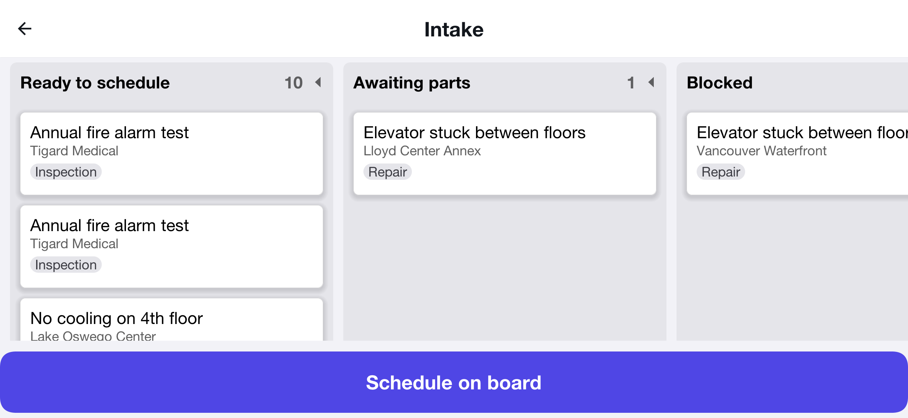

==== Time off and absences

A technician's time-off request waits under *Time-off requests*. A decision shows
on the technician's request. *Approve and cover* approves it and re-plans their jobs on those
days onto the rest of the crew in one step.

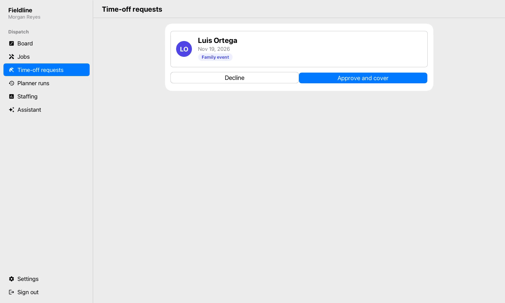

==== The assistant

The dispatcher's assistant takes requests in plain words, such as "Dana is out
Thursday, cover her jobs." It works through the same planner as the board, and
shows the run it made with the same figures and the same list of moves.

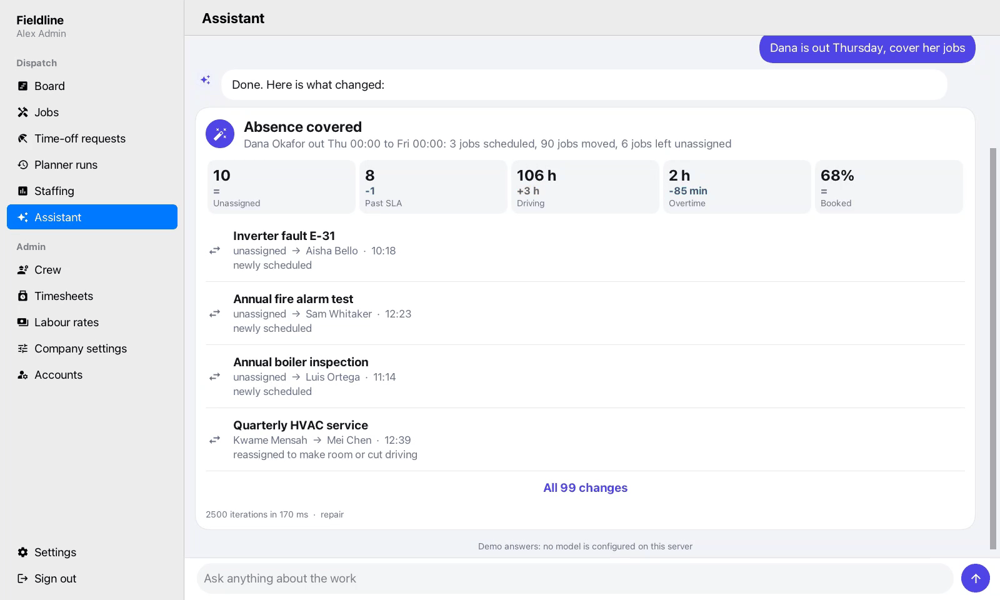

It also answers questions about the day: who is unassigned, who is qualified for a
job, and what a technician has on today or tomorrow.

==== Staffing

*Staffing* sets the work booked against the hours the crew has, day by day for
this week or two. A day above 90% is understaffed and a day below 55% has people
waiting for work. Below the chart, each technician's share of the work shows who
is carrying the week.

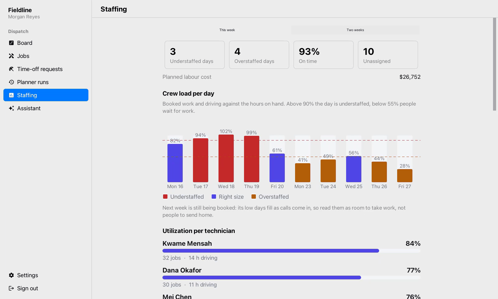

=== The administrator

The administrator sees everything the dispatcher sees, and an admin section of
the back office.

*Crew* is each technician's skills, certificates with the date they lapse,
territories, home base and limits. A job that needs a certificate goes only to
someone whose certificate is valid on the day.

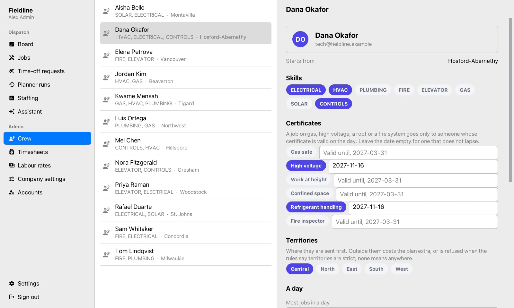

*Timesheets* add up the week from the clock: hours worked against hours rostered,
overtime, and what the week costs. Each technician's sheet lists their days, the
time driving and on site, and the breaks taken.

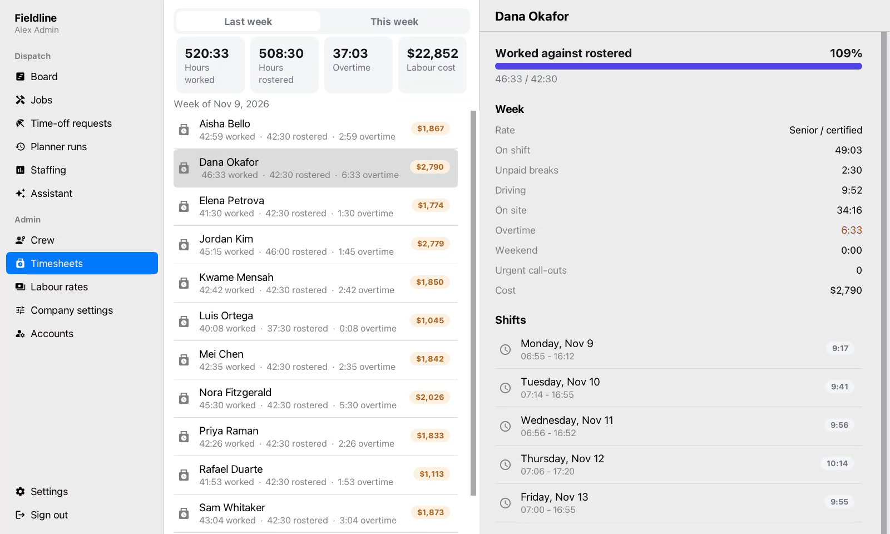

The labor rates set what an hour costs for each grade of technician, with the
uplift for overtime and weekends and the fee for an urgent call-out. The
company settings hold the rest of the pay rules and the rush hours that slow
travel.

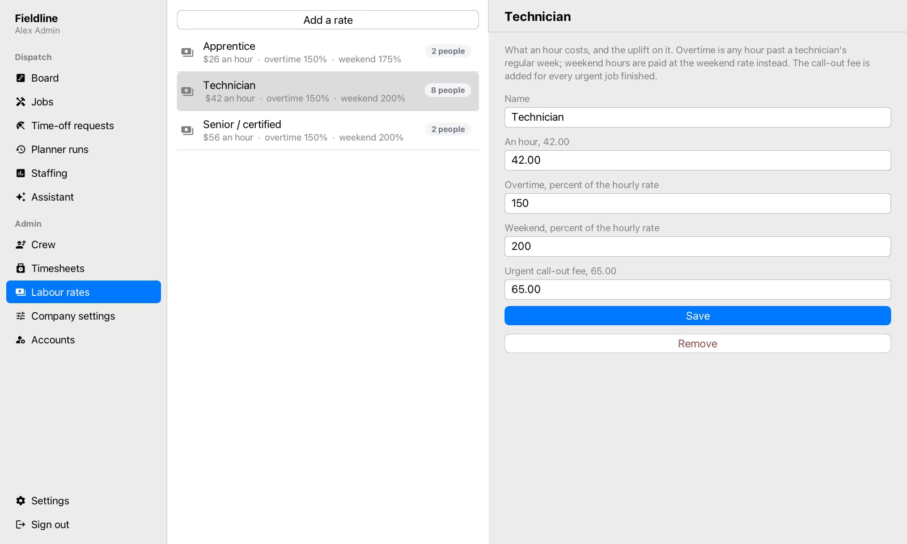

*Accounts* lists everyone who can sign in, with the roles each one holds. An
account can be suspended, which signs it out everywhere at once.

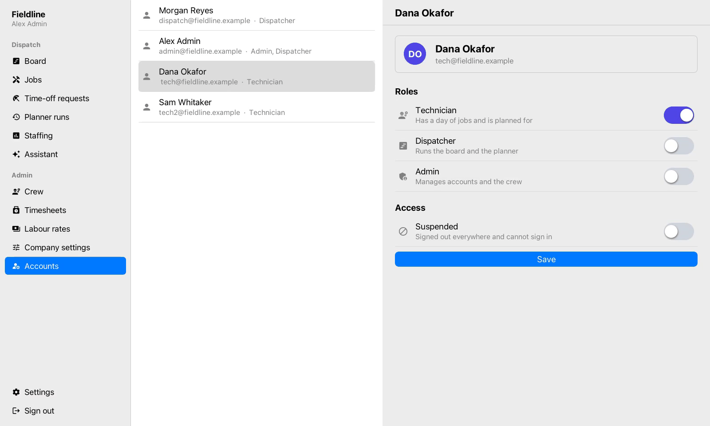

Outside the development profile the server creates only one account, the
administrator named in its settings, who grants everyone else their roles.
