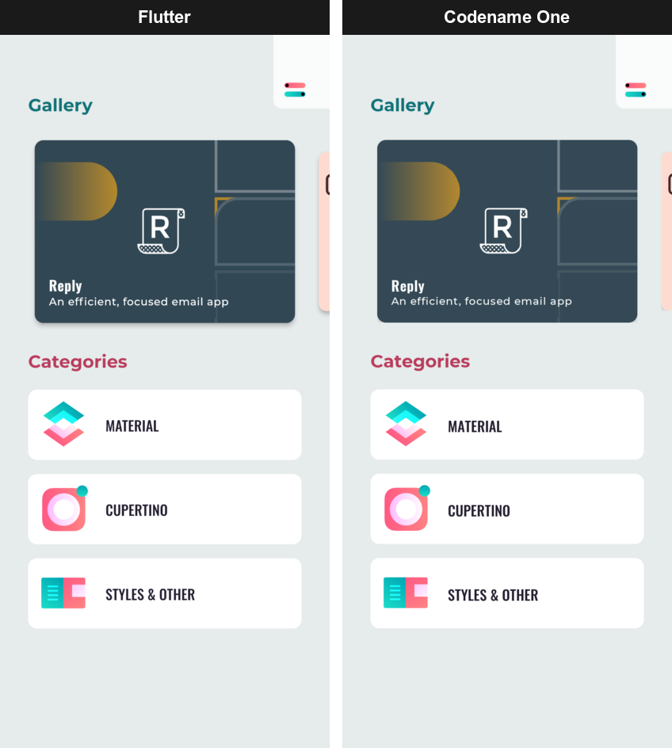
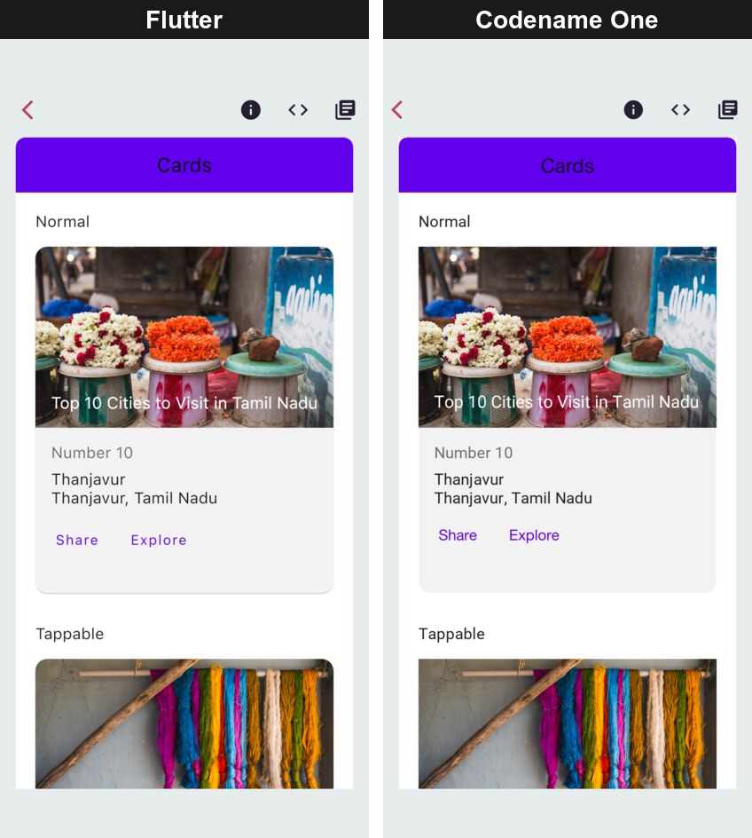
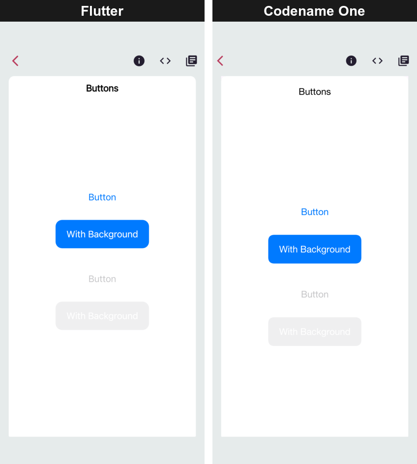
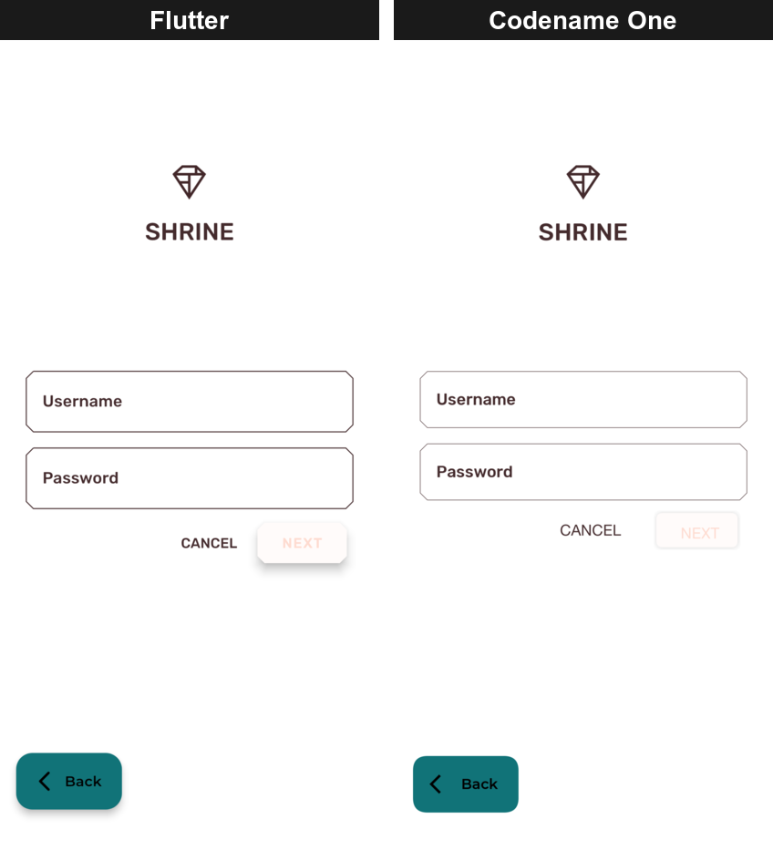
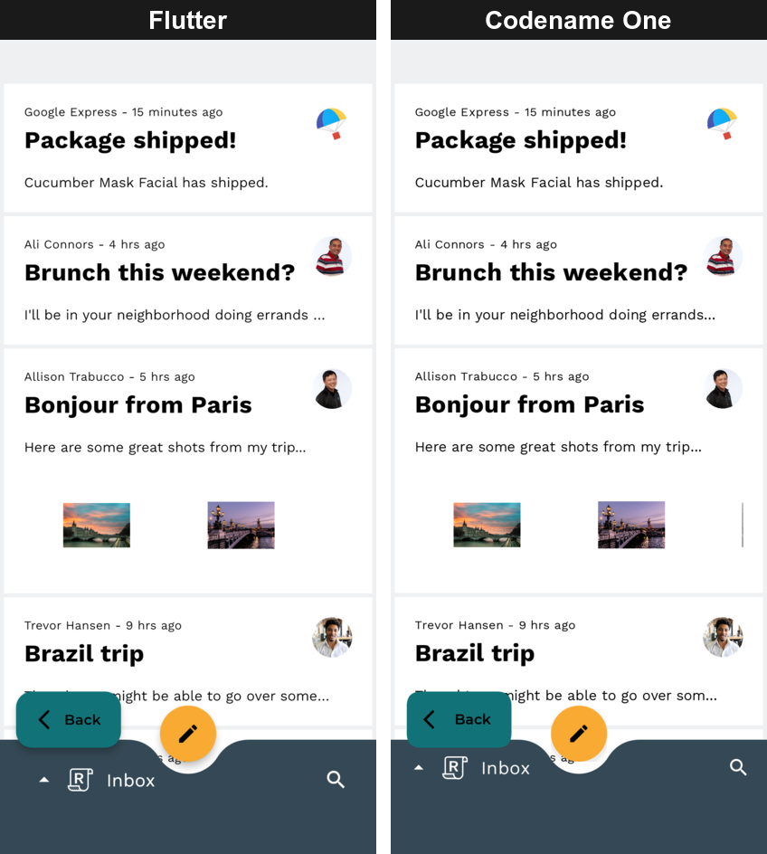

[[flutter-interop]]
== Running Flutter applications

Codename One builds a Flutter application from its Dart source. The Dart is
translated to Java at build time, and the result is an ordinary Codename One
application: no Dart VM, no embedded rendering engine and no platform view
ship with it. It builds for every platform Codename One targets, and it comes
out smaller, quicker to start and lighter on memory than the same application
built by Flutter.

IMPORTANT: Dart support is experimental. Most widgets render, but some callbacks
and parameters are accepted and then ignored, and the pipeline has so far been
verified against one large sample application. Test every interaction your
screens depend on before shipping.

[[flutter-benchmark-results]]
=== Smaller, faster and lighter than Flutter

The charts below come from one application, the Flutter Gallery, built both
ways from the same Dart source: once by the Flutter toolchain's own release
build, and once by Codename One. Both builds are measured on the same machine,
in interleaved rounds, on every change to the project. Lower is better
throughout.

image::img/flutter-bench-install.svg["Installed size of the Flutter Gallery per platform: Codename One against Flutter"]

image::img/flutter-bench-code.svg["Executable code of the Flutter Gallery per platform: Codename One against Flutter"]

image::img/flutter-bench-cold-start.svg["Cold start to the first frame per platform: Codename One against Flutter"]

image::img/flutter-bench-idle-memory.svg["Memory at rest per platform: Codename One against Flutter"]

The comparison is tilted *toward* Flutter. The application is Flutter's own
showcase, written by the Flutter team in Flutter's idioms, and Codename One
runs it as it is. To do that the Codename One build carries a runtime that
reimplements Flutter's widget, element and layout model on top of Codename One
components, which is work an application written for Codename One never pays
for. The same screens written directly against Codename One's own components
would be smaller and faster again. The numbers above are what a team gets on
the day it moves its Flutter code over, before changing a line of it.

Two platforms aren't measured in full, and the charts leave them out rather than
estimate them:

* *Start-up and memory on iOS.* Flutter can't compile Dart ahead of time for
  the simulator, so a simulator run would time Flutter's debug engine against a
  Codename One release build. iOS sizes come from release device bundles.
* *Start-up and memory on the web.* Timing a browser build needs a driver for
  the browser's developer tools, which the benchmark doesn't have, so it
  reports web sizes only.

Android start-up and memory come from an emulator rather than a phone. They
compare the two builds on one machine; they aren't phone timings.
<<flutter-benchmark>> explains how each metric is taken.

=== What it looks like

The Flutter Gallery's demos, rendered by Flutter on the left and by Codename One
on the right from the same Dart source:

image::img/flutter-gallery-text-field.png[The Text fields demo rendered by Flutter and by Codename One]

image::img/flutter-gallery-bottom-navigation.png[The Bottom navigation demo rendered by Flutter and by Codename One]

image::img/flutter-gallery-colors.png[The Colors demo rendered by Flutter and by Codename One]

image::img/flutter-gallery-button.png[The Text button demo rendered by Flutter and by Codename One]

The Codename One side is a real Codename One component tree, not a picture of
one: it uses the theme, the event dispatch thread, the accessibility tree and
the native build like any other Codename One screen, and it can share a `Form`
with hand-written Codename One code.

[[flutter-import]]
=== Importing a Flutter application

One command brings a Flutter project into a Codename One project:

[source,bash]
----
include::../demos/common/src/main/snippets/developer-guide/flutter-import.sh[tag=flutter-import-bash-001,indent=0]
----

Run it in a project generated from the Codename One archetype or
https://start.codenameone.com[the initializr]. It does what wiring Flutter in
by hand would take:

* Copies the Dart source in `lib` into `common/src/main/flutter`.
* Copies every asset and font `pubspec.yaml` declares, including whole asset
  directories and the assets of the packages the application depends on, which
  it finds through the project's `.dart_tool/package_config.json` or the pub
  cache.
* Adds the Flutter runtime to `common/pom.xml` and makes sure the build
  translates the Dart.
* Writes the application's entry class so that it runs the Dart `main()`. A
  class that was already there is saved beside it with a `.pre-flutter-import`
  suffix.
* Carries the application name and version over from `pubspec.yaml`.

It then lists the application's pub dependencies and says which of them
Codename One provides. A package is provided one of two ways. A pure Dart
package is copied and transpiled with the application, file by file, as far as
the application's imports reach into it. A plugin, or a package the runtime
implements natively (`provider`, `intl`, `go_router`, `firebase_auth` and the
others in <<flutter-plugin-coverage>>), is provided by a stub pack: Dart
declarations of the package's API backed by Java. A dependency listed as not
covered is the first thing to look at if a screen misbehaves.

[[flutter-import-report]]
==== The import report

The same report is written as JSON to `common/target/flutter-import-report.json`,
for a script or a CI step to read. Each package has a status (`covered` or
`unsupported`), the note or the reason, and the application's own files that
reach it. An unsupported package that is only unsupported because of something
it depends on carries the chain that verdict came through, ending with the
package that is unsupported itself:

[source,json]
----
{"package": "ui_kit", "status": "unsupported",
 "note": "depends on vector_graphics_compiler, which needs dart:ffi",
 "cause": "needs dart:ffi",
 "chain": ["ui_kit", "vector_graphics_compiler"],
 "reachedFrom": ["lib/login/login_screen.dart"]}
----

The report also lists, under `googleFonts`, every Google Fonts family the
application names. The `google_fonts` stub draws only fonts bundled with the
application, so those are the families to add as assets.

A few kinds of imports are resolved rather than reported:

* A conditional import (`if (dart.library.html) ...`) takes the branch for a
  library the runtime has, so a web-only branch and everything it imports are
  never read.
* A plugin that implements only desktop or web platforms is transpiled as Dart.
  Its calls into the platform answer `MissingPluginException`, as they would on
  a mobile device in Flutter.

==== Parameters that are accepted and not applied

Some stub parameters are accepted so the application compiles, and then have no
effect: an HTTP header a media player can't send, a fit mode an image renderer
lacks. A call that passes one gets a build warning at that argument:

----
[WARNING] src/main/flutter/feed/post.dart:[41,6] 'httpHeaders' of networkUrl is accepted but not applied on Codename One (dart2java:W0002)
----

Re-running the command later picks up changes made on the Flutter side. A file
you edited after the earlier import is left as you edited it, and a file the
Flutter project no longer has is removed.

No Dart or Flutter SDK is needed to build the result. The transpiler is Java and
runs as part of the normal Maven build. The command reads the pub cache only to
find package assets, so run `flutter pub get` once in the Flutter project if it
reports a package it can't find.

=== Migrating an entire application

After the import, the Dart *is* the application: the entry class calls the
Dart `main()`, whose `runApp` mounts the widget tree as the root of a `Form`.
Build and run it like any Codename One application, in the simulator or for a
device.

`FlutterUI.runApp` is the same call from Java, the analog of Flutter's own
`runApp`. It installs the Material base theme, because the widget tree is
expected to be the whole UI and to look the way its author intended:

[source,java]
----
include::../demos/common/src/main/java/com/codenameone/developerguide/flutter/FlutterInteropSnippets.java[tag=flutter-interop-java-002,indent=0]
----

A port is mostly a question of how much of the Dart language and of the Flutter
libraries the application uses. The transpiler reports what it can't handle
rather than guessing: a construct outside the supported subset fails the build
with a code naming the feature, so the gaps are a list to work through rather
than a runtime surprise. At runtime, a widget that isn't implemented is
recorded through the error inventory instead of drawing nothing.

=== Migrating a single form

The same build can carry Dart screens inside an application otherwise written
in Codename One, so a migration can go one screen at a time in either
direction.

Put the Dart files under `common/src/main/flutter`; the import command does
this, or copy them by hand. Each Dart widget class becomes a Java class of the
same name in `com.codename1.generated.flutter`, with its parameters as
constructor arguments in declaration order and the widget key first. A Dart
`MyHomePage({super.key, required this.title})` is created from Java as
`new MyHomePage(null, "Inbox")`.

`FlutterUI.wrap` inflates the widget into a plain `Container`, which goes
anywhere an ordinary component can:

[source,java]
----
include::../demos/common/src/main/java/com/codenameone/developerguide/flutter/FlutterInteropSnippets.java[tag=flutter-interop-java-001,indent=0]
----

The wrapped widget is a component like any other: it takes part in the parent's
layout, scrolls with it and is styled by the same theme. It doesn't install the
Material base theme, so a Dart screen dropped into an existing form won't
restyle the rest of it.

A wrapped widget isn't inside a navigator, so it has no `Overlay` of its own.
Dart code that calls `Overlay.of(context)` from inside it gets the same error
it would get outside a `Navigator` on Flutter; show such a screen as a route
of its own instead.

[[flutter-java-dart-calls]]
=== Calling between Java and Dart

Java and Dart run in the same application, on the same thread, so calls between
them are ordinary method calls. There are three ways to make them, and the
first is the one a Flutter developer already knows.

==== Platform channels

A Flutter application talks to its platform code through `MethodChannel` and
`EventChannel` from `package:flutter/services.dart`. Those work unchanged: the
Dart side compiles unchanged, and the platform side, which is Kotlin or Swift in
a Flutter project, becomes Java in the Codename One project. The Java classes
in `com.codename1.flutter.platform` mirror Flutter's Android
`io.flutter.plugin.common` API, so Android handler code ports by changing its
imports.

*Dart calling Java.* The Dart side invokes a method on a named channel:

[source,dart]
----
include::../demos/common/src/main/snippets/developer-guide/flutter-channels.dart[tag=flutter-interop-dart-001,indent=0]
----

A Java handler registered under the same channel name answers it:

[source,java]
----
include::../demos/common/src/main/java/com/codenameone/developerguide/flutter/FlutterInteropSnippets.java[tag=flutter-interop-java-003,indent=0]
----

`result.error(...)` reaches Dart as a `PlatformException`, and
`result.notImplemented()`, or no handler at all, as a
`MissingPluginException`, as on Flutter. The handler doesn't have to answer
before it returns: keep the `Result` and complete it when the answer arrives.

*Java calling Dart.* The direction reverses with the same two classes. Dart
registers a handler on the channel:

[source,dart]
----
include::../demos/common/src/main/snippets/developer-guide/flutter-channels.dart[tag=flutter-interop-dart-002,indent=0]
----

Java invokes it and gets the reply through a callback:

[source,java]
----
include::../demos/common/src/main/java/com/codenameone/developerguide/flutter/FlutterInteropSnippets.java[tag=flutter-interop-java-004,indent=0]
----

*Events from Java to Dart.* An `EventChannel` carries a stream of events: a
sensor reading, a download's progress, a message from a server. Java pushes
them through the `EventSink` it receives when Dart starts listening:

[source,java]
----
include::../demos/common/src/main/java/com/codenameone/developerguide/flutter/FlutterInteropSnippets.java[tag=flutter-interop-java-005,indent=0]
----

Dart listens to the stream as it would on Flutter:

[source,dart]
----
include::../demos/common/src/main/snippets/developer-guide/flutter-channels.dart[tag=flutter-interop-dart-003,indent=0]
----

`onListen` runs when the first listener subscribes and `onCancel` when the last
one cancels, so a sensor or a connection is only active while something is
listening.

Values cross the channel in the types each side expects, as Flutter's message
codec does:

[cols="1,1", options="header"]
|===
|Dart |Java

|`int`
|`Long`. An `Integer`, `Short` or `Byte` sent from Java arrives as `int`.

|`double`
|`Double`. A `Float` sent from Java arrives as `double`.

|`String`, `bool`, `null`
|`String`, `Boolean`, `null`

|`List`, `Map`
|`java.util.List`, `java.util.Map`, converted element by element
|===

Every handler runs on the event dispatch thread, and a reply is always
delivered asynchronously, never inside the call that asked for it, as on
Flutter.

==== Calling Dart functions directly

Without a channel, Java can call transpiled Dart directly. Each Dart file
becomes a class named after it, with `Lib` appended: `lib/greeting.dart`
becomes `LibGreetingLib`, and its top-level functions are public static methods
of that class. Dart's `main` is renamed `main$`.

[source,java]
----
include::../demos/common/src/main/java/com/codenameone/developerguide/flutter/FlutterInteropSnippets.java[tag=flutter-interop-java-006,indent=0]
----

This is the quickest way to reach Dart logic that has no UI, a parser or a
pricing rule, from Java. Channels are the better boundary for code that a
Flutter build must also keep running, because the Dart side doesn't change.

==== Sharing state and callbacks

A `ValueNotifier` or `ChangeNotifier` is an ordinary Java object on the
Codename One side. Java code that holds one can set its value or call
`notifyListeners()`, and every Dart widget listening to it, through
`ValueListenableBuilder` or `AnimatedBuilder`, rebuilds.
Callback parameters work the other way: an `onPressed` or `onChanged` that a
Java caller passes into a Dart widget's constructor is a Java lambda, and the
Dart code calls it.

=== How it fits together

The pipeline has three stages, and each is an ordinary build step you can run
and inspect on its own.

image::img/flutter-pipeline.svg[Dart source through the transpiler to the Codename One ports]

Dart widget source in `src/main/flutter` is read by the `transcode-flutter`
goal during `generate-sources`. It emits Java into
`target/generated-sources/flutter`, which the normal compile phase picks up.
At runtime those generated classes call into the Flutter runtime library,
which implements the widget, element and render-object model on top of
Codename One containers.

The key design point is where the boundary sits. The runtime reimplements
Flutter's *layout and composition* model -- constraints down, sizes up,
elements reconciled against widgets -- but it doesn't reimplement Flutter's
*rasterizer*. Painting is Codename One's, which is what makes the output a
real Codename One component tree rather than a texture.

The goal is bound in every project generated from the archetype and does
nothing while `src/main/flutter` doesn't exist. To wire a project by hand
instead of importing, add the runtime dependency to the `common` module, where
generated projects already carry it commented out:

[source,xml]
----
include::../demos/common/src/main/snippets/developer-guide/flutter-interop.xml[tag=flutter-interop-xml-001,indent=0]
----

The generated package and the paths are configurable:

[cols="1,2", options="header"]
|===
|Property |Meaning

|`cn1.flutter.sourceDir`
|Where the Dart lives. Defaults to `src/main/flutter`.

|`cn1.flutter.outputDir`
|Where the generated Java is written. Defaults to
`target/generated-sources/flutter`.

|`cn1.flutter.package`
|The package the generated classes are emitted into. Defaults to
`com.codename1.generated.flutter`.
|===

==== Localization and right-to-left layout

`GlobalMaterialLocalizations.delegate` and `GlobalCupertinoLocalizations.delegate`
supply English, Spanish and Hebrew strings for the built-in widgets, picked by the
locale's language code; any other language falls back to English. Your own
delegates and ARB-generated localizations work as they do in Flutter.

Under a right-to-left `Directionality`, rows,
wraps, `AlignmentDirectional`, stacks, text alignment, list tiles and app bars are
mirrored, and the directional arrow and chevron icons swap. A plain `Alignment`
never mirrors, as in Flutter.

[[flutter-plugin-coverage]]
=== Plugin coverage

These are the pub packages the runtime provides, and how. A package that is not
listed and is pure Dart is transpiled from its own sources.

[cols="2,4,3", options="header"]
|===
|Package |Backed by |Accepted and not applied

|`firebase_core`, `firebase_auth`
|The Identity Toolkit REST API: email and password, anonymous accounts, and
Google, Apple and OAuth credentials exchanged through `signInWithIdp`.
`signInWithProvider` runs Google's and Apple's sign-in.
|Phone sign-in, multi-factor, account linking

|`google_sign_in`
|`GoogleConnect`, Google's OIDC sign-in with PKCE in the system browser
|`signInSilently` answers the current run's account only; `hostedDomain`

|`firebase_ui_auth`, `firebase_ui_oauth_google`, `firebase_ui_oauth_apple`
|`SignInScreen` and `ProfileScreen` built from the runtime's Material widgets,
over `firebase_auth`; the Google and Apple buttons sign in as `signInWithProvider` does
|`styles`, `sideBuilder`, `breakpoint`, `headerMaxExtent`; reported as W0002 warnings

|`firebase_analytics`, `firebase_messaging`
|Logged events and `AnalyticsService`; Codename One push, including
`onBackgroundMessage` and provisional permission
|

|`firebase_ai`
|The Firebase AI Logic REST API, Gemini through Google AI or Vertex AI, with the
App Check token and the signed-in user's ID token
|Function calling, `responseSchema`, `toolConfig`; `generateContentStream`
delivers the whole reply as one event; Live and Imagen models

|`firebase_app_check`
|The debug provider's token, from the `firebase.appCheck.debugToken` Display property
|Play Integrity, DeviceCheck and App Attest: there is no attestation, so they yield no token

|`dio`
|`ConnectionRequest`: interceptors, `DioException` types, `CancelToken`,
`FormData`, downloads
|

|`go_router`
|The runtime's navigator: routes, redirects, `extra`, transitions
|

|`cached_network_image`
|`ConnectionRequest` with an in-memory cache: `placeholder`,
`progressIndicatorBuilder` and `errorWidget` are built
|`fadeInDuration`

|`google_maps_flutter`
|`MapView`: markers with hued or byte icons, polylines, circles, camera, taps
|

|`image_picker`, `camera`
|`Capture` and `com.codename1.camera`; `maxWidth`, `maxHeight` and `imageQuality`
re-encode the picked image
|The `child` overlay of `CameraPreview`

|`video_player`
|`MediaManager`
|`httpHeaders`, captions, playback speed

|`video_thumbnail`, `video_compress`
|No frame extraction or transcoding in the core: every thumbnail call fails,
and `compressVideo` answers the original file with a warning
|

|`webview_flutter`
|`BrowserComponent`, JavaScript channels through `addJSCallback`
|A POST body, `JavaScriptMode.disabled`, `clearCache`

|`flutter_svg`
|`Image.createSVG` where the port renders SVG, otherwise an empty box of the
requested size
|`colorFilter`, `fit`, `alignment`, `placeholderBuilder`

|`file_picker`
|The native open and save dialogs
|

|`audioplayers`
|`MediaManager`
|

|`flutter_image_compress`
|`Image` and `ImageIO`, JPEG and PNG
|HEIC and WebP where the platform can't encode them

|`geocoding`
|The Google Geocoding REST API, keyed by the `google.geocoding.key` Display
property
|

|`mixpanel_flutter`
|Mixpanel's HTTP ingestion API, with `setServerURL` for EU residency
|

|`flutter_web_auth_2`
|An in-app browser that watches for the callback URL
|

|`emoji_picker_flutter`
|A Codename One emoji grid with recents and search
|`Config`, except `height`

|`app_settings`, `flutter_timezone`
|`Display.execute` with the platform's settings URL; `java.util.TimeZone`
|

|`android_play_install_referrer`
|Nothing: `installReferrer` always fails with `UnsupportedError`
|

|`shared_preferences`, `path_provider`, `package_info_plus`,
`device_info_plus`, `connectivity_plus`, `geolocator`, `share_plus`,
`url_launcher`, `app_links`, `flutter_local_notifications`
|`Preferences`, `FileSystemStorage`, the build and Display properties,
`NetworkManager`, `LocationManager`, `Display.share`, `Display.execute` (an in-app
`BrowserComponent` for `LaunchMode.inAppWebView`), `LocalNotification` with
Android channels, raw sounds and a background tap callback
|
|===

[[flutter-stub-packs]]
=== Writing a stub pack

A package the runtime doesn't provide can be provided by a stub pack of your
own, in the application or in a library jar. A pack has two parts.

The Dart half is a file under `META-INF/dart/` on the compile class path --
in an application, `common/src/main/resources/META-INF/dart/`. It declares the
package's API with `external` members, and names the Java class behind each type
with `@JavaName`. The `cn1:covers` line tells the import report that the pack
stands in for the package:

[source,dart]
----
// cn1:covers lottie Lottie.asset over a Codename One animation
@JavaName('com.example.lottie.Lottie')
class Lottie extends Widget {
  @Unapplied('fit')
  external static Lottie asset(String name, {double? width, double? height,
      bool repeat, BoxFit? fit});
}
----

Stub types share one namespace. When two packages export the same name -- the
`AppleProvider` of `firebase_app_check` and of `firebase_ui_oauth_apple` -- give
each file a `// cn1:package <package>` line: a library then sees the declaration
of the package it imports, and a class of the application's own with the same
name is never shadowed by a stub of a package it does not import.

The Java half is an ordinary class with the members the declarations map to:

[source,java]
----
package com.example.lottie;

public class Lottie extends com.codename1.flutter.Widget {
    public static Lottie asset(String name, Double width, Double height,
            Boolean repeat, Object fit) {
        // ...
    }
}
----

The mapping rules:

* Named parameters become positional Java parameters, in the order they are
  declared. A parameter the call leaves out is passed as `null`.
* `int` is `Long` (or `long` when it can't be null), `double` is `Double`,
  `bool` is `Boolean`, `List` and `Map` are `dart.core.DartList` and
  `dart.core.DartMap`, `Future` and `Stream` are `dart.async.Future` and
  `dart.async.Stream`, and a function is a `dart.runtime.Funcs` interface.
* A constructor whose parameters are all named is a public no-argument
  constructor plus one method per parameter, named after it, which the
  generated code calls for each argument passed.
* An instance getter is a method with no arguments. A static getter is a
  public static field.
* `@Unapplied('a, b')` on a constructor or method names the parameters that
  are accepted and not applied, so that the build warns where one is passed.

Every stub on the class path shares one namespace, so a type that another stub
already declares mustn't be declared again. The transpiler ignores the import
of the package itself. For a pack outside the application, pass its jar to the
import with `-Dcn1.flutter.stubPacks=path/to/pack.jar` so that the report counts
it.

[[flutter-benchmark]]
=== How the numbers are measured

The benchmark lives in `scripts/flutter-bench`. It builds the Flutter Gallery
both ways on each platform and measures both builds on the same machine, and
continuous integration runs it on every change, publishing the numbers to the
pull request and to the port status page.

What it reports, per platform:

[cols="1,3", options="header"]
|===
|Metric |What it means

|Installed size
|The sum of the artifact's file lengths, which is what the user's device gives
up. Not `du`, which rounds every file up to a block.

|Executable code
|Every compiled binary in the artifact, added together. Counting only the main
executable is wrong on iOS, where a Flutter application's own code isn't in
the executable at all -- it's in the frameworks beside it.

|Download size
|The artifact compressed, because that's what a store ships.

|Cold start
|Wall time from launching the process to the first frame being on the screen,
measured from outside so neither runtime is trusted to time itself.

|Memory at rest
|The platform's own accounting for a settled, idle application.
|===

Three rules keep the numbers honest, and each exists because the obvious
alternative produced a flattering result:

* *Interleaved rounds.* One launch of each build, alternating, repeated. A
  machine that gets busier halfway through then penalizes both builds equally
  instead of whichever happened to run second, and start-up and memory are
  judged round by round: the ratio is the median of the per-round ratios.

* *Start-up is a bracket where the two runtimes report different events.* On
  the web, Flutter's earliest marker fires before its first frame is
  rasterized while Codename One's fires once the frame is on the screen, so the
  benchmark takes Flutter's figure as a range and computes the ratio from the
  end least favorable to Codename One.

* *A platform that can't be measured says so.* iOS start-up and memory are
  reported as not measured rather than taken from a simulator, for the reason
  given above.

To run it locally against builds you already have:

[source,bash]
----
include::../demos/common/src/main/snippets/developer-guide/flutter-interop.sh[tag=flutter-interop-bash-001,indent=0]
----

`--list` also reports which platform adapters have been exercised end to end,
which isn't the same question as which ones exist. The charts in
<<flutter-benchmark-results>> are rendered from the benchmark's result files by
`scripts/flutter-bench/render_doc_charts.py`.
