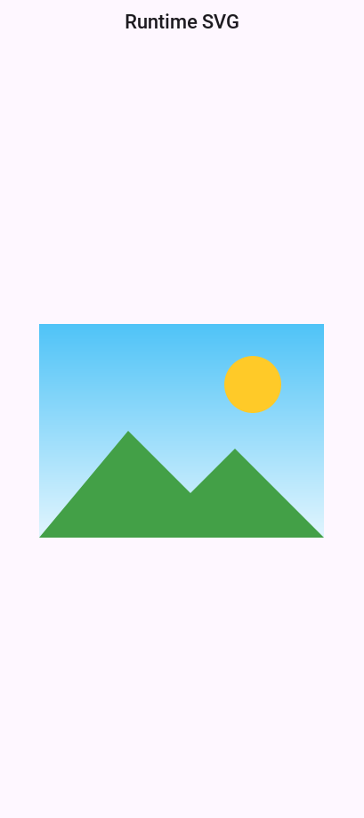
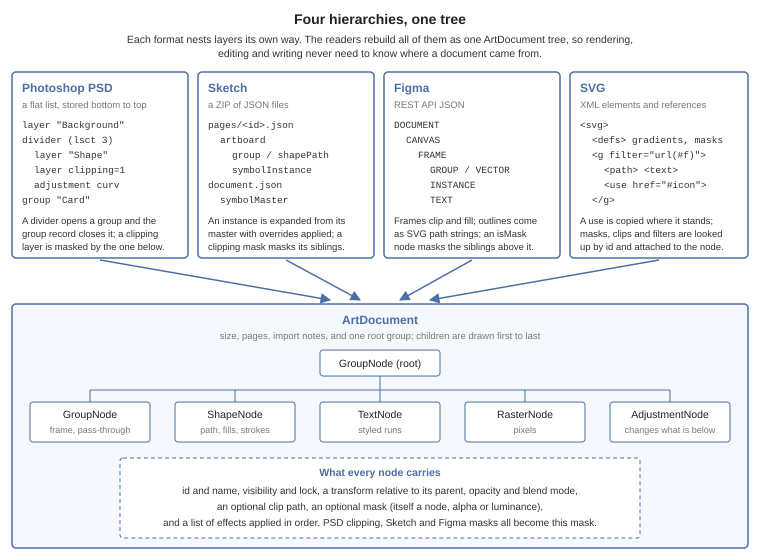
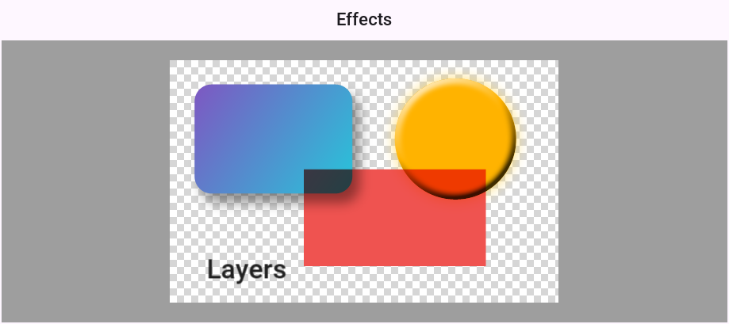
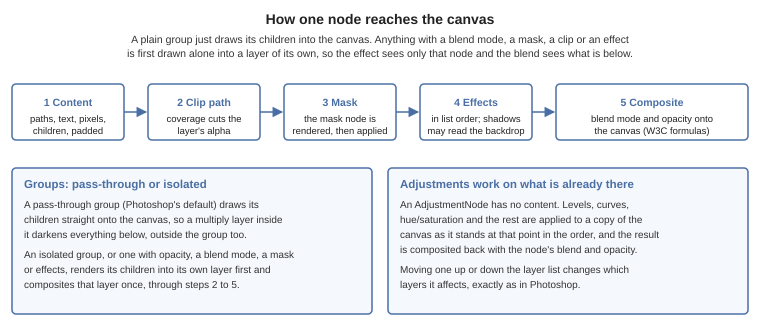
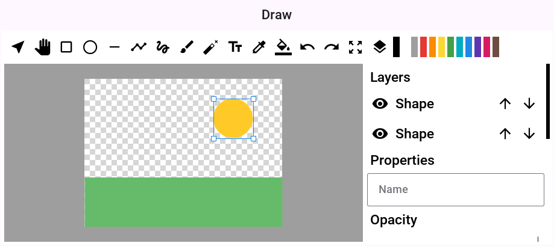

[[graphics-documents]]
== Graphics Documents: SVG, PSD, Sketch and Figma at Run Time

The build-time transcoder in the previous chapter is the cheapest way to ship an icon or an
illustration you have when you build the app. Some artwork only arrives at run time: a user
opens a Photoshop file, a design is pulled from Figma, or the app lets people draw. The
`com.codename1.art` package handles those cases. It reads layered documents into one tree,
renders them the same way on every platform, lets code and users change them, and writes
them back.

[cols="1,1,1,3",options="header"]
|===
| Format | Read | Write | Notes
| SVG | yes | yes | Static SVG 1.1 / Tiny 1.2: shapes, paths, `use`, gradients, patterns, clip paths, masks, text, images, CSS and filters
| Photoshop PSD / PSB | yes | yes | Layers, groups, masks, vector masks, clipping, layer styles, adjustment layers; the writer produces layered 8-bit RGB
| Sketch | yes | no | The ZIP format of Sketch 43 and later: pages, artboards, symbols with overrides, styles
| Figma | yes | no | The REST API's file JSON, fetched with `FigmaClient`
| `.cn1gfx` | yes | yes | Lossless native format: a ZIP of JSON and PNG
|===

=== Loading and rendering

`ArtFormats.read` detects the format from the content, so a file name is never needed. Here an SVG
that arrived as text becomes an image:

[source,java]
----
include::../demos/common/src/main/java/com/codenameone/developerguide/art/ArtSnippets.java[tag=art-load,indent=0]
----

.An SVG read at run time and rendered at two pixels per unit

=== The document tree

Each format arranges its layers differently. A PSD is a flat list in which marker records open
and close groups; Sketch spreads pages and symbol masters across several JSON files; Figma nests
frames inside canvases; SVG refers to gradients, masks and reusable shapes by id. The readers
turn them all into the same tree, so everything after loading works without knowing the source.

.How each format's structure maps onto an ArtDocument

Masks deserve a note, because each format expresses them differently: a Photoshop clipping
layer is masked by the layer below it, a Sketch layer with a clipping mask masks the siblings
that follow it, and a Figma `isMask` node masks the siblings above it. In the tree all three are
the same thing, a node set as another node's mask, so the editor and the writers treat them
alike.

Rendering is done in software by `ArtRenderer`. That's slower than drawing a
`GeneratedSVGImage`, but it means a document has the same pixels on iOS, Android, the
desktop and the web, with every blend mode and effect. Render once at the size you need and
keep the `Image`.

`Image.createSVG` falls back to this renderer on platforms with no native SVG support, so code
that called `createSVG` before now works everywhere. The fallback renders the document once,
at the size it declares, into an ordinary `Image`; a document over 4096 pixels on a side fails
with an `IOException` there, and is rendered with `ArtRenderer.toImage` at a smaller scale
instead.

=== Effects

A document can also be built in code. This one has a gradient card with a drop shadow, a
bevelled badge with an outer glow, and a rectangle in multiply mode that darkens what it covers:

[source,java]
----
include::../demos/common/src/main/java/com/codenameone/developerguide/art/ArtSnippets.java[tag=art-effects,indent=0]
----

.Effects and blend modes, drawn by ArtView

Every node is drawn in the same order of steps. Knowing it explains most surprises, such as why
a shadow follows a mask's shape or why an adjustment layer changes only what's below it:

.The steps that draw one node

Every effect a supported format defines has a renderer; none is kept in the model and
ignored. That covers drop and inner shadows, outer and inner glows, Gaussian, motion, zoom
and background blurs, strokes, color, gradient and pattern overlays, bevel and emboss
(stroke emboss too), satin,
Photoshop's adjustment layers (levels, curves, hue/saturation, color balance, selective
color, gradient maps and the rest), and the whole SVG filter primitive set. Effects live in
`com.codename1.art.effects` as `Effect` objects with named parameters, so an editor can
add, change and remove them.

Geometry is treated the same way. Sketch's subtract, intersect and difference operations keep
exactly the region they describe, and SVG text on a path follows its path.

Formats that can't hold an effect get it baked in. A PSD written from a document keeps
groups and blend modes as Photoshop layers; a node with effects becomes a rendered layer,
and an adjustment is applied to the pixels below it.

=== Import notes

What a reader can't represent is recorded on the document instead of being
dropped. Read `ArtDocument.getNotes()` after a load to tell users what changed:

[source,java]
----
include::../demos/common/src/main/java/com/codenameone/developerguide/art/ArtSnippets.java[tag=art-notes,indent=0]
----

* SVG animation and script are ignored, since a document is static.
* Photoshop smart objects and text layers are shown as the pixels the file stores for them.
* A Figma file fetched without `geometry=paths` has no vector outlines; `FigmaClient` always
  asks for them.
* Sketch files older than version 43 (a SQLite database) are rejected.

=== Figma

Figma documents come from its REST API. Pass a token the user supplies. `FigmaClient` never
stores it:

[source,java]
----
include::../demos/common/src/main/java/com/codenameone/developerguide/art/ArtSnippets.java[tag=art-figma,indent=0]
----

`fetch` requests the file with its geometry, then downloads the image fills it uses.
Images are fetched over HTTPS only, and the token isn't sent with them. Call `setOAuth(true)`
for an OAuth access token instead of a personal access token. To read a file you
downloaded yourself, use `FigmaReader.read(json, images)`; `FigmaReader.imageRefs` lists the
image references the JSON needs.

=== Editing

`ArtModel` wraps a document for editing. Every change goes through it, so it can be undone,
and listeners hear about it:

[source,java]
----
include::../demos/common/src/main/java/com/codenameone/developerguide/art/ArtSnippets.java[tag=art-editing,indent=0]
----

Changes made inside `beginGroup()` / `endGroup()` are a single undo step. Undo snapshots share
pixel data with the document, so code that paints into a `RasterNode` must give the node a
copy of its raster first: `node.setImage(node.getImage().copy())`.

=== The editor

`ArtEditor` is a ready-made drawing editor: an `ArtView` with a tool bar, a layers panel and
an inspector.

[source,java]
----
include::../demos/common/src/main/java/com/codenameone/developerguide/art/ArtSnippets.java[tag=art-editor,indent=0]
----

.The editor with a shape selected

Its tools select, move and resize; pan; draw rectangles, ellipses, lines, Bezier paths and
freehand strokes; paint and erase pixels; place text; pick colors; and fill shapes or pixel
regions. Pinch zooms the view. `exportSvg`, `exportPsd`, `exportPng` and `exportNative`
save the result. The layers panel and the inspector are ordinary containers
(`getLayersPanel`, `getInspector`). `ArtView` can be used by itself to show a document with
pan, zoom and hit testing.

=== Limits

The readers are written for files from untrusted sources. Image dimensions, layer counts,
decompressed sizes, ZIP entries and the depth of `use` and symbol references are capped. A
file over the limits fails with an `IOException`; it never exhausts memory.
