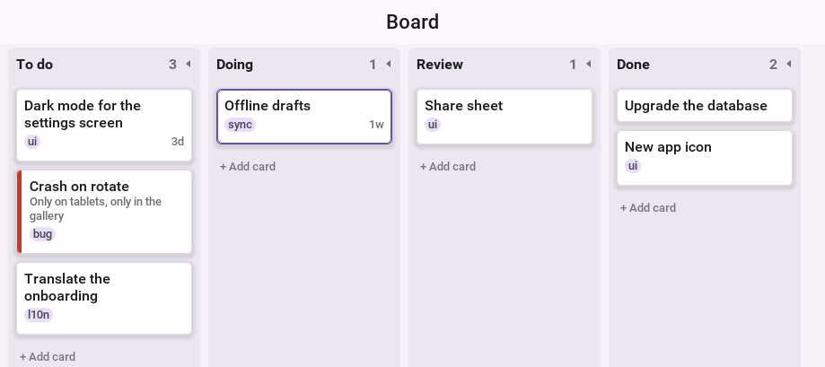
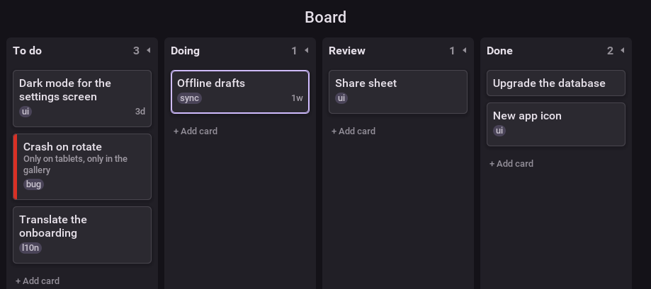
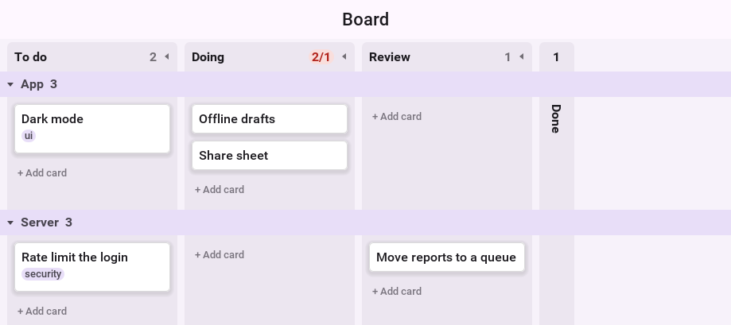

[[kanban-board]]
== Kanban boards

A Kanban board shows work as cards in columns, one column for each stage the
work passes through. Moving a card to the next column is how its state
changes. `KanbanBoard` is that board: the user drags cards within a column and
between columns, reorders and folds the columns, and adds and renames cards in
place.

The component is in `com.codename1.ui.kanban`. It draws from a model in
`com.codename1.kanban` that has no user interface in it, so a board can be
built, tested and stored without a form on the screen.

Like `NodeGraph`, the board paints its cards instead of building a component
for each one, and the whole board scrolls as one surface under column titles
that stay in view.

=== A first board

A `KanbanColumn` has an id and a title. A `KanbanCard` has an id and a title
too, and may carry a description, tags and a short badge such as a due date
or an estimate.

[source,java]
----
include::../demos/common/src/main/java/com/codenameone/developerguide/kanban/KanbanSnippets.java[tag=kanban-first,indent=0]
----

.A board of four columns, with tags, a badge and a selected card

.The same board in the dark appearance

With a mouse, a card is dragged directly. With a finger, a drag scrolls the
board and a long press picks the card up, so the two gestures don't compete.
`setDragEdits` chooses one behavior for both. While a card is held, the other
cards of the column under it make room where it would land.

On a phone, where one column fills most of the screen, `setColumnSnap(true)`
brings scrolling to rest with a column at the leading edge.

A column title is dragged the same way to move the column. The mark at the
end of a title folds the column to a strip that shows only its count, and a tap
on the strip opens it again.

=== Limits and swimlanes

A column with `setWipLimit` shows its count against the limit, and is marked
when it holds more. By default that's only a warning. A model with
`setEnforceWipLimits(true)` refuses the card that would go past the limit, and
the board shows the refusal while the card is still held over the column.

Add `KanbanLane` objects to the model and the board is split into swimlanes,
one row of cells for each. A lane has a title bar across the board, and a tap
on it folds the lane. A card belongs to a lane through `setLaneId`, and
dragging it into another lane changes that.

[source,java]
----
include::../demos/common/src/main/java/com/codenameone/developerguide/kanban/KanbanSnippets.java[tag=kanban-lanes,indent=0]
----

.Two swimlanes, a column over its limit and a folded column

=== Adding and editing cards

Each column ends in a row that adds a card. A tap on it opens a text field in
place, and the title typed there becomes a new card at the end of the column.
A double tap on a card renames it the same way. `setInlineAdd(false)` removes
the row. With `setInlineEditing(false)`, a double tap tells the listeners the
card was opened instead, which is where an application shows its own details
form.

With a keyboard, Delete removes the selected card, Enter opens it, and with
Control or Command, C, X, V and D copy, cut, paste and duplicate it.
`setEditingEnabled(false)` makes the board read-only. Columns and lanes still
fold.

=== Listening and refusing

Every edit is offered to the board's listeners before it reaches the model. A
listener that returns false refuses it, and the card goes back to where it
was. Extend `KanbanAdapter` to implement only what you need.

[source,java]
----
include::../demos/common/src/main/java/com/codenameone/developerguide/kanban/KanbanSnippets.java[tag=kanban-veto,indent=0]
----

The edits the user makes are also methods of the board: `moveCard`, `addCard`,
`renameCard`, `removeCard` and `moveColumn`. They go through the listeners
and the undo history the way a gesture does, so a menu or a toolbar button
behaves like the drag it stands for.

A model of your own implements `KanbanModel`, or extends `AbstractKanbanModel`
for the listener plumbing. Its `moveCard`, `insertCard` and the other edit
methods return false to refuse a change, which makes a read-only model the
default. A model backed by a server applies the change and tells the server
there.

=== Undo and saving

The board records its edits in an `UndoHistory`, the same class `NodeGraph`
uses, and one history can serve both. `KanbanJson` writes a model as JSON text
and reads it back.

[source,java]
----
include::../demos/common/src/main/java/com/codenameone/developerguide/kanban/KanbanSnippets.java[tag=kanban-undo,indent=0]
----

=== The look of a card

`DefaultKanbanCardRenderer` draws a card's title, up to two lines of its
description, its tags and its badge. `setAccent` gives the cards with a style
key a strip of color, and `setTagColor` gives a tag a color of its own. For a
different card, implement `KanbanCardRenderer`. It says how tall a card is at a
width and paints it.

A card can carry a real component as well, such as a progress bar or a
button. A `KanbanCardFactory` is asked for one per card, and the component is
drawn along the bottom of the card. It's drawn with the card and isn't added to
the form, so a board of many cards stays cheap. A tap on it reaches it, which
is enough for a button. After changing what it shows, repaint the board.

[source,java]
----
include::../demos/common/src/main/java/com/codenameone/developerguide/kanban/KanbanSnippets.java[tag=kanban-cards,indent=0]
----

The board is styled through these UIIDs, which the native themes define:

[cols="1,3",options="header"]
|===
|UIID |Used for

|`KanbanBoard` |The background
|`KanbanColumn` |The panel of a column
|`KanbanColumnHeader` |A column's title and count
|`KanbanColumnOverLimit` |The count of a column over its limit, and a refused drop
|`KanbanCard` |A card, its border and its text
|`KanbanCardSelected` |The outline of the selected card
|`KanbanCardTag` |The tags, the badge and the description
|`KanbanLane` |The title bar of a swimlane
|`KanbanAddCard` |The row that adds a card
|`KanbanDropSlot` |The place a held card would land
|===
