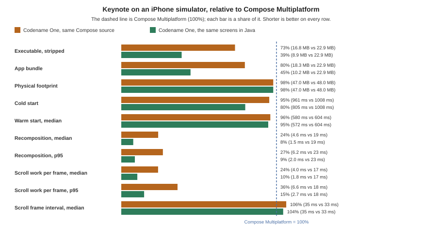
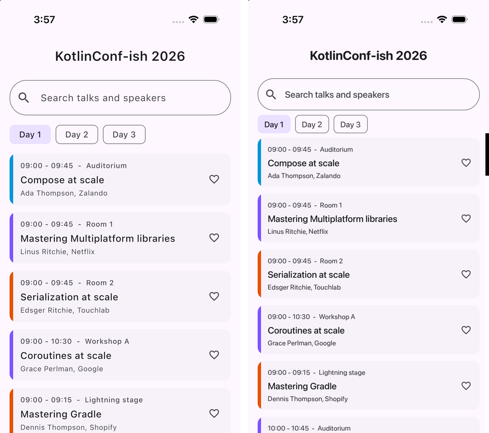
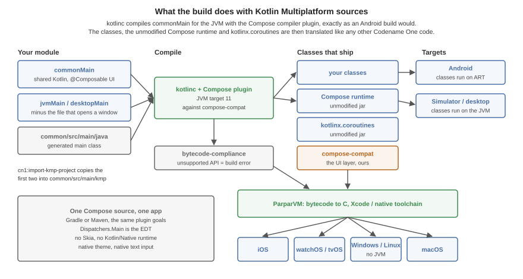
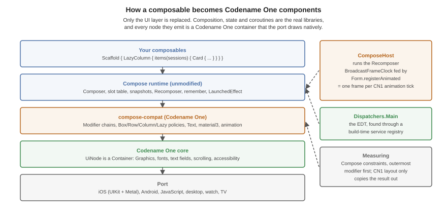

[[kmp-interop]]
== Running Kotlin Multiplatform and Compose applications

A Kotlin Multiplatform (KMP) module whose user interface is written with
Compose Multiplatform builds as a Codename One application. The shared
`commonMain` code is compiled unchanged, the composables render as Codename
One components, and the result ships to every Codename One target: iOS,
Android, the web, macOS, Windows and Linux (as native binaries with no JVM),
watchOS and tvOS.

=== Motivation

Compose Multiplatform runs on Kotlin/Native on iOS and links its own drawing
engine into the application. Codename One takes the JVM half of a KMP project
instead. kotlinc already compiles `commonMain` to ordinary class files for
Android and the desktop. Those classes, together with the real Compose runtime
and the real `kotlinx.coroutines`, are exactly what Codename One's translator
reads. Only the UI layer -- `androidx.compose.ui`, `foundation` and
`material3` -- is replaced, by one written over Codename One components and
`Graphics`.

The same application, built from the same `commonMain` both ways and measured
on the same iPhone simulator, with Compose Multiplatform as 100%. The second
bar is the same screens written in Java against Codename One directly, which
the next section explains:

- **Recomposition and scrolling take a quarter to a third of the CPU time.**
  A state change is drawn in 5.3 ms against 20.4 ms, and one step of
  scrolling in 5.6 ms against 16.9 ms. Every side keeps pace with the display,
  so the difference is headroom: for heavier screens, and for battery.
- **The executable is 27% smaller** (16.8 MB against 22.9 MB) and the bundle
  20% smaller, although the Codename One one carries the whole iOS port.
- **Start-up is faster**, 794 ms against 1051 ms cold.
- **Memory is level**, 48 MB of physical footprint against 49 MB.

The benchmark, its method and how to run it are in `scripts/kmp-bench` in the
Codename One repository. These are simulator numbers; they show where each
runtime spends CPU in identical code, not a device's frame rate.

Beyond size, the composables become real components, so a Compose screen
uses the platform's own text input and accessibility, can sit inside a
Codename One form next to any other component, and reaches every Codename One
API directly -- push notifications, in-app purchase, the native maps, the
backend -- with no `expect`/`actual` plumbing per platform.

The same build also reaches targets Compose Multiplatform's UI doesn't run
on: watchOS, tvOS, and Windows, Linux and macOS as native binaries with no JVM
to install. The Codename One backend runs the same Kotlin on the server, so a
data class or validation rule in `commonMain` is shared by the app and the
service that feeds it.

=== Dropping to Java where it pays

A Compose screen and a Codename One screen are the same kind of object at run
time -- a component in a form -- so an application doesn't have to choose one
for all its screens. Kotlin calls every Codename One class directly, and a Java
class can sit beside the composables in the same module. Compose
Multiplatform has no such floor: below `commonMain` there is a different
language and a different UI toolkit on every platform.

The benchmark measures what that floor is worth. `JavaBench.java` in
`scripts/kmp-bench/app/java` is the Keynote screens written against Codename
One directly, timed by the same steps, and it ships no Kotlin standard
library, no Compose runtime and no coroutines:

- **The executable is 8.9 MB**, 39% of Compose Multiplatform's 22.9 MB and
  about half of the Compose build's, and the bundle is 10.2 MB.
- **A step of scrolling takes 1.8 ms**, against 5.6 ms for the Compose build
  and 16.9 ms for Compose Multiplatform. A day change takes 4.6 ms.
- **Memory is 53 MB**: it builds all fifty cards of a day as components,
  where a lazy list composes only those in view.

A hot list, a custom chart or a screen that has to fit a watch is where this
pays; the rest of the application can stay in Compose.

=== One platform API on every target

The `expect`/`actual` declarations a KMP project writes per platform are
mostly calls Codename One already makes the same everywhere. A composable
reaches each of them as ordinary Kotlin calls:

- <<push-notifications-section,Push notifications>>, in-app purchase and
  subscriptions, and <<external-surfaces,home-screen widgets and live
  activities>>.
- <<crash-protection,Crash protection>> and <<app-shield,App Shield>>
  hardening, as build options rather than per-platform SDKs.
- <<webrtc-section,Real-time audio and video>> and
  <<ai-and-speech-section,AI and speech>>.
- Storage, SQLite, networking, the camera, location, sharing and the native
  maps, with one implementation per platform maintained in Codename One.

The targets go past phones and desktops too: Apple Watch and Wear OS from the
same project as the phone application, CarPlay and Android Auto, tvOS,
embedded Linux boards with no X11 and no JVM, the browser, and the
<<_server_side_backend,server-side backend>>.

=== Quick start

Create a Codename One application (for example at
https://start.codenameone.com) and import the KMP project into it:

[source,bash]
----
include::../demos/common/src/main/snippets/developer-guide/kotlin-multiplatform-interop.sh[tag=kotlin-multiplatform-interop-bash-001,indent=0]
----

The goal copies the module's `commonMain` and its JVM source set (`jvmMain`,
else `desktopMain`) into `common/src/main/kmp`, and rewrites the
application's main class so that it shows the module's root composable. Two
options cover projects it can't decide alone:

`-Dcn1.kmp.module=composeApp`:: The module to import, when more than one has a
`src/commonMain`.
`-Dcn1.kmp.entry=com.example.App`:: The fully qualified root composable, when
`commonMain` declares no single `@Composable fun App()`.

The Android and iOS source sets aren't copied. They call those platforms
directly, and Codename One supplies both. A JVM file whose `main` opens a
desktop window (`application { Window { App() } }`) is left out too: the
generated main class starts the application instead.

Then build and run as usual:

[source,bash]
----
include::../demos/common/src/main/snippets/developer-guide/kotlin-multiplatform-interop.sh[tag=kotlin-multiplatform-interop-bash-002,indent=0]
----

==== Gradle

A Gradle application needs the Compose compiler plugin,
`id("org.jetbrains.kotlin.plugin.compose")` at the application's Kotlin
version, applied next to the Codename One plugin. The build stops with the
line to add when it's missing.

`convert-to-gradle` writes it for you. The Codename One settings plugin adds
Google's Maven repository, limited to the `androidx.*` groups, which is where
the Compose runtime is published.

==== Placing the sources by hand

`common/src/main/kmp/commonMain/kotlin` and `common/src/main/kmp/jvmMain/kotlin`
are ordinary Kotlin source roots. The archetype's `compose` profile turns on
whenever `common/src/main/kmp` exists: it adds `codenameone-compose-compat`,
applies the Compose compiler plugin and sets both kotlinc's `jvmTarget` and
javac's source and target to 11, because the Compose runtime's inline functions are
JVM 11 bytecode. The Compose compiler plugin's version must equal the Kotlin
version, which is why both come from one property.

=== The entry point

A composition is shown in a `ComposeForm`, or embedded anywhere as a
`ComposeView`, which is an ordinary Codename One `Container`:

[source,kotlin]
----
include::../../scripts/hellocodenameone/common/src/main/kmp/jvmMain/kotlin/com/codenameone/examples/hellocodenameone/kmp/GuideSnippets.kt[tag=kotlin-multiplatform-interop-kotlin-002,indent=0]
----

Or beside other components:

[source,kotlin]
----
include::../../scripts/hellocodenameone/common/src/main/kmp/jvmMain/kotlin/com/codenameone/examples/hellocodenameone/kmp/GuideSnippets.kt[tag=kotlin-multiplatform-interop-kotlin-003,indent=0]
----

Both live in `com.codename1.compose`. From Java, a `ComposeView` is created
by a small Kotlin function that returns one, since a composable lambda can
only be written in Kotlin.

=== How the build works

There is no transpiler. kotlinc compiles the sources for the JVM, with the
Compose compiler plugin, against `compose-compat`. The application's
classes, the unmodified Compose runtime, `kotlinx.coroutines` and
`compose-compat` are then handled like any other Codename One code: the
bytecode compliance check runs over them, and ParparVM translates them to C
for iOS, the watch, TV and the native desktop targets. Android runs the
classes on ART and the simulator on the JVM.

`androidx/compose/` is never relocated, not even when the
<<android-interop,Android compatibility layer>> is active in the
same application: the Compose runtime the application was compiled against
is the one it runs.

=== How a composable becomes components

Composition, snapshots, `remember`, `LaunchedEffect` and recomposition are
the real Compose runtime's. What it emits are `UiNode` objects, each a
Codename One `Container`:

* **Measuring is Compose's.** A node walks its modifier chain outermost first
  under Compose constraints (`Box`, `Row`/`Column` and leaf policies). The
  Codename One layout pass only copies the result out, so `weight`,
  `fillMaxWidth`, `wrapContentSize` and intrinsic padding behave as they do
  in Compose.
* **Frames come from the Codename One animation loop.** `ComposeHost` runs
  the `Recomposer` with a `BroadcastFrameClock` that `Form.registerAnimated`
  ticks, so `withFrameNanos`, `animateFloatAsState` and `AnimatedVisibility` run
  in step with every other Codename One animation, and an idle screen costs
  nothing.
* **`Dispatchers.Main` is the EDT.** kotlinx.coroutines finds its main
  dispatcher through a service file. There is no service loader on the
  device, so the translator compiles that file into a registry at build time.
* **Lazy lists compose what's in view.** `LazyColumn` and `LazyRow` compose
  each item as its own composition when it comes within a quarter of a view
  of the window and dispose of it half a view past it. `scrollToItem` works
  on items that were never measured.
* **The system bars are respected.** `TopAppBar`, `CenterAlignedTopAppBar`
  and `NavigationBar` pad themselves by the display's safe area, read when
  they're measured, so a notch or a home indicator that the native view
  reports late still moves them.

=== Supported API

`compose-compat` covers what typical application screens use. Anything else
is a build error (see below), never a silent no-op.

Layout:: `Box`, `Row`, `Column`, `Spacer`, `LazyColumn`, `LazyRow`,
`Arrangement`, `Alignment`, `PaddingValues`, `Canvas`.
Modifiers:: size (`size`, `width`, `height`, `fillMax*`, `wrapContent*`,
`*In`, `required*`, `defaultMinSize`, `aspectRatio`), `padding`, `offset`,
`weight`, `background`, `border`, `clip`, `alpha`, `drawBehind`,
`clickable`, `combinedClickable`, `verticalScroll`, `horizontalScroll`,
`testTag`.
Text:: `Text`, `BasicText`, `TextField`, `OutlinedTextField`,
`BasicTextField`, `TextStyle`, `FontWeight`, the Material 3 type scale.
Material 3:: `MaterialTheme` and `ColorScheme`, `Scaffold`, `Surface`,
`TopAppBar`, `CenterAlignedTopAppBar`, `NavigationBar` and
`NavigationBarItem`, `Card`, `ElevatedCard`, `OutlinedCard`, `Button`,
`ElevatedButton`, `FilledTonalButton`, `OutlinedButton`, `TextButton`,
`IconButton`, `FloatingActionButton`, `ExtendedFloatingActionButton`,
`AssistChip`, `FilterChip`, `Checkbox`, `Switch`, the progress indicators,
dividers, `Icon` with `Icons.Filled`, `Icons.Outlined` and
`Icons.AutoMirrored`.
Animation:: `AnimatedVisibility`, `animateFloatAsState`, `animateDpAsState`, `animateColorAsState`,
`rememberInfiniteTransition` with `animateFloat`.
Images:: `Image` with `ImageVector` and `ContentScale`.

`LazyColumn(reverseLayout = true)` throws: it's not implemented.

==== Unsupported API is a build error

The bytecode compliance check runs over the compiled classes. A composable or
modifier that `compose-compat` doesn't provide is a reference to something
that doesn't exist, and the build reports it under its original name with
the source line, before anything is translated. Port such a screen by
replacing the call, or by writing the missing piece in the application with
the supported building blocks -- most custom components are a `Box` with a
`drawBehind`.

=== Testing

Compose screens are tested the way any Codename One screen is: a
`ComposeView` is a component, so screenshot tests and the component inspector
see it like any other. The Codename One test application
(`scripts/hellocodenameone`) carries Compose screens under
`common/src/main/kmp` -- layout and modifiers, typography and buttons, a
`Scaffold` over a `LazyColumn` of cards, and state with `LaunchedEffect` and
`AnimatedVisibility` -- and its `KmpCompat*` screenshot tests compare them on
every platform the test suite runs on.

=== Troubleshooting

The Compose compiler plugin reports a Kotlin version mismatch:: The plugin
and kotlinc are different versions. Take both from one property.
kotlinc or javac reject JVM 11 bytecode or inline functions:: The module is
compiling below JVM 11. The `compose` profile sets it: check that
`common/src/main/kmp` exists and that nothing in the pom overrides
`kotlin.compiler.jvmTarget`.
The Gradle build stops asking for `org.jetbrains.kotlin.plugin.compose`:: Add
the plugin line shown in the Gradle section.
`Incremental compilation failed` after changing the Kotlin version:: Kotlin's
incremental cache from the old compiler is in `target`. Build once with
`clean`.
