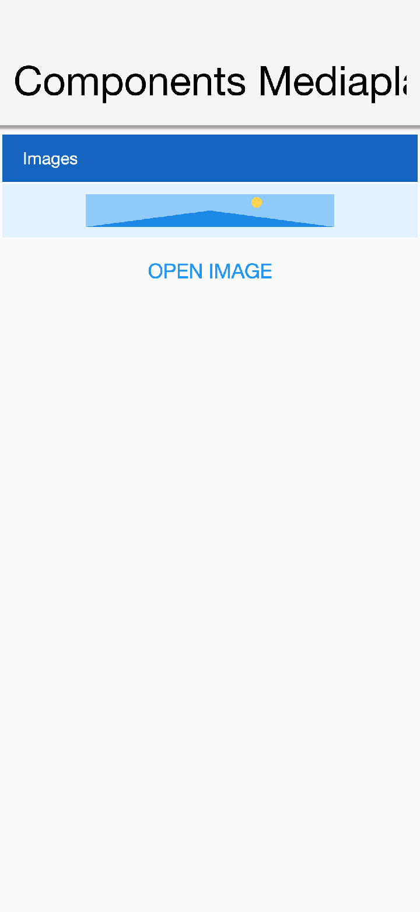
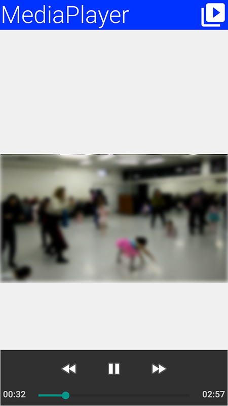

[[media-and-audio-section]]
== Media and Audio

[[media-audio-mediamanager-section]]
=== MediaManager and MediaPlayer

IMPORTANT: `MediaPlayer` is a *peer component*, understanding this is crucial if your application depends on such a component. You can learn about peer components and their issues <<native-peer-components,here>>.

The https://www.codenameone.com/javadoc/com/codename1/components/MediaPlayer.html[MediaPlayer] allows you to control video playback. To use the `MediaPlayer` you need to first load the `Media` object from the https://www.codenameone.com/javadoc/com/codename1/media/MediaManager.html[MediaManager].

The `MediaManager` is the core class responsible for media interaction in Codename One.

TIP: You should also check out the https://www.codenameone.com/javadoc/com/codename1/capture/Capture.html[Capture] class for things that aren't covered by the `MediaManager`.

In the demo code below you use the gallery functionality to pick a video from the device's video gallery:

[source,java]
----
include::../demos/common/src/main/java/com/codenameone/developerguide/snippets/generated/MediaAndAudioJava001Snippet.java[tag=media-and-audio-java-001,indent=0]
----

.Video playback running on the simulator

.Video playback running on an Android device. Notice the native playback controls that appear when the video is tapped

IMPORTANT: Video playback in the simulator will work with JavaFX enabled. This is the default for Java 8 or newer so recommend using that.

[[pcm-audio-section]]
=== PCM Audio Buffers, Mixing, and Effects

`AudioBuffer` stores raw interleaved float PCM samples in the `[-1, 1]` range, and `WAVWriter` writes those samples to a WAV file.

The portable live PCM source in Codename One is microphone capture: create an `AudioBuffer` with `MediaManager.getAudioBuffer(...)`, then create a recorder with `MediaRecorderBuilder.redirectToAudioBuffer(true)`. The builder's `path` value is the buffer key in this mode; it isn't a file path.

[source,java]
----
include::../demos/common/src/main/java/com/codenameone/developerguide/snippets/generated/MediaAndAudioJava002Snippet.java[tag=media-and-audio-java-002,indent=0]
----

When the `VideoIO` API is available, it can also produce PCM from a prerecorded video file. `VideoIO.getVideoIO().openReader(path).readAudio()` returns the decoded audio track as an `AudioBuffer`, so video audio can be mixed or processed with the same APIs shown below. `VideoIO` support is platform-gated with `VideoIO.isSupported()`, and JavaScript currently reports no decoded audio track even though frame decoding and encoding are supported.

Codename One still doesn't expose a standalone portable decoder that converts an arbitrary prerecorded audio-only file, such as MP3 or AAC, into an `AudioBuffer` without going through a video container API. Use the normal `Media` APIs to play those files. If you need offline PCM editing for audio-only formats, decode them before passing samples to Codename One, or add a platform decoder API for that format.

When you need to combine PCM clips before writing or playing them, use `AudioMixer`. It creates a sample-accurate timeline on one sample clock. Each track must use the same sample rate and channel count as the mixer. Track offsets are supplied in milliseconds and are rounded to the nearest sample frame on the mixer clock; if you already know the exact frame position, use `addTrackAtFrame(...)`.

The mixed buffer is clipped to the normalized PCM range `[-1, 1]`, so it can be passed directly to `WAVWriter`. The mixer doesn't resample or convert channel layouts; downsample or otherwise convert source buffers before adding them if they're not already on the target clock.

`AudioEffects` provides small platform-neutral PCM transforms that compose with the mixer:
[source,java]
----
include::../demos/common/src/main/java/com/codenameone/developerguide/snippets/generated/MediaAndAudioJava003Snippet.java[tag=media-and-audio-java-003,indent=0]
----

`equalize(...)` is a simple three-band tone shaper for lightweight cleanup and demos. `removeCenter(...)`, `isolateCenter(...)`, and `midSide(...)` use classic stereo mid/side processing. They can reduce, isolate, or enhance centered dialog only when the source is stereo and the voice is actually centered. These methods aren't source-separation, speech-isolation, or noise-reduction APIs.

`AudioMixer` and the simple buffer-wide `AudioEffects` operations use the `com.codename1.util.Simd` float-array API internally when the current platform supports it. Stateful filters, such as the equalizer, stay scalar because each sample depends on the previous filter state. You can force scalar behavior for diagnostics with `AudioMixer.setSimdOptimizationsEnabled(false)` or `AudioEffects.setSimdOptimizationsEnabled(false)`.

[[audio-graph]]
=== The Audio Graph

The `com.codename1.media.audio` package is a real-time and offline audio graph modelled on the W3C Web Audio API. Sources feed processing nodes that end at the context's destination, and every node parameter is an `AudioParam` with sample-accurate automation. The node set and its behavior follow the specification, so Web Audio articles and tutorials apply with Java naming: `gain.gain.value = 0.5` becomes `gain.getGain().setValue(0.5f)`.

The graph is rendered by portable code on every platform, and each port only supplies an output that plays the rendered samples. A graph therefore sounds the same everywhere it runs, and an `OfflineAudioContext` that renders to memory produces the same samples on a device as in a unit test.

==== Playing Sound in Real Time

`AudioContext.create()` opens the speaker and answers null on a platform with no real-time output, so check for null, or ask `AudioContext.isSupported()` first. The simulator, Android, iOS, macOS, Windows, Linux and the browser have one. The example below plays a filtered beep with an attack and a decay:

[source,java]
----
include::../demos/common/src/main/java/com/codenameone/developerguide/snippets/AudioGraphSnippets.java[tag=audio-graph-beep,indent=0]
----

The nodes available are:

* *Sources:* `AudioBufferSourceNode` (with loop points, playback rate and detune), `OscillatorNode` with the standard waves and custom `PeriodicWave` shapes, `ConstantSourceNode` and `MicrophoneSourceNode`.
* *Processing:* `GainNode`, `DelayNode`, `BiquadFilterNode` (all eight filter types, with `getFrequencyResponse`), `IIRFilterNode`, `WaveShaperNode` with oversampling, `DynamicsCompressorNode`, `ConvolverNode` for reverb, `StereoPannerNode`, `ChannelSplitterNode` and `ChannelMergerNode`.
* *Spatial:* `PannerNode` and the context's `AudioListener`.
* *Analysis:* `AnalyserNode`.
* *Custom:* `AudioProcessorNode`, which runs your own Java code.

==== Spatial Sound

A `PannerNode` places a source in 3D around the context's `AudioListener`, with the specification's linear, inverse and exponential distance models and sound cones. `PanningModel.EQUALPOWER` pans between the speakers; `PanningModel.HRTF` renders binaurally for headphones, so a sound can come from behind or above the listener:

[source,java]
----
include::../demos/common/src/main/java/com/codenameone/developerguide/snippets/AudioGraphSnippets.java[tag=audio-graph-spatial,indent=0]
----

The HRTF mode uses a structural model of the head (the delay between the ears, the shadow of the head and the echoes of the outer ear) rather than a measured data set. It runs the same portable code on every platform, so `isHrtfSupported()` is always true.

==== Analysis and Visualization

An `AnalyserNode` passes its input through unchanged and exposes its spectrum and waveform for a visualizer or a level meter. Read it from the EDT, for example in an animation callback:

[source,java]
----
include::../demos/common/src/main/java/com/codenameone/developerguide/snippets/AudioGraphSnippets.java[tag=audio-graph-analyser,indent=0]
----

==== Custom Processing

`createAudioProcessor` is the counterpart of the Web Audio `AudioWorkletNode`. The `AudioProcessor` you pass is called once per block of 128 frames on the audio thread, with the same `inputs[input][channel][frame]` layout a worklet gets. Declare parameters with `AudioParamDescriptor` to automate them like any other `AudioParam`. The code runs on the audio thread, so it must not block, wait for the EDT or allocate memory on every call:

[source,java]
----
include::../demos/common/src/main/java/com/codenameone/developerguide/snippets/AudioGraphSnippets.java[tag=audio-graph-processor,indent=0]
----

A processor that throws is stopped and outputs silence, and the handler set with `setOnProcessorError` runs on the EDT.

==== Microphone Input

`createMicrophoneSource` plays the `AudioBuffer` a recorder fills when it's built with `redirectToAudioBuffer(true)` (see <<pcm-audio-section>>), resampled to the context's rate. `isMicrophoneSourceSupported()` answers whether the platform implements that capture; it's false on the native Windows and Linux ports, whose recorders always write a file:

[source,java]
----
include::../demos/common/src/main/java/com/codenameone/developerguide/snippets/AudioGraphSnippets.java[tag=audio-graph-microphone,indent=0]
----

==== Offline Rendering and Decoding

An `OfflineAudioContext` renders a graph to memory as fast as the device can, for export, for tests, or to bake an effect into a clip. `decodeAudioData` reads WAV files whose samples are integers of 8 to 32 bits or floats of 32 or 64 bits, and returns null for any other format. Decode compressed audio before it reaches the graph, or play it with `Media`:

[source,java]
----
include::../demos/common/src/main/java/com/codenameone/developerguide/snippets/AudioGraphSnippets.java[tag=audio-graph-offline,indent=0]
----

==== Platform Notes

* `AudioContext.getOutputLatency()` reports the delay of the platform's output, so a game can schedule sounds against what the player hears.
* On Android the output is 16-bit PCM.
* In the browser, the graph is rendered in Java and played through the browser's own audio context. Like any web audio, it starts after the first tap or key press on the page.
