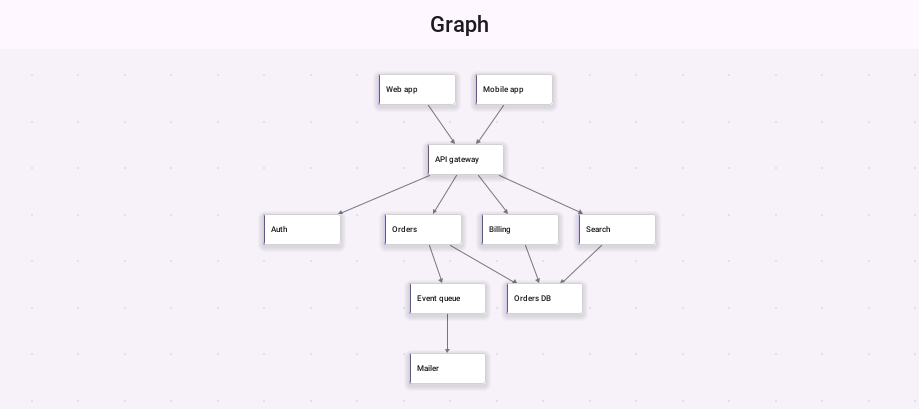
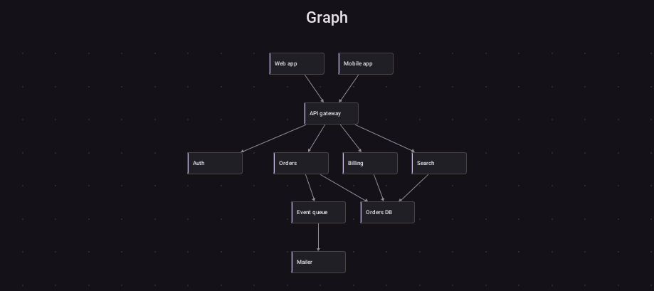
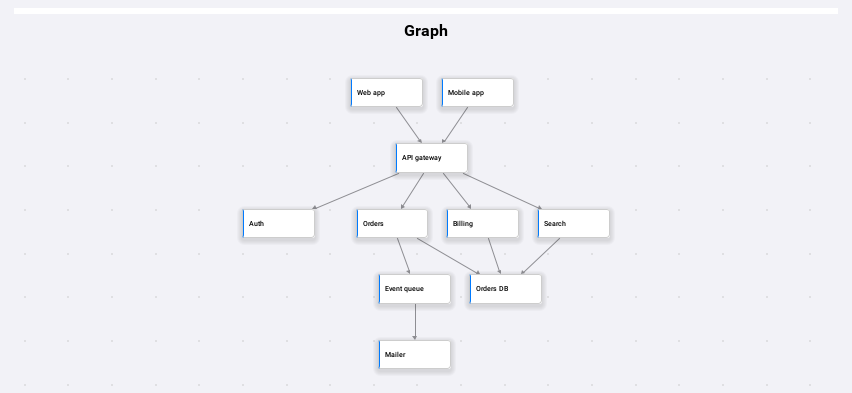
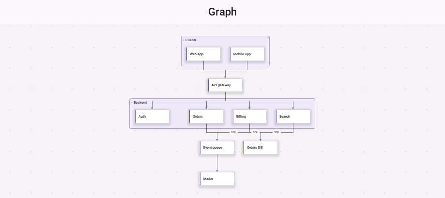
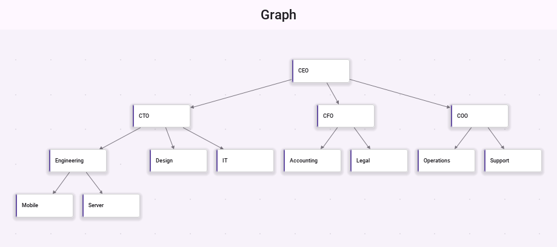
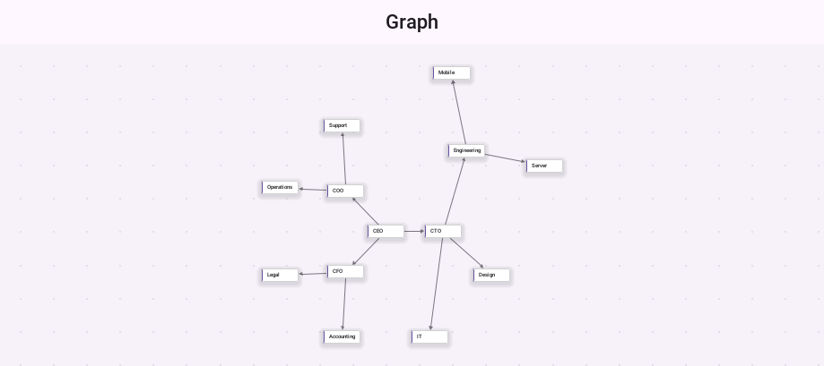
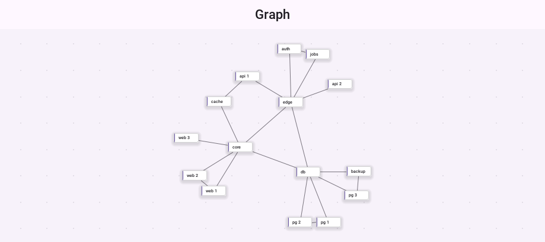
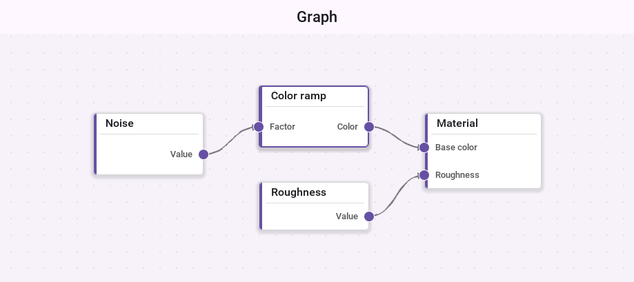
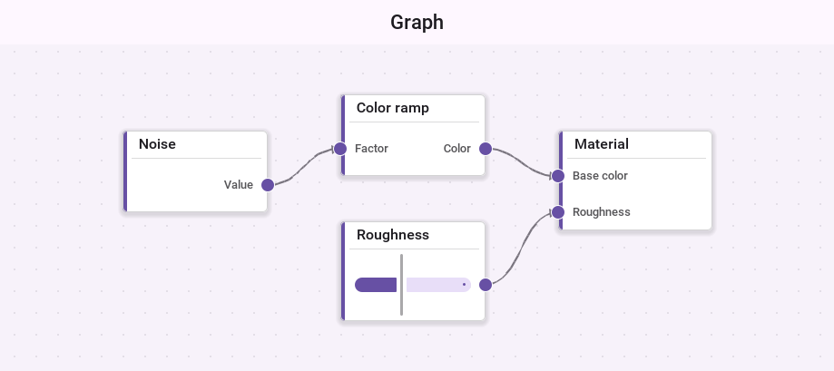

[[node-graphs]]
== Node graphs

Some ideas are easiest to explain as boxes and the lines between them: the
services of a system and who calls whom, an organization chart, a dependency
map, or a pipeline the user builds by wiring blocks together. `NodeGraph`
covers both kinds. It shows a diagram the application lays out, and it's an
editor in which the user drags nodes and connects their ports.

The component is in `com.codename1.ui.graph`. It draws from a model in
`com.codename1.graph` that has no user interface in it, so a graph can be
built, laid out, tested and stored without a form on the screen. The arrangements are
in `com.codename1.graph.arrange`.

`NodeGraph` paints its nodes and edges directly instead of building a
component for each one. A graph with thousands of nodes pans and zooms the way
one with ten does, because only what's on the screen is drawn. When the user
zooms far out, nodes are drawn as plain cards without text.

=== A first graph

A `GraphNode` has an id and a label, and `addEdge` connects two nodes by
their ids. An arrangement gives each node a position, and `fitToView` zooms so the
whole graph is in view.

[source,java]
----
include::../demos/common/src/main/java/com/codenameone/developerguide/graph/GraphSnippets.java[tag=graph-first,indent=0]
----

Give the graph the center of a `BorderLayout`. It pans and zooms inside the
room it's given, so it doesn't belong in a container that scrolls too. The
user pans by dragging the background, zooms with a pinch or the mouse wheel,
and taps a node to select it.

.A system map with the layered arrangement

.The same map in the dark appearance and on iOS

=== Groups, labels and styles

A `GraphGroup` draws a frame around the nodes that name it, with its label in
the corner. Tapping that label collapses the group to a single card, and
tapping it again opens it. An edge can carry a label, drawn in a pill at its
middle, and a style key that the renderers use to pick a color.

[source,java]
----
include::../demos/common/src/main/java/com/codenameone/developerguide/graph/GraphSnippets.java[tag=graph-groups,indent=0]
----

`setEdgeStyle` chooses how edges are drawn: `EDGE_STRAIGHT`,
`EDGE_ORTHOGONAL`, `EDGE_CURVED`, or `EDGE_AUTO`, which follows the route an
arrangement computed when there is one.

.Two groups, edge labels and orthogonal edges

=== Arrangements

An arrangement reads the model and returns a position for every node.
`arrange(arrangement, true)` animates the nodes to their new places, and
`false` moves them at once. A graph with no arrangement keeps the positions its
nodes were given, which is the manual mode a node editor uses.

[source,java]
----
include::../demos/common/src/main/java/com/codenameone/developerguide/graph/GraphSnippets.java[tag=graph-arrangements,indent=0]
----

[cols="1,3",options="header"]
|===
|Arrangement |Good for

|`LayeredArrangement`
|Flows and dependencies. Nodes go in layers along the direction of their
edges, ordered to keep edges from crossing, and long edges are routed around
the layers between their ends.

|`TreeArrangement`
|Hierarchies such as an organization chart. Each parent sits centered over
its children, and subtrees never overlap.

|`RadialArrangement`
|The same hierarchy as rings around the root.

|`ForceArrangement`
|Networks with no natural direction. Connected nodes pull together and all
nodes push apart, until the graph settles.
|===

.An organization chart with the tree arrangement

.The same chart with the radial arrangement

.A network with the force arrangement

`ForceArrangement` can also run live while the user works. Dragged nodes stay
where the user holds them, and the rest of the graph moves around them.

[source,java]
----
include::../demos/common/src/main/java/com/codenameone/developerguide/graph/GraphSnippets.java[tag=graph-live,indent=0]
----

A node marked with `setPinned(true)` stays where it's while `ForceArrangement`
arranges the others.

=== A node editor

Give a node ports and the graph becomes an editor. Inputs are drawn on one
side of the card and outputs on the other. With editing on, the user drags
from an output to an input to connect them, drags nodes around, long presses
or Shift-drags the background to select several with a box, and deletes what's selected with
`deleteSelection`. `setLabelEditing(true)` also lets the user double tap a
node to rename it.

[source,java]
----
include::../demos/common/src/main/java/com/codenameone/developerguide/graph/GraphSnippets.java[tag=graph-editor,indent=0]
----

.A node editor: typed ports connected by curved edges, on a grid

A port has a type. The model's `ConnectionValidator` refuses an edge between
ports whose types differ, from an input to an input, from a node to itself, a
second copy of an edge that exists, and an edge past a port's
`setMaxConnections` limit. `setAllowCycles(false)` also refuses an edge that
would close a loop. While the user drags a connection, the port under the
finger shows whether it would accept it, and a drop on a port that refuses it
connects to the nearest one on that node that accepts it.

Nodes without ports can be connected too. A selected node shows a handle on
its trailing edge, and dragging from it, or from a long press on the node,
draws a new edge to wherever it's dropped.

=== Listening and refusing

Every change the user makes is offered to the graph's listeners before it
reaches the model. A listener that returns false refuses it, and nothing
changes. Extend `GraphAdapter` to implement only what you need.

[source,java]
----
include::../demos/common/src/main/java/com/codenameone/developerguide/graph/GraphSnippets.java[tag=graph-veto,indent=0]
----

A model of your own implements `GraphModel`, or extends `AbstractGraphModel`
for the listener plumbing. Its `moveNode`, `connect`, `removeNode` and the
other edit methods return false to refuse a change, which makes a read-only
model the default.

=== Components inside nodes

Nodes are painted, but a node can carry a real component as well: a slider, a
text field or a button. The factory is asked for one per node, and a node it
returns null for stays painted. The component is placed over the node's card
while the node is on the screen and the zoom is above `setComponentZoom`. Below
that, the card is painted alone.

[source,java]
----
include::../demos/common/src/main/java/com/codenameone/developerguide/graph/GraphSnippets.java[tag=graph-components,indent=0]
----

.A slider inside a node

=== Finding your way

`setMinimapVisible(true)` shows a small map of the whole graph in a corner,
with the part on the screen outlined. Tapping the map moves the view there.
`centerOn(node)` moves the view to a node, `setZoomRange` limits how far the
user can zoom, and `toImage` paints the whole graph into an image for sharing
or printing.

=== Styling

The graph is styled through these UIIDs, which the native themes define:

[cols="1,3",options="header"]
|===
|UIID |Used for

|`NodeGraph` |The background
|`NodeGraphGrid` |The grid lines, when the grid is on
|`NodeGraphNode` |A node's card, its border and its text
|`NodeGraphNodeSelected` |A selected node
|`NodeGraphGroup` |A group's frame and label
|`NodeGraphPort` |The ports
|`NodeGraphEdge` |The edges and their arrows
|`NodeGraphEdgeLabel` |The pill behind an edge label
|`NodeGraphMinimap` |The minimap
|===

For more than colors, implement `GraphNodeRenderer` or `GraphEdgeRenderer`,
or extend the default ones, and pass them to `setNodeRenderer` and
`setEdgeRenderer`.
