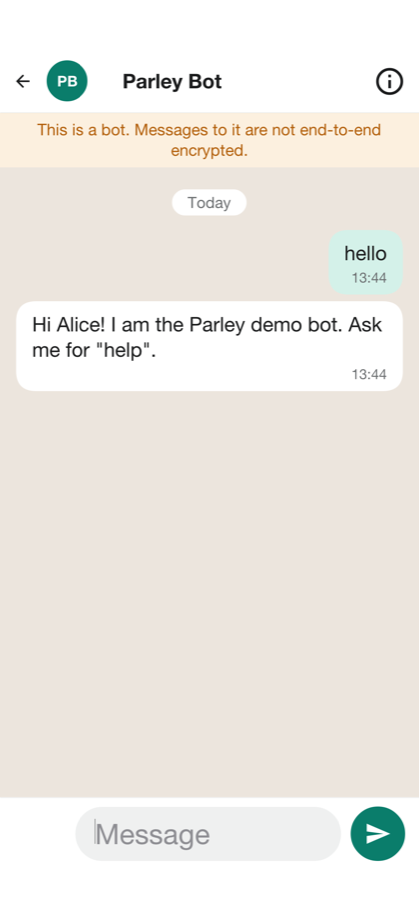

[[parley-implementors-guide]]
== Parley: Building on the sample

Parley is a messenger, and most of what makes one isn't in the server. The
server stores and relays ciphertext it can't open; the keys, the sessions, the
encryption and the history are in the app. Parley kept what it shares with
<<wayline-implementors-guide,Wayline>> and <<savor-implementors-guide,Savor>>: the
module layout, the accounts and sign-in, text messages, push notifications, the
live channel, the operations console and hosting the app in a browser. This
chapter covers what a messenger changes. For the parts the samples share, it
points at the Wayline chapter, which is true of Parley with the names swapped.

[[parley-launch]]
=== Running it

The project is in `scripts/parley`, and the Initializr generates it under your own
package and name. Start the server on the development profile, which seeds the demo
accounts and conversations and prints text messages on the console:

[source,bash]
----
include::../demos/common/src/main/snippets/developer-guide/parley.sh[tag=parley-sh-server,indent=0]
----

Then run the app in the simulator, from the project's directory:

[source,bash]
----
include::../demos/common/src/main/snippets/developer-guide/parley.sh[tag=parley-sh-simulator,indent=0]
----

`backend/server.sh run --web` builds the app for a browser as well and serves it at
`http://localhost:8080/`. Running on a device, and the compiled server, work as
<<wayline-launch>> describes.

=== The modules

The three modules are Wayline's: `shared` holds the contract, the data transfer
objects and the `@RestClient` interfaces both sides compile against; `common` is
the app; `backend` is the server. The app's packages are `crypto` (keys, sessions
and the encrypted vault on the device), `chat` (sending, receiving and calls),
`store` (the history), `live`, `net`, `notify`, `admin` and `ui`. The backend's
follow the domain:

[cols="1,3"]
|===
| Package | What it holds

| `device`
| The devices of each account and the public keys they publish: identity keys,
  signed prekeys and one-time prekeys.

| `chat`
| Conversations and their members, the envelopes that carry messages, their
  fan-out to devices, encrypted attachments and the demo bot.

| `call`
| Calls: who is calling whom, the signalling relay and the TURN credentials.

| `contact`
| Finding people, blocks and reports.

| `bridge`
| The links to Telegram and WhatsApp.

| `account`, `admin`, `sms`, `push`, `live`
| Taken from Wayline and adapted: roles, moderation and the privacy preferences,
  the statistics, text messages, push, and the live channel.
|===

The server's rules are in one table, with the admin console behind the `admin`
role and everything else behind a signed-in account:

[source,java,role=cn1-no-try]
----
include::../../scripts/parley/backend/src/main/java/com/codenameone/examples/parley/SecurityConfig.java[tag=parley-api-rules,indent=0]
----

[[parley-protocol]]
=== The protocol

Parley follows Signal's two published specifications, X3DH to start a session and
the Double Ratchet to carry it, over the primitives Codename One has on every
port. Where Signal uses X25519 for the Diffie-Hellman steps, Parley uses P-256,
which the platforms provide natively; it derives keys with HKDF-SHA-256 and
encrypts messages with AES-256-GCM. The pieces are in
<<crypto-api-section,the crypto API>>: `KeyGenerator.ec(256)`, `KeyAgreement.ecdh`,
`Hkdf.derive`, `Cipher` and `Hmac`, and `Signature` for the prekey's signature.

Each device is its own identity. It makes three kinds of key, once, and keeps the
private halves in the `Vault`:

* An **identity key**, long term.
* A **signed prekey**, which the identity key signs and which is rotated.
* A supply of **one-time prekeys**, each of which opens one session and is then
  gone.

The device publishes the public halves to `device/Devices`, which checks the
signature. That check doesn't make the server trusted: a server that wanted to lie
would swap the identity key too, which is what the safety numbers catch.

To write to a device it hasn't talked to, the sender fetches that device's prekey
bundle. The server hands out, and so deletes, one of the one-time prekeys. The
sender combines its identity key and a fresh ephemeral key with the bundle's
identity key, signed prekey and one-time prekey -- three or four ECDH results,
joined and run through HKDF -- into a root key, and the first message carries what
the receiver needs to repeat the computation. The receiver can be offline, and the
first message is still forward secret. After that the Double Ratchet takes over:
every message moves a symmetric chain forward, every reply a Diffie-Hellman step,
so a key that leaks opens neither the past nor, once a reply has been exchanged,
the future. Messages that arrive out of order open from skipped keys the ratchet
keeps, and a header that claims an absurd number of lost messages is refused.

`crypto/Sessions` keeps one session per remote device, plus the one before it.
Two devices that start a session with each other at the same moment each end up
with two; the earlier one opens whatever the other side sent on it. The same
happens when a contact reinstalls: the new device's first message starts a new
session, and messages still in flight on the old one still open.

A message is a JSON payload -- kind, text and a media reference -- that's encrypted for each recipient device. The
server sees an envelope: who sent it, which device it's for, a header, a
ciphertext and a time. It never sees a payload. The ciphertext is limited to 64 KB,
which is why attachments travel apart from it.

[[parley-fanout]]
==== Groups, devices and delivery

There is no group key. A message to a group is encrypted once for every device of
every member, and once for each of the sender's other devices, so that they show
what was sent. The client sends all the copies in one request, and the server
checks that they cover exactly the devices it knows, so that a message can't
skip a device. A group of 256 people on up to six devices each is a lot of
copies, which is the price of having no state to keep in step: adding a member
needs no rekey, and a removed member simply stops being addressed.

`chat/Fanout` stores each envelope and sends it over the live channel to the device
it's for. An account with no device connected gets a push that carries nothing:
it only wakes the app, which fetches what's waiting over its own connection. An
envelope is deleted when its device acknowledges it, and one nobody fetches is
kept for 30 days. Delivery is at least once: an envelope is stored before it's
sent live, so a device can see it twice, and the app remembers the ids it has
seen. Typing indicators and call signals go live only and are never stored.

Linking a device is signing in on it. The server lists the account's devices, up to
six, and the app on every one of them encrypts for the others. Unlinking one
deletes its keys and the envelopes waiting for it, which nobody else could read. A
safety number is computed from the two identity keys and usernames, hashed a
thousand times, and is shown as sixty digits. It follows the shape of Signal's but
its iteration count and version byte are the app's own, so the numbers don't match
Signal's.

[[parley-media]]
==== Media

A photo, a video or a voice note is encrypted on the device with a fresh AES key,
and the ciphertext is uploaded to `chat/Media`. The upload answers an id of 128
random bits. The id, the key and a digest of the ciphertext go inside the message,
so only the message's recipients have the key. The server stores bytes it can't
read for anyone who presents the id, up to 16 MB, and the receiver checks the
digest before it opens anything: an attachment changed on the way isn't opened.
Profile and conversation photos are the one exception, because the server has to
hand them to people who haven't been sent a message.

==== At rest on the device

Keys, sessions and message history are JSON documents in `Storage`, each sealed
with AES-GCM under a vault key that lives in the platform keystore (`SecureStorage`:
the Keychain, the Android Keystore). A copy of the app's files holds nothing
readable without that key, and signing out deletes it, which turns the files into
noise. Each account on a device has a vault of its own, named by a hash so that the
file names don't say whose they are. App lock, screen security and the privacy
settings that the app enforces itself -- read receipts, typing -- are in
`ui/Privacy` and `Prefs`; last seen and the profile photo are enforced by the
server, which is what hands them out.

=== Disappearing messages

The timer is a setting of the conversation, in seconds, that the server keeps and
every member's phone reads. A message in a conversation with a timer is stamped
with the time it vanishes, counted from when it was sent: the server stamps the
envelopes it stores, and each phone stamps its own copy and deletes it then. An
envelope that's still waiting when its time comes is deleted on the server
too (`EnvelopeRepository.expire`), so a phone that was offline for longer than
the timer never receives it. A timer can't take back what a recipient already copied, and
the user's guide says so.

[[parley-calls]]
=== Calls

A call is two apps and a relay. The server never touches the media: it rings the
callee, relays the signalling, and hands out the addresses of the servers through which
the apps reach each other. The media itself is WebRTC's, encrypted with DTLS-SRTP
between the two devices.

The app owns the signalling, which is how `com.codename1.webrtc` is meant to be used
(<<webrtc-section,the WebRTC chapter>>). `call/Calls` starts and ends a call and
passes along six signals as `call` frames on the live channel: `OFFER`, `ANSWER` and
`ICE` carry WebRTC's own text, and `ACCEPT`, `DECLINE` and `END` move the call
through its states:

[cols="1,3"]
|===
| State | How it gets there

| `RINGING`
| The caller started it. It rings the callee for 45 seconds.

| `ACCEPTED`
| The callee answered.

| `ENDED`
| Either side hung up.

| `DECLINED`
| The callee refused.

| `MISSED`
| The caller gave up, or nobody answered in time.

| `BUSY`
| The callee was already in a call.
|===

The caller opens its camera and microphone and sends the offer at once, so the
callee's phone already holds it when the person answers. A candidate that arrives
before the description it belongs to waits for it. A call nobody ended is closed
by a sweep after it has been ringing too long, or running for hours.

Where the platform has a system call screen the call is reported to it as well:
CallKit on iOS and the ConnectionService on Android, through `com.codename1.call`.
The call rings on the lock screen, shows in the phone's call log, and the system's
answer and hang-up buttons drive the same steps as the app's. A VoIP push rings a
phone the app isn't running on. The pieces are in `chat/Calls` in the app and
`push/MessagePushes` on the server.

==== Reaching each other: STUN and TURN

Most calls find a direct path with only STUN. A call between two phones on mobile
networks often doesn't, and needs a TURN server to relay the encrypted packets. The
server doesn't run one. It hands each caller the addresses of yours, with a
credential that expires, so nothing about the TURN server is kept in the app:

[source,properties]
----
include::../demos/common/src/main/snippets/developer-guide/parley.sh[tag=parley-sh-turn,indent=0]
----

`parley.ice.secret` is the secret shared with the TURN server -- coturn's
`static-auth-secret`, with `use-auth-secret` on. `Calls.ice` builds the credential
the way coturn checks it: the username is the expiry time and the account, and the
password is the HMAC-SHA1 of the username under the secret. Nothing is stored, and
a leaked credential stops working on its own after `parley.ice.ttl` seconds. With
no TURN server set, only STUN is handed out, and calls between networks that block
a direct path fail. The default STUN server is a public one; run your own for a
service of your own.

[[parley-bridges]]
=== Bridges to Telegram and WhatsApp

A group or a channel can be linked to a Telegram group or a WhatsApp number. What a
Parley member writes goes out to the linked chat, and what's written there comes in
and is posted into the conversation. Each bridge is off until the server has its
credentials:

[source,properties]
----
include::../demos/common/src/main/snippets/developer-guide/parley.sh[tag=parley-sh-bridges,indent=0]
----

* **Telegram:** a bot from BotFather. Its webhook is `/bridge/telegram/<secret>`,
  where the secret is a random string of 16 or more characters, and is also given to
  `setWebhook` as the `secret_token`. A group is linked by adding the bot to the
  Telegram group, sending it `/id` and typing the number it answers with.
* **WhatsApp:** a Cloud API access token and phone number. Meta calls
  `/bridge/whatsapp`, answers the verify token when subscribing, and signs every
  delivery with the app secret, which the server checks.

==== The privacy trade-off

To carry a message across, a bridge has to read it. A bridged conversation is
therefore **not end-to-end encrypted**: its members' apps send it to the server in
plain text, so that the server can pass it on. The sample doesn't hide this. Only a
group's owner or one of its admins can link it, the link is announced in the group
so that everyone learns, in a notice they can't miss, that from now on what they
write there leaves Parley in plain text, and every member's app marks the
conversation as not end-to-end encrypted. The chat with the demo bot is marked the
same way, for the same reason. The administrator's **Bridges** screen lists every
link.

Plain text on the server is also plain text in the other network, under that
network's own rules about what it keeps. Decide whether your service wants bridges
at all; leave them unconfigured and the feature isn't offered.

=== The admin console and what the server knows

The console is built on the operations console's `Console`, so it's a list beside a
detail on a wide screen and a list that opens a screen per item on a phone. The
statistics count what the server can see -- accounts, messages, kinds of
conversation, the busy hours -- and nothing it can't. A report is the only way
content reaches an administrator, and it carries only what the reporter's own phone
chose to attach.

=== Hosting, accounts, text messages and push

These are Wayline's, with the names swapped: the accounts and the sign-in
(<<wayline-access>>), text messages (<<wayline-sms>>) with the providers
`parley.sms.provider` names, push (<<wayline-push>>) with `parley.push.provider`,
the database (<<wayline-database>>) and hosting (<<wayline-hosting>>). One
difference matters here: a Parley push never carries a message, it only wakes the
app, which fetches and decrypts on the device, so the push provider never learns
what anyone said.

=== Tests

[source,bash]
----
include::../demos/common/src/main/snippets/developer-guide/parley.sh[tag=parley-sh-tests,indent=0]
----

The backend tests run the server on the JVM and then compiled, against the
envelope and device rules, the calls' states, the bridges and who may call what.
`run-e2e.sh` starts a server on the test profile and drives the app in the
simulator against it. `run-web-e2e.sh` does the same for the app in a browser, linked as a
device.

=== Making it yours

The ways to make Wayline your own apply here too: the name, icon and colors, the
languages, the text-message and push providers, the database, hosting. A few apply
to a messenger in particular:

* **Your own relay.** Point `parley.ice.turn` at a TURN server you run.
* **No bridges.** Leave the Telegram and WhatsApp settings out.
* **A different curve or cipher.** The primitives are in `crypto/Ratchet`, and the
  server never sees them, so changing them is an app-side change with a migration
  for existing sessions.
* **Before it's a product.** A real service needs an independent review of the
  protocol code, a way to back up and restore history, key transparency or another
  answer to a server that lies about keys, abuse handling at scale, calls with more
  than two people and retention rules for the places it operates in. None of them
  are in the sample.
