[[parley-users-guide]]
== Parley: A private messenger from three sides

Parley is a sample app with a server behind it. People chat one to one and in
groups, send photos, video and voice notes, and call each other with voice or
video. Everything they write, and every call, is end-to-end encrypted: the
server relays what it can't read. An administrator looks after the service
without ever seeing a message. The app and the server are one Maven project,
written in Java on both sides.

This chapter is the user's guide: what a person sees and can do, and what an
administrator sees. <<parley-implementors-guide>> is the other half. It explains
how the project is built, how the encryption works and what to change to make the
app yours. Parley shares its accounts, sign-in, text messages, push notifications,
live channel and operations console with <<wayline-users-guide,Wayline>> and
<<savor-users-guide,Savor>>, the two sibling samples.

One app serves everyone. The server gives every account a set of roles, and the
app opens on the screen that fits them: a person on their chats, an administrator
on the admin console.

[cols="1,3"]
|===
| Role | What it adds

| User
| Every account is a user. Chat one to one, in groups and in channels, send
  photos, video and voice notes, call, link more devices, and decide what others
  can see about you.

| Admin
| Granted by another administrator. See the service in numbers and charts, read
  and resolve the reports people make, find and moderate accounts, and link
  conversations to Telegram and WhatsApp.
|===

=== Trying it

Start the server on its development profile and it creates a set of accounts, all
with the password `parley-demo`, a few conversations between them and a bot that
answers. <<parley-launch>> has the commands.

[cols="2,3"]
|===
| Account | Role

| `alice@parley.example`, `bob@parley.example`, `carol@parley.example`, `dan@parley.example`
| Users who share a group, **Weekend hike**, a family group and a channel,
  **Parley news**.

| `mallory@parley.example`
| A user an administrator has flagged, with a report about them still open.

| `admin@parley.example`
| Runs the service.

| The Parley bot
| Answers whoever writes to it, so that one person trying the app alone has
  someone to talk to. It's the server, so its chats are marked as not end-to-end
  encrypted.
|===

To see a conversation from both ends, sign in as one account in the simulator and
as another in a second simulator, or in a browser.

=== Getting in

The welcome screen offers to sign in or to create an account. **Server address**
is there for a phone on the same network as a development server: `localhost` on a
phone is the phone, so the app has to be told where the server is. The app in a
browser has no such entry: it always talks to the server that hosts it.

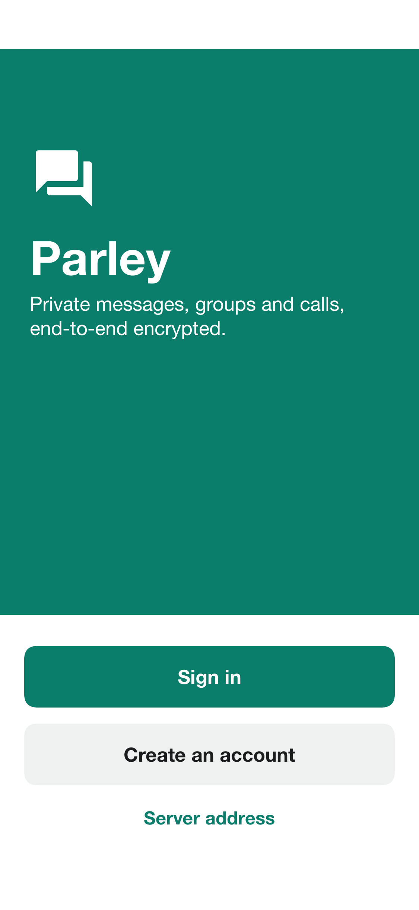

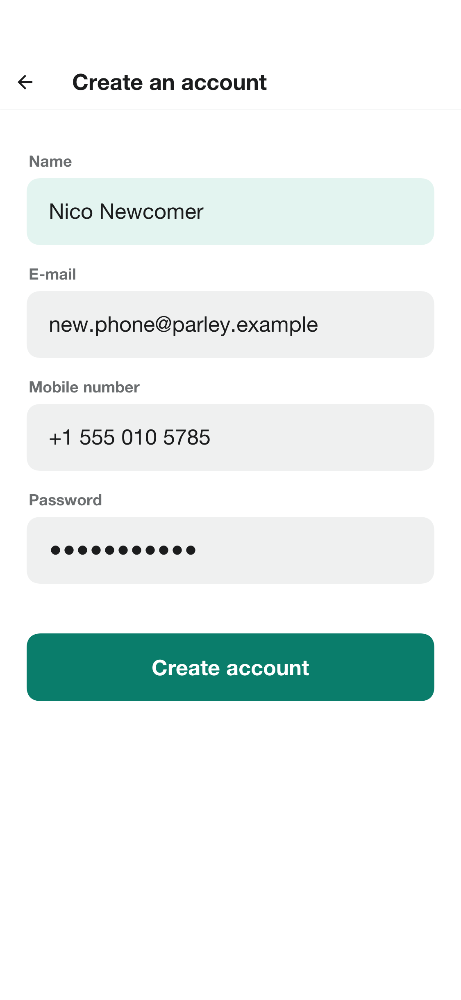

A new account asks for a name, an e-mail address, a mobile number and a password.
The mobile number is verified with a code sent as a text message, and a
development server prints the code on its console and the app shows it. The number
is used to find people you know, and only if you leave that on.

The first sign-in on a device asks whether the app may share usage statistics. The
answer can be changed in the settings at any time. What's shared never includes a
name, a contact, a number or anything that was written.

On first sign-in the app also makes this device's encryption keys. They're made
on the device and never leave it, which is why a message sent before the account
existed on this device can't be read here.

=== Chats

The chat list starts with every conversation, the newest first, with an unread
count and the start of the last message. Pressing and holding a conversation
pins it to the top, mutes it or archives it. A notification only says that
something arrived: what it says is fetched and decrypted on the device.

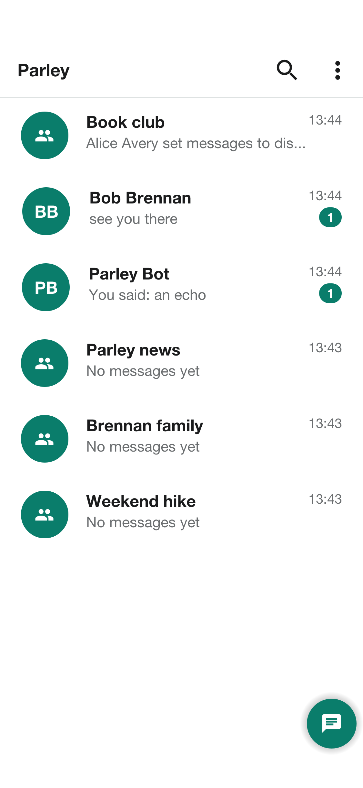

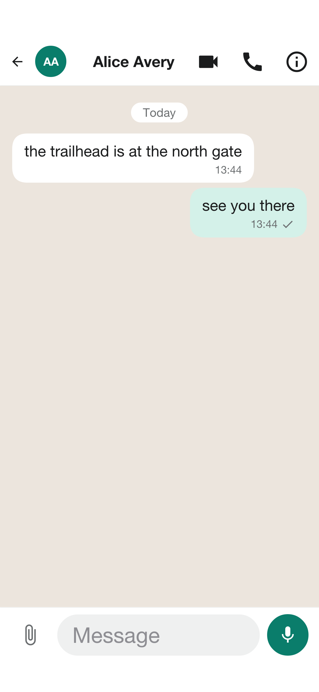

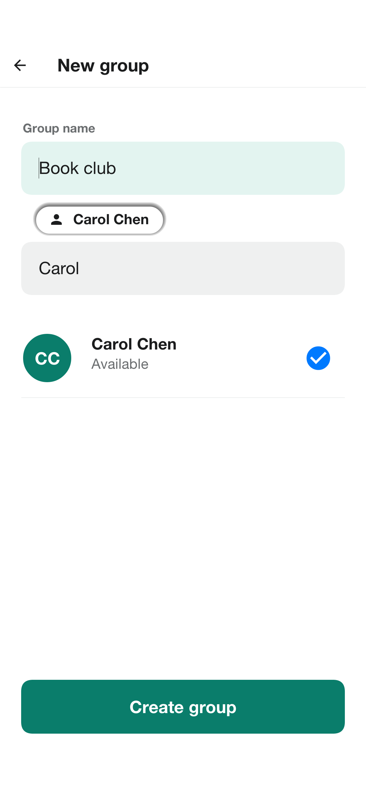

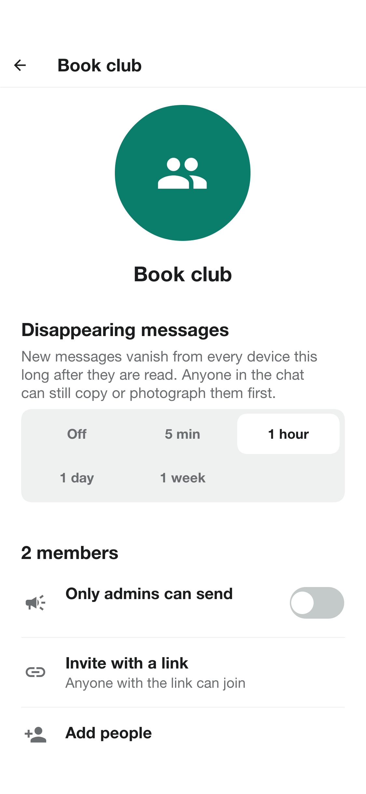

There are three kinds of conversation:

[cols="1,3"]
|===
| Kind | Description

| Chat
| Two people.

| Group
| Up to 256 people. The person who made it owns it and can name administrators,
  who add and remove members and change the name, the description and the photo.
  A group can be joined with a link or a code.

| Channel
| A group in which only the administrators can send. Everyone else reads.
|===

The button on the chat list starts a conversation: find a person by name,
username or phone number, make a group, or join one with an invite link.

A conversation shows its messages as they arrive, a typing indicator, and the
state of each message you sent: sent, delivered, and read. A message can be
replied to, copied, forwarded, edited, and deleted. **Delete for everyone**
removes it from every phone in the conversation. Photos, video and voice notes
are sent from the attachment button: a photo or a video from the gallery or the
camera, and a voice note recorded with the microphone. Each is encrypted on
your phone before it leaves, and an attachment is limited to 16 MB.

Pressing the name at the top opens the conversation's info: who is in it, a
mute switch, the timer for disappearing messages, the safety numbers, and for a
person, the choice to block or to report them.

=== Is anyone listening

Messages, photos, voice notes and calls are encrypted on your phone with keys that
only the phones in the conversation hold. The server stores and relays what it
can't read, which is the point: nobody outside the conversation, the server's
administrators included, can read it.

A message is only as private as the person you think you're talking to, so the
info screen offers **Safety numbers**: sixty digits that both phones compute from
their keys. Compare them with the other person's screen, in person or over a
call. If they match, nobody is in the middle. They change when either person's
keys do -- a new phone, a reinstall -- so a number that changed for a person who
hasn't changed phones is worth a question.

A chat with the demo bot, and a conversation an administrator has linked to
Telegram or WhatsApp, aren't end-to-end encrypted, because a bot or another
network has to read what's written. The app marks those conversations, and
anyone in a bridged conversation is told when it's linked. <<parley-bridges>>
explains the trade-off.

=== Privacy

**Privacy and security** in the settings holds what others can learn about you and
what the phone shows:

[cols="1,3"]
|===
| Setting | What it does

| Last seen and online
| Who sees when you were last online: everyone, your contacts or nobody. The
  server enforces it, because the server is what hands the information out.

| Profile photo
| Who sees your photo, in the same three choices.

| Read receipts
| Whether others see when you've read their message. Off, you don't see theirs
  either, so it isn't a way to watch without being watched.

| Typing indicator
| Whether others see when you're typing.

| Disappearing messages
| A default timer for new chats: off, 5 minutes, 1 hour, 1 day or 1 week. New
  messages in a chat with a timer vanish from every phone in it that long after
  they're read. Anyone in the chat can still copy what was said, so it limits
  what's kept, not what was seen.

| Screen security
| Keeps chats out of screenshots and the app switcher.

| App lock
| Asks for a fingerprint, face or passcode to open Parley, after the app has been
  away.

| Blocked
| People who can't message or call you. A person is blocked from their chat's info
  screen.
|===

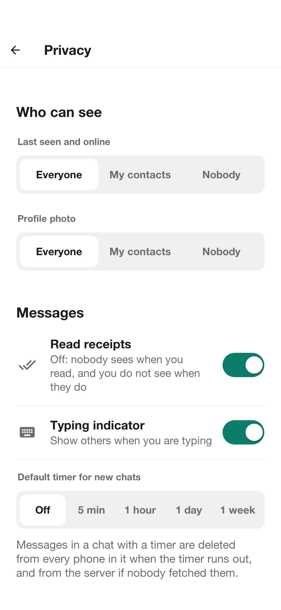

**Report** on a person or a conversation sends the administrators a reason and the
last few messages as the reporter's phone shows them, and nothing else: they can't
read anything the reporter didn't choose to send.

=== Calls

A call is one to one, voice or video, from the buttons at the top of a chat. The
other person's phone rings, with a notification and the phone's own call screen --
the lock screen on iOS, the system call UI on Android -- even when Parley isn't
running. Answering opens the call screen, which has a mute switch, a speaker switch, for video a camera
switch and a button to turn the camera off, and **End**. A call you don't answer shows in **Calls**
as missed, and a call to someone who's already in one is told they're busy.

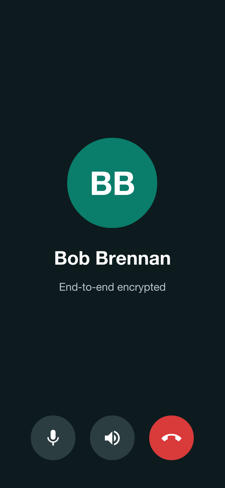

The audio and video go straight between the two phones, or through a relay when a
direct path doesn't exist, which on mobile networks is often. Either way they're
encrypted between the two phones. Calls need the camera and the microphone, which
the app asks for the first time.

=== Linked devices

The same account can be signed in on up to six phones, tablets, and browsers.
**Linked devices** in the settings lists them. Each is its own end of every
conversation, with its own keys, and a message to you is encrypted for
each.
Unlinking one is final: the server stops sending it anything, and what it held
opens nothing sent afterward.

=== The administrator

The admin console starts on a dashboard: how many people are active, how many
messages were sent and how many accounts are new, with charts of the last two
weeks, of the busiest hours and of the kinds of chat. Message counts are all the
server knows: what was said is encrypted on the devices and never reached it.

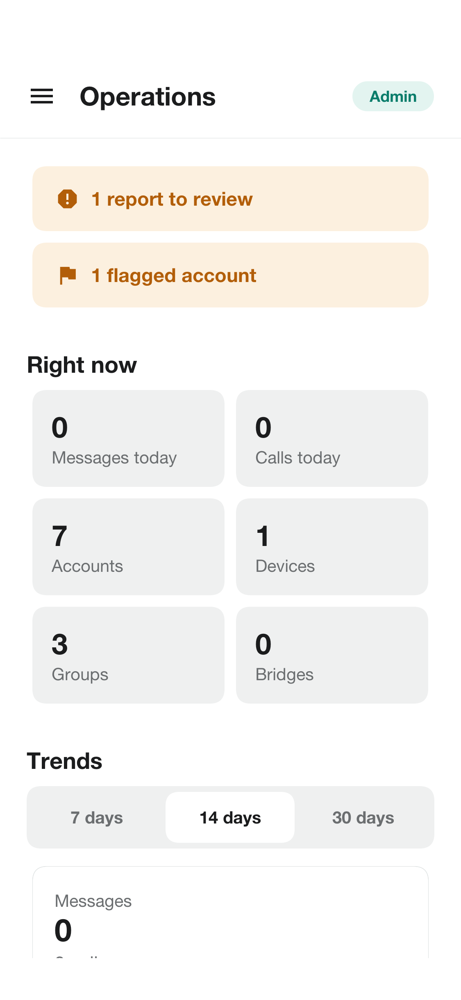

**Reports** lists what people reported, with the reason, the messages the reporter
attached and a button to resolve it with a note of what was done. **People** finds
any account. An account can be flagged, which marks it for the admins and changes
nothing for its owner, or blocked with a reason that's kept in its history: a
blocked account is signed out everywhere and can't sign in. Another administrator
can be named from the same screen.

**Bridges** lists the conversations linked to Telegram or WhatsApp, and says when a
network isn't set up on this server.

On a tablet or a desktop the console lays its sections down the left side and
opens what's picked beside its list.

=== Settings

The settings hold the account -- its name, about line, photo, phone number and
password -- the privacy choices, the linked devices, the language, the theme,
notifications and the usage statistics. Deleting the account removes the
sign-in, the profile and the settings for good. The app is in English, Spanish,
French, German and Hebrew, and in Hebrew it's laid out from right to left.

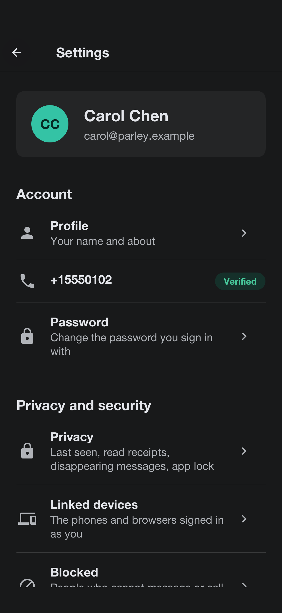

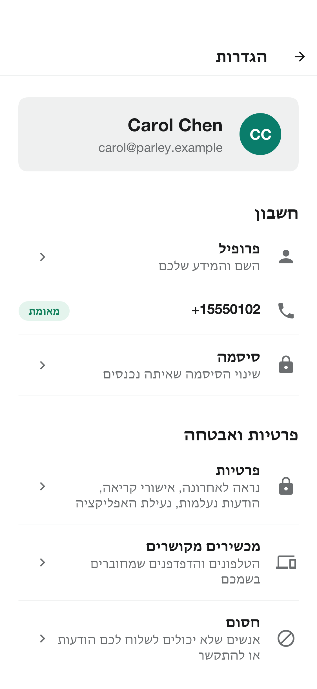

NOTE: The translations are machine-generated samples, and no native speaker has
reviewed them. Have them checked before you ship the app in those languages.

=== In a browser

The server can host the app itself: open the server's address in a browser and the
same app loads there, signs in against that server, links itself as a device and
opens its live channel. A browser gives a page less than a phone gives an app, and
the app says so where it matters: the system call screen and the call push are for
phones.
