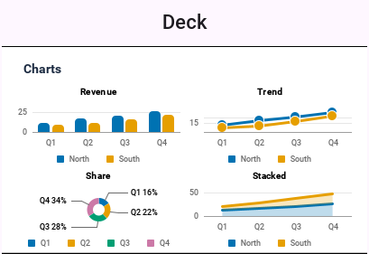
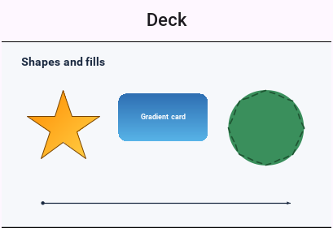
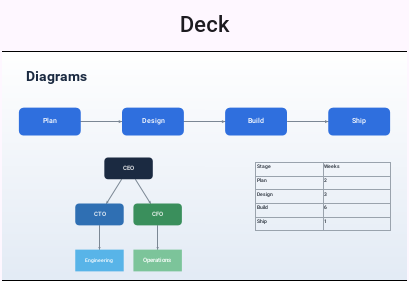
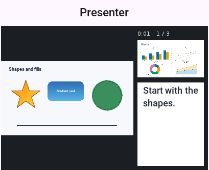
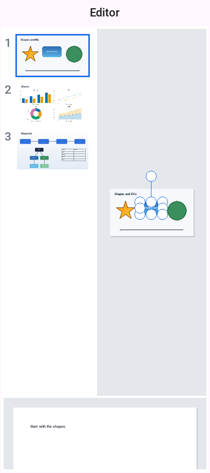

[[presentations]]
== Presentations

A sales deck, a lecture, a quarterly review: each is a list of slides, and each
was most likely written in PowerPoint, Keynote or LibreOffice Impress.
`com.codename1.presentation` reads those files, plays them, edits them and
writes them back, on every platform and with no native code.

.A slide of charts, played by `SlideShow`

It's the third of the office packages, beside `com.codename1.spreadsheet` and
`com.codename1.wordprocessing`, and it shares their parts rather than
repeating them. The text in a slide is word processor text: paragraphs, runs
and styles from `com.codename1.wordprocessing`, laid out by `DocumentLayout`
and edited in place by a `DocumentView`. A chart on a slide is a
`com.codename1.ui.chart.Chart`, and a diagram is arranged by
`com.codename1.graph`.

[cols="1,1,1",options="header"]
|===
|Format |Read |Write
|PowerPoint (`.pptx`) |Yes |Yes
|OpenDocument presentation (`.odp`) |Yes |Yes
|Keynote (`.key`) |Yes |No
|PowerPoint 97-2003 (`.ppt`) |Yes |No
|Codename One slides (`.cn1slides`) |Yes |Yes
|PDF |No |Yes
|===

=== Reading and writing files

`Presentation.read` takes a stream and a format, and `write` saves a
presentation in another. Keynote and the old binary PowerPoint format are read
only; open one and save it as `.pptx` to keep editing it elsewhere.

[source,java]
----
include::../demos/common/src/main/java/com/codenameone/developerguide/presentation/PresentationSnippets.java[tag=slides-convert,indent=0]
----

A reader never drops content without a word. Whatever it can't convert, such
as an embedded video or an effect the model has no counterpart for, is named in
`getWarnings()`, and the rest of the slide still loads.

`.cn1slides` is the package's own format, a ZIP of one XML file. It keeps
everything the model holds exactly, so use it to store a presentation your
application made or changed.

=== The model

A `Presentation` is immutable: a slide size in points, a theme, and a list of
`Slide` objects. Each slide has a background, its elements from back to front,
speaker notes, a transition and its builds. The elements are:

* `ShapeElement`: one of the preset shapes (`ShapeGeometry.presets()` lists
  them) with a fill, an outline and optional text. A text box is a shape with no
  fill.
* `PictureElement`: a picture, cropped and flipped as needed.
* `TableElement`: a word processor `Table`.
* `ChartElement`: categories, series and values, drawn as a column, bar, line,
  area, pie, doughnut, scatter or radar chart.
* `DiagramElement`: nodes and the edges between them, arranged as a process, a
  hierarchy, a cycle or a radial diagram.
* `GroupElement`: elements moved and scaled together.

Every change makes a new object, so a presentation can be shared between
threads and compared with `equals`. Build a slide in code the same way a reader
does:

[source,java]
----
include::../demos/common/src/main/java/com/codenameone/developerguide/presentation/PresentationSnippets.java[tags=slides-imports;slides-shapes,indent=0]
----

.Preset shapes with gradient fills, a dashed outline and an arrow

==== Charts

A `ChartElement` holds the numbers, not a picture of them. On screen it becomes
a live `Chart`, which animates in when its slide appears; in a PDF it's drawn
by the same chart code, so the two look alike. PowerPoint and LibreOffice files
keep their charts as data too, so the numbers stay editable after a round
trip.

[source,java]
----
include::../demos/common/src/main/java/com/codenameone/developerguide/presentation/PresentationSnippets.java[tags=slides-imports;slides-charts,indent=0]
----

==== Diagrams and tables

A `DiagramElement` lists nodes and edges and names an arrangement. Where each
box goes is worked out by the layouts of `com.codename1.graph`, so adding a
node rearranges the diagram instead of overlapping it.

[source,java]
----
include::../demos/common/src/main/java/com/codenameone/developerguide/presentation/PresentationSnippets.java[tags=slides-imports;slides-diagrams,indent=0]
----

.A process, an organisation chart and a table

The slides go into a presentation in order:

[source,java]
----
include::../demos/common/src/main/java/com/codenameone/developerguide/presentation/PresentationSnippets.java[tag=slides-deck,indent=0]
----

=== Playing a presentation

`SlideShow` is a component that plays a presentation. A tap on the right of the
screen, a swipe to the left or the right arrow key moves forward; a tap on the
left, a swipe to the right or the left arrow key goes back. Hidden slides are
skipped.

[source,java]
----
include::../demos/common/src/main/java/com/codenameone/developerguide/presentation/PresentationSnippets.java[tag=slides-show,indent=0]
----

Moving forward first plays the slide's builds, a click at a time, and then
the transition into the next slide: fade, push, cover, uncover, wipe or zoom,
from any side. A build makes an element appear, fade, fly in, zoom or wipe in,
fade out again or pulse for emphasis. Builds that start with the previous one
or after it play together as one step, and a slide whose first build doesn't
wait for a click plays it as soon as the slide appears.

Transitions and builds are painted by `SlideAnimation` from a progress value,
so any frame can be drawn on its own. That's how a thumbnail can show a slide
halfway through its builds, and how the screenshot tests check every frame:

[source,java]
----
include::../demos/common/src/main/java/com/codenameone/developerguide/presentation/PresentationSnippets.java[tag=slides-frame,indent=0]
----

==== Presenter mode

In presenter mode the slide shares the screen with the next slide, the speaker
notes and a clock. Put it on the second screen of a desktop application, or use
it to rehearse.

[source,java]
----
include::../demos/common/src/main/java/com/codenameone/developerguide/presentation/PresentationSnippets.java[tag=slides-presenter,indent=0]
----

.Presenter mode: the current slide, the next one, and the notes

=== Editing

`SlideView` is an editor: the slides as thumbnails down the side, the slide
being edited in the middle and its notes below. Tap an element to select it.
Drag it to move it, drag a square handle to resize it and the handle above it to
rotate it; the rotation snaps to multiples of 15 degrees. Double tap a shape to
type into it.

[source,java]
----
include::../demos/common/src/main/java/com/codenameone/developerguide/presentation/PresentationSnippets.java[tag=slides-editor,indent=0]
----

.The editor with the gradient card selected

The text editor that opens in a shape is a `DocumentView`, so selection, the
clipboard, the keyboard and input methods work as they do in a document.
Everything the editor does goes through its `PresentationModel`, and each drag
or text edit is a single undo step. Your own commands use the same model:

[source,java]
----
include::../demos/common/src/main/java/com/codenameone/developerguide/presentation/PresentationSnippets.java[tags=slides-imports;slides-model,indent=0]
----

=== PDF and pictures

`Presentation.Format.PDF` writes one page per visible slide, each the size of
the slide. A slide becomes an image with `SlideRenderer.toImage`, for a share
sheet or a list of thumbnails. The screen, the PDF and the image are all painted
by the same code, so they match.
