[[pulse-users-guide]]
== Pulse: A fitness studio app from every side

Pulse is a sample app with a server behind it, for a gym or a studio that runs
classes. Members book classes for themselves and their children, open the door
with their phone, pay for a membership and train with their friends. Trainers run
their classes, the front desk lets people in, and the owner reads the numbers and
fills the quiet classes. The app and the server are one Maven project, written in
Java on both sides.

This chapter is the user's guide: what each kind of user sees and can do.
<<pulse-implementors-guide>> is the other half. It explains how the project is
built and what to change to make it yours.

One app serves everyone. The server gives every account a set of roles, and the
app offers a mode for each role the account holds. Someone who holds more than one
switches between them from the menu.

[cols="1,3"]
|===
| Role | What it adds

| Member
| Every account is a member. Book classes for yourself and your household, show
  the door pass, manage the membership, say when you're away, see your visits and
  workouts, and keep up with friends.

| Trainer
| Granted by the owner. See the week's classes and who's coming, mark
  attendance, follow heart rate zones live in class, and swap shifts.

| Front desk
| Granted by the owner. Check people in by pass, fob or name, take walk-ins, and
  read the day at a location. A tablet signed in as the desk runs as the kiosk by
  the door.

| Owner
| Runs the studio: the dashboard, plans, the timetable, staff, campaigns and
  accounts.
|===

=== Trying it

Start the server on the development profile. It needs nothing installed: the
database is in memory, text messages and push notifications are printed on the
console, and cards are simulated.

[source,bash]
----
include::../demos/common/src/main/snippets/developer-guide/pulse.sh[tag=pulse-sh-server,indent=0]
----

Then run the app in the simulator, from another terminal:

[source,bash]
----
include::../demos/common/src/main/snippets/developer-guide/pulse.sh[tag=pulse-sh-simulator,indent=0]
----

The development profile seeds a studio with two locations, a timetable of adult
and children's classes from three weeks back to three weeks ahead, the plans on
sale, and a few weeks of bookings, visits and paid invoices, so every screen has
something to show. Every demo account has the password `pulse-demo`:

[cols="2,3"]
|===
| Account | Who

| `member@pulse.example`
| A member with two children in the household and a card on file.

| `member2@pulse.example`
| A new member: no household and no card.

| `member3@pulse.example`
| A member the owner has flagged.

| `member4@pulse.example`
| A member who hasn't been in for weeks.

| `trainer@pulse.example`, `trainer2@pulse.example`
| Trainers.

| `desk@pulse.example`
| The front desk and the door kiosk.

| `owner@pulse.example`
| The owner.
|===

The simulated card `4242 4242 4242 4242` is accepted and `4000 0000 0000 0002`
is declined. No money moves.

=== Getting in

A new member registers with a name, an e-mail address, a password and a phone
number, which is confirmed with a code sent by text message. On the development
profile the code is printed on the server's console and filled in for you. Before
the first booking the app asks the account holder to sign the studio's waiver, for
themselves and for each child they add.

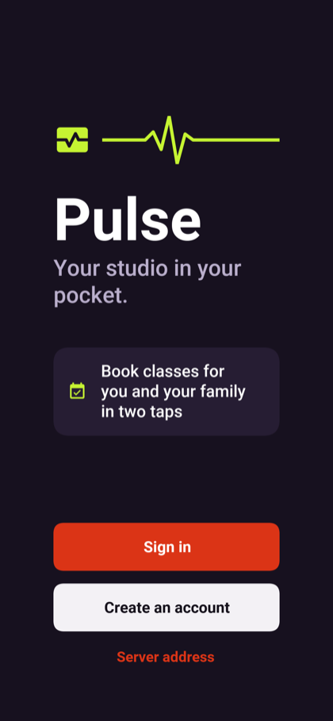

=== The member

The member's home leads with the next class booked, with the time, the trainer and
the room, and how long until it starts. Under it are this month's visits, the
week streak, the points and level, and the badges.

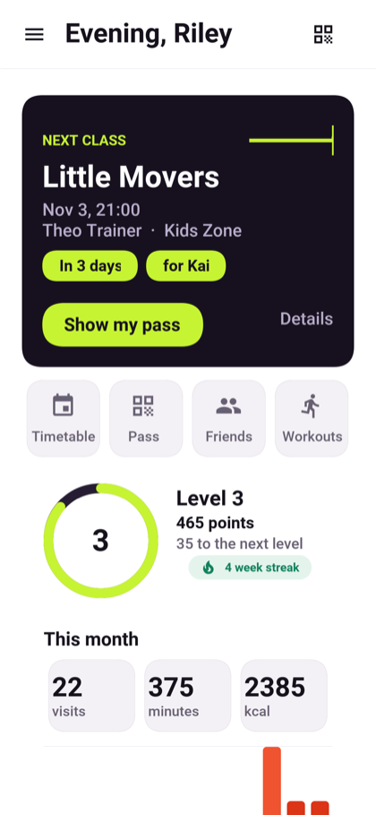

==== The timetable and booking

The timetable lists the classes at each location by day, with the places left,
which update live as other members book. Pills at the top pick the day and the
person in the household, and picking a person shows only the classes open to them. Booking takes a place if one is free and
joins the waitlist if not. When someone gives a place back, the first person
waiting is moved into the class and told so at once.

A place given back at least 12 hours before the class is free. Later than that it
counts as a late cancellation, and a class from a pack is spent. Someone booked
who never comes is marked a no-show once the class is over.

A booking is refused when the class has already started, when the person is
outside the class's age range on the day of the class, when the waiver isn't
signed, or when no membership covers the class.

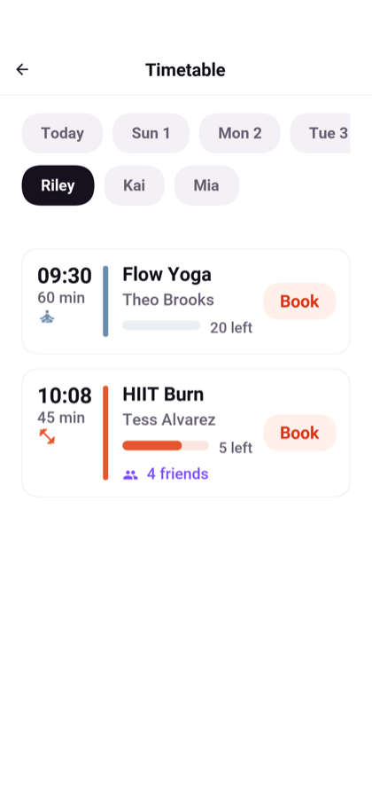

==== The household

An account holder books for up to eight people: themselves and their children.
Each child has their own membership, their own place in a class and their own door
pass, but only the account holder signs in. A child's age is worked out from their
date of birth on the day of each class, so a child grows into the next age band
without anyone changing anything.

==== The door pass

The pass is a QR code that changes every 30 seconds. It's computed on the phone,
so it works with no signal. A pass is good once: a screenshot shown a second time
is refused as already used. A child without a phone gets an NFC fob or wristband
instead. If a phone is lost, replacing the pass makes the old codes and the old
fob stop opening the door at once.

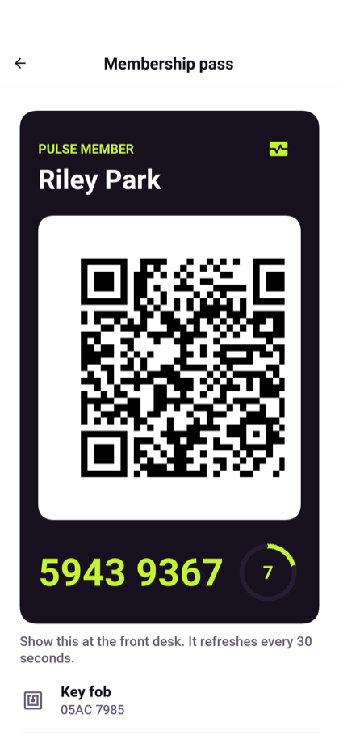

==== The membership

The plans on sale are monthly, annual, class packs and drop-ins. Joining takes the
first payment; changing plan takes what's left of the old period off the first
invoice. A membership can be frozen for one week to three months, and cancelled.

When a renewal is declined the card is tried again after one, three and seven
days. The membership stays usable through the first retry; from the second
failure it's past due and the door says so; after the last retry the invoice
waits to be paid by hand from the wallet. A member who brings a friend gets a
credit when the friend first pays.

==== Away periods

A member who is travelling or injured says when they'll be away. No marketing
reaches them meanwhile, and they can choose to freeze their billing for the same
time.

==== Visits, workouts and friends

The member's page shows this month's visits, the streak of weeks with a visit, and
the last twelve weeks. Workouts recorded by the phone's health store or the watch
are kept with their heart rate. A member can share their heart rate with the
trainer during a class.

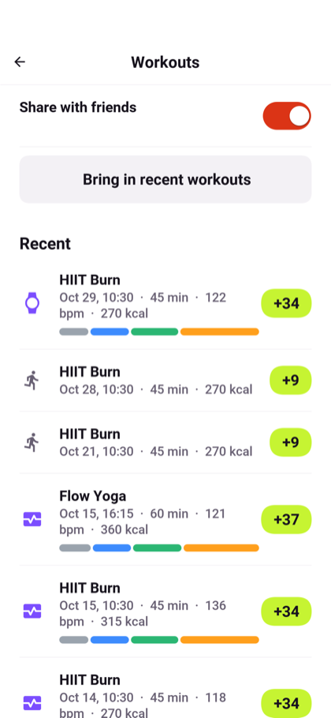

==== Points, levels and badges

Coming to a class, recording a workout and keeping a weekly streak earn points,
and points raise the member's level. A workout recorded with a heart-rate strap or
a watch earns extra points, since it shows how hard the member worked.
Badges mark milestones: the first class, ten and fifty classes, a four- and a
twelve-week streak, a first workout with heart rate, a class worn with a strap or a
watch, a minute in zone 5, and ten hours of workouts. Tapping a badge says how it
is earned.

Friends are added by the e-mail they sign in with, and nothing about a member is
shown to someone they haven't accepted. The feed shows friends' visits and the
workouts they chose to share, kudos can be given for them, and a friend can be
invited to a class.

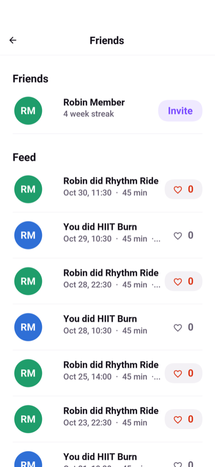

The timetable shows which friends are booked into each class.

==== Messages and quiet hours

Two kinds of message arrive without anyone sending them: an invitation to a class
starting within a day and a half that's still under 60% full, sent to members who
have taken that kind of class before, and a reminder that the studio misses them after two weeks without
a visit. Neither is sent to a member who is away or who turned promotions off, and
neither arrives during quiet hours, which are 10 PM to 7 AM until the member
changes them in the settings.

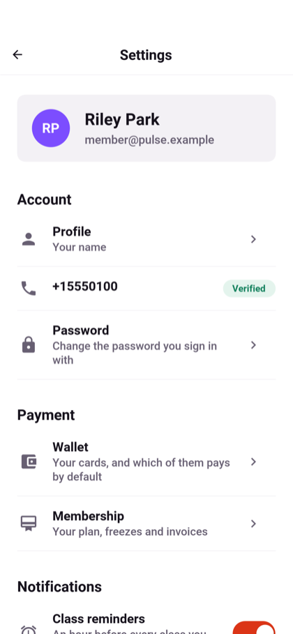

==== The watch

On a paired watch, Pulse is four pages, swiped sideways. The first is the next class:
its name, a countdown, the room and the trainer, and a bar of how full it is.

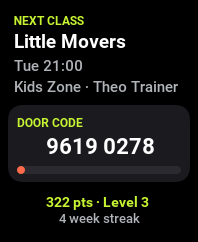

The second is the door code, with a bar counting down to the next one. The code is
the same one the phone's pass shows, so the watch opens the door with the phone
left in the locker.

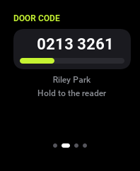

The third is the week: a ring of the points toward the next level, the points still
needed, the week streak and the visits of the last eight weeks as bars.

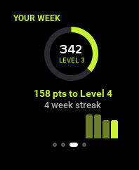

The last lists the classes booked after the next one.

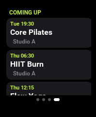

=== The trainer

The trainer's home leads with the class on now, or the next one, with a button for
its roster. The trainer's month follows: the classes taught, the check-ins,
how full the classes were and how many of those booked came, the regulars who came
three times or more, and the kudos received. A chart shows the check-ins of
each of the last eight weeks, and under it the kinds of class that drew the most
people.
The week's classes follow, each with how many places are taken, and a full class
says so.

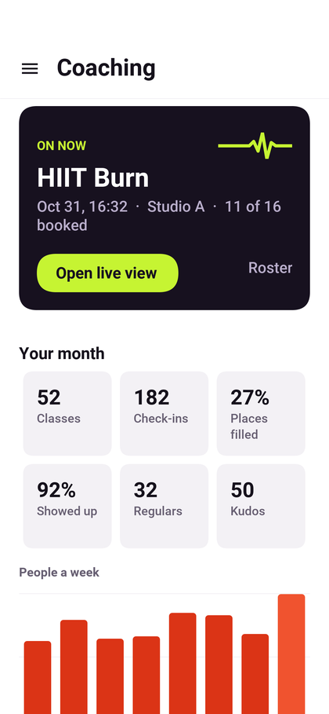

The trainer sees the classes they teach in the coming week. The roster of each class
shows the members booked, the ones waiting and the ones who came, with what the trainer needs to
know about each person. Attendance can be marked by hand for someone the door
didn't see, and corrected for 30 minutes after the class ends.

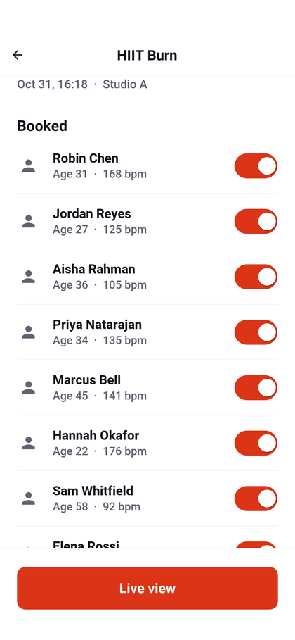

During a class, members who share their heart rate appear with their current zone,
one to five, worked out from their age.

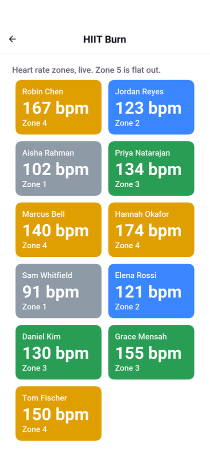

A trainer offers a shift they can't work to the others, and any other trainer can
take it.

=== The front desk and the kiosk

The desk checks people in by scanning the pass, reading a fob, or finding the
member by name. Every check-in answers: admitted, or refused with the reason to
read out, such as a membership that's past due or a class the person isn't booked
into. A booking counts for a visit from an hour before its class until 30 minutes
after it starts.

Someone who comes in without a membership is recorded as a walk-in: a guest, a day
pass or a free trial, paid in cash, by card or not at all. The owner's campaigns
follow up on them.

The desk's day shows who came, what was taken and what starts soon. Signed in on a
tablet by the door, the desk account runs as the kiosk: a member holds up their
pass and the screen turns green or red.

The desk's home opens with two large buttons, one to scan a pass and one to read a
fob, and a field to type a pass number. Under them are today's check-ins, walk-ins
and takings, the classes coming up, and the people who just came in, admitted or
turned away.

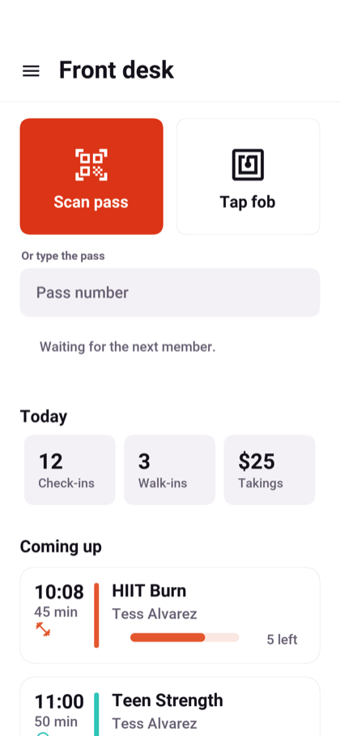

=== The owner

The dashboard opens with the recurring revenue a month, the members, the share of
places taken in the last week's classes, and the members who haven't been in for
two weeks and didn't say they'd be away. Under them are who joined and who left in
the last 30 days, the visits this week and the invoices past due; the takings of
each day for the last 30 days; the kinds of class booked most, ranked; and the
classes in the next two days that are under half full, each with a button to fill
it.

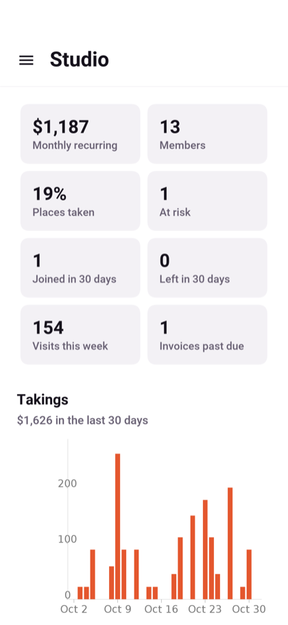

==== Insights

The Insights screen is where the owner looks further back. It opens with four numbers: the
share of members who joined 90 days ago or more and are still members, the visits
of a member in a week, the share of bookings nobody came to, and the monthly
recurring revenue of a member.

The busy hours are a grid of the days of the week by the hours the studio is open,
each cell as dark as the check-ins in that hour over the last eight weeks. Under it,
the membership: how many members there are against twelve weeks ago, a line of the
active members of each week, and bars of who joined and who left.

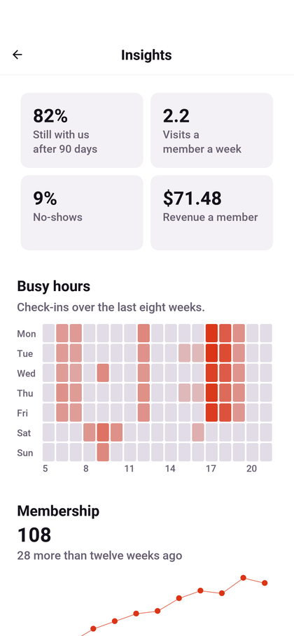

The classes are ranked by how full they ran, each with its share of no-shows. The
plan mix is a ring of the members on each plan, with what each plan brings in a
month; a class pack is paid by the pack, so it says that instead.

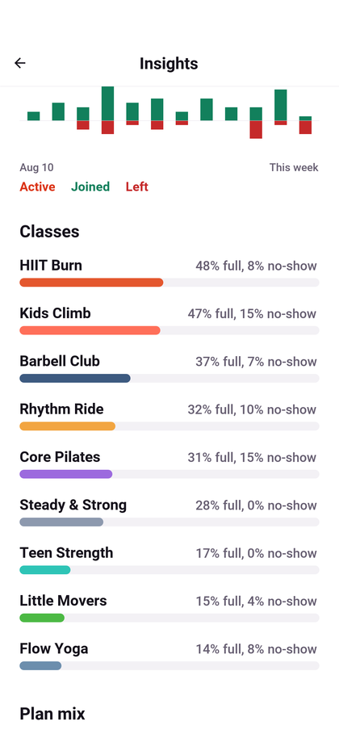

The coaches are ranked by their check-ins, each with their classes, how
full those were, how many booked came, and their kudos.

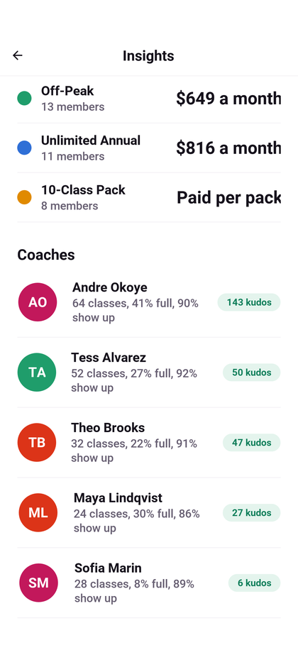

==== Members

The members list searches by name and filters to the members at risk, past due or
frozen. Each row shows the plan, the last visit and the visits in 30 days, and a pill
that says where the member stands.

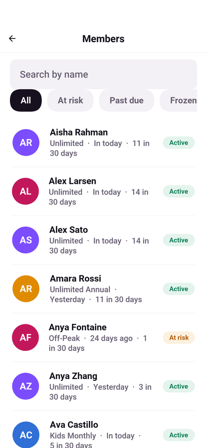

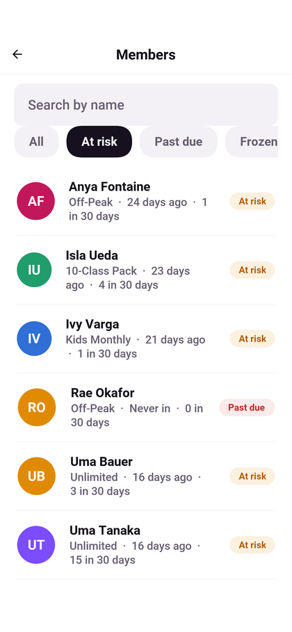

A member's page has the visits in 30 days, the week streak and what the member has
paid in all, a chart of the visits of each of the last twelve weeks, the classes
they come to most, and their invoices.

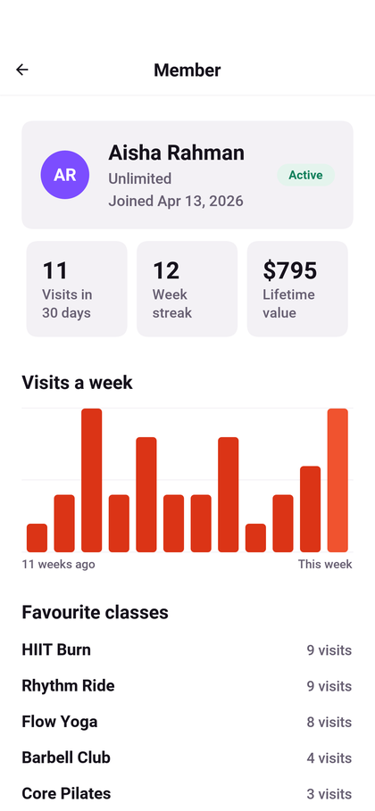

==== Billing

Billing totals what was collected in the last 30 days, what's outstanding and how
many charges failed, and lists the invoices, filtered to paid, failed, or open. A
failed invoice shows which attempt it's on and when the next one runs; the owner can
void a failed or open invoice, with a reason.

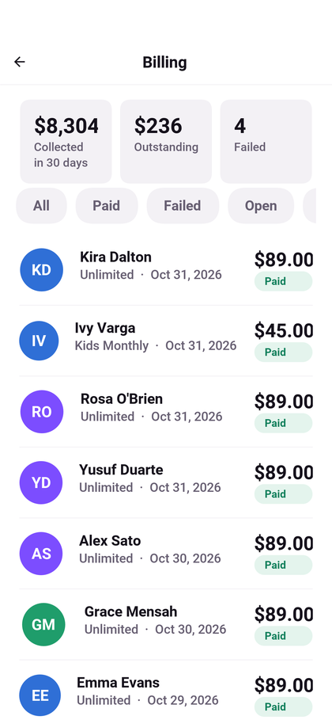

The owner adds and changes plans (a change reaches members at their next renewal),
puts classes on the timetable for a number of weeks, manages the staff and their
roles, and sends campaigns to everyone who took a kind of class, to every active
member, or to the members who haven't been in for a month. Each campaign counts
how many were sent, opened, and booked.

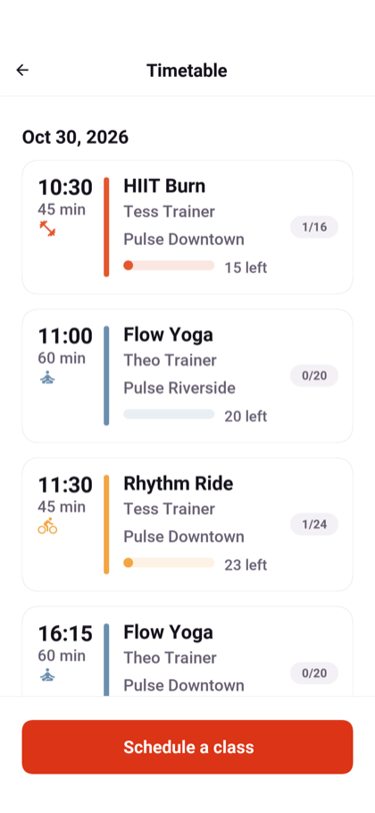

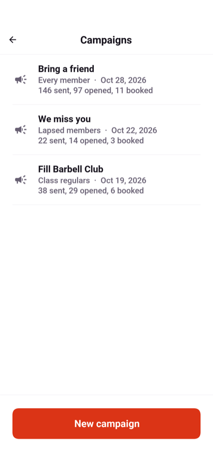

=== In a browser

The server can host the app itself, so the whole studio can be tried in a browser:

[source,bash]
----
include::../demos/common/src/main/snippets/developer-guide/pulse.sh[tag=pulse-sh-web,indent=0]
----

Then open `http://localhost:8080/`. A browser offers less than a phone: the door
pass, health data and the watch are features of the phone app.
