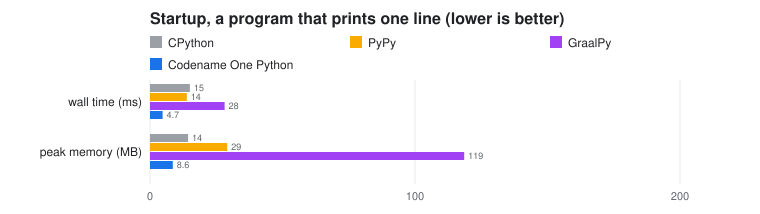
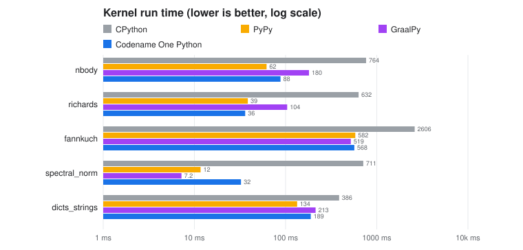
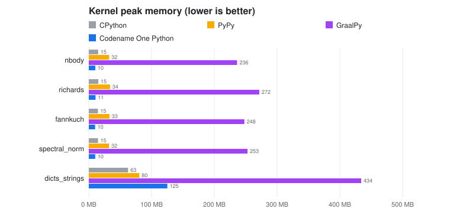
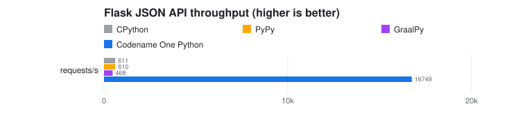
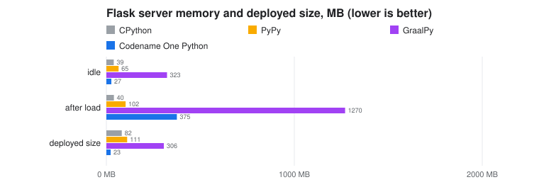
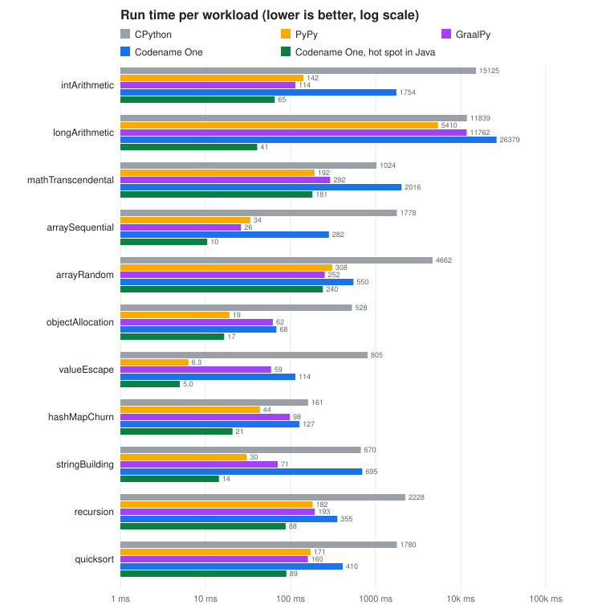
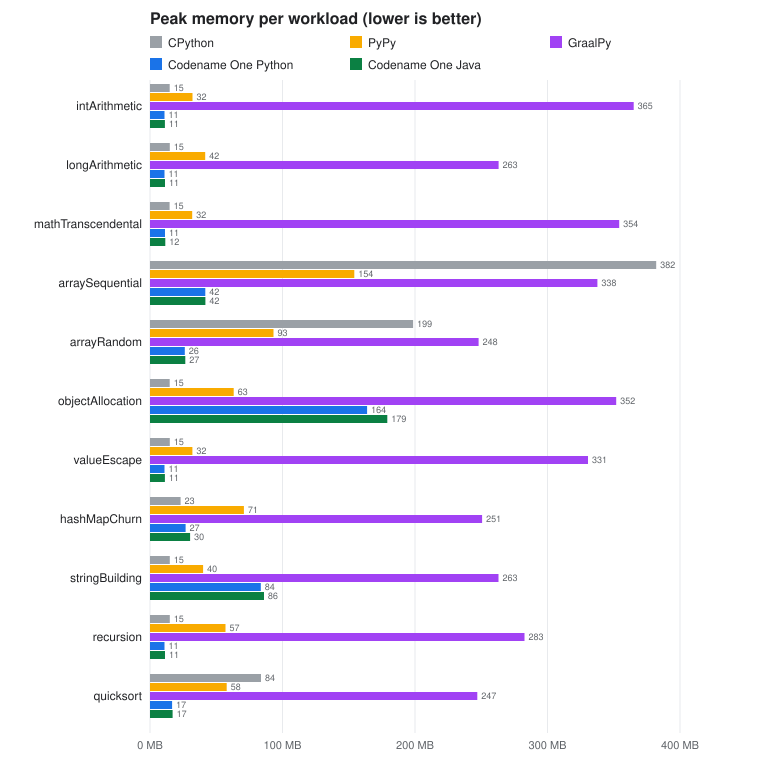

== Writing applications and backends in Python

Python source builds as a Codename One application. The build translates each
module to Java, compiles it with the rest of the project, and from there it
goes wherever Java goes: iOS, Android, the JavaScript port, the desktop ports,
the simulator, and native server binaries built on the Codename One backend.

No Python interpreter ships with the application. Each module becomes a Java
class, each function a method, and a small runtime supplies Python's object
model, its built-in types and the standard library modules applications use.
Annotated code is compiled to unboxed Java arithmetic, so a typed numeric loop
runs at the speed of the equivalent Java.

Two things follow from compiling ahead of time rather than interpreting:

* The program is known in full at build time. A module imported by a
  name computed while the program runs, `exec`, `eval` and `compile` of a
  string, and frame introspection are build errors that name the file and the
  line. None of them reaches a device as a hidden failure.
* Packages with C extensions are supported. The package's Python is
  translated like your own code, and each compiled module is replaced by a
  Java class with the same functions; see <<python-c-extensions,C extensions>>.
  The most used ones -- `numpy`, ``pydantic``'s core, ``yaml``'s scanner -- are
  already provided, as Codename One implementations of the same public API.

=== Adding Python to a project

Put the sources in `common/src/main/python`, or import an existing Python
project into a Codename One application:

[source,bash]
----
include::../demos/common/src/main/snippets/developer-guide/python-interop.sh[tag=python-interop-bash-001,indent=0]
----

The import copies the `.py` files, adds the Python runtime dependency and the
`transpile-python` goal to the common module, records the entry module and
makes the application's main class run it. Then build and run the project as
usual; the translation runs in `generate-sources`. Gradle projects get the
same step as the `transpilePython` task.

The goal reads these properties:

[cols="1,3",options="header"]
|===
| Property | Meaning
| `cn1.python.sourceDir` | The Python sources, `src/main/python` by default.
| `cn1.python.mainModule` | The module run as `+__main__+` when the application starts.
| `cn1.python.outputDir` | Where the generated Java goes.
| `cn1.python.skip` | `true` skips the step.
|===

=== Debugging

The translated classes carry the Python source's file and line numbers in
place of the generated Java's. A stack trace names the Python file and line:

----
com.codename1.python.runtime.PyException: ValueError: bad 6
	at com.codename1.generated.python.py_app$2eutil.M_L1_Thing_boom(util.py:7)
	at com.codename1.generated.python.py_main.lambda$exec$1(main.py:6)
	at com.codename1.generated.python.py_main.exec(main.py:10)
----

The same lines reach a Java debugger attached to the simulator or to a server
binary run on the JVM. Each class also carries a JSR-45 source map whose
default stratum, `Python`, gives the file's path within the source directory,
for example `app/util.py`. Breakpoints are set by Python line number, and a
debugger that resolves sources through the source map opens the `.py` file.
With `jdb`:

[source,bash]
----
include::../demos/common/src/main/snippets/developer-guide/python-interop.sh[tag=python-interop-bash-002,indent=0]
----

The mapping is applied to the compiled classes by the build's `remap-compat`
step (`cn1RemapCompat` in Gradle), so the generated Java in
`target/generated-sources/python` still shows the Python line that
each statement came from, as a `/* line N */` comment above it.

=== Calling Codename One and Java from Python

Any class on the project's class path is importable under the `java.` prefix:

[source,python]
----
include::../demos/common/src/main/python/developer_guide/hello_form.py[tag=python-interop-python-001,indent=0]
----

A Python function or lambda passed where Java expects a listener or another
single-method interface becomes an implementation of that interface. Overloads
are chosen at build time when the argument types are known, and otherwise by
the runtime from the values passed.

Values cross the boundary as follows:

[cols="1,1",options="header"]
|===
| Python | Java
| `int` | `long`, or `BigInteger` past 64 bits
| `float` | `double`
| `bool` | `boolean`
| `str` | `String`
| `bytes` | `byte[]`
| `None` | `null`
| `list`, `dict` | `java.util.List`, `java.util.Map`
|===

Java collections behave as their Python counterparts in Python code: `len`,
indexing, `in` and iteration work on an `ArrayList` or a `HashMap`, and a
Java exception arrives as a Python exception whose message names the Java
type.

To call into Python from Java, import the module through the runtime and call
its attributes. The build generates
`com.codename1.generated.python.PythonModules`, which registers every
translated module. When Python is the application's entry point, its main
class calls `PythonModules.registerAll()` at startup; a Java application
that uses Python as a library calls it once before importing anything:

[source,java,role=cn1-no-try]
----
include::../demos/common/src/main/java/com/codenameone/developerguide/python/PythonInteropSnippets.java[tag=python-interop-java-001,indent=0]
----

=== Building the user interface in Python

The user interface is Codename One's, called from Python, so everything in
the rest of this guide applies: layouts, themes and CSS, the component
inspector, and the same look on every platform. The examples below are
complete applications. Each is a `main.py` you can put in
`common/src/main/python`.

==== A list loaded from the network

The first example fetches JSON with `requests` on a worker thread, shows a
progress indicator while it waits and fills a list when the response
arrives. Pull the list down, or tap the toolbar button, to load it again.

[source,python]
----
include::../demos/common/src/main/python/developer_guide/releases.py[tag=python-interop-python-002,indent=0]
----

Three conventions carry over from Codename One's Java API:

* Network calls run off the event dispatch thread. A Python thread is fine
  for that, and `callSerially` hands the result back to the thread that owns
  the components.
* A component added to a form that's already showing appears after
  `revalidate()`.
* A Python function goes wherever an `ActionListener` or a `Runnable` is
  expected. A default argument, as in `lambda e, n=name: ...`, captures the
  loop's value for each row, as it would in any Python callback.

==== A model, two forms and storage

The second example keeps notes in SQLite through the standard `sqlite3`
module, models them as a dataclass and moves between a list and an editor
form. The editor saves when the user goes back, and asks before deleting.

[source,python]
----
include::../demos/common/src/main/python/developer_guide/notes.py[tag=python-interop-python-003,indent=0]
----

The structure is the one a Python developer would write for any user
interface toolkit: a storage class with no user interface code, and a class
that owns the forms and turns model objects into components. `show()`
moves forward to a form, `showBack()` returns with the reverse transition,
and the toolbar's back command is also what Android's back button runs.

=== Libraries

The standard library modules applications use most are included: `json`, `re`,
`datetime`, `decimal`, `fractions`, `collections`, `itertools`, `functools`,
`dataclasses`, `enum`, `typing`, `inspect`, `asyncio`, `logging`, `pathlib`,
`os.path`, `csv`, `struct`, `hashlib`, `base64`, `uuid`, `random`,
`statistics`, `heapq`, `bisect`, `textwrap`, `string`, `tomllib`, `sqlite3`,
`threading`, `queue`, `concurrent.futures`, `pickle`, `shelve`,
`urllib.request`, `http.client`, `email.message`, `zlib`, `gzip`, `zipfile`,
`zoneinfo`, `unittest` (with `unittest.mock`) and others. A small `pytest` is
included as well: `raises`, `approx`, marks, fixtures and parametrized tests.

These third party packages are provided, each tested against the output of
the real package:

[cols="1,3",options="header"]
|===
| Package | Notes
| `requests`, `httpx` | Over Codename One's network stack.
| `pydantic` | Models, fields, validators, `TypeAdapter`, JSON round trips.
| `attrs`, `python-dateutil`, `PyYAML` |
| `numpy` | `ndarray` of `float64`, `int64` and `bool` with broadcasting,
  views, fancy indexing, ufuncs, reductions, sorting and `numpy.linalg`. The
  kernels are Java loops over primitive arrays. `numpy.random` draws from
  Python's generator, so its streams differ from NumPy's.
| `pandas` | `Series` and `DataFrame` over the `numpy` subset: index
  alignment, selection with `loc`, `iloc` and masks, missing values,
  statistics and `describe`, `groupby` on one key, `merge`, `concat`, and
  CSV and JSON reading and writing. Printing matches pandas, including how
  long and wide frames are shortened. Date indexes, `MultiIndex`, pivot tables, categoricals
  and rolling windows aren't supported.
| `Pillow` | `PIL.Image` in the `RGB`, `RGBA`, `L`, `LA`, `P` and `1` modes: conversion,
  cropping, rotation, pasting, channels and point operations, computed as
  Pillow computes them. `ImageDraw` draws points, lines, rectangles, ellipses,
  polygons and text. On a server, decoding and encoding PNG and JPEG,
  resizing and text use the backend's `com.codename1.backend.image` package
  and give Pillow's exact pixels: every resizing filter, `LANCZOS` and
  `BICUBIC` included, matches Pillow, `ImageFont.truetype` loads TrueType
  fonts and `ImageFont.load_default()` returns the scalable Aileron font.
  Text follows Pillow's basic layout without hinting, so at small sizes a
  glyph can sit a pixel away from where Pillow puts it. On a device,
  decoding, encoding, resizing and text go through Codename One's image
  support (`Image`, `ImageIO`, `Graphics` and the native font), which also
  reads GIF, BMP and WebP. `ImageFont.truetype` loads the font through
  `Font.createTrueTypeFontFromData` where the platform supports it and falls
  back to the native font elsewhere, and `ImageFont.load_default()` is the
  native font. Those results are drawn by the platform, so they look right
  but aren't Pillow's exact pixels.
| `flask`, `fastapi`, `uvicorn` | See <<python-backends,Python backends>>.
| `typing_extensions`, `six`, `tabulate`, `idna`, `packaging` |
|===

==== Packages from PyPI

`cn1:import-python-project` installs the project's requirements, read from
`pyproject.toml` and `requirements.txt`, from PyPI. Each requirement and
everything it depends on is resolved to the newest release its version
specifiers accept, its download is checked against the SHA-256 PyPI
publishes, and its Python sources go into `common/src/main/python-packages`.
The build translates that directory together with `src/main/python`.
Requirements on packages the runtime already provides, such as `requests`
or `numpy`, aren't downloaded.

The versions chosen are recorded in `python-packages/python.lock`. Importing
again installs the same versions, so a dependency changes only when you
delete its line from the lock, or the file itself, and import again.

[cols="1,3",options="header"]
|===
| Property | Meaning
| `cn1.python.offline` | `true` lists the requirements without downloading them.
| `cn1.python.index` | Another index that serves PyPI's JSON API, such as a company mirror.
|===

You can also copy a package's sources into the source directory by hand;
they translate like the application's own modules.

[[python-c-extensions]]
==== C extensions

A package with a C extension is supported. Its compiled modules are what
CPython loads from C; everything around them is ordinary Python. The build
translates that Python as usual, and each compiled module is replaced by a
Java class that registers the same functions. Most C extensions are small
accelerators or thin wrappers over a system facility, so the Java is usually
short, and often a call into a Codename One API that already does the job.

The import finds the compiled modules (`.so` and `.pyd` files in a wheel,
`.pyx` sources in a source distribution) and the names the package's Python
uses from each one. For every module it generates a class in
`common/src/main/java/com/codename1/python/ext` with a stub per function,
and lists it in `python-packages/cn1-native-modules.properties`:

[source,java,role=cn1-no-try]
----
include::../demos/common/src/main/java/com/codenameone/developerguide/python/MarkupsafeSpeedups.java[tag=python-interop-java-002,indent=0]
----

Replace each stub's body with Java. The functions receive plain Java values
(a `Number` for an `int` or a `float`, `String`, `byte[]`, `java.util.List`
for a list or tuple, `java.util.Map` for a dict, `null` for `None`) and
return the same kinds; an `Object[]` comes back to Python as a tuple. Raise a
Python exception with `Py.error(Py.TYPE_ERROR, "...")` and its siblings, and
use `NativeModule.raw` for a function that needs the Python objects
themselves. Until a stub is filled in, calling it raises a
`NotImplementedError` that names it. The import never overwrites a class
that already exists, so importing again keeps your code.

Many packages ship a C accelerator together with a pure Python version of
the same code, and import the compiled module inside
`try: ... except ImportError:`. When every import of a compiled module is
guarded that way, the import reports it as optional and generates nothing:
the pure Python version runs instead.

==== Threads

`threading`, `queue` and `concurrent.futures` run on Java threads. As in
CPython, one global interpreter lock serializes Python code: it's released
while a thread sleeps, waits on a lock, a queue or a future, or waits for a
network response, so threads help with blocking work and not with
computation. `ProcessPoolExecutor` is accepted and runs its tasks on threads.

Codename One's user interface belongs to its event dispatch thread. Python
code started by the application runs on that thread, so update components
from a worker thread with `Display.getInstance().callSerially`, as Java code
does.

==== `sqlite3`

`sqlite3` runs on the platform's own SQLite through Codename One's
`Database`. On iOS, Android and the simulator a value comes back in the
storage class SQLite recorded for it. The Linux, Windows and JavaScript ports
don't report storage classes, so a value comes back as an `int` or a `float`
when its text is a number, and as a `str` otherwise.

[[python-backends]]
=== Python backends

A Flask or FastAPI application builds into a single native server executable.
The application starts the server the way it always does:

[source,python]
----
include::../demos/common/src/main/python/developer_guide/flask_fib.py[tag=python-interop-python-004,indent=0]
----

`app.run()` and `uvicorn.run(app)` are lowered onto the Codename One backend's
HTTP server, so the same file still runs under CPython for development:

[source,bash]
----
include::../demos/common/src/main/snippets/developer-guide/python-interop.sh[tag=python-interop-bash-003,indent=0]
----

Routing, converters, JSON bodies, `abort`, error handlers and the default
error pages of Flask, and FastAPI's path, query, body and header parameters,
dependencies, `response_model` and OpenAPI generation are supported, and
Flask sessions, `flash`, Jinja templates (`extends`, `block`, `include`,
macros, `call`, `import`, `filter` blocks, loops, conditions and the common
filters, with autoescaping), multipart file uploads and streamed responses
work as well. A streamed response is sent chunk by chunk as its generator
yields. Session cookies use Flask's own `itsdangerous` format, so a server
built here and one running under CPython read each other's sessions when they
share a secret key.

FastAPI middleware works as in Starlette: `@app.middleware("http")`,
`BaseHTTPMiddleware` subclasses, `CORSMiddleware`, `GZipMiddleware` and
`TrustedHostMiddleware`. WebSocket endpoints are supported, including
`TestClient.websocket_connect`. A WebSocket endpoint runs on a real asyncio
event loop, so it can await `asyncio.sleep`, tasks and queues while its socket
is open, and pure ASGI middleware sees WebSocket connections as it does in
Starlette. Denying a connection answers with the status the endpoint or
middleware chose, such as 403.

==== SQLAlchemy

SQLAlchemy's Core and ORM run over the platform's SQLite, and on a backend
over the PostgreSQL, MySQL and MariaDB drivers the Codename One backend ships.
The engine URL picks the database, as it does under CPython:

[source,python]
----
include::../demos/common/src/main/python/developer_guide/library.py[tag=python-interop-python-007,indent=0]
----

Declarative models with `Mapped` annotations, relationships in both
directions (including many-to-many and cascades), `selectinload` and
`joinedload`, joins, aliases, subqueries, common table expressions, unions,
single and joined table inheritance and `text()` queries are supported.
`Numeric` columns come back as `decimal.Decimal` and `DateTime` and `Date`
columns as `datetime` values on every database. A `text()` query has no
column types, so on a server database its numbers and dates come back as
the text the server sent. SQLAlchemy's own drivers, such as `psycopg`, aren't
used: the URL `postgresql+psycopg://` selects the backend's driver.

==== Stack size

Every request runs on a virtual thread with 1MB of C stack, because transpiled
Python frames are large and `re` recurses. A handler that recurses deeper than
that raises it with a build hint in `codenameone_settings.properties`, in bytes
or with a `KB` or `MB` suffix:

[source,properties]
----
include::../demos/common/src/main/snippets/developer-guide/python-backend.properties[tag=python-backend-properties-001,indent=0]
----

`CN1_HTTP_VT_STACK` can still raise it when the server starts, and the larger
of the two applies.

=== Compared with CPython, PyPy and GraalPy

The same programs, run on one Apple Silicon Mac with
`scripts/python-compare/compare.py` and
`scripts/python-compare/common_compare.py`. Codename One rows are native
executables. The interpreters are CPython 3.14, PyPy 3.11 (7.3.20) and GraalPy
3.13 (Community edition 25.4, on its own JVM). Every program runs in a process
of its own, so each memory figure is that program's peak resident memory.

==== Startup

A program that prints one line, best of ten runs:

[cols="1,1,1",options="header"]
|===
| | Wall time (ms) | Peak memory (MB)
| CPython 3.14 | 15.1 | 14.4
| PyPy 3.11 | 13.9 | 29.1
| GraalPy 3.13 | 28.2 | 118.6
| Codename One | 4.7 | 8.6
|===

==== Python kernels

Classic benchmark programs written for Python (`scripts/python-bench/kernels`),
fastest round in milliseconds, then peak memory in MB:

[cols="2,1,1,1,1,1,1,1,1",options="header"]
|===
| Kernel 2+| CPython 3.14 2+| PyPy 3.11 2+| GraalPy 3.13 2+| Codename One
| nbody | 764 | 15 | 62 | 32 | 180 | 236 | 88 | 10
| richards | 632 | 15 | 39 | 34 | 104 | 272 | 36 | 11
| fannkuch | 2606 | 15 | 582 | 33 | 519 | 248 | 568 | 10
| spectral_norm | 711 | 15 | 12 | 32 | 7.2 | 253 | 32 | 10
| dicts_strings | 387 | 63 | 134 | 80 | 213 | 434 | 189 | 125
|===

==== A Flask server

The Flask sample above, measured with `ab -n 20000 -c 8` after a warm-up:

[cols="1,1,1,1,1,1",options="header"]
|===
| | First response (ms) | Requests per second | Idle memory (MB) | Memory after load (MB) | Deployed size (MB)
| CPython 3.14 | 81 | 611 | 39.1 | 39.9 | 82.0
| PyPy 3.11 | 184 | 610 | 64.8 | 102.3 | 110.5
| GraalPy 3.13 | 438 | 468 | 322.8 | 1270.4 | 305.8
| Codename One | 33 | 16,749 | 26.6 | 375.2 | 22.8
|===

The deployed size is the interpreter's installation plus Flask and its
dependencies, against the one executable. CPython, PyPy and GraalPy serve with
Werkzeug's threaded server, which is what `app.run()` starts; a production
CPython deployment behind a WSGI server with several worker processes serves
more, using a full interpreter's memory per worker. The Codename One server's
heap grows under load and stays at that size, which is the memory after load
column; it doesn't grow further on longer runs.

Where an application needs CPython instead: code that builds source text and
runs it with `exec`, and packages whose C code is the bulk of the package
rather than an accelerator under its Python, such as `scipy` or `torch`.
Replacing those means writing a numerical library in Java, not a few
functions.

=== Python against Java on Codename One

The workloads below are the ones every Codename One port is measured with,
`com.bench.CommonWorkloads`, ported line by line to Python in
`scripts/python-bench/common`. Each one returns a checksum, and every runtime
has to return the checksum Java returns, so all five columns compute the same
thing. The Python port reproduces Java's 32 and 64-bit wrap-around with masks,
since a Python `int` never overflows.

The *Codename One Java* column is the Java original compiled by Codename One
into the same executable. It's the floor: the speed and memory Codename One
reaches for this work when written in Java, and the target for the same
program written in Python.

[cols="2,1,1,1,1,1,1,1,1,1,1",options="header"]
|===
| Workload 2+| CPython (ms, MB) 2+| PyPy 2+| GraalPy 2+| Codename One Python 2+| Codename One Java
| `intArithmetic` | 14452 | 15 | 132 | 32 | 102 | 365 | 66 | 11 | 58 | 11
| `longArithmetic` | 11709 | 15 | 5301 | 42 | 11134 | 263 | 39 | 11 | 38 | 11
| `mathTranscendental` | 1010 | 15 | 186 | 32 | 289 | 354 | 180 | 11 | 167 | 12
| `arraySequential` | 1745 | 382 | 33 | 154 | 26 | 338 | 32 | 42 | 9.3 | 42
| `arrayRandom` | 4542 | 199 | 275 | 93 | 234 | 248 | 244 | 26 | 220 | 27
| `objectAllocation` | 522 | 15 | 18 | 63 | 58 | 352 | 31 | 164 | 14 | 179
| `valueEscape` | 801 | 15 | 6.1 | 32 | 56 | 331 | 3.5 | 11 | 4.5 | 11
| `hashMapChurn` | 158 | 23 | 41 | 71 | 87 | 251 | 44 | 27 | 20 | 30
| `stringBuilding` | 630 | 15 | 32 | 40 | 67 | 263 | 29 | 84 | 14 | 86
| `recursion` | 2152 | 15 | 177 | 57 | 189 | 283 | 86 | 11 | 82 | 11
| `quicksort` | 1519 | 84 | 168 | 58 | 111 | 247 | 118 | 17 | 80 | 17
|===

What the numbers say:

* **Python reaches Java's memory.** On every workload the compiled Python uses
  about the memory the Java program uses, and sometimes less:
  integers, floats and integer lists are held unboxed, a list of integers that fit 32 bits
  takes four bytes an item as a Java `int[]` does, and objects that don't
  escape a function are never allocated.
* **And mostly its speed.** Six of the eleven run within 15% of Java, among
  them the arithmetic, recursion and the transcendental math; the rest take
  1.5 to 3.4 times as long. What remains is the cost of a Python `int` being
  unbounded: where the compiler can't prove a value stays within 64 bits, the
  generated code carries the check and a slow path Java doesn't need.
* **Against the interpreters.** Codename One Python is the fastest of the four
  Python runtimes on six workloads and within 10% of the fastest JIT on three
  more, without a warm-up; GraalPy is faster at sequential array access and
  PyPy at allocating objects. It uses a
  third of PyPy's memory and a twentieth of GraalPy's on most of them. `longArithmetic`
  multiplies 64-bit values whose product needs 128 bits and masks it back: the
  interpreters compute it with arbitrary precision integers, and the compiler
  recognizes the wrap-around and computes it in a Java `long`.

==== Tuning a hot spot in Java

A profile usually shows a handful of functions that dominate the run time.
Any of them can be rewritten as a Java method in the same project and called
from Python like any other Java class. The rest of the program stays Python.

The integer kernel in Python:

[source,python]
----
include::../demos/common/src/main/python/developer_guide/int_arithmetic.py[tag=python-interop-python-005,indent=0]
----

The same function in Java, under `common/src/main/java`:

[source,java]
----
include::../demos/common/src/main/java/com/codenameone/developerguide/python/CommonWorkloads.java[tag=python-interop-java-003,indent=0]
----

And the Python that calls it:

[source,python]
----
include::../demos/common/src/main/python/developer_guide/call_java.py[tag=python-interop-python-006,indent=0]
----

The Java `int` wraps by itself, so the masks disappear and the loop compiles
to a few machine instructions. In the run above that took the workload from
1.75 seconds to 65 milliseconds, faster than PyPy and GraalPy, in 11 MB.

Guidelines for choosing what to move:

* Measure first. Only a loop that dominates a profile is worth a second
  language.
* Move whole loops, not single operations. Every call across the boundary
  converts its arguments, so a Java method called once per element gains
  little; one called once per batch gains the most.
* Pass primitive values and Java arrays where possible. A Python `list` passed
  to Java arrives as a `java.util.List` of boxed values.
* Annotate the Python that stays. Codename One compiles functions whose
  parameters and locals have known types (`int`, `float`, `bool`, `str`,
  lists of them and classes with `__slots__`) to typed Java code. The rest
  takes the generic path, which is the one that CPython-like timings come
  from.
