[[reel-users-guide]]
== Reel: A streaming service from four sides

Reel is a sample app with a server behind it. Viewers watch films, series and
courses on a phone, a tablet, a desktop or in a browser, and pick up on one
screen where they left off on another. Creators upload video and publish it.
Moderators decide what gets published. An administrator runs the service. The
app and the server are one Maven project, written in Java on both sides.

This chapter is the user's guide: what each of them sees and can do.
<<reel-implementors-guide>> is the other half. It explains how the project is
built, how playback is protected and what to change to make the service yours.

One app serves everyone. The server gives every account a set of roles, and the
app opens on the screen that fits them.

[cols="1,3"]
|===
| Role | What it adds

| Viewer
| Every account is a viewer. Browse and search the catalog, watch with ads or
  without, keep a list, download for offline viewing, take courses, and manage
  the household's profiles and the plan.

| Creator
| Upload video, describe it, add chapters, quizzes and polls, submit a title for
  review and follow how it's watched.

| Moderator
| Approve or reject what creators submit, take down what was published, and
  keep the blocklists that check every upload.

| Admin
| See the service in numbers and charts, manage accounts, plans, coupons and ad
  campaigns, switch features on and off, and deal with account sharing.
|===

=== Trying it

Start the server on its development profile and it creates a set of accounts,
all with the password `reel-demo`, the plans, two ad campaigns and a catalog of
the Blender open movies and a short course:

[cols="2,3"]
|===
| `viewer@reel.example`, `viewer2@reel.example` | viewers
| `viewer3@reel.example` | a viewer with an open account-sharing alert
| `creator@reel.example` | owns the uploaded titles
| `moderator@reel.example` | reviews what creators submit
| `admin@reel.example` | runs the service
|===

`scripts/reel/README.adoc` has the two commands that start the server and the
app, and the one that fetches the films. Without the films every screen works;
the artwork and the picture are missing.

=== Watching

A viewer with more than one profile in the household is asked who is watching.
A kids profile sees only titles rated for children, and a profile can be locked
with a PIN.

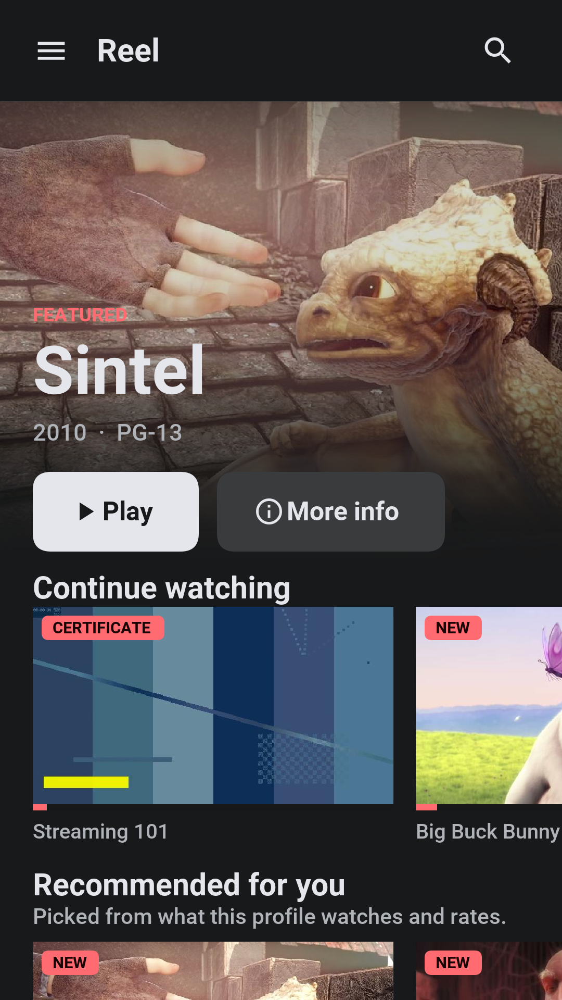

The home screen leads with one title and then rows: continue watching,
recommendations based on what the profile watched, the list, and the catalog
by genre. Search finds titles by name, synopsis, genre, and creator.

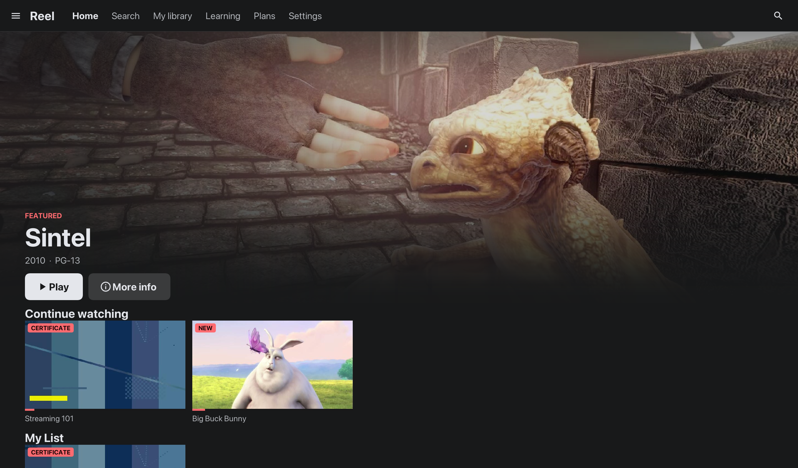

On a desktop or a tablet the sections of the app sit along the top bar, the
featured title's text moves to the left of its artwork, and the rows show as
many titles as the window has room for.

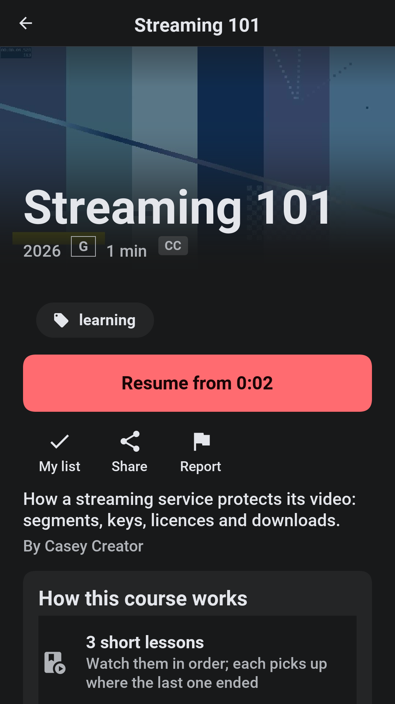

A title's page shows its episodes or lessons, plays it from where the profile
stopped, adds it to the list, rates it, downloads it, shares it and reports it.
Under the name are the year, the age rating in its box, the length, the best
quality the title was packaged in and a CC mark when it has subtitles. The
content advisories say what the rating is for: violence, frightening scenes,
strong language, sexual content, drugs or alcohol, flashing lights. Further
down the page lists the audio and subtitle languages. A title that's not in
the plan offers the plan that has it, or a rental.

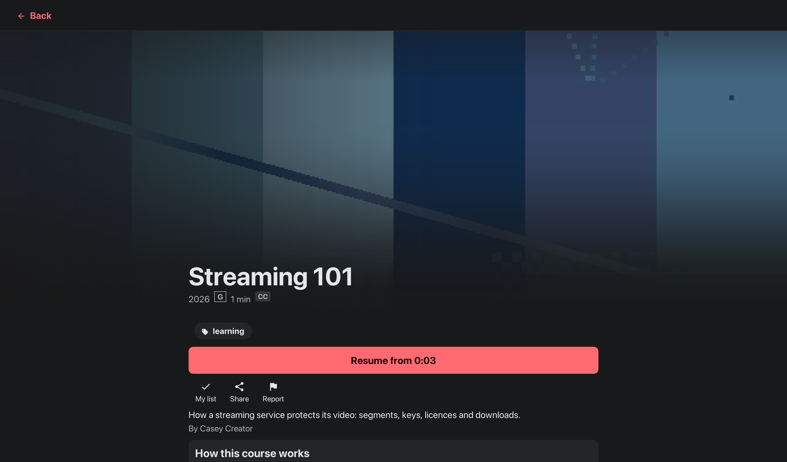

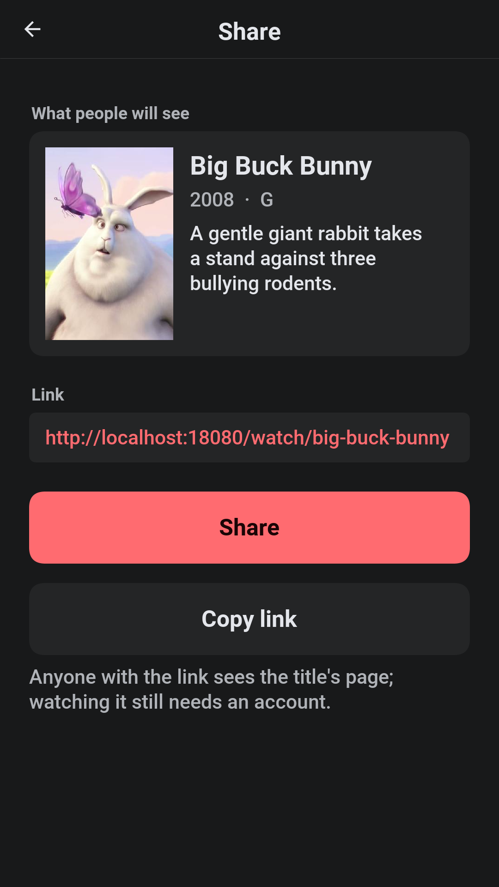

Share shows how the link will look where it's pasted and offers the device's
share sheet or a copy of the link. The link opens a public page on the server
with the poster, the rating, the advisories and the synopsis, which is what a
chat app or a social network shows in its preview. Its Watch button opens the
app on that title, after signing in where needed. A draft or a removed title has
no public page.

==== The player

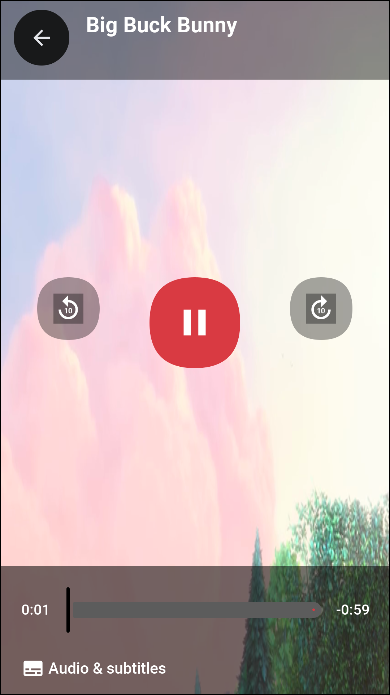

The player draws its own controls over the picture: back and forward ten
seconds, play and pause, a scrub bar with the time played and the time left,
chapters, Audio & subtitles and, in a series or a course, the next episode. The
controls fade after a few seconds of playback and come back on a tap. When an
episode ends and autoplay is on, the next one starts.

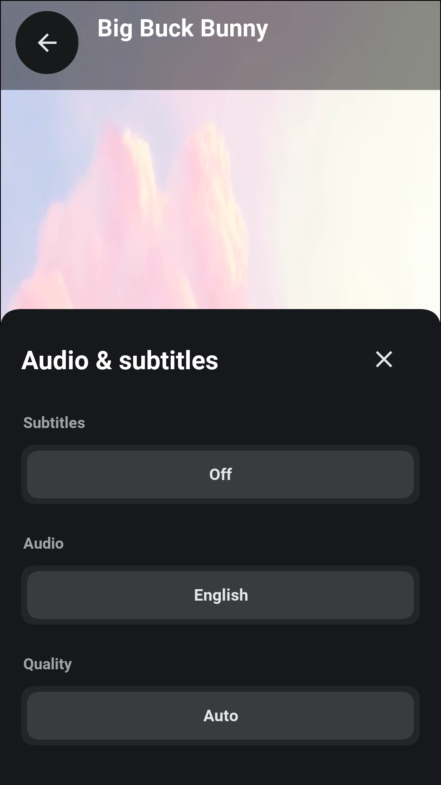

Audio & subtitles picks the subtitles (or none), the audio track and the
quality: Auto, or one of the heights the title was packaged in, up to what the
plan allows. Subtitles change at once. A different audio track or quality
reopens the stream where it was.

Subtitles are WebVTT files kept beside the video and drawn by the app, so they
look the same on every device and work with every kind of protection. The
audio track is chosen by the server, which marks it as the default in the
playlist the player reads.

On a plan with ads, short ad breaks play before and during the title, and some
can be skipped after a few seconds. A course pauses for a quiz or a poll and,
where the course branches, moves on to the lesson the answer leads to. While a
protected title plays, screenshots and screen recording are blocked where the
device allows it, and a faint mark naming the account sits over the picture.

A plan allows a number of screens at once. Starting one more ends with a
message saying so, and an administrator, a suspension or a sign-out on another
device can end a stream that's playing.

==== Your library, settings and account

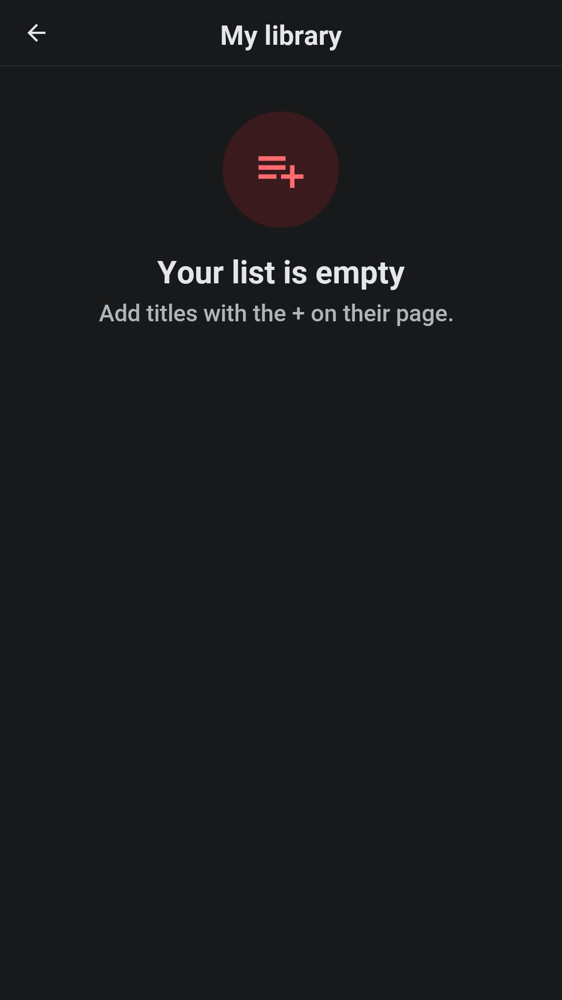

The library holds the profile's list, its downloads and what it watched. A
title can be taken out of the history, which also takes it out of what the
recommendations learn from.

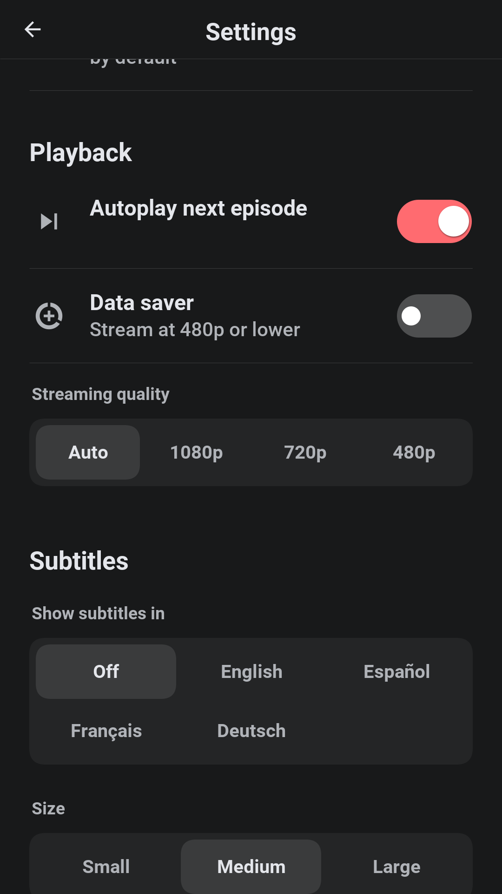

Settings hold the playback preferences (autoplay, data saver, the streaming
quality), the subtitle language and size used whenever a title has a track in
that language, notifications, the language and the theme of the app, and
privacy. The account screen shows the devices signed in and what's playing on
each, and signs any of them out.

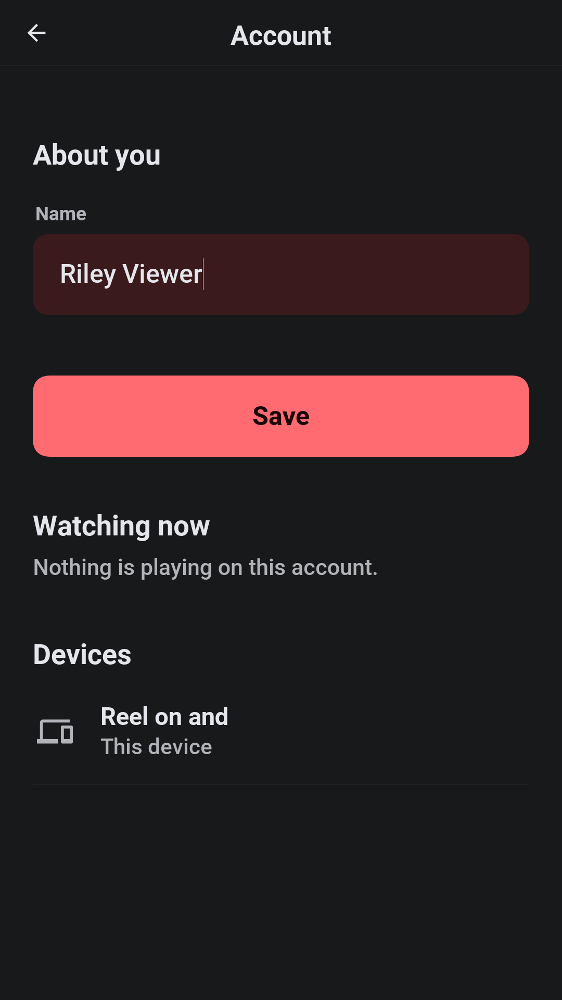

=== Downloads

On a plan with downloads, a title can be kept on the device. The file stays
encrypted, and playing it asks the server for the key, so a download stops
playing when its license runs out, when the device is signed out or when the
account is suspended. The library lists downloads without a connection.
Signing out removes them from the device.

=== Plans, rentals and the wallet

The development profile offers three plans: Basic with ads (one screen, HD),
Standard (two screens in Full HD, downloads) and Premium (four screens, the best
quality there is, downloads). A plan starts with a trial where the
administrator gives one, a coupon takes money off, and the plan can be changed
or cancelled at any time; a cancelled plan runs to the end of what was paid.
Invoices are listed in the account.

Cards are added in the wallet. On the development profile `4242 4242 4242 4242`
is accepted, `4000 0000 0000 0002` is declined and nothing is charged. On a phone
the plan can also be bought through the app store.

=== Learning

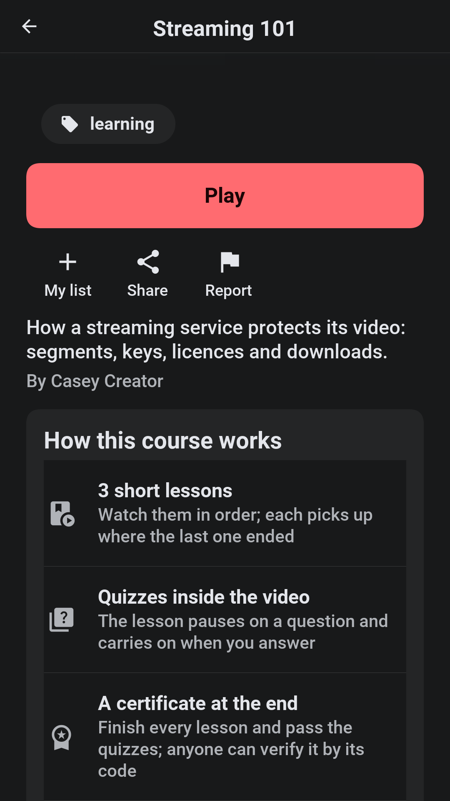

On a service with courses, a course is a title whose episodes are short lessons.
The Courses row on the home screen says so, and a course's page explains how it
works: the lessons are watched in order, the video pauses on a quiz and carries
on when it's answered, and finishing every lesson and passing the quizzes earns
a certificate. The page shows how far the profile got. Progress is kept per
lesson, and a certificate opens from the learning screen, where anyone can
verify it by its code.

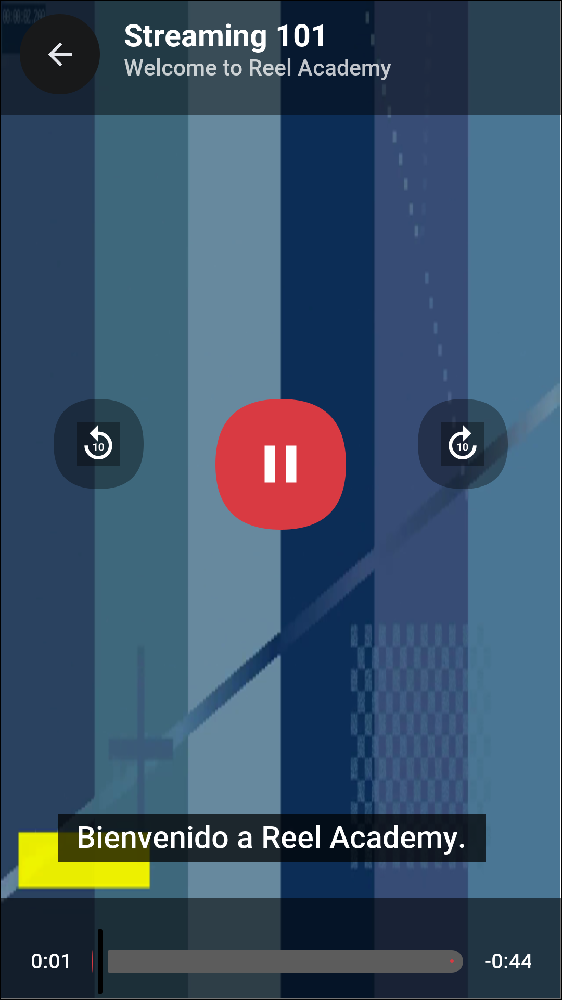

The demo course has subtitles in English, Spanish, French, and German.

=== Creating

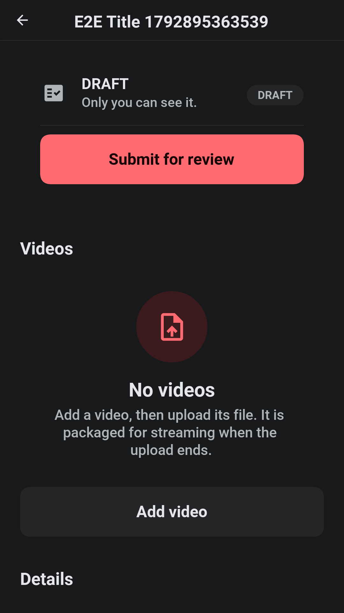

The studio lists the creator's titles with their status: draft, in review,
published, changes needed or removed. A title has a name, a synopsis, genres,
a rating and its videos. A video is uploaded in pieces, so a dropped connection
costs one piece and not the file, and the server packages it into the protected
formats the players need. Its chapters are lines of `m:ss Title`, and its
quizzes, polls and branches are added at a time in the video.

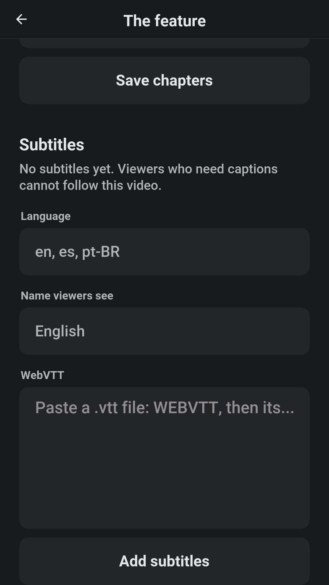

A video's subtitles are added one language at a time, as WebVTT: a language
such as `en` or `pt-BR`, the name viewers see, and the text. A title's age
rating comes with its content advisories, which the creator ticks when making
or editing the title.

A finished title is submitted for review. A rejected one comes back with the
moderator's note, and the creator can correct it and submit it again, or appeal.
The analytics show views, minutes watched and where viewers stop, over the last
thirty days.

=== Moderating

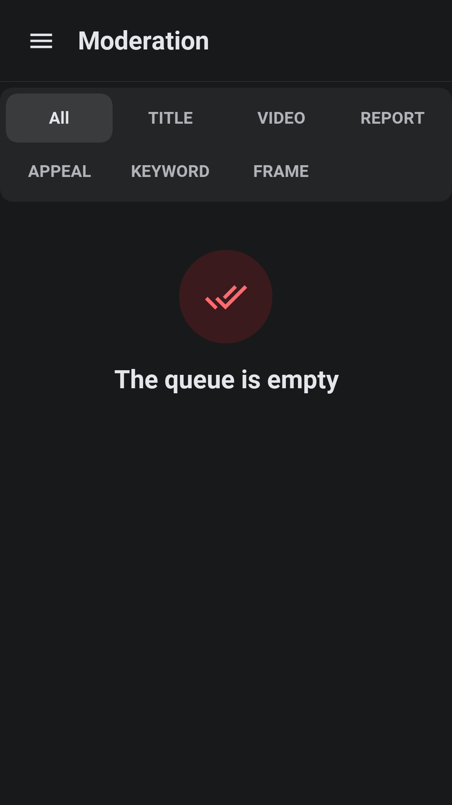

The queue holds submitted titles, reports from viewers and appeals. Every upload
is checked on arrival against the keyword blocklist and against the frames of
video that were taken down before, and what matches is marked in the queue.
A moderator approves a title, which publishes it and tells whoever follows the
series, or rejects or removes it with a note the creator sees. Every decision
is kept on the account's record.

=== Administering

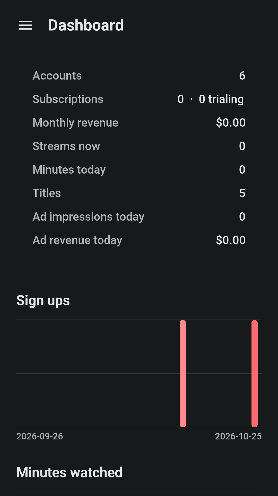

The dashboard shows the service at a glance: accounts, subscriptions and trials,
monthly revenue, streams now, minutes watched today, titles, ad impressions and
ad revenue, with thirty days of sign-ups, minutes, revenue and cancellations
drawn as charts.

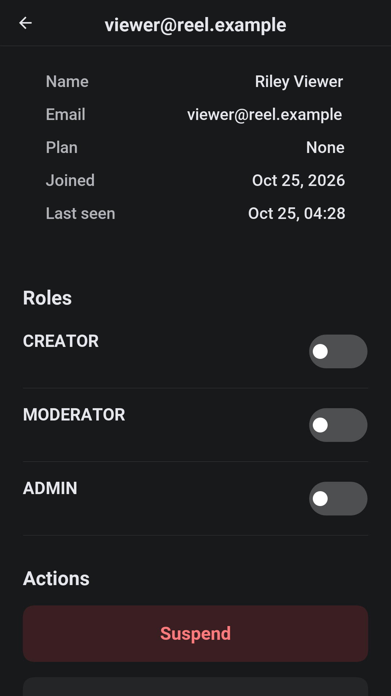

An account's page grants and removes roles, suspends and reinstates the account
with a reason, flags it, and lists its devices, its sessions, its sharing alerts
and its invoices. *Watching now* lists every stream that's playing and ends
one. Account sharing raises an alert when an account streams from more places
than a household plausibly does; the administrator dismisses it or signs the
account out everywhere.

*Features* switches the service between three presets, a streaming service, a
video platform and a training academy, and then turns single features on and
off: subscriptions, rentals, ads, open uploads, interactive video,
certificates, profiles, downloads, sharing detection, hardware DRM, the
watermark and reports. The app follows on its next start, with no new build.
*Branding* sets the name, the tagline, the logo and the colors.

=== In a browser

The server can host the app itself, so a browser opening the server's address
gets Reel with nothing installed. A browser plays the protected video through
its own media player, and offers neither downloads nor app-store purchases.
