[[savor-users-guide]]
== Savor: A food-delivery app from four sides

Savor is a sample app with a server behind it. A customer browses the
restaurants that deliver to them, fills a cart and pays. The restaurant accepts
the order and cooks it, the nearest courier is offered the delivery, collects it
and brings it to the door while the customer follows it on a map, and an
administrator runs the service. The app and the server are one Maven project,
written in Java on both sides, and the Initializr's food-delivery template
generates it under your own name.

This chapter is the user's guide: what each of the four kinds of user sees and
can do. <<savor-implementors-guide>> is the other half. It explains how the
project is built and what it does differently from <<wayline-users-guide,Wayline>>,
the ride-hailing sample it grew from.

One app serves all four. The server gives every account a set of roles, and the
app opens on the screen that fits them: a customer on the restaurants, a merchant
on the restaurant's order queue, a courier on the delivery screen, an
administrator on the operations console. Someone who holds more than one role
switches between them from the menu.

[cols="1,3"]
|===
| Role | What it adds

| Customer
| Every account is a customer. Choose where to deliver to, browse and search the
  restaurants, build an order, pay, follow it to the door, rate it, tip and keep
  the receipt.

| Merchant
| Granted when an administrator approves a restaurant. Accept or reject the
  orders that arrive, say how long the kitchen needs, mark them ready, pause the
  restaurant, edit the menu and read the sales.

| Courier
| Granted when an administrator approves an application to deliver. Go online,
  accept or decline the deliveries offered, collect and deliver them, and see and
  cash out what they earned.

| Admin
| Granted by another administrator. See the service in numbers and charts,
  approve restaurants and couriers, flag or block accounts, cancel and refund
  orders, read the payments, and set the prices and the promo codes.
|===

=== Trying it

Start the server on its development profile and it creates a set of accounts, all
with the password `savor-demo`, twelve restaurants with their menus, and two weeks
of orders so that the charts have something to draw. <<savor-launch>> has the
commands.

[cols="2,3"]
|===
| Account | Role

| `customer@savor.example`, `customer2@savor.example`
| Customers.

| `customer3@savor.example`
| A customer an administrator has flagged.

| `merchant@savor.example`
| Runs the kitchen of Ember & Crust, one of the twelve restaurants.

| `courier@savor.example`, `courier2@savor.example`
| Approved couriers.

| `courier3@savor.example`, `courier4@savor.example`
| Approved couriers who carry the two weeks of past orders.

| `applicant@savor.example`
| Has applied to deliver and is waiting for a decision.

| `admin@savor.example`
| Runs the service.
|===

A customer alone can watch an order come all the way. On the development profile
a simulated kitchen accepts and cooks the orders of every restaurant that has no
merchant, and a simulated courier takes the delivery while no real courier is
online. Sign in as the merchant and as a courier in other simulators to play those
parts yourself.

No money moves on a development server, which simulates cards unless it's told to
use a payment provider. An order's total is held on the card when it's placed and
taken when the food arrives. Five numbers behave in five ways:

[cols="2,3"]
|===
| Card number | What happens

| `4242 4242 4242 4242`
| Accepted, and every hold and charge succeeds.

| `4000 0000 0000 0002`
| Declined when you try to add it.

| `4000 0000 0000 0341`
| Accepted and held, then declined when the order arrives.

| `4000 0000 0000 0119`
| Accepted and held, then taking the money fails without an answer, so the
  order's payment stays pending.

| `4000 0000 0000 7726`
| Accepted, and every charge succeeds. A refund is pending at first, and shows as
  refunded about a minute later.
|===

Any expiry date in the future and any security code work with them. The codes
`WELCOME10` (10% off an order of $15 or more) and `SAVOR5` ($5 off an
order of $25 or more) work once per account.

=== Getting in

The welcome screen offers to sign in or to create an account. **Server address**
is there for a phone on the same network as a development server: `localhost` on a
phone is the phone, so the app has to be told where the server is. The app in a
browser has no such entry: it always talks to the server that hosts it.

.The welcome screen
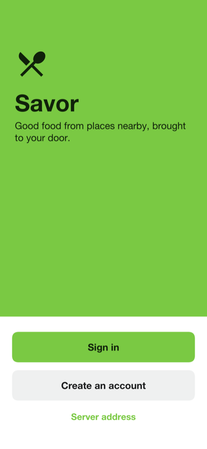

A new account asks for a name, an e-mail address, a mobile number and a password,
and whether the person also wants to deliver. The mobile number is verified with a
code sent as a text message before the first order, because the courier calls it
from the door. A development server prints the code on its console and the app
shows it.

.Creating an account
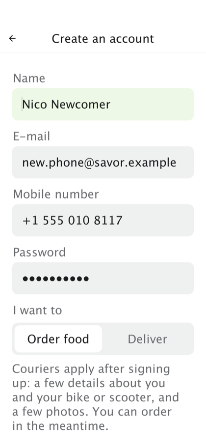

.Verifying the phone number
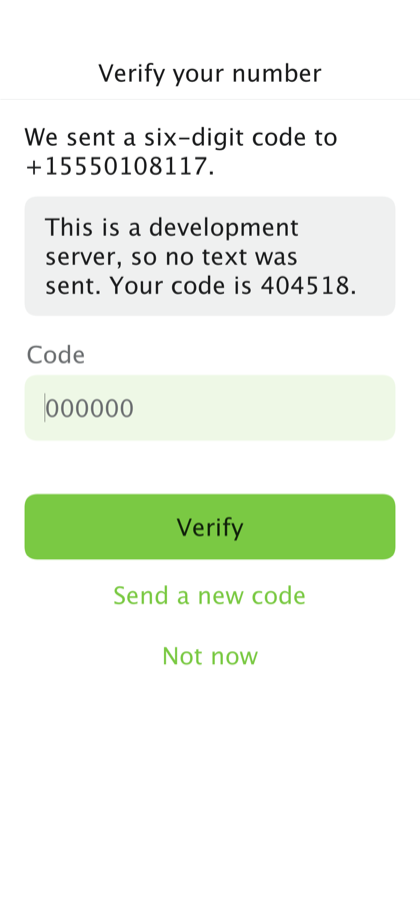

The first sign-in on a device asks whether the app may share usage statistics.
The answer can be changed in the settings at any time.

.The usage statistics question
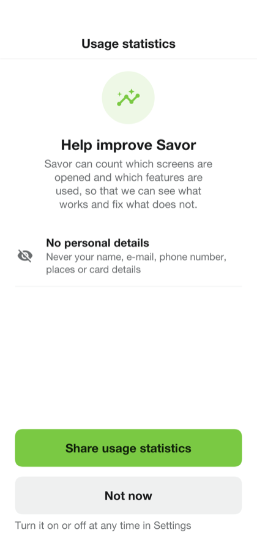

=== The customer

The home screen starts with where the food goes. The address under **Deliver to**
is the device's position until another is chosen, and tapping it searches for a
street, a place or a saved address. Under a greeting that follows the time of day
are the cuisines, the order to list the restaurants in (nearest, top rated, lowest
fee or fastest) and the restaurants themselves: the ones that deliver to the
address, each with its rating, its time to the door and its delivery fee. A
restaurant that's closed or paused says so and still shows its menu.

.The home screen
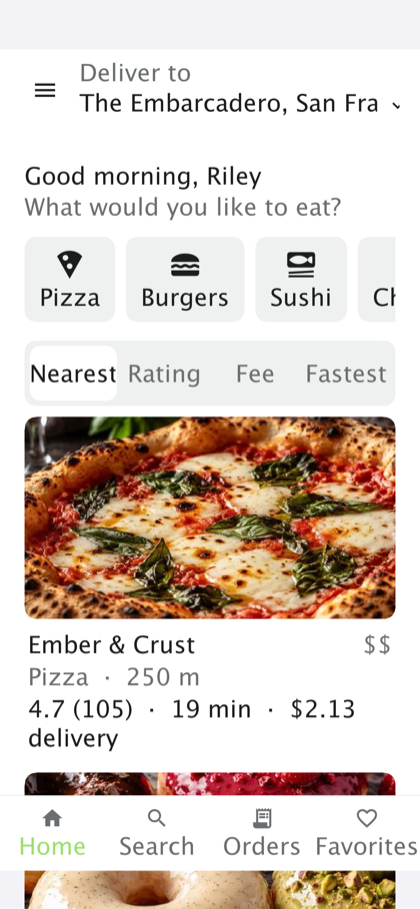

.The home screen in the dark theme
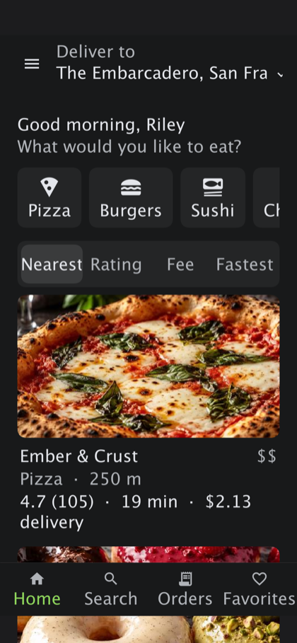

**Search** finds restaurants by their name, their cuisine or a dish on their menu.
**Orders** lists what's on its way and what came before, with a button to order a
past one again, and **Favorites** keeps the restaurants marked with a heart.

A restaurant's page shows its menu by section. A dish with choices -- a size, a
sauce, extra toppings -- opens on a page of its own, which says which choices are
required and how many of each may be picked, and adds the dish with a quantity.
The cart button at the bottom follows the order's total. A cart holds the dishes of
one restaurant: adding a dish from another asks first and starts again.

The checkout lists the dishes, takes a note for the kitchen, the card or cash that
pays, a promo code and a tip for the courier, and shows the total as the server
prices it: the food, the delivery fee, the service fee, a small-order fee for a
small order, the tax, the discount and the tip. The tip chosen is
remembered for the next order.

.The checkout
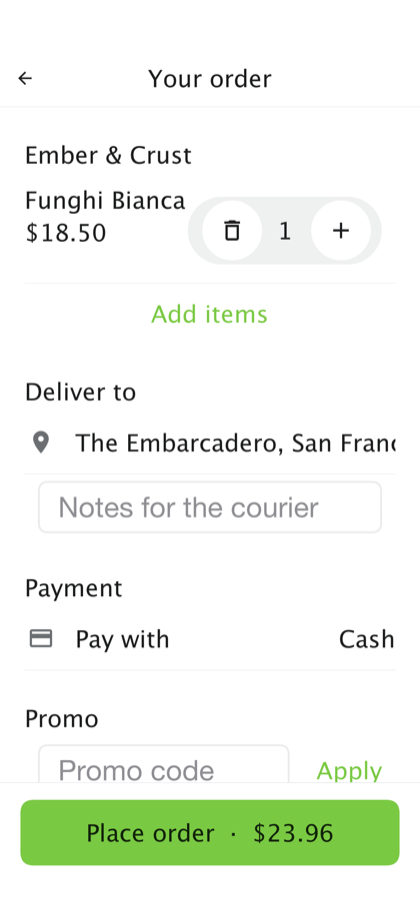

**Place order** holds the total on the card and opens the order on a map. The
steps across the bottom follow it: waiting for the restaurant, being prepared,
ready, on its way and delivered. Until the restaurant accepts it the order can be
cancelled, and the hold on the card is let go. Once a courier has it the map shows
the courier's position and the time to the door, and the courier can be called or
texted.

.Waiting for the restaurant
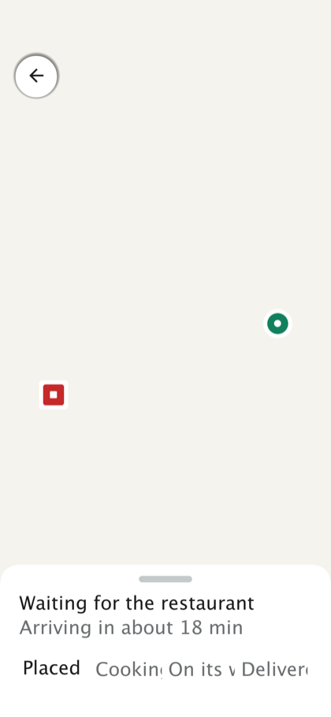

.On its way
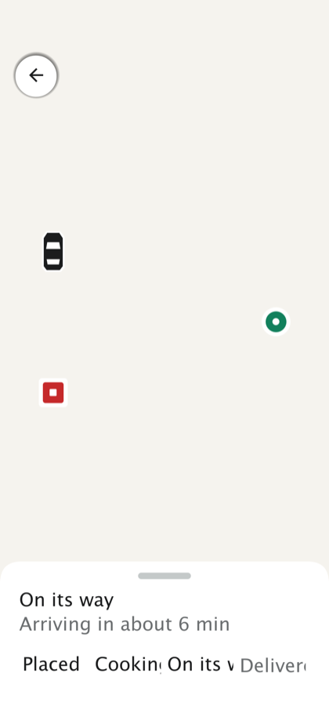

When the food arrives the order asks for a rating and offers the receipt. The card
is charged then, for the total that was held.

.Delivered
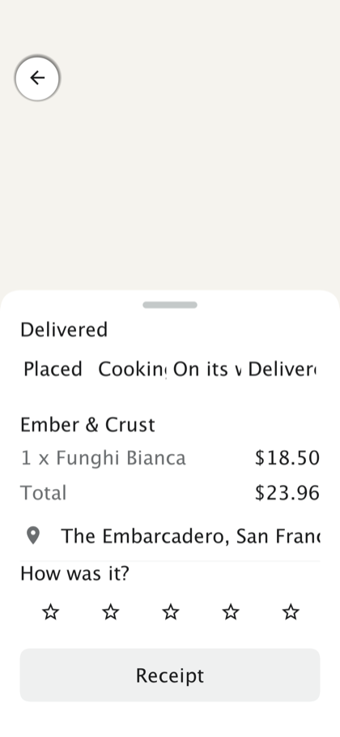

==== Wallet and receipts

The wallet holds the account's cards and cash. Tapping one makes it the default,
which the checkout starts from. A card is added on a form of its own, or on the
payment provider's page when the server uses one, so its number never reaches the
app or the server.

.The wallet
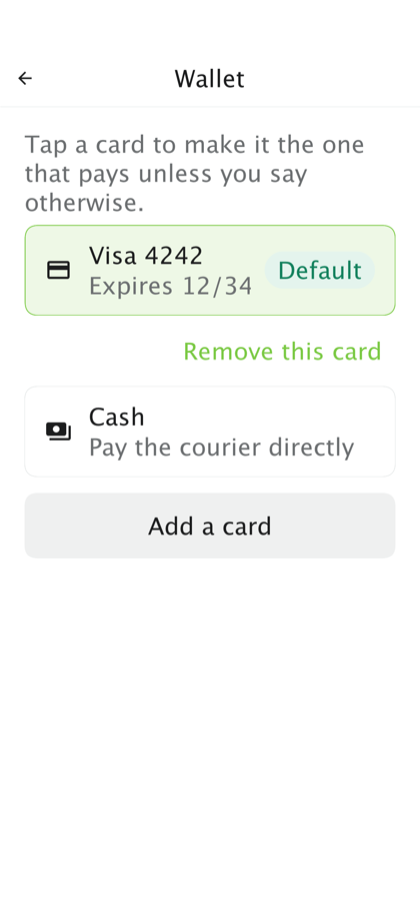

A receipt shows what was paid, part by part, and takes a tip for the courier
afterwards, once.

=== The merchant

A merchant opens on their restaurant's queue. A new order arrives with a sound and
a vibration, without the screen being reloaded, and the queue keeps the orders
that still need the kitchen at the top. On a tablet or a desktop the order opens
beside the queue; on a phone it opens on a screen of its own.

.The order queue
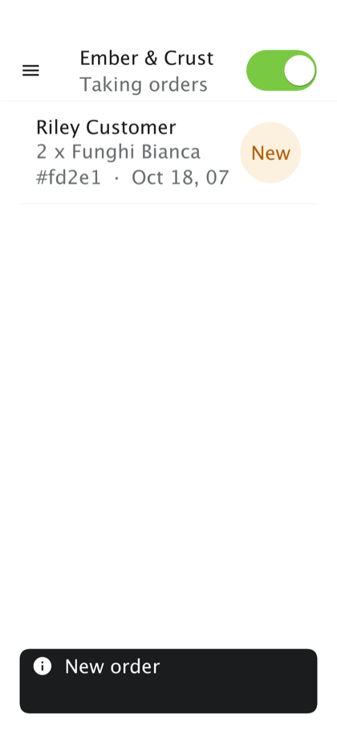

An order shows its dishes with their choices, the customer's note and the total of
the food. **Accept** takes it with the time the kitchen needs, which the customer
sees, and sends for a courier at once, so that one is on the way while the food
cooks. **Reject** asks for a reason, which the customer reads, and lets the hold on
the card go. **Mark ready** tells the courier to collect it: a courier can't take
an order the kitchen hasn't finished.

.An order as the kitchen sees it
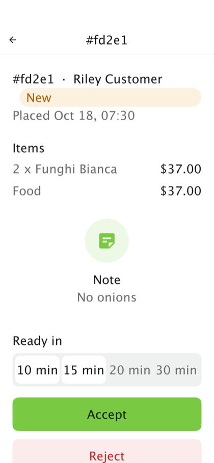

The switch at the top pauses the restaurant: customers still see it, and can't
order. The menu editor adds and renames sections, adds dishes with a photograph,
a price and choices, and marks a dish sold out for the day. **Sales** totals what
the restaurant earned, after the service's commission.

Anyone can ask for a restaurant to be listed, from the menu of the customer's home
screen. It waits, unseen by customers, until an administrator approves it, and the
account that asked then becomes its merchant.

=== The courier

Anyone can apply to deliver, from the menu of the customer's home screen.

==== Applying to deliver

The application asks for the courier's details, the vehicle, and five photographs:
an identity document, the licence, a selfie, the vehicle registration and the
insurance. Each can be taken with the camera or picked from the gallery, and the
application can be left and finished later.

.The documents of an application
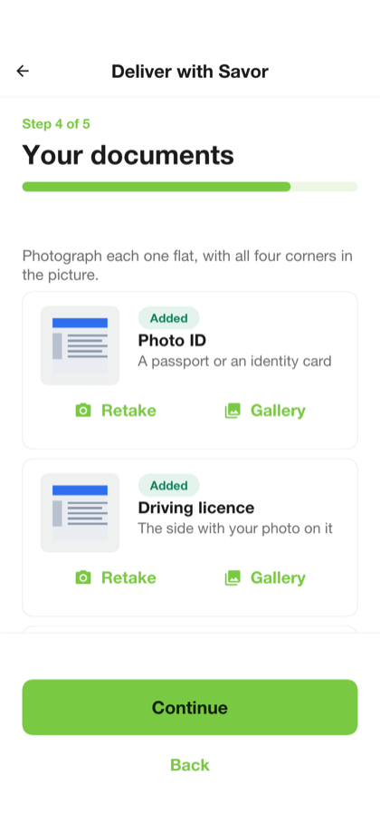

Once sent, it waits for an administrator. A rejection carries a reason, and the
applicant can correct the application and send it again.

.Waiting for a decision
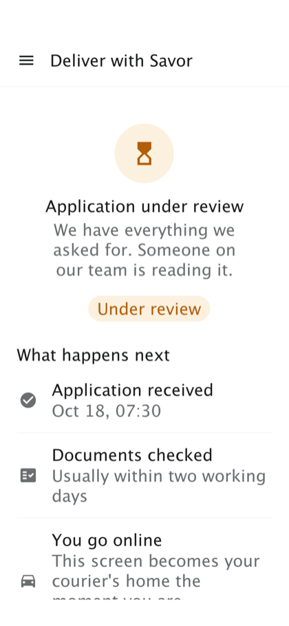

==== Delivering

An approved courier opens on the delivery screen. **Go online** makes them one of
the couriers the server offers deliveries to: those near the restaurant, as soon as
its kitchen accepts an order.

.Offline
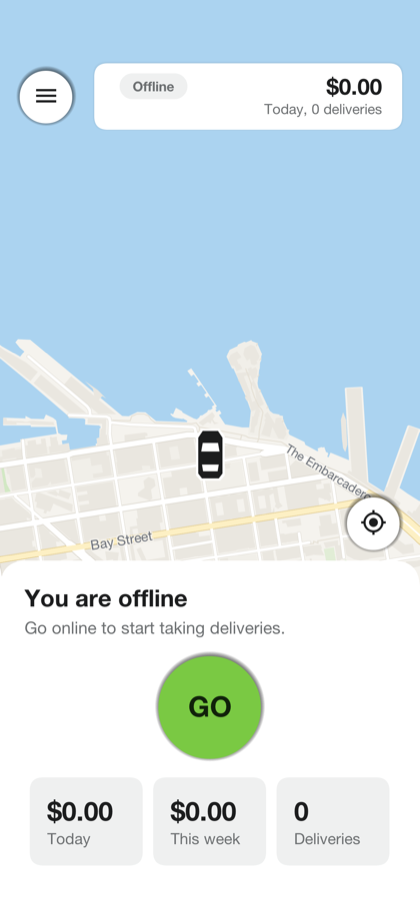

An offer shows what the courier is paid -- the delivery fee and the tip -- the
restaurant, the distance and a countdown. Declined or left to run out, it goes to
the next courier.

.An offer
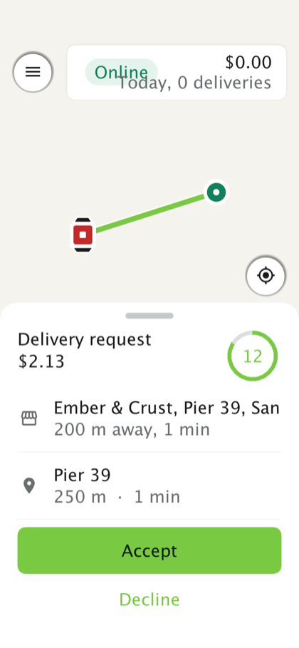

An accepted delivery is two legs. The first leads to the restaurant, where a button
tells the kitchen the courier is waiting. Collecting the food works once the kitchen
has marked the order ready, and the second leg leads to the door, with the customer's name, the address, the note and, for an order paid in
cash, the amount to collect. **Delivered** ends it.

.On the way to the door
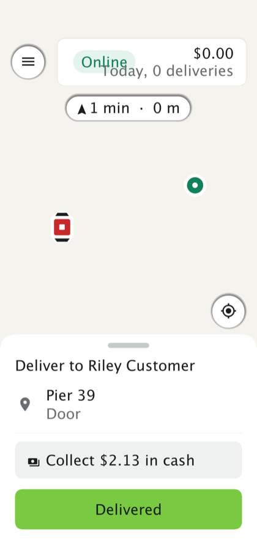

==== Earnings

The earnings screen shows the balance that can be cashed out, the totals for
today, this week and this month, and a chart of the last two weeks.

.Earnings
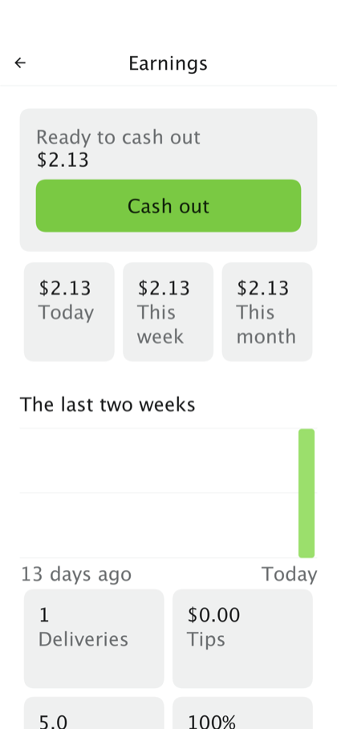

=== The administrator

The operations console starts on a dashboard: what needs an answer -- restaurants
and couriers waiting for approval, flagged accounts -- above the service as it's
now, and charts of orders and their value over the last two weeks.

.The dashboard
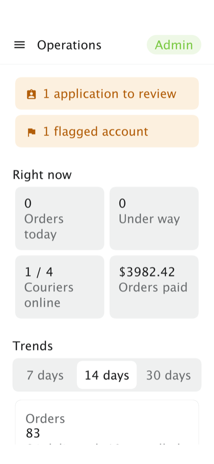

.The trends
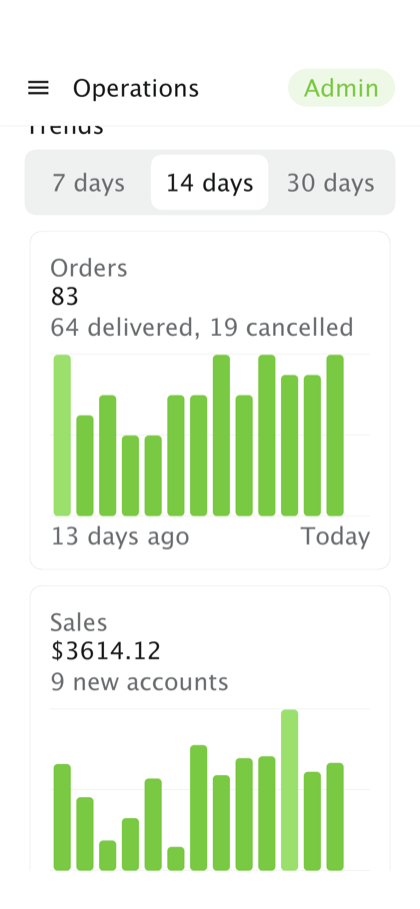

**Restaurants** lists them by status: waiting, approved, suspended, or rejected. A
waiting one is approved or rejected with a reason; an approved one can be
suspended, which takes it off the customers' lists, and let back later.
**Couriers** holds the applications to deliver, each with its documents.

.An application to deliver
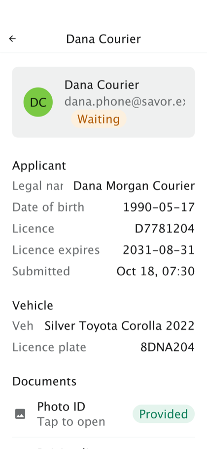

**People** finds any account. An account can be flagged or blocked with a reason
that's kept in its history, and a blocked account can neither sign in nor be
offered a delivery.

.An account
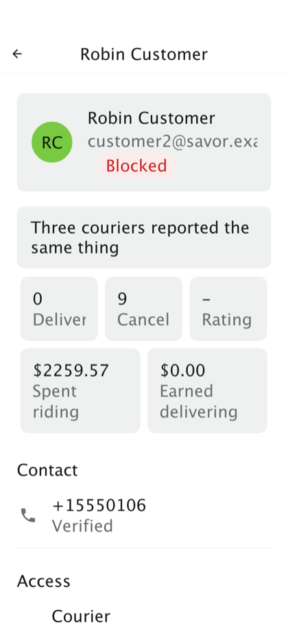

**Orders** lists every order with its state. One that hasn't arrived can be
cancelled, which lets the hold go; one that has can be refunded in full or in part.
**Payments** lists each charge, **Pricing** sets the delivery fee and its price by
distance, the small-order fee, the service fee, the commission and the tax, and
**Promos** creates and ends promo codes. The live map shows the couriers who are
online.

On a tablet or a desktop the console lays its sections down the left side and opens
what's picked beside its list.

=== Settings

The settings hold the account -- its name, phone number and password -- the cards,
the language, the theme, notifications and the usage statistics. The app is in
English, Spanish, French, German and Hebrew, and in Hebrew it's laid out from right
to left.

NOTE: The translations are machine-generated samples, and no native speaker has
reviewed them. Have them checked before you ship the app in those languages.

.The settings
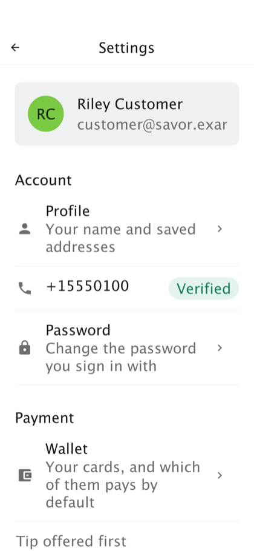

.The settings in the dark theme
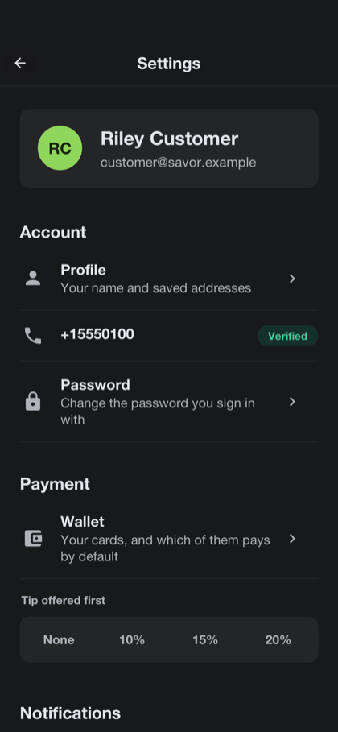

.The settings in Hebrew
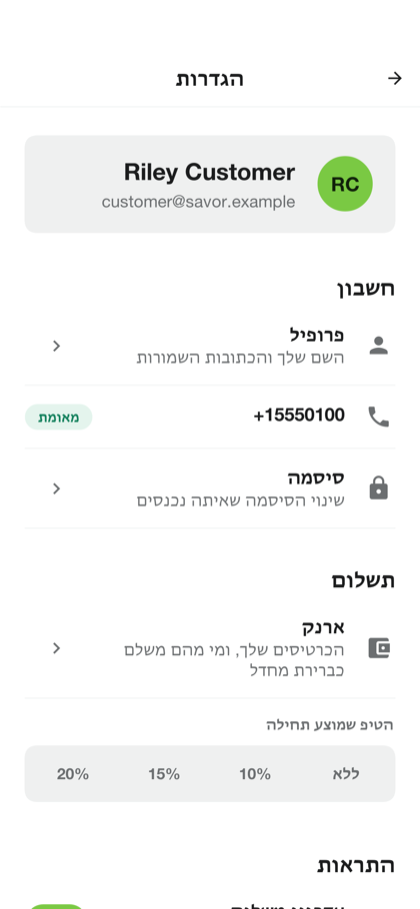

.Usage statistics
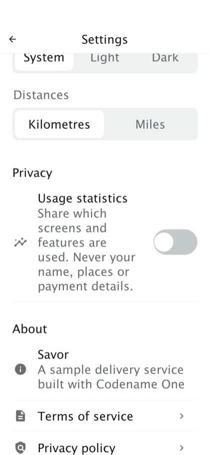

=== In a browser

The server can host the app itself: open the server's address in a browser and the
same app loads there, signs in against that server and opens its live channel to
it. A browser gives a page less than a phone gives an app, and the app says so
where it matters. Calling and texting a courier are offered only where the device
can dial, and the restaurants listed are those near a default address when the
browser won't say where it is.
