[[scheduling-and-gantt]]
== Scheduling and Gantt charts

A booking application, a field service tool, a clinic, a production plan: each
shows time on one axis and people or work on the other, and lets the user move
things around in it. Two components cover that ground. `Scheduler` shows items
in time by the day, the week, the month, as an agenda, or against a list of
resources. `Gantt` shows a project: tasks in a tree, the bars they take up on a
time axis, the links between them and the load they put on the people who do
them.

Both are in `com.codename1.ui.scheduler`, and both draw from a model in
`com.codename1.scheduling` that has no user interface in it. The model is plain
Java you can build, test and store without a form on screen.

Both components paint their content directly instead of building a component
for each item. A month with thousands of items scrolls the way one with ten
does, the hour column and the row titles stay in view while the rest moves
under them, and a pinch or a control-wheel zooms the time axis.

=== A first schedule

A `ScheduleItem` has an id, a title, a start and an end. Instants are epoch
milliseconds; `TimeMath` turns a day and a minute of the day into one in a time
zone, so a day that's 23 or 25 hours long comes out right.

[source,java]
----
include::../demos/common/src/main/java/com/codenameone/developerguide/scheduling/SchedulingSnippets.java[tag=scheduler-first,indent=0]
----

Give the scheduler the center of a `BorderLayout`. It scrolls inside the room
it's given, so it doesn't belong in a container that scrolls too.

.A week of a schedule
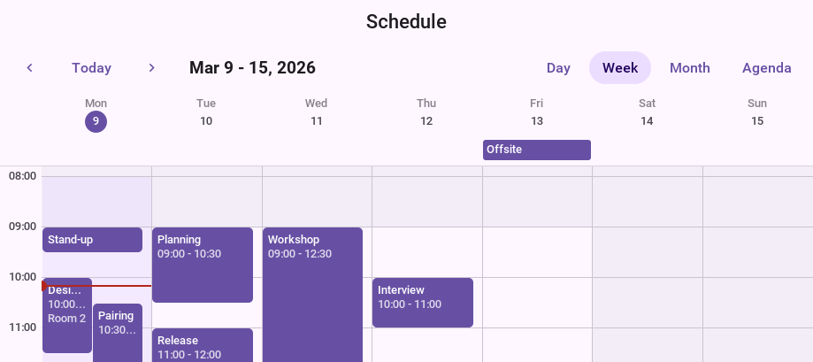

The toolbar above the grid moves to the previous or the next stretch, returns
to today and switches between views. `setViews` chooses which views it offers,
`setToolbarVisible(false)` removes it when the application has a heading of its
own, and `next()`, `previous()`, `today()` and `setDate()` do from code what
its buttons do.

[cols="1,3",options="header"]
|===
|View |What it shows

|`DAY`, `WORK_WEEK`, `WEEK`
|Hours down the page, a column for each day. Items that overlap share the
column's width, and items that last all day sit in a lane above the hours.

|`MONTH`
|A grid of days with the first items of each, and a count of the rest.

|`AGENDA`
|A list of the coming days and what's in them.

|`RESOURCE_DAY`
|One day, with a column for each resource: who's free at ten.

|`RESOURCE_TIMELINE`
|A row for each resource and time running across: who's booked this week.
|===

`WORK_WEEK` shows the days the scheduler's `WorkCalendar` works. A week starts
on Monday unless `setFirstDayOfWeek` says otherwise, and a week that starts on
the day the user asked from is the same view with that day as its first.

The bar over the schedule is one row where there is room for it. On a screen
as narrow as a phone's the buttons that pick the view move to a row of their
own, as in the day view below, and `setCompactToolbar(true)` folds them into a
single button with a menu.

The figures that follow are one schedule, three people's month, in each view.

.The day view: two meetings at the same time share the column
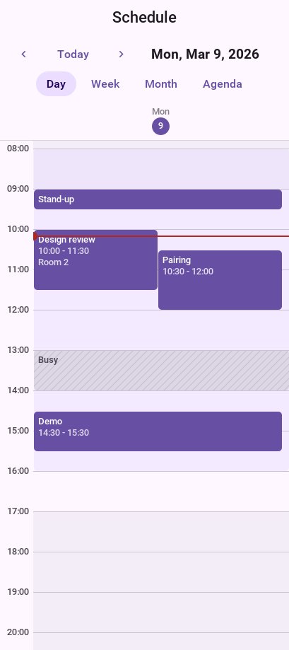

.The work week
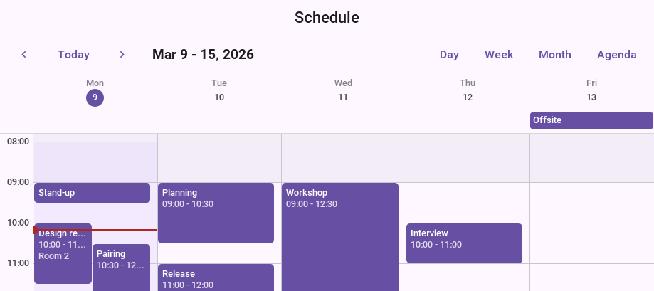

.The month view
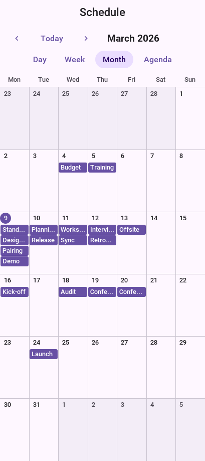

.The agenda
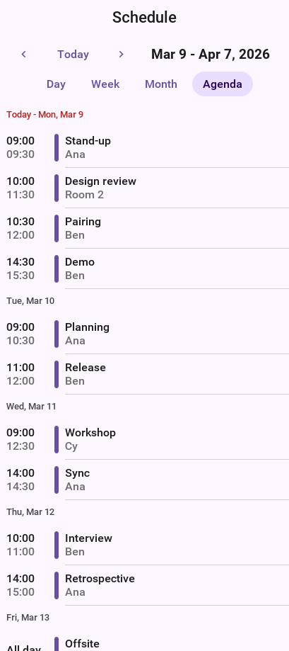

The views take their colors from the theme, so they follow its dark appearance
and look at home on each platform with no code:

.The day view in the dark appearance
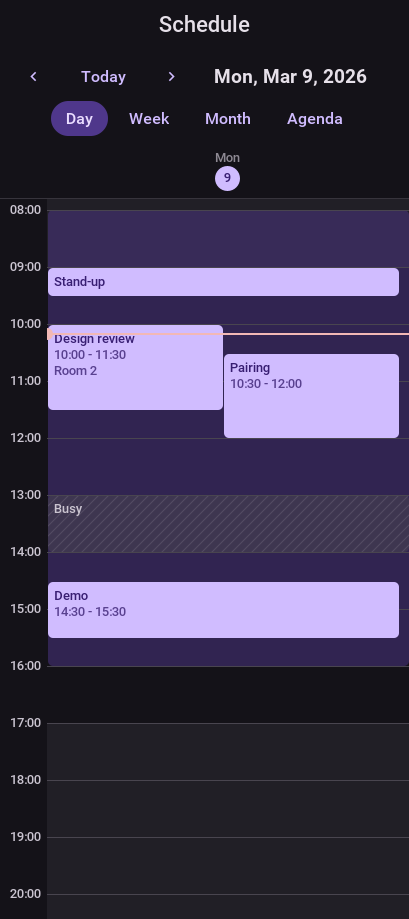

.The month view in the dark appearance
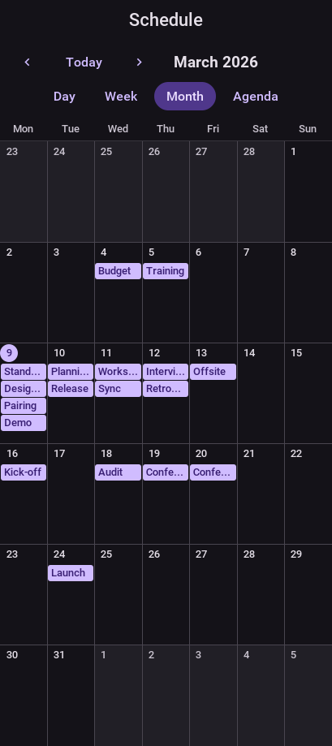

.The day view in the iOS theme
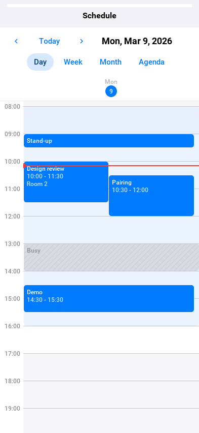

=== Resources

A `ScheduleResource` is anything work is booked against: a person, a room, a
machine. An item names its resource by id.

[source,java]
----
include::../demos/common/src/main/java/com/codenameone/developerguide/scheduling/SchedulingSnippets.java[tag=scheduler-resources,indent=0]
----

An item is one of three kinds. An `EVENT` is a block with a title that can be
selected, opened, and moved. A `BACKGROUND` item is a band under the events,
such as the hours somebody is available. A `BLOCKED` item is time that's taken
and isn't this application's to edit, such as busy time read from another
calendar, and it's drawn hatched so it never reads as an event that lost its
color.

.`RESOURCE_DAY`: a column for each person
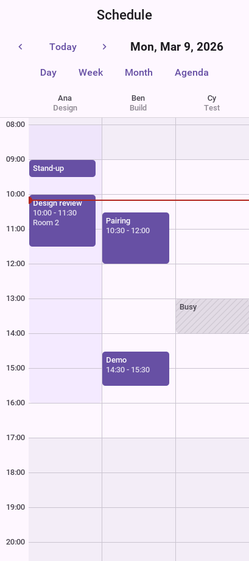

.`RESOURCE_TIMELINE`: a row for each person
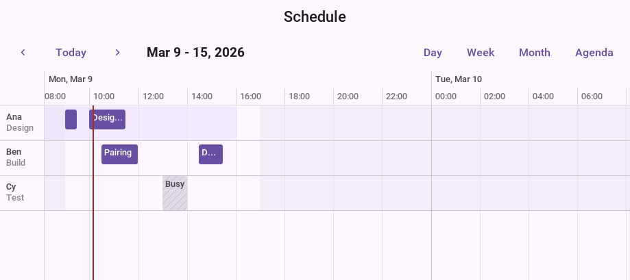

=== Working hours

A `WorkCalendar` says which days are worked and between which minutes of the
day, with exceptions for single dates. The scheduler shades the time outside
it, and a resource can carry a calendar of its own.

[source,java]
----
include::../demos/common/src/main/java/com/codenameone/developerguide/scheduling/SchedulingSnippets.java[tag=scheduler-work-calendar,indent=0]
----

`WorkCalendar.continuous(zone)` is a calendar with no time off at all, for a
schedule that draws its own availability as background items.

=== Selecting, opening and editing

With a mouse, a drag moves the item under it, a drag on an item's edge resizes
it, and a drag across empty time selects a range. On a touch screen a drag
scrolls, and a long press starts the same edits. `setDragEdits` overrides the
choice, `setEditable(false)` makes the schedule read only, and an item can
refuse on its own with `setMovable(false)` or `setResizable(false)`. Times snap
to `setSnapMinutes`.

A `SchedulerListener` hears about every one of them. `itemChanging` is asked before an
edit lands and can refuse it, which leaves the item where it was.

[source,java]
----
include::../demos/common/src/main/java/com/codenameone/developerguide/scheduling/SchedulingSnippets.java[tag=scheduler-events,indent=0]
----

An accepted edit goes to the model's `updateItem`. `DefaultScheduleModel` keeps
everything in memory; an application whose items live on a server implements
`ScheduleModel`, or extends `AbstractScheduleModel`, loads the range the view
asks for in `setVisibleRange`, and sends the edit in `updateItem`.

==== What the pointer shows, and how things move

A mouse says a lot before it's pressed, and the views answer it. The item
under the pointer lights up, and over free time the slot a drag would start in
is marked. The cursor says what a drag would do: an arrow cross over an item
that can be moved, a resize arrow at an edge that can be pulled, a hand over
something that can only be opened. A tooltip gives the title and the time of
an item too small to show them. None of this appears on a touch screen, which
has no pointer to rest.

Edits are animated the same way with a mouse and with a finger. An item that's
picked up lifts off the page: a shadow comes up under it, and the place it
left dims to show where it'd return. Let go, it glides from where it was
dropped to the time it snapped to, and takes its place beside whatever is
already there. An edit a listener refuses glides back to where it started. Each
of these takes under a quarter of a second.

The figures that follow are those animations stopped at their stages.

.An item is moved: pointed at, picked up, carried, dropped beside a meeting, and at rest
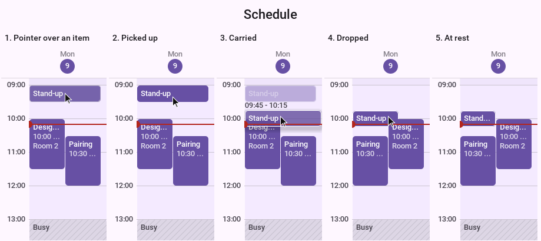

.An item is made longer by its lower edge
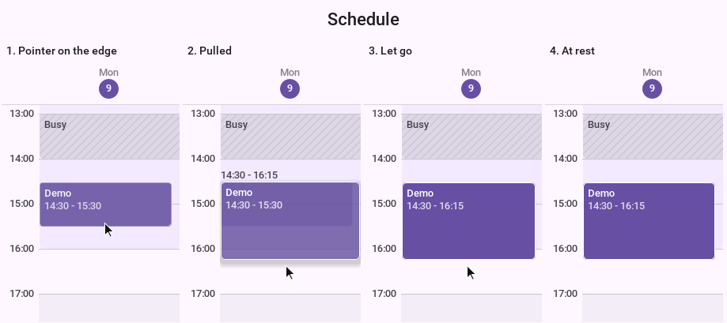

.A drag over free time selects it
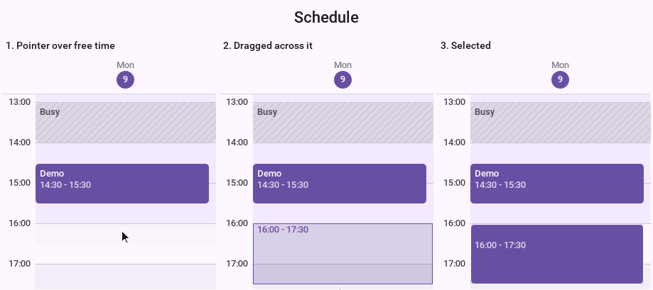

.In the month an item is carried to another day
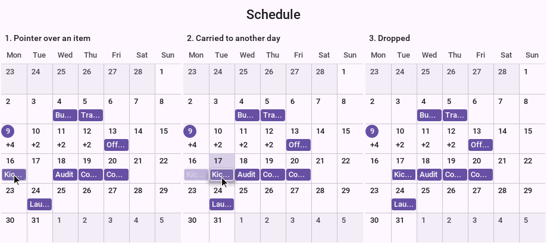

An application that takes screenshots of its own, or tests an animation, stops
the clock they run by. `setAnimationTime` fixes it at a number of milliseconds,
whatever starts afterward starts at that moment, and moving the clock on shows
the animation that far along. It's how the figures above were made.

[source,java]
----
include::../demos/common/src/main/java/com/codenameone/developerguide/scheduling/SchedulingSnippets.java[tag=scheduler-animation-time,indent=0]
----

=== Showing a calendar

`CalendarScheduleModel` is a `ScheduleModel` over a `CalendarSource` from the
<<calendar-integration,calendar API>>: the device's calendars, Google,
Microsoft or CalDAV. Each calendar added is a resource, recurring events are
expanded for the range in view, and a drag saves the event back through the
source.

[source,java]
----
include::../demos/common/src/main/java/com/codenameone/developerguide/scheduling/SchedulingSnippets.java[tag=scheduler-calendar-source,indent=0]
----

`addFreeBusyCalendar` adds a calendar as blocked time only, for a person whose
details aren't the user's to read. `setMutationScope` decides whether a drag on
one occurrence of a recurring event changes that occurrence or the series.
Call `dispose()` when the form is gone, so the model stops listening to the
source.

=== A project as a Gantt chart

A `ProjectModel` holds tasks in a tree, the dependencies between them, the
resources they're assigned to and the calendar they're worked on. A task has a
duration in working time and no dates of its own: `update()` schedules the
project, and each task then answers `getStart()` and `getEnd()`.

[source,java]
----
include::../demos/common/src/main/java/com/codenameone/developerguide/scheduling/SchedulingSnippets.java[tag=gantt-first,indent=0]
----

.A project as a Gantt chart
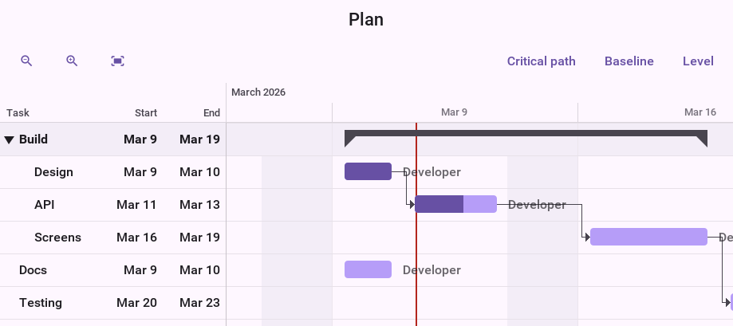

A task with children is a summary, drawn as a bracket over them, and a task
with no duration is a milestone. A dependency is one of the four usual types,
with a lag that may be negative:

[cols="1,3",options="header"]
|===
|Type |The successor

|`FINISH_TO_START`
|Starts when the predecessor finishes. This is what `link(a, b)` makes.

|`START_TO_START`
|Starts when the predecessor starts.

|`FINISH_TO_FINISH`
|Finishes when the predecessor finishes.

|`START_TO_FINISH`
|Finishes when the predecessor starts.
|===

A link that would close a loop is refused: `canLink` answers before one is
made, and `link` throws when it's asked for one anyway.

Scheduling runs a forward and a backward pass over working time. Afterward
every task has its early and late dates, `getTotalSlack()` says how long it can
slip before the project does, and `isCritical()` marks the tasks with none.
`setShowCriticalPath(true)` draws those bars and the links between them in
their own colors.

.The critical path: the tasks with no slack, and the links between them
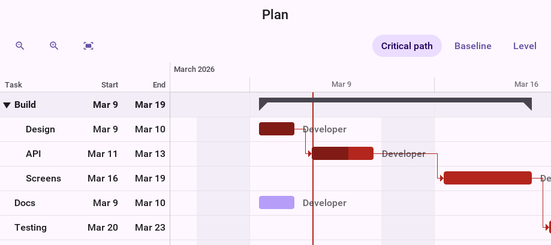

`captureBaseline()` keeps every task's dates as the plan of record, and
`setShowBaseline(true)` draws them as a thin bar under each task, so a slip
shows as a bar that has moved off its baseline. `setCollapsed` folds a summary
over its tasks, as a tap on its arrow in the table does.

.A baseline: the API took two days more than planned, and everything after it moved
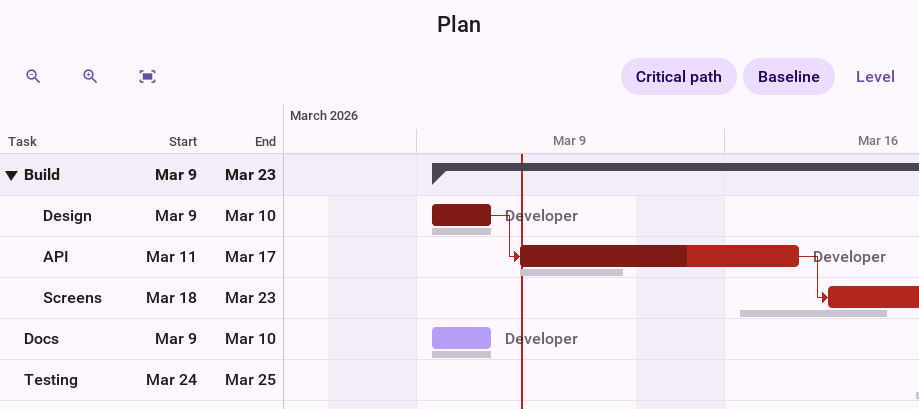

.A summary folded over its tasks
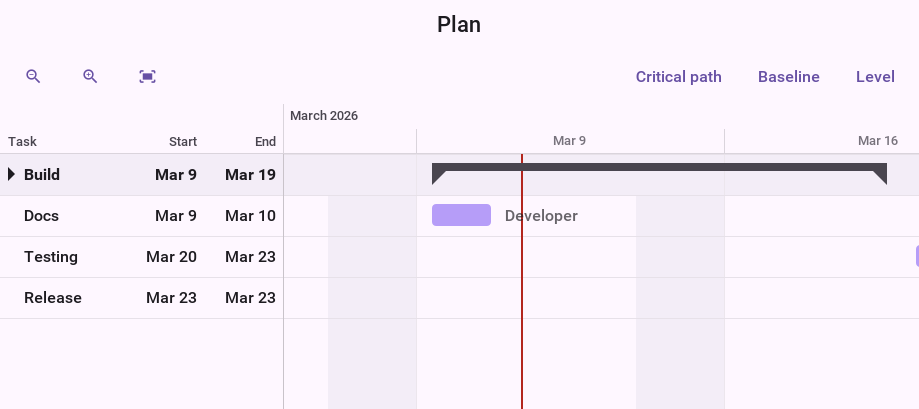

A task can be held by a constraint, such as `START_NO_EARLIER_THAN` a date or
`MUST_FINISH_ON` one, and `isConstraintViolated()` reports one the links made
impossible. `setManuallyScheduled(true)` takes a task out of scheduling
altogether and keeps the dates it's given.

In the chart, a drag moves a bar, a drag on its end changes the duration, the
handle inside it sets the progress, and a drag from a bar's end to another bar
links the two. Every edit goes through the model and the project is scheduled
again. A `GanttListener` can refuse any of them:

[source,java]
----
include::../demos/common/src/main/java/com/codenameone/developerguide/scheduling/SchedulingSnippets.java[tag=gantt-events,indent=0]
----

The chart answers a mouse as the scheduler does. The bar under the pointer
lights up together with the links into and out of it, and its row is marked in
the table and across the chart, so a task is easy to follow in a wide plan. The
cursor shows what a drag would do, down to the end of a bar and the two handles
of the selected one, and a tooltip gives the task's dates and progress. A bar
that's picked up lifts over a shadow, and when it's let go the project is
scheduled again and every bar the change moved slides to its new dates
together.

.A task is moved two days later and the tasks that depend on it follow
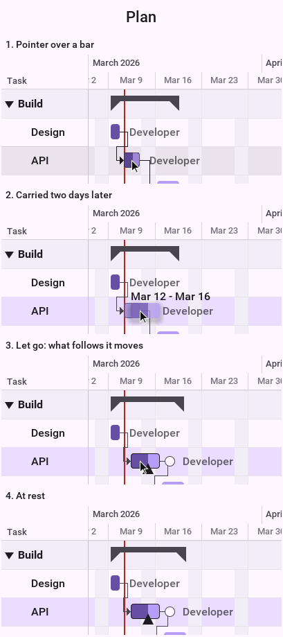

.A dependency is drawn from the selected bar to another
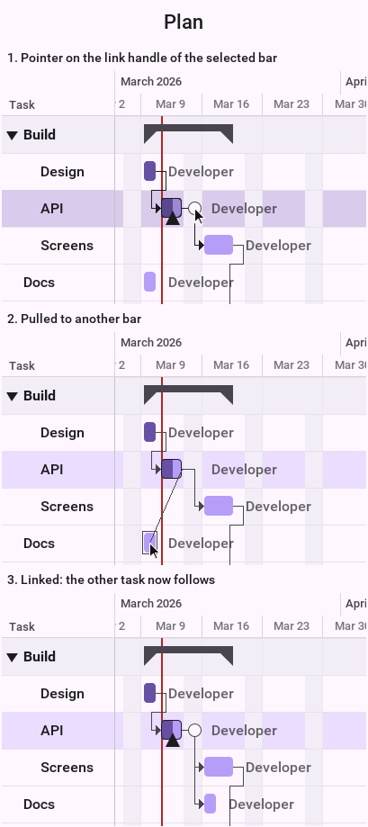

`Gantt` has the same `setAnimationTime` as `Scheduler`, which is how these
frames were stopped.

=== Resource load and leveling

A task is assigned to a resource in units: `assign("dev")` is one person
full-time, `assign("dev", 0.5f)` half of one. A resource has a capacity, and where
the tasks assigned to it add up to more, it's over-allocated.

`setLoadVisible(true)` puts a histogram of each resource's load under the
chart, on the same time axis, with the stretches over capacity in the error
color.

.The load of each resource under the chart: one developer has been given two tasks at once
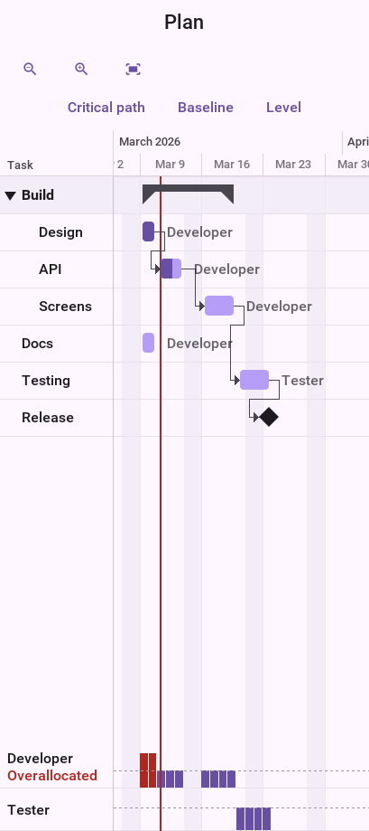

`ResourceLeveler` resolves over-allocation by delaying tasks. It first uses the
slack a task has, so the project's end doesn't move, and then delays by
priority. It returns a proposal and changes nothing until that's applied:

[source,java]
----
include::../demos/common/src/main/java/com/codenameone/developerguide/scheduling/SchedulingSnippets.java[tag=gantt-leveling,indent=0]
----

`getUnresolved()` lists what leveling couldn't fix, such as one task that needs
more of a resource than there is. `ProjectModel.clearLeveling()` removes the
delays again.

.The same project leveled: the task that had slack was moved, and the load is within capacity
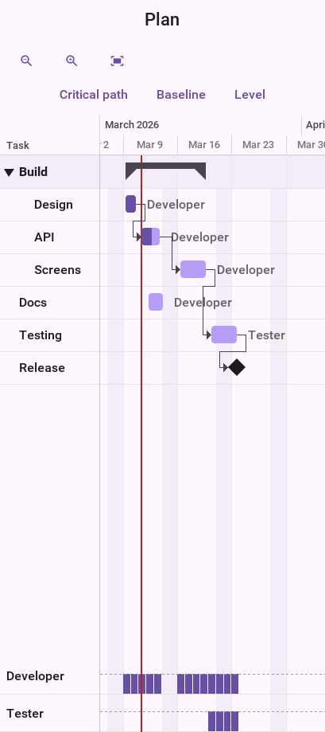

=== Printing and export

`SchedulePrinter` renders a scheduler or a Gantt chart on pages: the whole
view at the zoom it has, split across and down, with the hour column, the
resource names or the task table repeated on every page.

[source,java]
----
include::../demos/common/src/main/java/com/codenameone/developerguide/scheduling/SchedulingSnippets.java[tag=schedule-print,indent=0]
----

`writePdf` writes the same pages to a PDF file where the platform can encode a
JPEG, which `SchedulePrinter.isPdfSupported()` reports. The pages are pictures,
so their text can't be selected. `print` needs a platform that prints, as
`Printer.isPrintingSupported()` says.

=== Styling

The components paint from styles, so a theme restyles them like anything else.
The native themes define every one of these UIIDs; with another theme they fall back
to a neutral light or dark palette, and a UIID the theme does define is taken
from the theme whole.

[cols="2,3",options="header"]
|===
|UIID |What takes its colors and font from it

|`Scheduler`, `SchedulerToolbar`, `SchedulerTitle`, `SchedulerViewButton`
|The background and the toolbar

|`SchedulerGrid`, `SchedulerOffHours`, `SchedulerNow`, `SchedulerSelection`
|Grid lines, the time outside working hours, the current time and a selected
range

|`SchedulerHeader`, `SchedulerHeaderToday`, `SchedulerTimeLabel`
|Day and resource titles, today's title, and the hours

|`SchedulerItem`, `SchedulerBackgroundItem`, `SchedulerBlocked`
|Items, by kind

|`SchedulerMonthDay`, `SchedulerMonthOther`, `SchedulerAgendaItem`
|The month grid and the agenda

|`Gantt`, `GanttHeader`, `GanttRow`, `GanttSummaryRow`
|The chart, its time axis and the task table

|`GanttBar`, `GanttBarProgress`, `GanttBarCritical`, `GanttSummaryBar`,
`GanttMilestone`, `GanttBaseline`
|Bars

|`GanttLink`, `GanttLinkCritical`
|Dependency lines

|`GanttLoad`, `GanttOverload`
|The resource load histogram
|===

An item, a resource or a task can carry a color or a UIID of its own
(`setColor`, `setUIID`), which is how one schedule shows confirmed and
tentative bookings differently. For anything further, `setItemRenderer` and
`setBarRenderer` replace the painting of an item or a bar; extend
`DefaultScheduleItemRenderer` or `DefaultGanttBarRenderer` to change one part
of it.

==== Restyling from CSS

A rule for one of the UIIDs in the table changes that part and leaves the rest
to the native theme. These rules give the schedule a brand color, and add a
UIID of the application's own for bookings that aren't confirmed:

[source,css]
----
include::../demos/common/src/main/css/guide-snippets-theme.css[tag=scheduling-css-scheduler,indent=0]
----

The items that are tentative ask for that UIID with
`item.setUIID("TentativeBooking")`.

.The day view under those rules
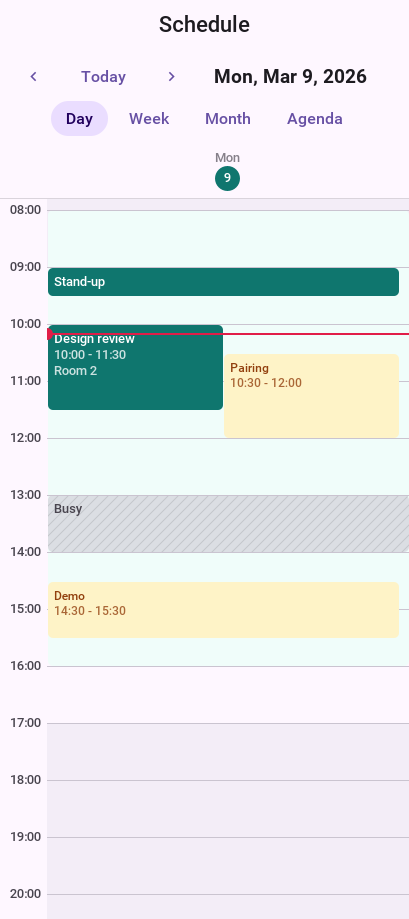

The Gantt chart is restyled the same way:

[source,css]
----
include::../demos/common/src/main/css/guide-snippets-theme.css[tag=scheduling-css-gantt,indent=0]
----

.The chart under those rules
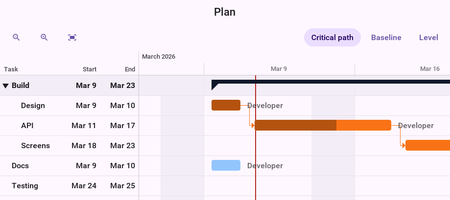

The chart follows the theme's appearance and platform like the scheduler:

.The chart in the dark appearance
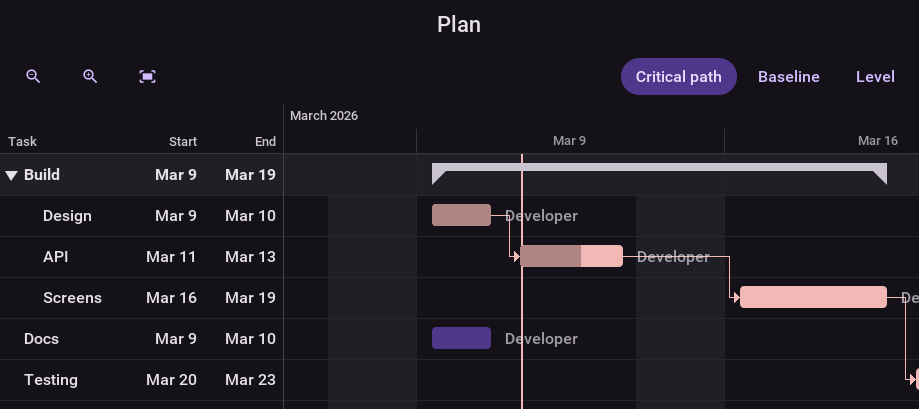

.The chart in the iOS theme
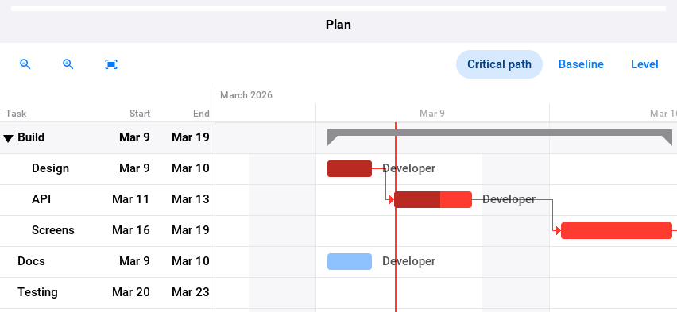

==== Colors from the data

A color can come from the model instead of the theme. A resource with a color
gives it to all its items, and an item with one of its own overrides that;
the text turns black or white to stay readable on whichever it is.

.A color for each person, and one item with a color of its own
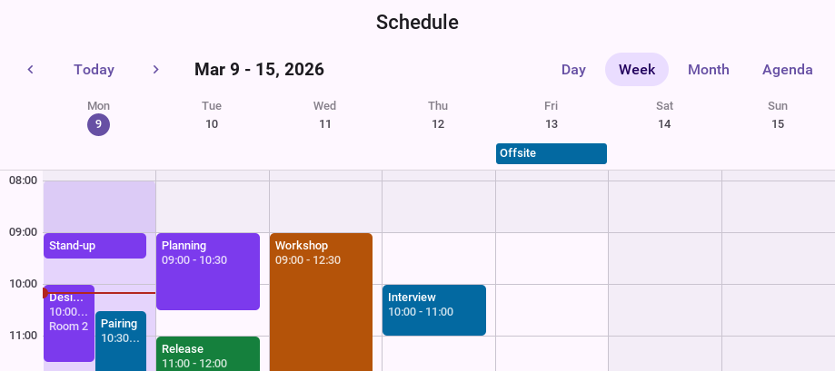

==== A renderer of your own

A renderer is handed the item, its rectangle and a set of flags that say how
it's being shown: `SELECTED`, `DRAGGED` while it's carried, `HOVERED` while
the pointer rests on it, `COMPACT` in the month and the all-day lane. This one
draws an event as a card with a stripe, and deepens it under the pointer:

[source,java]
----
include::../demos/common/src/main/java/com/codenameone/developerguide/scheduling/CardItemRenderer.java[tag=scheduler-renderer,indent=0]
----

[source,java]
----
include::../demos/common/src/main/java/com/codenameone/developerguide/scheduling/SchedulingSnippets.java[tag=scheduler-renderer-use,indent=0]
----

.The day view drawn by that renderer
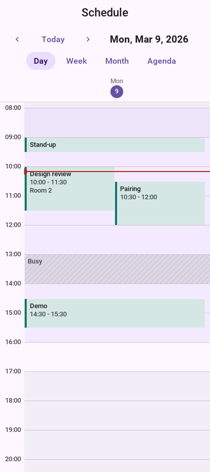

The views still draw the light, the shadow and the glide around what the
renderer paints, so a custom item moves like a built-in one.
