[[skirmish-implementors-guide]]
== Skirmish: Making the game your own

Skirmish shares the module layout, the accounts and sign-in, push notifications and
the operations console with <<savor-implementors-guide,Savor>> and
<<wayline-implementors-guide,Wayline>>. What it adds is a game: a deterministic
simulation that the app, the server, the replay viewer and the tests all run, a 3D
battle drawn over it, and the progression, store and moderation a live game needs.
This chapter shows where each of those lives and what to change to make the game
yours.

[[skirmish-launch]]
=== Running it

The project is in `scripts/skirmish`, and the Initializr generates it under your own
package and name. Start the server on the development profile, which keeps its
database in memory, seeds the demo accounts and simulates purchases and push
notifications:

[source,bash]
----
include::../demos/common/src/main/snippets/developer-guide/skirmish.sh[tag=skirmish-sh-server,indent=0]
----

Then run the app in the simulator, from the project's directory:

[source,bash]
----
include::../demos/common/src/main/snippets/developer-guide/skirmish.sh[tag=skirmish-sh-simulator,indent=0]
----

The app looks for the server at `http://localhost:8080/`; *Settings* changes the
address, which is how a phone reaches a server on your computer. To build the native
iOS app on a Mac, generate the Xcode project, which lands under `ios/target`,
then open it and run it on a simulator or a device from Xcode:

[source,bash]
----
include::../demos/common/src/main/snippets/developer-guide/skirmish.sh[tag=skirmish-sh-ios,indent=0]
----

The development profile needs nothing installed, and four demo accounts exist, each
with the password `skirmish-demo`:

[cols="1,3"]
|===
| Account | What it's for

| `player@skirmish.example`
| A player with some history: level 3, two chests waiting and a daily quest
  ready to claim.

| `rival@skirmish.example`
| A second player, to battle the first from another simulator or device.

| `trouble@skirmish.example`
| A player the server has already flagged, so the console has something to
  review.

| `admin@skirmish.example`
| The operator. Signs in to the same app and gets the admin console as well.
|===

[[skirmish-tour]]
=== What the sample does

This tour follows a player through the app, with a pointer to the section that
explains how each part is built.

==== Signing in

The first screen offers to sign in, to create an account, or to practice against
the bot without one. A new account picks a battle name, which is what opponents
and the leaderboard see.

image::img/skirmish-register-name.png["Creating an account: three heroes above a field for the battle name, its preview, and fields for e-mail and password",scaledwidth=40%]

image::img/skirmish-signin.png["The sign-in screen: three heroes above the name Skirmish, fields for e-mail and password, and buttons to sign in, create an account or practice",scaledwidth=40%]

A new player goes straight into the training battle, described in
<<skirmish-training>>.

==== The home screen

The home screen shows the player's progress at a glance: level and how close the
next one is, coins, gems and trophies, the hero of the deck, the *BATTLE* button,
chests, today's quests and the deck.

image::img/skirmish-home.png["The home screen: avatar, level and experience bar, the hero on stage, the BATTLE button, the chest slots and the daily quests",scaledwidth=40%]

* Chests are earned by winning and by levelling up. A tap opens one.
* Daily quests change every day. Three are picked for each player, and a
  finished one is claimed with *Claim*.
* Achievements are long-term goals with gem rewards, listed in the *Trophies*
  room.

Every reward is shown in a popup with the player's hero cheering. The server
decides every part of it, as <<skirmish-progression>> shows.

image::img/skirmish-reward-levelup.png["A reward popup: Training complete, a level-up badge, coins, gems, experience and a chest, and the achievement unlocked",scaledwidth=40%]

==== The deck

A deck is eight cards, and the battle hand is four of them at a time, with the
next card waiting. *Deck* shows every card with its elixir cost, and the eight in
use are framed in gold. A tap swaps a card in or out.

image::img/skirmish-deck.png["The deck screen: ten card portraits, eight of them framed in gold, the deck's average elixir cost and a button to save it",scaledwidth=40%]

==== Battle

A battle lasts three minutes. Each side has a king's castle and two archer
towers. Toppling a tower wins a crown, and toppling the castle wins outright. When
the clock runs out, the side with more crowns wins. A tie goes to a minute of
overtime where the next crown wins, and is a draw if nobody scores. Elixir comes
twice as fast in the last minute of regular time.

image::img/skirmish-battle.png["A battle: the field with the river and two bridges, both sides' towers, troops on the left lane, and the hand of cards under the elixir bar",scaledwidth=40%]

Elixir fills the bar at the bottom, one drop at a time up to ten. A card is played
by tapping it and then the field, or by dragging it there. Troops and buildings go
on the player's own side of the river, and spells go anywhere. Troops walk to the
nearest bridge and attack the first thing in their way.

The result screen follows, with the crowns, trophies and coins won. From there a
player can watch the replay, report the opponent, or watch a sponsored video for
extra coins.

image::img/skirmish-result.png["The result screen: Victory, the crown count, and buttons to watch an ad for coins and to continue",scaledwidth=40%]

==== Finding an opponent

*BATTLE* puts the player in a queue that pairs players with similar trophy counts
and falls back to the bot if nobody is found. During an online battle, the buttons
under the hand send a quick emote to the opponent. <<skirmish-referee>> explains
how the two phones stay in step.

image::img/skirmish-online-battle.png["An online battle against the bot, with the emote buttons GG, Wow!, Oops and Thanks under the hand",scaledwidth=40%]

*Practice* plays the bot straight away and earns nothing. *Challenge* makes a code
and a link to send a friend, and opening the link starts the friend's app straight
into the battle.

==== Replays

Every online battle is kept, and *Replays* lists them. Any signed-in player can
watch any battle, with both players' names. A replay isn't a recording. It's the
starting state and every card played, run again through the same rules. The viewer
pauses, plays at two or four times speed, and a slider jumps to any moment.

image::img/skirmish-replay.png["The replay viewer showing a battle in progress with play, pause and speed controls",scaledwidth=40%]

==== The shop and settings

The shop sells gems for real money, and cosmetic items for gems: arenas, emote
sets and a season pass. Purchases go through the platform's store, and the server
checks every receipt before granting anything, as <<skirmish-purchases>> shows. On
the development profile the store is simulated, so a purchase completes
immediately.

image::img/skirmish-shop.png["The shop: gem packs with prices, and cosmetic items with their gem cost",scaledwidth=40%]

*Settings* renames the player, and switches the sound, push notifications and
sharing anonymous usage statistics on or off. The server address can be changed
here too, which is how the app reaches a server on another machine.

image::img/skirmish-settings.png["The settings screen with the battle name, sound, notification and privacy switches, and the server address",scaledwidth=40%]

=== The modules

[cols="1,3"]
|===
| Module | What it holds

| `rules`
| The game itself: the cards, the arena, the units, the bot and replays. It uses
  nothing but a handful of `java.*` classes, no Codename One API and no floating
  point, so the app, the server and the tests compile the same classes.

| `shared`
| The contract: the data transfer objects and the `@RestClient` interfaces both
  sides compile against.

| `common`
| The app: the 3D battle, the menus, the store, ads, analytics, push and the
  admin console.

| `backend`
| The server: accounts, decks, matchmaking, the authoritative match rooms,
  replays, progression, receipts, push and moderation.

| `ios`
| The iOS build, for generating the Xcode project.
|===

=== The rules run everywhere

Everything that decides a battle is in `Match.step`, and nothing else changes a
match. It advances the game by one tick, a twentieth of a second, applying the
cards played on that tick:

[source,java,role=cn1-no-try]
----
include::../../scripts/skirmish/rules/src/main/java/com/codenameone/examples/skirmish/rules/Match.java[tag=skirmish-step,indent=0]
----

Three rules keep every copy of a match identical:

* *No floating point.* Positions are thousandths of a tile, held in `int`, and
  `FixedMath` supplies the integer square root and distance checks. Floating point rounds
  differently on different processors and compilers, so a battle that used it
  would drift apart between a phone and the server.
* *No clock and no `java.util.Random`.* Time is the tick count, and chance comes
  from `Rng`, seeded by the server when the match starts.
* *The order is fixed.* Units act in the order they were created, and cards played
  on the same tick apply in the order the server received them, which the
  server's log fixes for every copy of the match.

Because of that, a replay is only the seed, the two decks and the list of cards
played. `Replay` re-runs them through `Match` and arrives at the same battle, and
the server and both players compare a hash of the state to detect a client that has
gone its own way.

==== Adding a card

A card is a row in `Cards`:

[source,java,role=cn1-no-try]
----
include::../../scripts/skirmish/rules/src/main/java/com/codenameone/examples/skirmish/rules/Cards.java[tag=skirmish-cards,indent=0]
----

Hit points and damage are whole numbers, ranges and radii are in thousandths of a
tile, speed is thousandths of a tile per tick, and `hitTicks` is the time between
attacks. `CardDef` also describes what a card targets, whether it splashes, how many
units it spawns and how long a building lasts.

The look of a card on the field is a row in `Models`, the glTF character it uses,
its height in tiles and its attack animation:

[source,java,role=cn1-no-try]
----
include::../../scripts/skirmish/common/src/main/java/com/codenameone/examples/skirmish/battle/Models.java[tag=skirmish-unit-looks,indent=0]
----

The card's portrait in the hand and the deck is a PNG in
`common/src/main/resources`, `card_<id>.png`. `PortraitStudio` renders a portrait
from the card's model, so a new card gets art that matches the others:

[source,bash]
----
include::../demos/common/src/main/snippets/developer-guide/skirmish.sh[tag=skirmish-sh-portraits,indent=0]
----

Changing what any card does changes the outcome of recorded battles. Bump
`RulesVersion.ID` with it: each replay records the version it was played under, and
`GoldenReplayTest` fails until the golden replays are recorded again.

[[skirmish-referee]]
=== The server is the referee

An online battle is played in lockstep. Neither phone decides anything: each sends
the card it wants to play, and the server's `MatchRoom` runs the match, stamps the
play with the tick it takes effect on and sends it to both players:

[source,java,role=cn1-no-try]
----
include::../../scripts/skirmish/backend/src/main/java/com/codenameone/examples/skirmish/game/MatchRoom.java[tag=skirmish-room,indent=0]
----

The play is scheduled a few ticks ahead, so it reaches both phones before it's
due, and each phone advances its own copy of the match only as far as the server
has said. `OnlineDriver` is the client's half:

[source,java,role=cn1-no-try]
----
include::../../scripts/skirmish/common/src/main/java/com/codenameone/examples/skirmish/battle/OnlineDriver.java[tag=skirmish-lockstep,indent=0]
----

A play that isn't legal is dropped by the rules, and a player who floods the room
is flagged for the console. Practice against the bot and the replay viewer use the
same screen with another `Driver`, which is why all three look and behave the same.

=== The finishing camera

The battle is a `com.codename1.gaming` 3D scene, and only the renderer knows about
it. When the match is over, `BattleView` swings the camera around the field and
down beside the fallen castle before the result screen appears:

image::img/skirmish-finale-sweep.png["Halfway through the finishing camera sweep, the field seen from the side",scaledwidth=40%]
image::img/skirmish-finale.png["The camera's final view, low beside the enemy castle",scaledwidth=40%]

[source,java,role=cn1-no-try]
----
include::../../scripts/skirmish/common/src/main/java/com/codenameone/examples/skirmish/battle/BattleView.java[tag=skirmish-finale,indent=0]
----

Particle effects and the camera are cosmetic: they read the match and never
change it, so they can be changed without touching a replay.

[[skirmish-progression]]
=== Progression

Levels, experience, chests, daily quests and achievements are all decided on the
server, after it has recorded a result. The app only shows what the server says
was earned:

[source,java,role=cn1-no-try]
----
include::../../scripts/skirmish/backend/src/main/java/com/codenameone/examples/skirmish/progress/Progression.java[tag=skirmish-progression,indent=0]
----

The amounts and the quests are tables in that class, so balancing the economy is a
change to one file.

=== Re-skinning

The menus are ordinary Codename One components, and the game's look is
`common/src/main/css/theme.css`. Its palette is a set of variables at the top:

[source,css]
----
include::../../scripts/skirmish/common/src/main/css/theme.css[tag=skirmish-palette,indent=0]
----

The wooden buttons are a style like any other, a gradient with a border and a
shadow, so they need no images and stay sharp at any density:

[source,css]
----
include::../../scripts/skirmish/common/src/main/css/theme.css[tag=skirmish-wood-button,indent=0]
----

The characters and buildings are glTF files in `common/src/main/resources`. They're
KayKit models, packed from the original downloads by `tools/pack-models.py`; any
rigged glTF character with the same animation names can replace one.

[[skirmish-purchases]]
=== Purchases

The shop sells gems through the platform's store. The app's `Store` starts the
purchase, and the server grants nothing until it has checked the receipt with Apple
or Google:

[source,java,role=cn1-no-try]
----
include::../../scripts/skirmish/backend/src/main/java/com/codenameone/examples/skirmish/shop/ReceiptValidator.java[tag=skirmish-receipt-validator,indent=0]
----

The server picks the validator from its configuration:

[source,java,role=cn1-no-try]
----
include::../../scripts/skirmish/backend/src/main/java/com/codenameone/examples/skirmish/Services.java[tag=skirmish-receipt-choice,indent=0]
----

The product identifiers and the ad units are in `AppConfig`, and the server's
`Catalog` names the same products. Replace both with your own before release:

[source,java,role=cn1-no-try]
----
include::../../scripts/skirmish/common/src/main/java/com/codenameone/examples/skirmish/AppConfig.java[tag=skirmish-monetization-ids,indent=0]
----

=== Ads

`Ads` shows an interstitial between battles and a rewarded video for extra coins
after one. The units in `AppConfig` are Google's test units, which always fill and
never pay:

[source,java,role=cn1-no-try]
----
include::../../scripts/skirmish/common/src/main/java/com/codenameone/examples/skirmish/engage/Ads.java[tag=skirmish-ads,indent=0]
----

A rewarded video is only a request: the server pays the coins, up to three
times a day.

=== Push notifications and analytics

The server tells a player when a chest is ready or a friend has challenged them.
It sends through the Codename One push service once the app's push key is set:

[source,java,role=cn1-no-try]
----
include::../../scripts/skirmish/common/src/main/java/com/codenameone/examples/skirmish/AppConfig.java[tag=skirmish-push-key,indent=0]
----

[source,java,role=cn1-no-try]
----
include::../../scripts/skirmish/backend/src/main/java/com/codenameone/examples/skirmish/Services.java[tag=skirmish-push-choice,indent=0]
----

`Telemetry` records what a game is measured by: sign-ups and sign-ins, every
battle and its result, the cards played, deck changes, spending, purchases, ad
rewards and shares. It sends nothing unless the player
allows it in *Settings*.

=== Moderation

The console is part of the same app, shown only to an account with the admin role.
The server flags players on its own, as well as on reports:

[source,java,role=cn1-no-try]
----
include::../../scripts/skirmish/backend/src/main/java/com/codenameone/examples/skirmish/admin/Flags.java[tag=skirmish-flags,indent=0]
----

Every action an operator takes goes through `Moderation`, which records it with its
reason and removes a suspended or banned player from any battle they're in.

The admin account sees *Admin console* on the home screen. Its tabs are:

image::img/skirmish-admin-overview.png["The admin console's overview: players online, matches today, purchases and gems sold",scaledwidth=40%]

* *Overview* counts players online, matches and purchases.
* The *Live matches* tab lists the battles being played, and any of them can be watched
  as it happens.
* The *Flags* tab lists reports from players and signals the server raises on its own: a
  player who keeps leaving matches, whose game state keeps diverging from the
  server's, or who floods it with invalid plays.
* *Players* finds an account by name or e-mail and shows its matches, purchases
  and moderation history.
* *Promote* is where the game is marketed, as described in the next section.
* *Forge* lists reported and hidden packs, and the models and images players
  uploaded.

image::img/skirmish-admin-flags.png["The flags tab: a report and an automatic flag, each with the reason and the match it came from",scaledwidth=40%]

An operator can warn, mute, suspend or ban a player, reset their trophies or
revoke purchased items, and the history of actions sits beside the player's
numbers.

image::img/skirmish-admin-player.png["A player in the console, with their numbers, the moderation buttons and the history of actions",scaledwidth=40%]

=== Inviting friends and promoting the game

Growth uses what Codename One already has, and the game counts nothing of its
own. An invitation link comes from `com.codename1.analytics.invite`. The app makes
it, with a campaign, a channel and the player's code as its payload:

[source,java,role=cn1-no-try]
----
include::../../scripts/skirmish/common/src/main/java/com/codenameone/examples/skirmish/engage/Friends.java[tag=skirmish-invite-share,indent=0]
----

The friend's app reads it back on its first start, whether the link opened the
installed app or went through the store first:

[source,java,role=cn1-no-try]
----
include::../../scripts/skirmish/common/src/main/java/com/codenameone/examples/skirmish/engage/Friends.java[tag=skirmish-invites,indent=0]
----

The *Friends* screen shows the player's invite code and what an invitation pays,
and its *Invite friends* button opens the share sheet. A friend who opens the link
starts with extra coins, and the screen lists everyone who joined through the
player's link and whether they have played yet.

From then on, everything the friend's app reports through Codename One
analytics carries the campaign and the referrer, so the invite funnel,
retention and revenue per campaign are read in the Codename One console.
`Telemetry` adds the player's level and trophy band as user properties, which
the console slices every report by.

The server keeps only what's part of the game: the codes, who joined through
whom, and the rewards. A claim is refused for an account older than a week,
for a player's own code and for a second code, and the inviter is paid once the
friend has played a battle, for at most ten friends:

[source,java,role=cn1-no-try]
----
include::../../scripts/skirmish/backend/src/main/java/com/codenameone/examples/skirmish/social/Referrals.java[tag=skirmish-referrals,indent=0]
----

The *Promote* tab in the console is where the operator works. It opens the analytics
console, and it sends Codename One push notifications to a segment of players:
everyone, players away for some days, new players, or those who came through an
invitation. A broadcast is counted before it's confirmed, the server sends at most
five a day, and each one carries a campaign name in its data, which the app
reports when the notification is tapped:

[source,java,role=cn1-no-try]
----
include::../../scripts/skirmish/backend/src/main/java/com/codenameone/examples/skirmish/social/Promotion.java[tag=skirmish-promotion,indent=0]
----

The same tab sets the spotlight, a banner at the top of every player's home
screen, and makes campaign links for adverts and posts: invite links without a
player's code, which reward nobody and attribute everyone they bring in.

The store's rating prompt is Codename One's `AppReview`, asked after a win and
only of a player who keeps coming back:

[source,java,role=cn1-no-try]
----
include::../../scripts/skirmish/common/src/main/java/com/codenameone/examples/skirmish/Skirmish.java[tag=skirmish-app-review,indent=0]
----

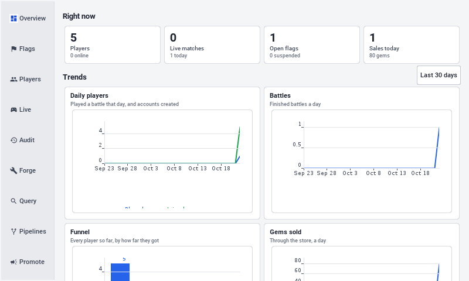

On a desktop or a tablet, the console puts its tabs in a sidebar:

[source,java,role=cn1-no-try]
----
include::../../scripts/skirmish/common/src/main/java/com/codenameone/examples/skirmish/admin/AdminConsole.java[tag=skirmish-admin-desktop,indent=0]
----

`run-e2e.sh` runs its tests a second time on Linux with the simulator as a
desktop window, and that pass captures the console's tabs.

[[skirmish-engagement]]
=== Reports, queries and engagement pipelines

The console is an operator's tool, so it doesn't wear the game's theme. Its
styles are a separate set of `Desk` UIIDs in the same `theme.css`: a light
page, cards with thin borders, and one accent colour. Every form puts its labels
in a right-aligned column of one width, so the fields start at the same place:

[source,java,role=cn1-no-try]
----
include::../../scripts/skirmish/common/src/main/java/com/codenameone/examples/skirmish/admin/Desk.java[tag=skirmish-desk-field,indent=0]
----

The *Overview* tab draws its trends with Codename One's charts package: daily
players and new accounts, battles, gems sold, the funnel from joining to
paying, retention, and the trophy ladder. The server's `Insights` builds them
from the game's own records, accounts, battles and purchases, so they need no
extra tracking. What players do inside the app, the screens they open and the
pushes they read, is in Codename One analytics, one button away.

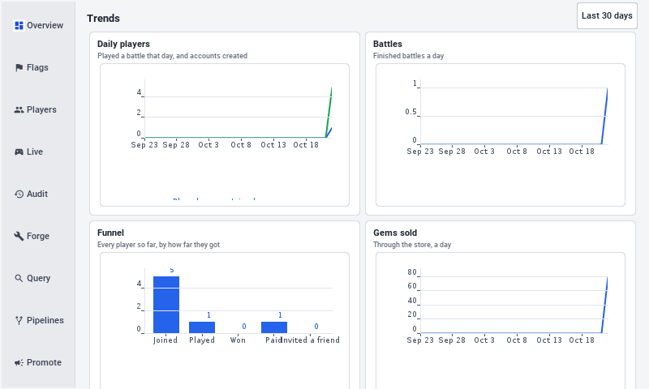

The *Query* tab finds players by conditions on what the server knows about
them: days since they last played or joined, trophies, battles, wins, gems,
coins, purchases and friends invited. *Make a pipeline* turns the same
conditions into an automated pipeline.

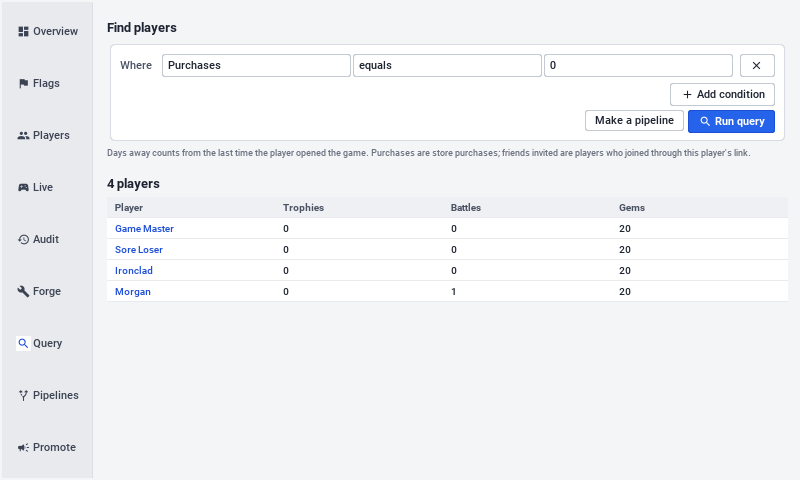

A pipeline is a rule of the form "players who match these conditions get this":
a push that opens a chosen screen, or gems. Each player is reached at most once
per cool-down, and the server runs every enabled pipeline once an hour, on one
server at a time:

[source,java,role=cn1-no-try]
----
include::../../scripts/skirmish/backend/src/main/java/com/codenameone/examples/skirmish/social/Pipelines.java[tag=skirmish-pipelines-schedule,indent=0]
----

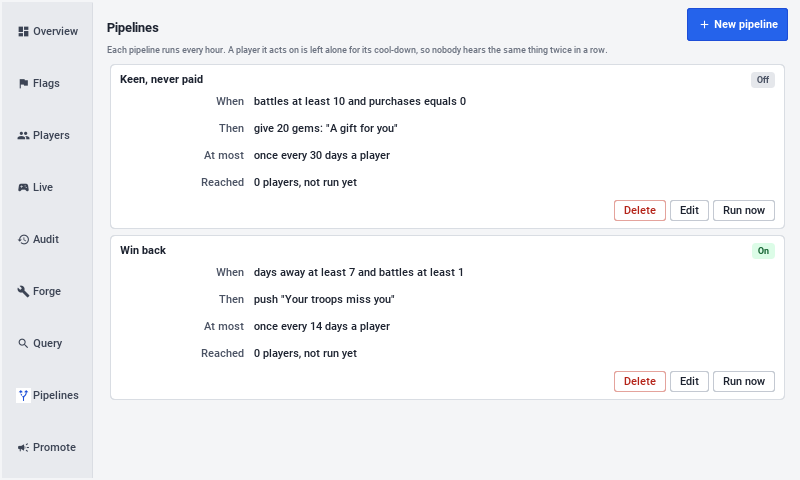

The demo seeds two. *Win back* pushes "Your troops miss you" to a player away
for a week who has played before, and *Keen, never paid* gives 20 gems to a
player with ten battles and no purchases. The *Count players* button shows how many players
match today before a pipeline is saved.

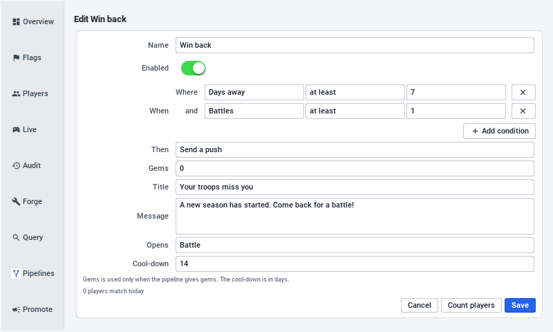

[[skirmish-growing]]
=== Tutorial: Growing your game

A game that's finished still needs players, and players who come back. This
tutorial walks through the levers Skirmish already has, in the order a new game
usually needs them, and what to read in the analytics console to know whether
each one is working. Everything here is measured by Codename One analytics, so
nothing needs a dashboard of its own.

==== Step 1: Switch the measurements on

. Turn on analytics for the app in the Codename One console. `Telemetry` sends
  through `CodenameOneAnalyticsProvider` once the player agrees on the consent
  screen; without that agreement nothing leaves the device.
. Set `AppConfig.PUSH_APP_KEY` to the app's push key from the console's Push
  section. Without it the game works, but sends no notifications.
. Run a few battles in the simulator. The events, `battle_start`,
  `battle_end`, `share` and the rest, appear in the console's event list, and
  every report can be sliced by the `level_band` and `trophy_band` user
  properties.

==== Step 2: Read the funnel

The first report to open is the funnel a new player walks: `sign_up`, the
training battle's reward, the first `battle_end` with a win, `deck_saved`,
`purchase`. The step where most players stop is the one to work on first:

* Players who sign up and never battle need a shorter way in. The training
  battle is in `Tutorial`; its lines are in a `MissionDef`, and a shorter one
  is a smaller list.
* Players who battle once and leave need a reason to return. That's what the
  next steps are for.
* Players who play but never spend may need a cheaper first offer. The prices
  are in the server's `Catalog`.

==== Step 3: Bring players back with push

Retention, the share of players who return a day and a week after they
installed, is the number most games live or die by. Push brings players back,
but only when it's rare and worth reading.

. Sign in as the administrator, open the console, and choose *Promote*.
+
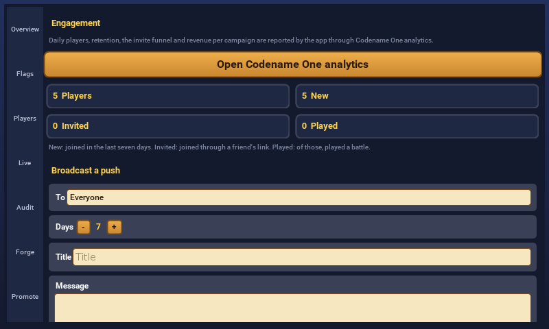
. Under *Broadcast a push*, choose who it's for. *Away for a while* with 3 days
  reaches players who stopped recently and still remember the game.
. Write a title and a message about something new, and choose the screen a tap
  opens: the shop for a sale, the Forge for new content.
. Give it a campaign name, such as `comeback-march`. The app reports a
  `push_open` event with that name when the notification is tapped, and the
  campaign is how the console tells broadcasts apart.
. Choose *Count players*, then *Send*, and confirm.
+
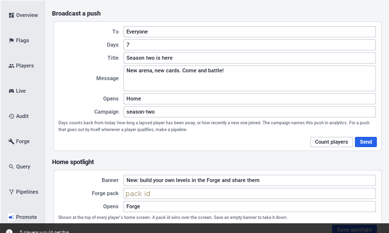
+
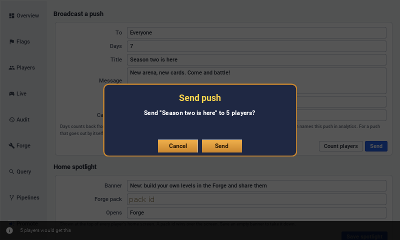

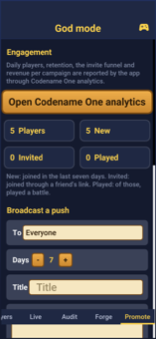

A day later, compare that campaign's `push_open` count with the number of
players it was sent to, and the cohort's return rate with the week before. A
broadcast that nobody opens is worse than none: it teaches players to ignore
the next one. The server allows five a day for that reason, and
`MAX_BROADCASTS_PER_DAY` in `Promotion` is the place to lower it.

==== Step 4: Grow through invitations

An invitation is the cheapest player a game gets, because a friend is already
playing. The rewards decide how often players send one:

. The amounts are constants at the top of the server's `Referrals`:
  `FRIEND_COINS` for the friend, `INVITER_COINS` and `INVITER_XP` for the
  player who invited them, and `MAX_REWARDED` for how many friends pay.
. The inviter is paid only once the friend has played a battle, so a reward
  can't be farmed with empty accounts, and the friend must claim within a
  week of joining.
. In the console, compare the `share` events with `content` set to `invite`
  against the installs attributed to the `friends` campaign and their
  `first_battle` and `first_win` conversions. When many links are shared and
  few bring anyone in, raise the friend's reward; when few are shared at all,
  make the *Friends* screen easier to reach.

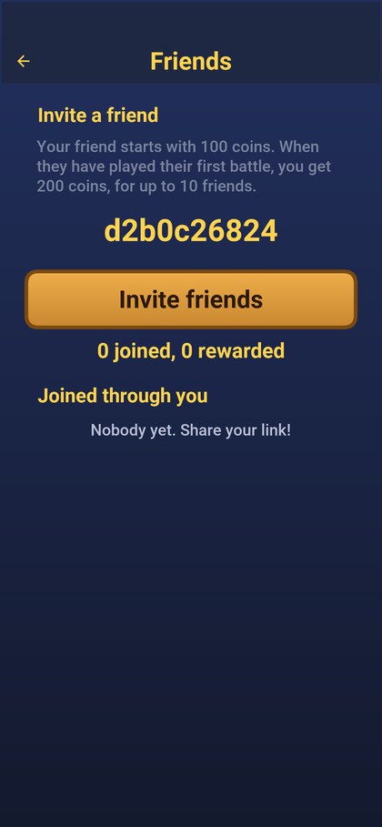

Set the `invite.domain` build hint to a domain of your own before release, so
the links carry the game's name rather than the default service.

==== Step 5: Campaign links for the world outside

An advert, a post or a newsletter gets a link from *Campaign link* on the same
tab. It's an invitation without a player's code: it opens the store for anyone
without the game, rewards nobody, and every player it brings in is reported
under its campaign. Use one name per channel, such as `newsletter-may` and
`video-launch`, and the console compares what each one brought in, down to
revenue.

==== Step 6: The home screen spotlight

The banner at the top of every player's home screen is the quickest message
there is: no notification permission, no store review. Set it under *Home
spotlight* with a line of text and either a Forge pack, which opens that pack,
or a screen. Use it for what's new this week; take it down by saving an empty
banner.

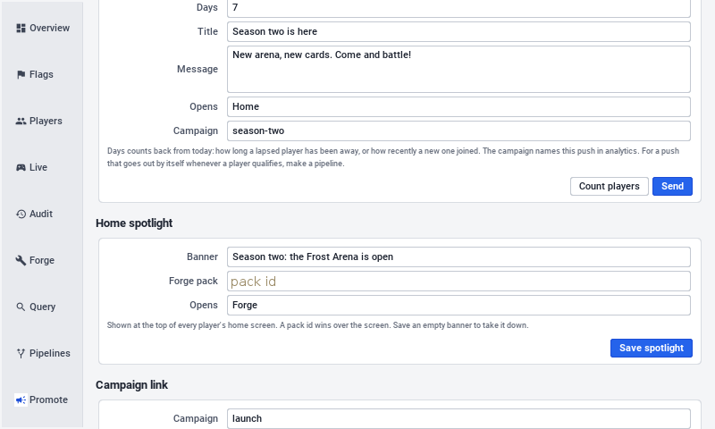
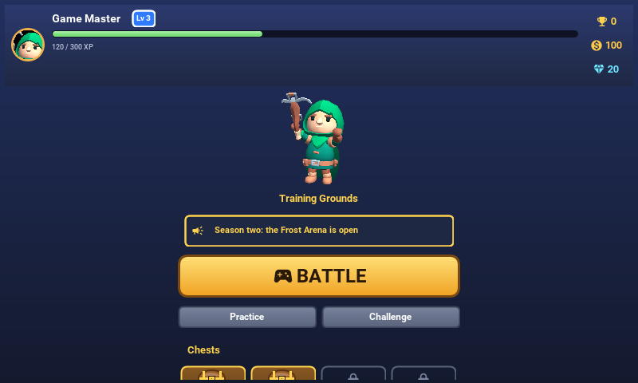
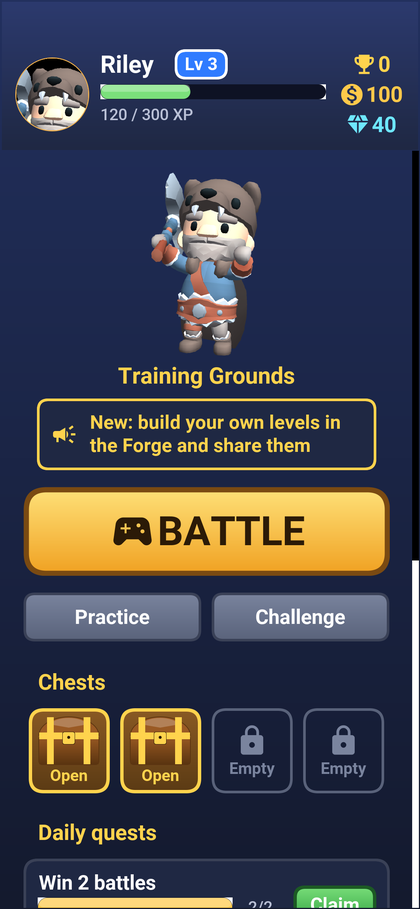

==== Step 7: Ratings

A store's rating is what a stranger sees first. `AppReview` asks only players
who've launched the game five times over three days, never more than once a
month, and only after a win. A low score goes to feedback rather than the
store. Tune those numbers in `Skirmish.runApp`.

[[skirmish-training]]
=== The training battle

`Tutorial` is a script of steps run over an ordinary practice battle. Each step
freezes the clock, shows Elda's line and, if it asks for something, the finger and
the one card that can be played. Changing the lesson means changing the list of
steps.

The mentor, Elda, explains one idea at a time while the clock is frozen: the red
towers are the targets, cards cost elixir, and elixir refills by itself. Then she
asks for something and a finger shows how. It points at the card to pick, then
slides from the card to the spot to drop it, and only that card can be picked
while she's teaching it.

image::img/skirmish-tutorial-welcome.png["The training battle with Elda's speech bubble welcoming the player and a Next button",scaledwidth=40%]

image::img/skirmish-tutorial-pick.png["A finger pointing at the Squire card in the hand while Elda asks the player to pick it up",scaledwidth=40%]
image::img/skirmish-tutorial-drag.png["The finger dragging from the hand to a glowing circle by the left bridge",scaledwidth=40%]

The lesson covers attacking, defending when the enemy sends troops, and throwing
a spell at a tower. Finishing the battle against a slow opponent pays once: coins,
experience, a chest and the first achievement. A player can replay the lesson from
*How to play* on the home screen.

image::img/skirmish-tutorial-defend.png["Elda warning that enemies are coming and asking the player to pick the Twin Archers",scaledwidth=40%]
image::img/skirmish-tutorial-spell.png["The finger dragging the Fire Orb spell toward the red tower",scaledwidth=40%]

The app can also drive itself through its own screens: `Tour` signs in, collects
rewards, visits the deck and plays a battle, which is how the promotional video is
recorded. Any Codename One app can be driven the same way without code of its own,
through its built-in MCP server; see <<_mcp_headless_api,the MCP headless API>>.

=== Content packs and the Forge

Everything the Forge edits is data in `rules`: a `ContentPack` holds cards
(`CardDef`), arenas (`Arena`), missions (`MissionDef`) and campaigns
(`CampaignDef`), and `PackCodec` reads and writes it as JSON. The classic game is
the same model: `Arena.CLASSIC` and the built-in cards describe the field and
the cards the battle always had, so the golden replays still pass. A mission is
played by `MissionRun`, which builds a `Match` from the pack's arena and cards,
plays the scripted waves and the bot, and decides the stars.

The Forge is the game's own level editor, in the same app on every platform.
Players build packs of new cards, arenas, missions and campaigns, share them with
a link, and play what others made. The game's designers use the same editor: a
pack an operator marks official appears first, for everyone. *Forge* on the home
screen lists the packs. *Official* comes with the game, *Popular* and *New* are
what players published, and *Yours* holds a player's own drafts and packs.

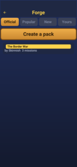

==== Playing a pack

A pack shows its campaigns, each a list of missions that open one after another,
and the stars won in each. A mission can be anything the author wrote: hold the
castle for two minutes, win three crowns against waves of enemies, or beat a bot
with a fixed deck. Its story is told during the battle, and a line that stops the
clock waits for *Next*, the way the training battle does.

A mission pays up to three stars. The first is for winning, and the second and
third are for what the author asked, such as keeping towers standing or winning
before a set second. Rewards come once per star, and the server plays every
mission again before it believes the stars, as <<skirmish-forge-verify>> shows.

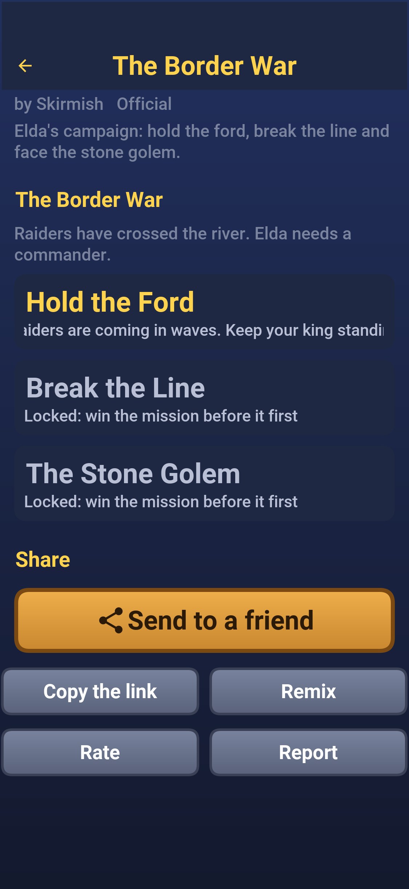
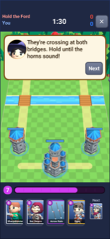

*Share* sends a link that opens the pack in the app, and *Remix* copies a pack
into a new one of the player's own to change.

==== Making a pack

*Create a pack* starts one with a single mission against the bot, ready to play.
The pack editor lists its cards, arenas, missions and campaigns, shows any problem
that would stop it from being published, and saves a draft that only its author
sees until *Publish*.

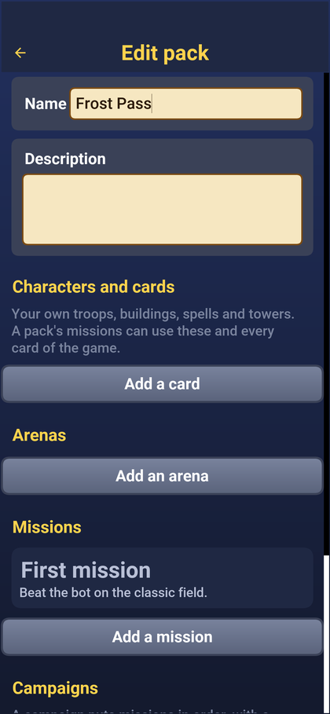

* Cards start from any card in the game and change its cost, hit points, damage,
  speed, range, targets and what it spawns. A card can look like any of the
  game's characters, or like a rigged glTF model imported from a `.glb` file,
  with its animations matched to walking, attacking and dying on a turntable
  preview. An imported model is visible to the author and to anyone they share
  the pack with straight away, and to everyone once a moderator has approved it.
* Arenas are drawn on a grid: castles, towers, rocks and trees placed with a
  tap, mirrored to the enemy's half as they're placed, on a field of any size
  with one to three lanes and a frost or desert theme.
* Missions pick an arena, the goal, the length of the battle, each side's elixir
  and deck, the waves of enemies that arrive at set seconds, the lines of the
  story, the stars and the reward. *Test play* plays the mission at once.
* Campaigns put missions in order, with a story before the first and after the
  last.

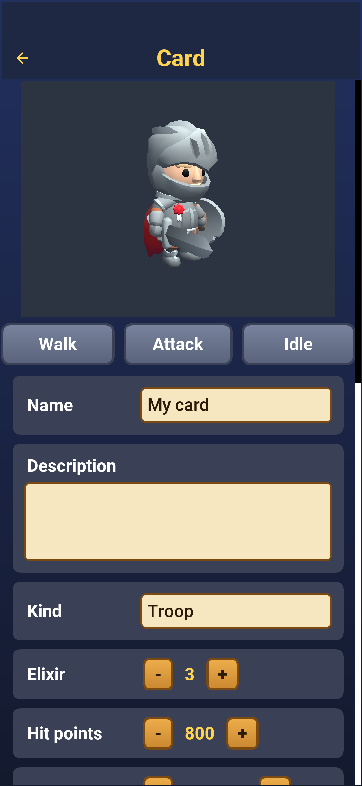
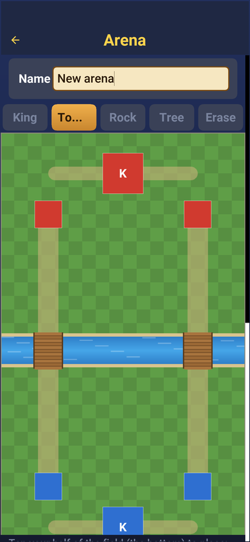

==== Limits

A pack comes from a stranger, so `Validator` checks every number in it before
the server publishes it and before the app loads it. The limits keep a pack from
stalling a phone, a server or the economy, not from being odd:

[source,java,role=cn1-no-try]
----
include::../../scripts/skirmish/rules/src/main/java/com/codenameone/examples/skirmish/rules/forge/Validator.java[tag=skirmish-forge-limits,indent=0]
----

An uploaded model is checked by `GlbInspector` on the server: the size, the
`.glb` header, and caps on its nodes, meshes, joints, and animations. It's stored
by its SHA-256 and waits in the console's *Forge* tab until a moderator approves
it.

[[skirmish-forge-verify]]
==== Results are played again

The app plays a mission locally and sends its replay. The replay names the pack,
its content hash and the mission, so the server finds the exact version that was
played, plays the player's commands again with `MissionRun.verify` and pays only
for stars it saw won, and only once:

[source,java,role=cn1-no-try]
----
include::../../scripts/skirmish/backend/src/main/java/com/codenameone/examples/skirmish/forge/Forge.java[tag=skirmish-forge-result,indent=0]
----

The app's side starts the battle, fetches the pack's files first, and posts the
result when it ends; a test play from the editor posts nothing:

[source,java,role=cn1-no-try]
----
include::../../scripts/skirmish/common/src/main/java/com/codenameone/examples/skirmish/forge/MissionPlay.java[tag=skirmish-forge-play,indent=0]
----

==== Shipping official content

The official pack is seeded from `Samples.official()` when the server starts.
A designer can instead build a campaign in the Forge, publish it, and mark it
official in the console; an official pack is listed first and pays the rewards
its missions set, while a community pack's rewards are capped per star and per
day. The amounts are constants at the top of the server's `Forge` class.

=== Tests

`rules` has the determinism tests and the golden replays; `backend` plays whole
online matches over its sockets and checks receipts, progression, moderation and
the Forge's publishing and mission results, the invite rewards and their
refusals, and the broadcast limits;
`run-e2e.sh` drives the app through its screens in the simulator against a running
server and takes the screenshots in this guide:

[source,bash]
----
include::../demos/common/src/main/snippets/developer-guide/skirmish.sh[tag=skirmish-sh-tests,indent=0]
----
