[[skirmish-users-guide]]
== Skirmish: A real-time card battler

Skirmish is a complete game: two players drop troops, buildings and spells onto a
small field, and the first to topple the other's towers wins. Around the battle is
everything a live game needs: accounts, a deck to build, matchmaking, challenge
links, replays, a training battle that teaches new players, levels, daily quests,
chests and achievements, a shop with in-app purchases and rewarded ads, push
notifications, and a console where an operator watches matches and moderates
players.

It's a sample of what Codename One does for games, and a starting point for your
own. The battle is a 3D scene drawn by `com.codename1.gaming` with glTF characters
and particle effects. The menus are ordinary Codename One components, styled
through CSS into carved wood and stone. The rules of the game are one Java
module that the app, the server and the tests all compile, so a battle plays out
identically wherever it runs.

The project is in `scripts/skirmish`, and the Initializr generates it under your
own name and package. The application source is licensed under MIT-0. The
characters and buildings are KayKit models by Kay Lousberg, released under CC0.

This chapter is the player's tour. <<skirmish-implementors-guide>> explains how
it's built and how to make it your own.

[[skirmish-trying-it]]
=== Trying it

Start the server on its development profile and run the app in the simulator, as
<<skirmish-launch>> shows. The development profile needs nothing installed: the
database is in memory, purchases and push notifications are simulated, and four
demo accounts exist, each with the password `skirmish-demo`:

[cols="1,3"]
|===
| Account | What it's for

| `player@skirmish.example`
| A player with some history: level 3, two chests waiting and a daily quest
  ready to claim.

| `rival@skirmish.example`
| A second player, to battle the first from another simulator or device.

| `trouble@skirmish.example`
| A player the server has already flagged, so the console has something to
  review.

| `admin@skirmish.example`
| The operator. Signs in to the same app and gets the admin console as well.
|===

=== Signing in

The first screen offers to sign in, to create an account, or to practice against
the bot without one. A new account picks a battle name, which is what opponents
and the leaderboard see.

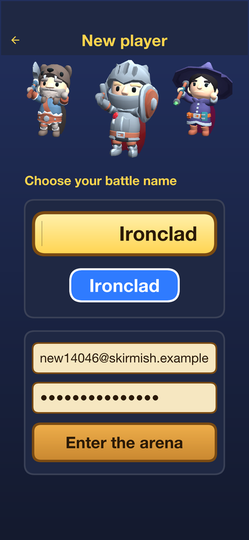

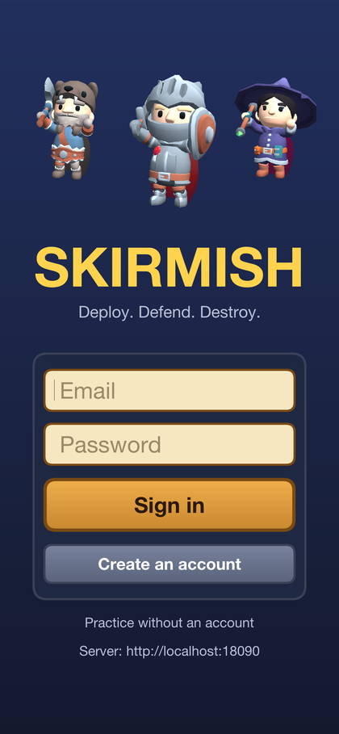

=== Learning to play

A new player goes straight into a training battle on their first visit, and anyone
can replay it from *How to play* on the home screen. Elda, the mentor, explains one
idea at a time while the clock is frozen: the red towers are the targets, cards
cost elixir, and elixir refills by itself.

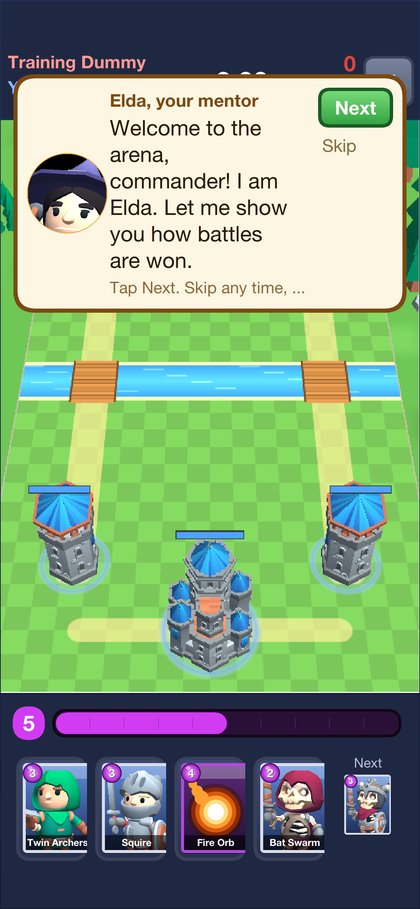

Then she asks for something, and a finger shows how. It points at the card to
pick, then slides from the card to the spot to drop it, and only that card can be
picked while she's teaching it.

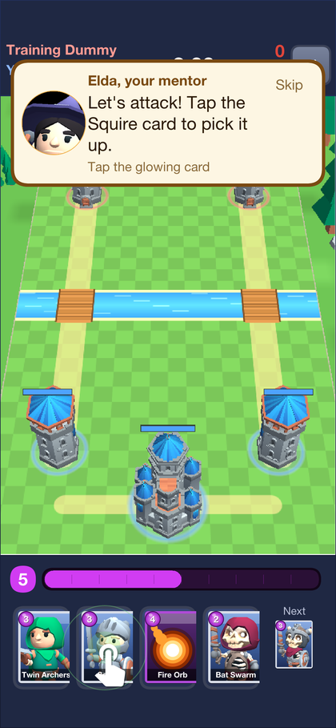
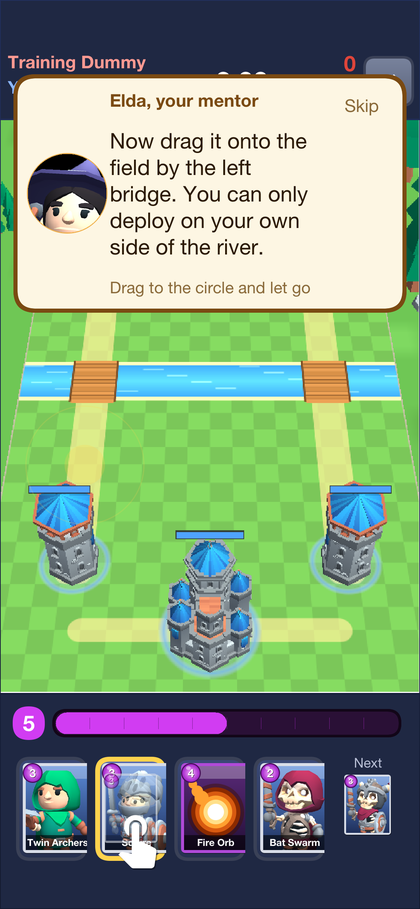

The lesson covers attacking, defending when the enemy sends troops, and throwing
a spell at a tower.

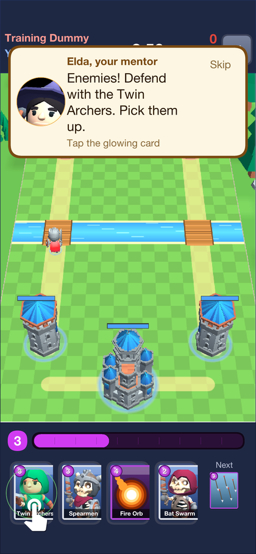
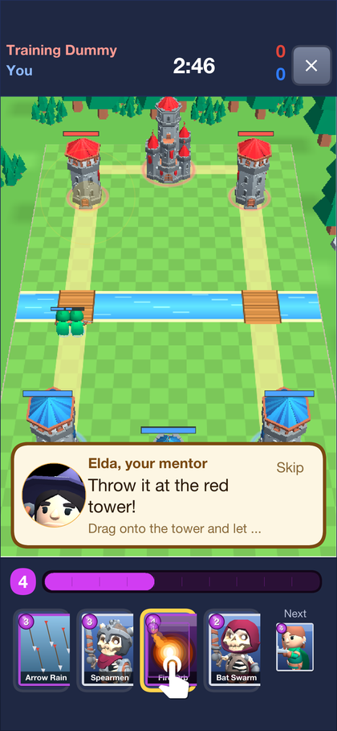

Then the player finishes the battle against a slow opponent.
Finishing it pays once: coins, experience, a chest and the first achievement.

=== The home screen

The home screen shows the player's progress at a glance: their level and how close
the next one is, coins, gems and trophies, the hero of their deck, the
*BATTLE* button, their chests, today's quests and their deck.

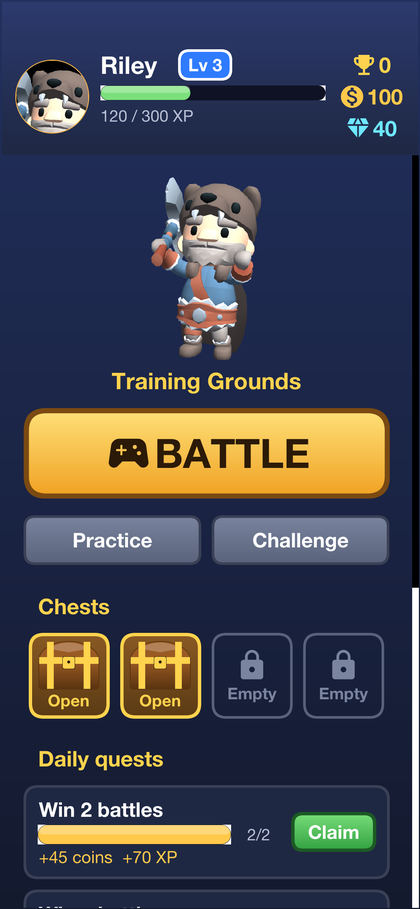

* *Chests* are earned by winning and by levelling up. A tap opens one.
* *Daily quests* change every day. Three are picked for each player, and a
  finished one is claimed with *Claim*.
* *Achievements* are long-term goals with gem rewards, listed in the *Trophies*
  room.

Every reward is shown in a popup with the player's hero cheering:

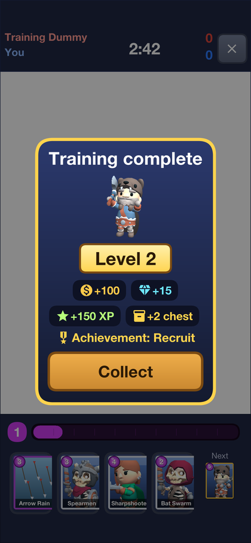

=== The deck

A deck is eight cards, and the battle hand is four of them at a time, with the
next card waiting. *Deck* shows every card, with its elixir cost, and the eight
in use are framed in gold. A tap swaps a card in or out.

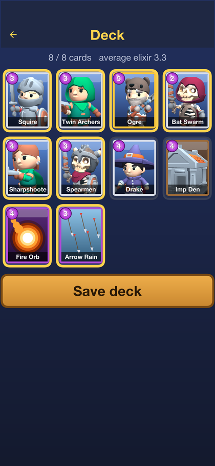

=== Battle

A battle lasts three minutes. Each side has a king's castle and two archer
towers. Toppling a tower wins a crown; toppling the castle wins outright. When the
clock runs out, the side with more crowns wins. A tie goes to a minute of
overtime, where the next crown wins, and is a draw if nobody scores. Elixir comes
twice as fast in the last minute of regular time.

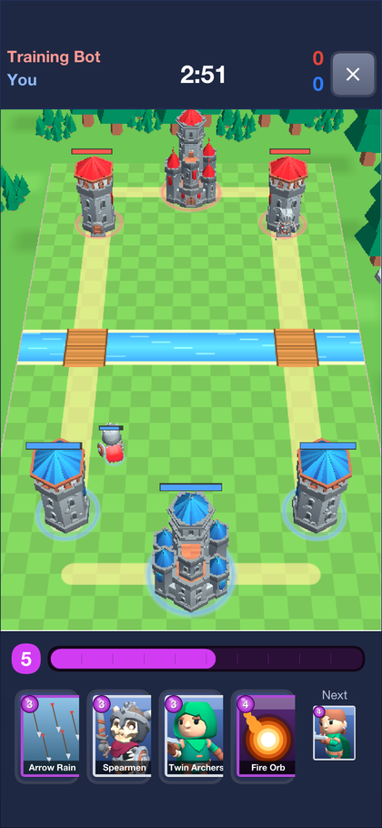

Elixir fills the purple bar at the bottom, one drop at a time up to ten. To play a
card, tap it and tap the field, or drag it there. Troops and buildings go on your
own side of the river; spells go anywhere. Troops walk to the nearest bridge and
attack the first thing in their way.

When the battle is decided, the camera leaves its fixed view, swings around the
field and comes down beside the fallen castle:

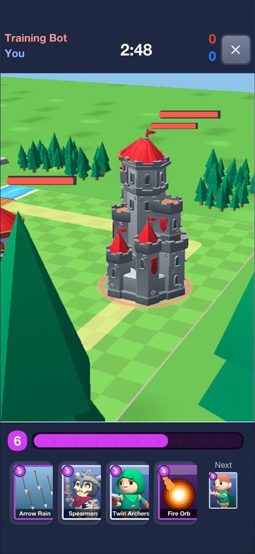
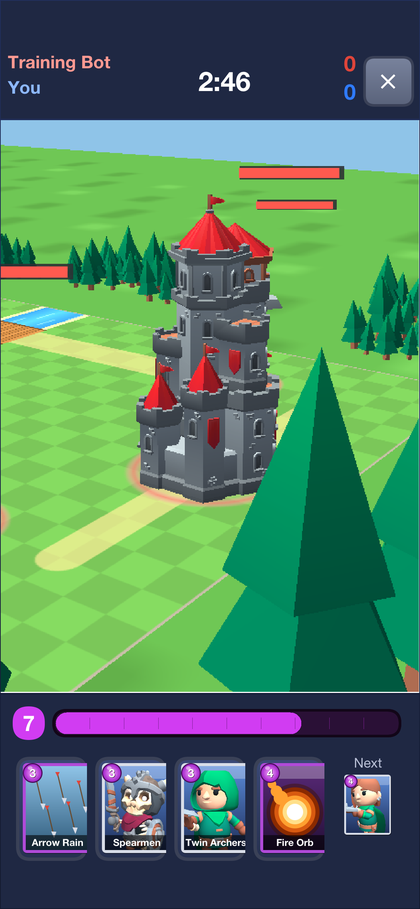

The result screen follows, with the crowns, trophies and coins won. From there a
player can watch the replay, report the opponent, or watch a sponsored video for
extra coins.

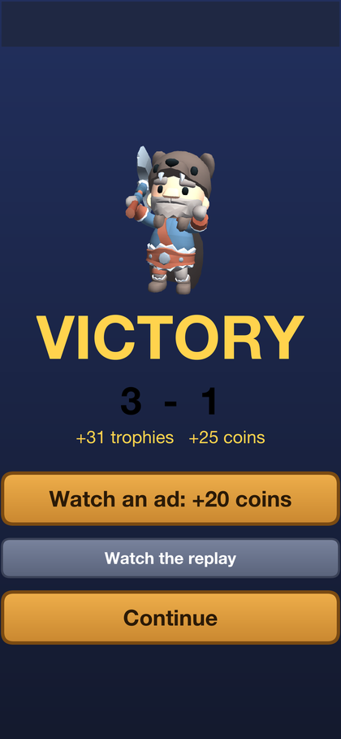

=== Finding an opponent

*BATTLE* puts the player in the queue, which pairs players with similar trophy
counts and falls back to the bot if nobody is found. During an online battle, the
buttons under the hand send a quick emote to the opponent.

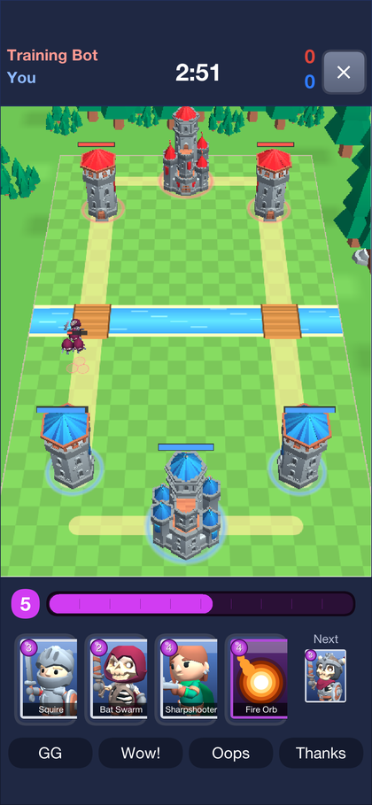
 *Practice* plays the bot
straight away, and costs nothing and earns nothing.

*Challenge* makes a code and a link to send a friend. Opening the link starts the
friend's app straight into the battle.

=== Replays

Every online battle is kept, and *Replays* lists them. Replays are public: any
signed-in player can watch any battle, with both players' names. A replay isn't a recording:
it's the starting state and every card played, run again through the same rules.
The viewer pauses, plays at two or four times speed, and a slider jumps to any
moment.

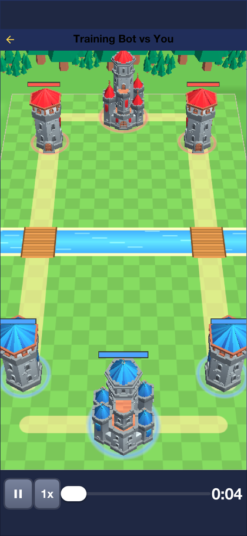

=== The shop

The shop sells gems for real money, and cosmetic items for gems: arenas, emote
sets and a season pass. Purchases go through the platform's store, and the server
checks every receipt before granting anything. On the development profile the
store is simulated, so a purchase completes immediately.

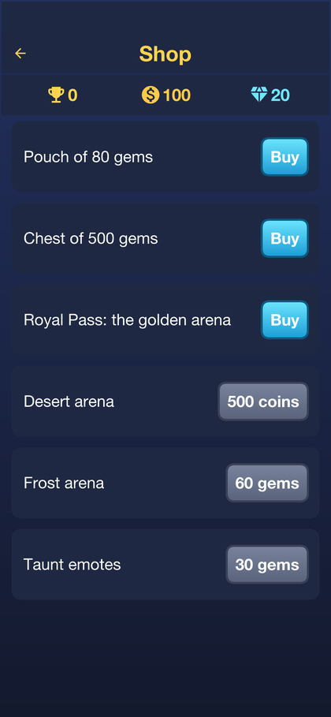

=== Settings

*Settings* renames the player, and switches the sound, push notifications and
sharing anonymous usage statistics on or off. The server address can be
changed here too, which is how the app reaches a server on another machine.

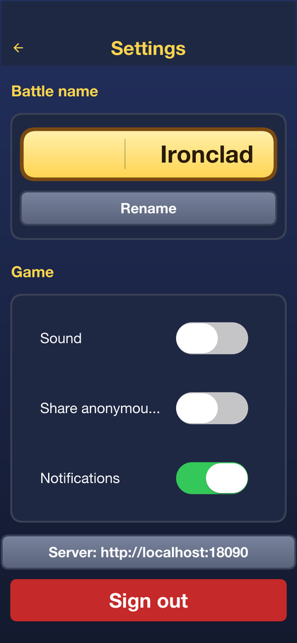

=== Friends

*Friends* on the home screen shows the player's invite code and what an invite
pays. *Invite friends* opens the share sheet with a link. A friend who opens it
starts with extra coins, even when the link took them through the store to
install the game first, and once they've played their first battle the player
who invited them is paid too, for up to ten friends. The screen lists everyone
who joined through the player's link and whether they've played yet.

The banner at the top of the home screen is the game's news, set by the
operator. A tap opens what it's about: a Forge pack, the shop or another screen.

=== The Forge

The Forge is the game's own level editor, in the same app on every platform.
Players build packs of new cards, arenas, missions and campaigns, share them
with a link, and play what others made. The game's designers use the same
editor: a pack an operator marks official appears first, for everyone.

*Forge* on the home screen lists the packs. *Official* comes with the game,
*Popular* and *New* are what players published, and *Yours* holds a player's own
drafts and packs.

==== Playing a pack

A pack shows its campaigns, each a list of missions that open one after another,
and the stars won in each. A mission can be anything the author wrote: hold the
castle for two minutes, win three crowns against waves of enemies, or beat a bot
with a fixed deck. Its story is told during the battle, and a line that stops
the clock waits for *Next*, the way the training battle does.

A mission pays up to three stars. The first is for winning; the second and the
third for what the author asked, such as keeping towers standing or winning
before a set second. Rewards come once per star, and the server plays every mission again
before it believes the stars, so they can't be claimed without being won.
Missions in packs players made pay a small amount, up to a daily limit.

*Share* sends a link that opens the pack in the app, *Remix* copies a pack into
a new one of the player's own to change, and a pack can be rated or reported.

==== Making a pack

*Create a pack* starts one with a single mission against the bot, ready to play.
The pack editor lists its cards, arenas, missions and campaigns, shows any
problem that would stop it from being published, and saves a draft that only
its author sees until *Publish*.

* *Cards* start from any card in the game and change its cost, hit points,
  damage, speed, range, targets and what it spawns. A card can look like any
  of the game's characters, or like a rigged glTF model imported from a
  `.glb` file, with its animations matched to walking, attacking and dying on a
  turntable preview. An imported model is visible to the author and to anyone
  they share the pack with straight away, and to everyone once a moderator has
  approved it.
* *Arenas* are drawn on a grid: castles, towers, rocks and trees placed with a
  tap, mirrored to the enemy's half as they're placed, on a field of any size
  with one to three lanes and a frost or desert theme.
* *Missions* pick an arena, the goal, the length of the battle, each side's
  elixir and deck, the waves of enemies that arrive at set seconds, the lines
  of the story, the stars and the reward. *Test play* plays the mission at once.
* *Campaigns* put missions in order, with a story before the first and after the
  last.

=== The admin console

The admin account sees *Admin console* on the home screen: the operator's view of
the game.

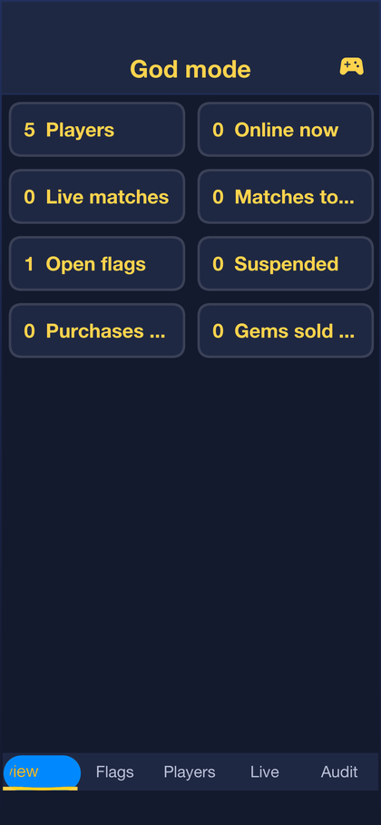

* *Overview* counts players online, matches and purchases.
* The *Live matches* tab lists the battles being played, and any of them can be watched
  as it happens.
* *Flags* are reports from players and signals the server raises on its own: a
  player who keeps leaving matches, whose game state keeps diverging from the
  server's, or who floods it with invalid plays.
* *Players* finds an account by name or e-mail and shows its matches, purchases
  and moderation history.
* *Promote* is where the game is marketed. It opens the Codename One analytics
  console, where engagement, retention and every campaign's results are read;
  sends a push notification to everyone, to players who've been away, to new
  players or to those who came through an invite; sets the home screen's
  banner; and makes campaign links for adverts and posts. On a desktop the
  console's tabs are a side bar.
* *Forge* lists reported and hidden packs, and the models and images players
  uploaded. An operator looks at a model on the turntable before approving or
  rejecting it, hides or restores a pack, and makes a pack official.

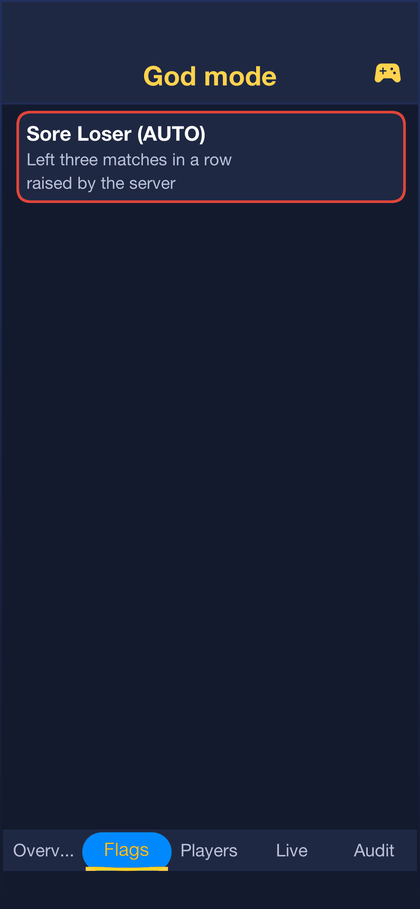

An operator can warn, mute, suspend or ban a player, reset their trophies or
revoke purchased items. Every action is recorded with its reason, and a suspended
or banned player is removed from any battle they're in.

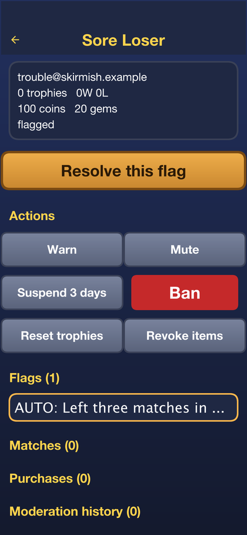
