[[slate-users-guide]]
== Slate: An appointment booking app from every side

Slate is a sample app with a server behind it, for any business that sells time
with a person: a salon, a tutor, a personal trainer, a consultancy, a clinic.
Clients book an appointment and see only the times that are free.
Providers run their day and connect their own calendars. The owner reads the
numbers, keeps the catalogue and sets the rules every booking obeys. The app and
the server are one Maven project, written in Java on both sides.

This chapter is the user's guide: what each kind of user sees and can do.
<<slate-implementors-guide>> is the other half. It explains how the project is
built and what to change to make it yours.

One app serves everyone. The server gives every account a set of roles, and the
app offers a mode for each role the account holds. Someone who holds more than one
switches between them from the menu.

[cols="1,3"]
|===
| Role | What it adds

| Client
| Every account is a client. Book, move and cancel appointments, check free
  times against your own calendar, put appointments in your phone's calendar
  with a reminder, and join the waiting list for a full day.

| Provider
| Granted by the owner. See your day, week and agenda in one timeline, mark
  appointments done or missed, set your hours and time off, and connect the
  calendars that make you busy.

| Owner
| Read the dashboard, see every provider's day side by side, edit services,
  providers, locations and rooms, and change the booking rules with a preview.
|===

=== Trying it

Start the server on the development profile, which creates a demo salon and its
accounts and simulates cards and the Google and Microsoft calendars:

[source,bash]
----
include::../demos/common/src/main/snippets/developer-guide/slate.sh[tag=slate-sh-server,indent=0]
----

Then run the app in the simulator:

[source,bash]
----
include::../demos/common/src/main/snippets/developer-guide/slate.sh[tag=slate-sh-simulator,indent=0]
----

Every demo account has the password `slate-demo`:

[cols="2,3"]
|===
| `client@slate.example` | a client with a card on file and a history
| `client2@slate.example` | a new client, with no card and nothing booked
| `provider@slate.example` | the provider most demo appointments are with
| `provider3@slate.example` | works at both locations
| `owner@slate.example` | runs the business
|===

The demo is a salon. The same server can run as a tutoring business, a
personal trainer, a consultancy or a clinic: the words change (a stylist and a
chair become a tutor and a room), and every rule and screen stays the same.

Cards are simulated: `4242 4242 4242 4242` is accepted and
`4000 0000 0000 0002` is declined. No money moves.

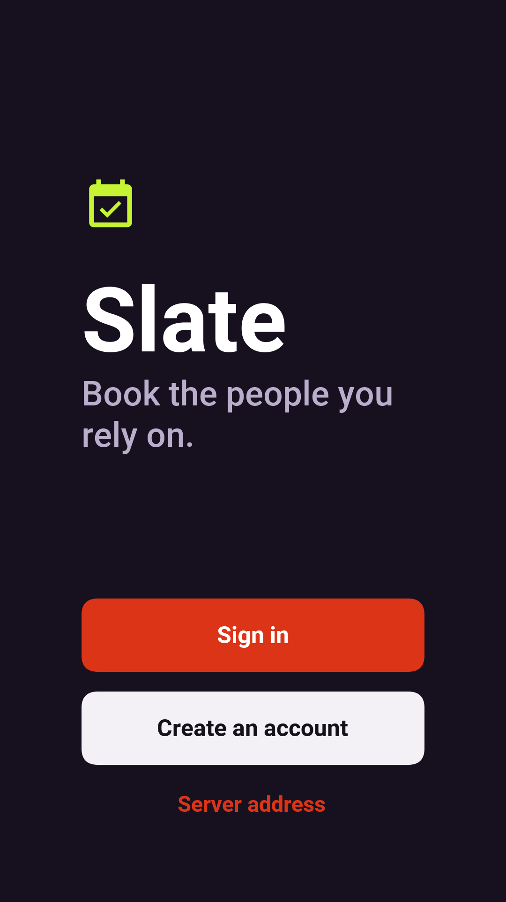

=== The client

The client's home leads with the next appointment and lists what can be booked,
each service with its length and price.

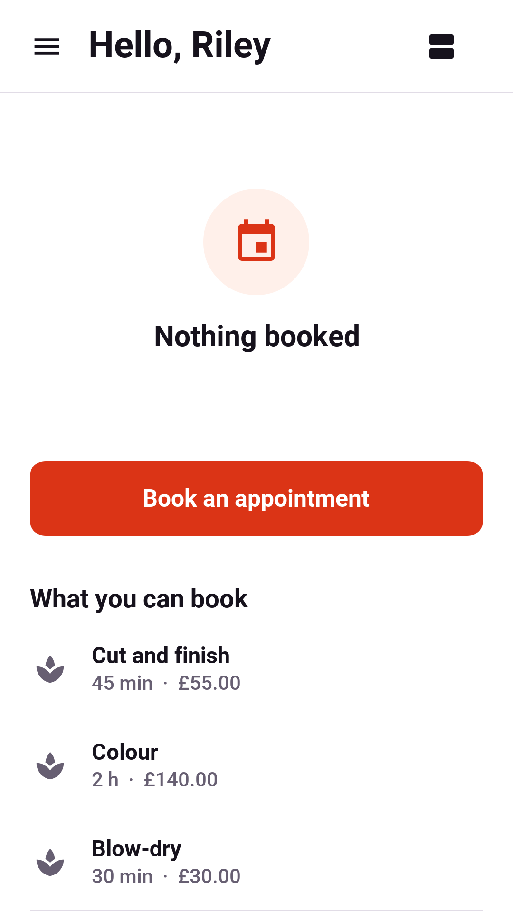

==== Finding a time

Booking starts from a service. Pills at the top choose the location and the
provider, or anyone who offers it, and a strip of days chooses when. The screen
shows only the starts that are free. A start appears only when every rule
agrees:

* the provider works then, isn't already booked, isn't on time off and isn't
  busy in a calendar they connected;
* the service's buffers before and after fit, and so does the travel time when
  the provider's previous appointment was at the other location;
* a room or a chair the service needs is free;
* the provider hasn't reached their limit for the day and gets the break they
  asked for after a long stretch;
* the start doesn't leave a gap too short to sell, if the business asks for that;
* the client isn't booked elsewhere at the same time, and hasn't reached the
  business's limit for the day.

When a day has nothing, the screen says why -- fully booked, not working that
day, or too soon to book -- and offers the waiting list. The week view shows the
next seven days at once, for a client who cares about the time more than the day.

// vale-skip: Microsoft.FirstPerson: the switch's own label.
With *Check my calendar* on, the app reads the phone's own calendars and marks
any start that clashes with something already there. Only busy times are read,
on the phone. Nothing about the client's calendar is sent anywhere.

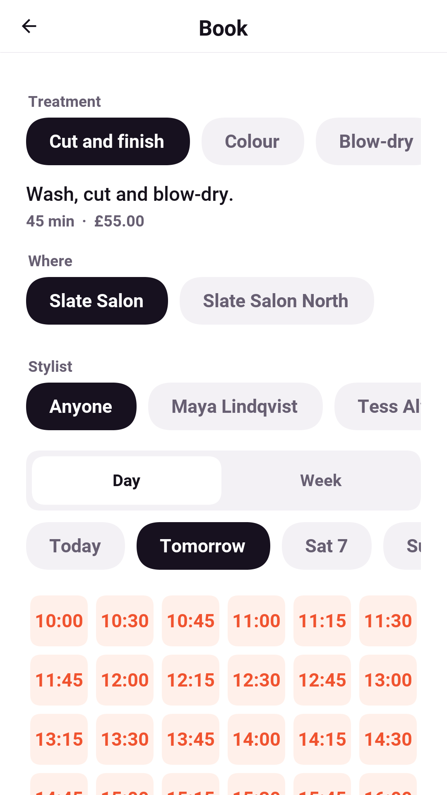

==== Holding and confirming

Choosing a start holds it for a few minutes, with a countdown, so nobody else
can take it while the client decides. The confirm screen shows the price, the
deposit if the business takes one, the card it comes from, and the terms: until
when cancelling is free and what a no-show costs. A note answers the service's
question, if it has one ("Anything the stylist should know?"). Going back lets
the time go.

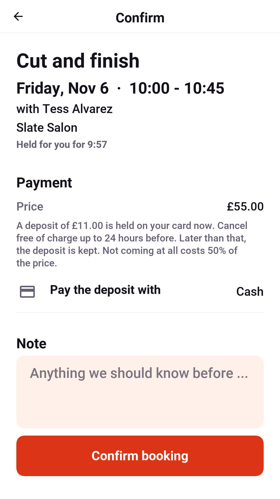

Once it's confirmed, the appointment can go into the phone's calendar with a
reminder an hour ahead. The event belongs to the app. When the appointment moves,
the event moves with it, and when it's cancelled, from any device, the event is
deleted.

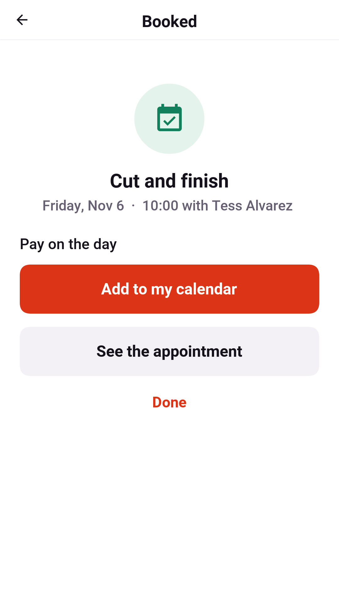

==== Appointments

// vale-skip: Microsoft.FirstPerson: the screen's own label.
Upcoming bookings are listed in *My appointments*, a day at a time, and past ones below them. An
appointment's screen shows when, where, who with and what was paid. It says
exactly what cancelling costs right now: free until a stated time, or the deposit
kept once that time has passed. It can open the appointment as
an `.ics` file for any calendar the app can't write to.

Moving an appointment opens the same time picker with the same service and
provider. The old time is kept until the new one is confirmed, so a move never
loses the booking.

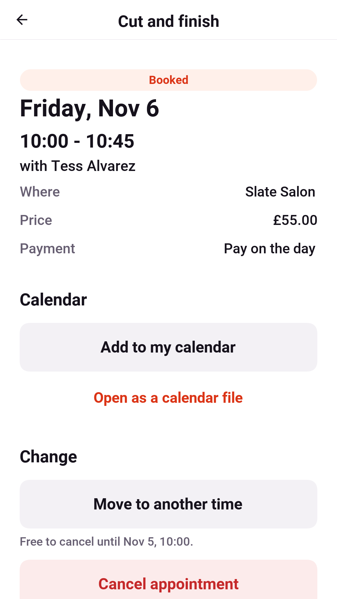

==== The waiting list

// vale-skip: Microsoft.FirstPerson: the button's own label.
When a day is full, *Tell me if a time frees up* asks which part of the day suits
and joins the list for that week. When a matching appointment is cancelled, the
first person waiting gets a push notification. The time isn't held, so the
first person to book it gets it.

=== The provider

The provider's home is their time: the day, the week or an agenda of what's
booked. One timeline merges their working hours, every appointment, their time
off and every block that a connected calendar says is busy. When a client books
or cancels, the timeline updates at once.

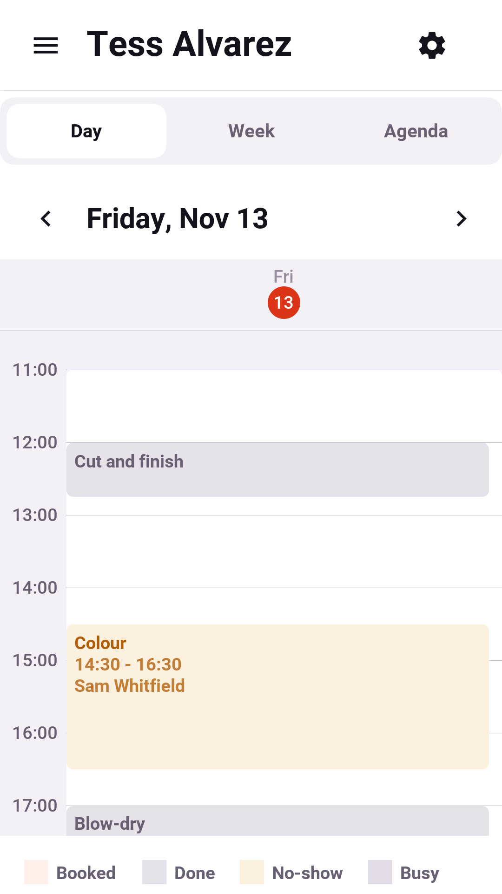

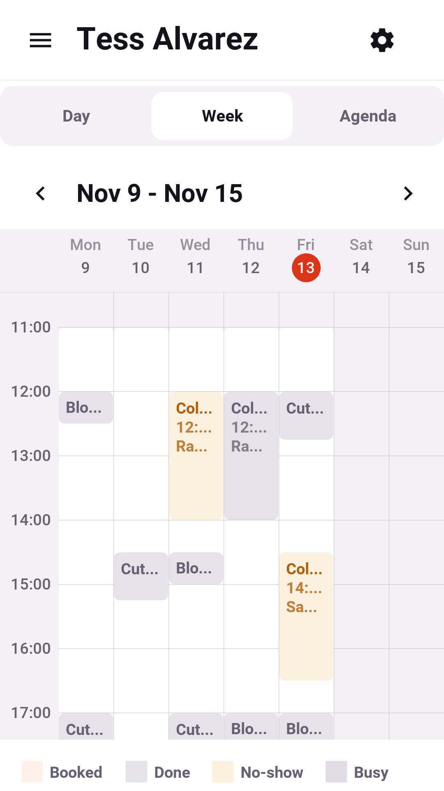

An appointment opens to the client's name, note, and payment. Once it has
started, the provider marks it done or missed. Before that, they can cancel it,
which refunds the client in full and tells them at once.

==== Hours and time off

*Working hours* sets the week: which days and from when to when. Saving replaces
the whole week at once, so a half-edited week is never bookable. *Time off*
blocks anything from an hour to a holiday. Appointments already booked inside it
aren't moved; the provider sees them and decides.

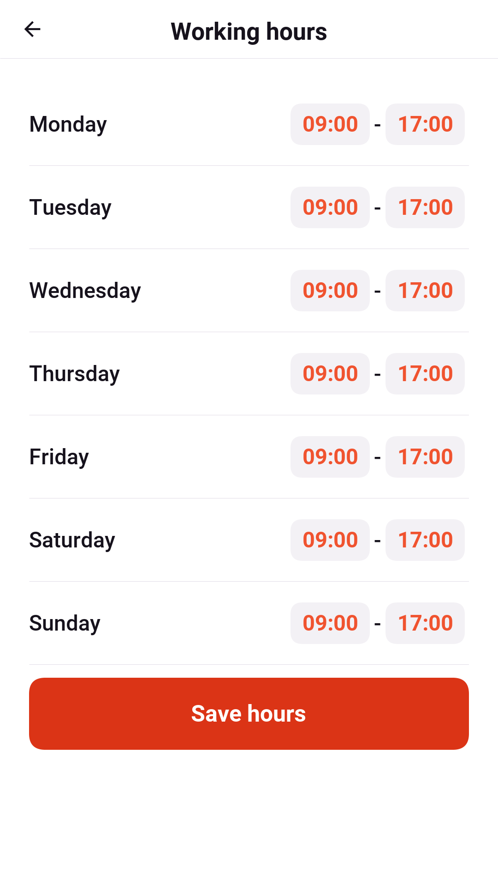

==== Calendars

A provider's other commitments keep clients away once their calendars are
connected:

* *This phone's calendars.* The provider picks which of the phone's calendars
  count. Only busy intervals go to the server: a start and an end, with no
  title, attendees or place. The app sends the next month again when it opens
  and whenever the calendar changes.
* *Google Calendar* and *Microsoft Outlook.* The provider signs in once, in the
  app. From then on, the server reads only the free/busy view every few minutes.
  On the demo server both are simulated, and connecting needs no account.
* *A calendar address.* Most calendars can publish a private `.ics` address,
  which the server reads.

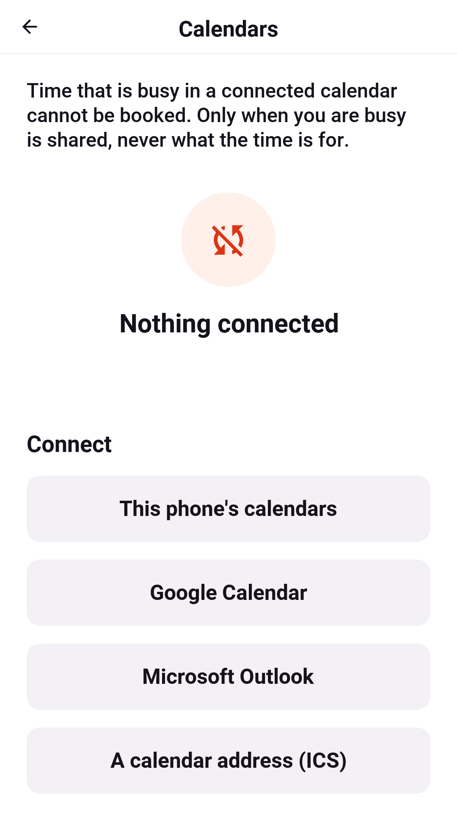

=== The owner

The dashboard covers the last few weeks: appointments booked and done, no-shows,
cancellations, money taken and how full the providers' hours were. It also
charts bookings by day and lists the most booked services and the busiest
providers.

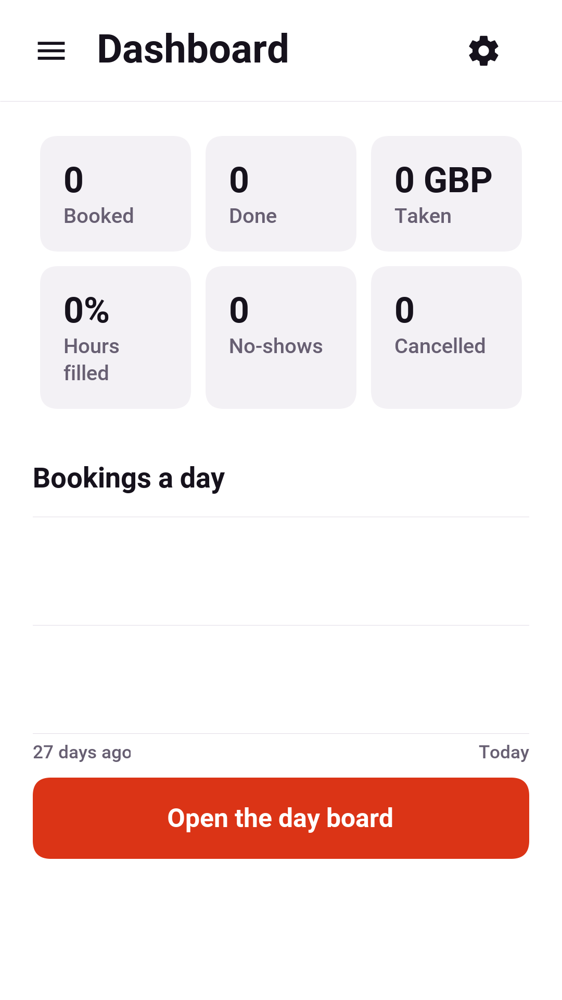

The *Day board* puts every provider's day side by side, one column each. It's
wide enough on a tablet or a desktop to see who is free at a glance, and scrolls
sideways on a phone.

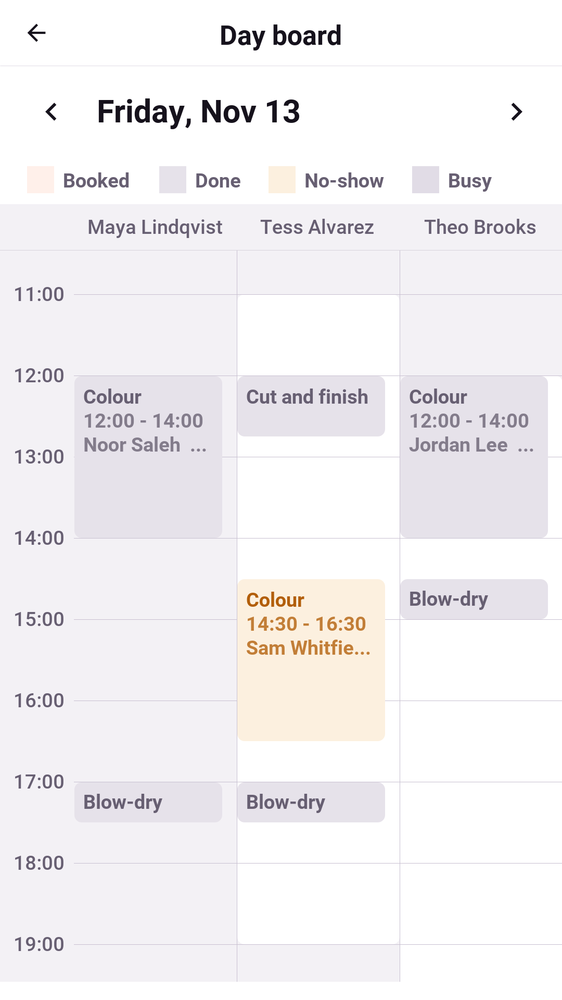

==== The catalogue

Services, providers, locations, and rooms and equipment each have a list and an
editor. A service has its length, price, buffers before and after, how many
clients it takes at once, how many providers it needs, the kind of room it needs
and its deposit. A provider has their title, a daily limit and a break after a
long stretch. Nothing is deleted, only switched off, so past appointments keep
the names they were booked under.

==== The booking rules

The rules decide which starts are offered:

[cols="1,3"]
|===
| Rule | What it does

| Start times every
| The step between starts: every 15 minutes, every half hour.

| Book at least / at most ahead
| The notice a booking needs, and how far ahead the calendar opens.

| Packing
| *Any free start*, or *Next to other bookings*, which offers only starts that
  touch an existing appointment or the edge of the day, keeping the free time in
  one piece.

| Never leave a gap shorter than
| Refuses a start that would strand a gap too short to sell.

| Between one client's appointments / a day
| Keeps one client from booking back to back, or more than the business allows
  in a day.

| A chosen time is held for
| How long the hold lasts while the client confirms.

| Deposit, free cancellation, moving, no-show fee
| The money and the deadlines.
|===

Rules interact. A small step, a minimum gap and tight packing together offer far
fewer starts than any one of them suggests. *Preview tomorrow* runs the edited
rules against tomorrow's real schedule without saving anything. It shows every
provider's starts, with the reason for each one that's refused.

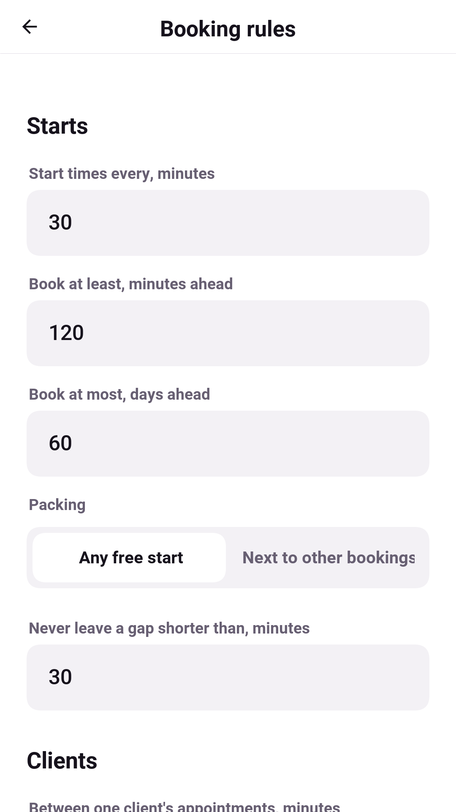

=== On the desktop

The same app runs as a desktop application, and on a window that wide it isn't
a phone screen stretched out. It opens at the size of a desktop window and is
laid out for one:

* The menu is docked down the side, with who is signed in at its top. You move
  between screens with it, so there are no back arrows; Back is in the
  window's menu, with its shortcut.
* The controls are the platform's own: macOS, Windows or GNOME buttons, fields
  and lists.
* The dashboard spreads its numbers across the window, and the day board shows
  every provider's day side by side.

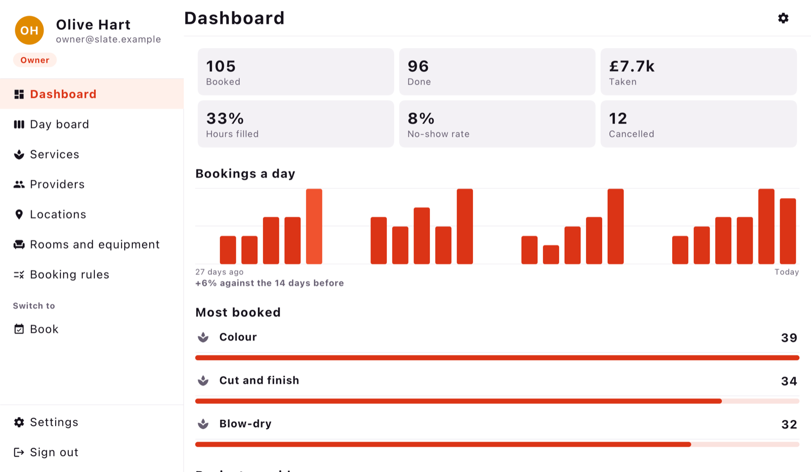

* The catalogue keeps its list on the left and edits the row picked on the
  right, so working down the services never leaves the list.

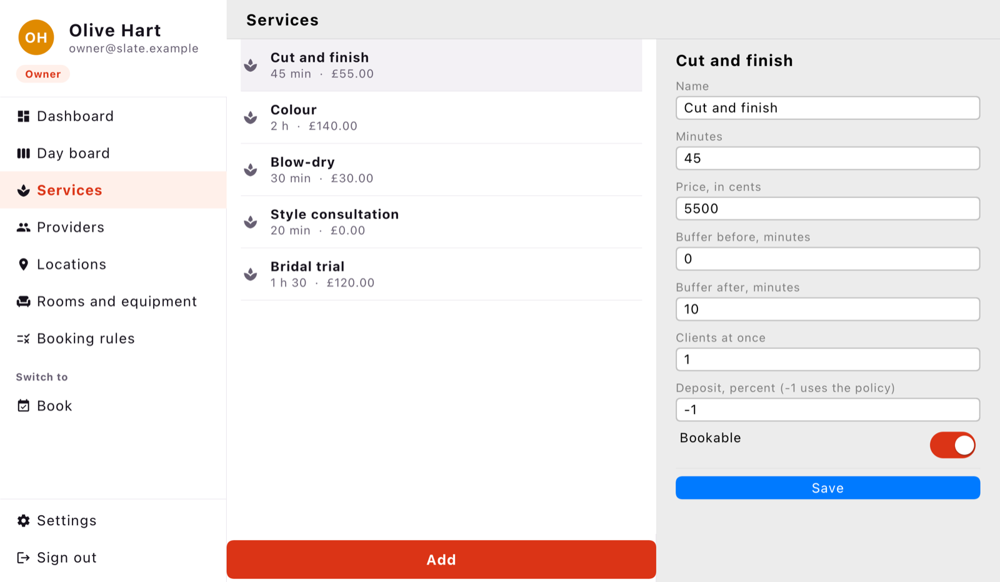

* The provider's week shows all seven days at once.

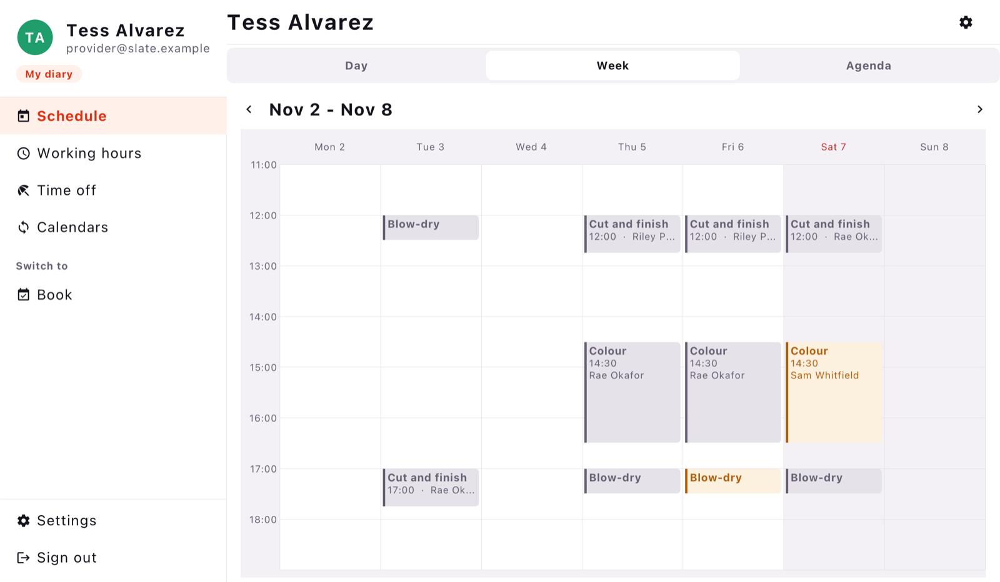

* Booking has no confirm screen. Picking a time holds it and shows the price,
  the terms and the button that books it beside the times, so picking another
  time is one click and the hold on the last one is let go.
* The client's home shows what's coming up beside what can be booked.

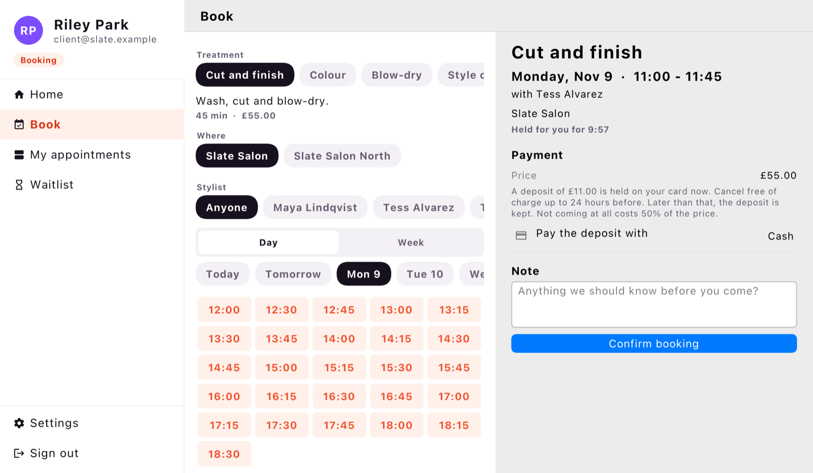

=== In a browser

The server can host the app itself, so the whole business can be tried in a
browser:

[source,bash]
----
include::../demos/common/src/main/snippets/developer-guide/slate.sh[tag=slate-sh-web,indent=0]
----

Then open `http://localhost:8080/`. A browser offers less than a phone: it can't
read the phone's calendars or add events to them.
