[[splat-implementors-guide]]
== Splat: Making the paintball game your own

Splat is a first-person team paintball shooter, four against four, that takes itself
exactly as seriously as a dad in a borrowed tactical vest. Every match opens with a
grim mission briefing ("Operation: Borrowed Bedsheet"). Every hit lands a big red
*PAINTED* stamp, and every player who is out may try to wipe the paint off before the
referee notices. Under the jokes it's a real-time shooter that most game frameworks
would split across an engine, a networking product and a separate server:

* The server referees every match. Phones send their inputs, the server runs the
  match and sends snapshots back, and each phone predicts its own player so the
  marker fires with no wait (<<splat-prediction>>).
* A shot from a phone with a slow connection still lands where it was aimed: the
  rules make up for the shooter's lag (<<splat-lag-comp>>).
* Bots think inside the rules, so a practice match, a match the server fills with
  bots and a replay all play the same way from the same seed.

All of it is ordinary Codename One code in one project: the 3D field drawn with
`GameView`, the HUD as a component layered over it, and the server as a Codename One
Backend. Splat shares the module layout, the accounts, push notifications, the shop and
the operations console with <<dash-implementors-guide,Dash>> and
<<skirmish-implementors-guide,Skirmish>>. This chapter shows where each part lives and
what to change to make the game yours.

[[splat-launch]]
=== Running it

The project is in `scripts/splat`, and the Initializr generates it under your own
package and name. Start the server on the development profile, which keeps its
database in memory, seeds the demo accounts and simulates purchases and push
notifications:

[source,bash]
----
include::../demos/common/src/main/snippets/developer-guide/splat.sh[tag=splat-sh-server,indent=0]
----

Then the app in the simulator:

[source,bash]
----
include::../demos/common/src/main/snippets/developer-guide/splat.sh[tag=splat-sh-simulator,indent=0]
----

For a device build, generate the Xcode project:

[source,bash]
----
include::../demos/common/src/main/snippets/developer-guide/splat.sh[tag=splat-sh-ios,indent=0]
----

The rules have their own tests, the server has its own, and `run-e2e.sh` drives the app
through its real screens against a running server:

[source,bash]
----
include::../demos/common/src/main/snippets/developer-guide/splat.sh[tag=splat-sh-tests,indent=0]
----

[[splat-tour]]
=== What the sample does

A player signs in, or plays a practice match as a guest, and lands on the main menu: a
vertical list of modes on the left over a 3D operator holding the equipped marker, and a
rank card with level, XP and currencies on the right. *OPERATIONS* opens the playlist: two
fields, the Lot 7 Self Storage yard and the Cul-de-Sac Siege, each with three modes and a
tactical map of the field drawn from its cover. Team Paint is first to 25 paints, Capture
the Flag is three captures with a flag that's clearly a bedsheet, and Hold the Snack Bar
is king of the hill. Each operation can be played as a quick match, with a party of
friends or as practice against bots.

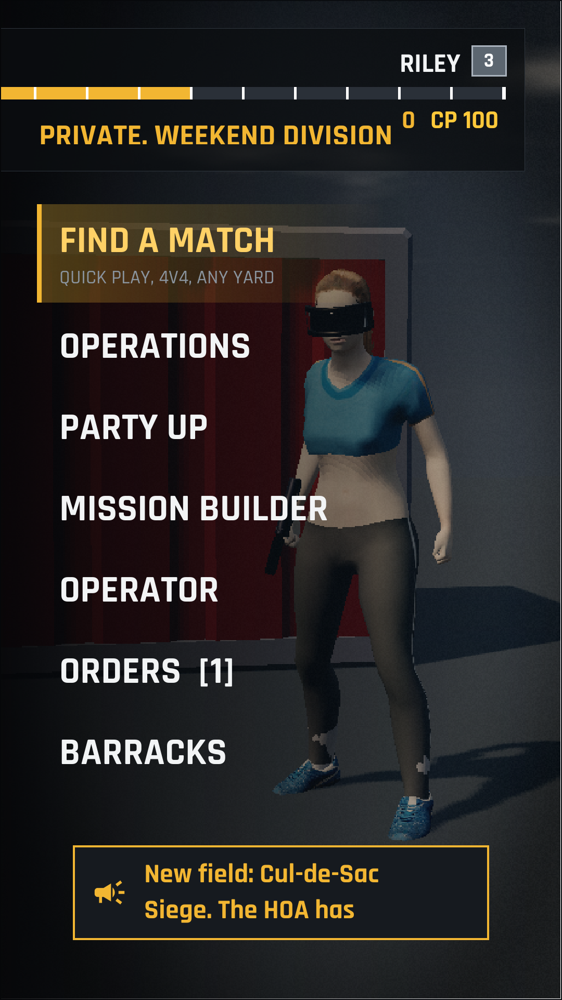
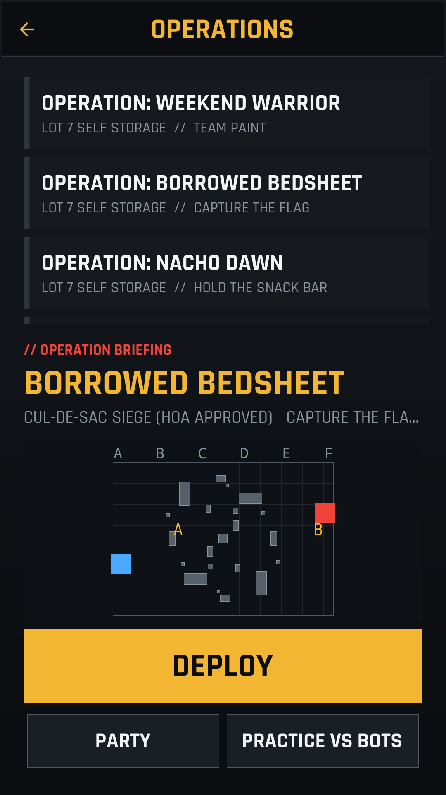

A match opens on a letterboxed briefing that types itself out, redactions included, then
hands over to the field in first person: the marker in hand bobs, sways and kicks, and
aiming down the sights zooms in and tightens the spread. The HUD has a minimap, the score
bar and clock, a killfeed, the hopper count, hit markers and damage arcs. The controls
are a virtual stick on the left, look by dragging on the right, and buttons to fire,
aim, jump, throw a paint grenade
and wipe. On a desktop the keyboard and mouse do the same. A hit player is out until
the respawn, arms up the way the rules of every field require, and may try to wipe
the paint off. One try in three goes unnoticed; the others cost three more seconds.

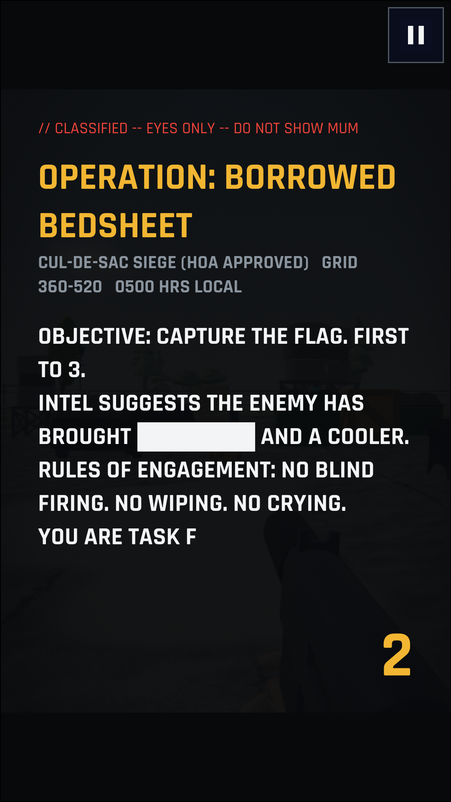
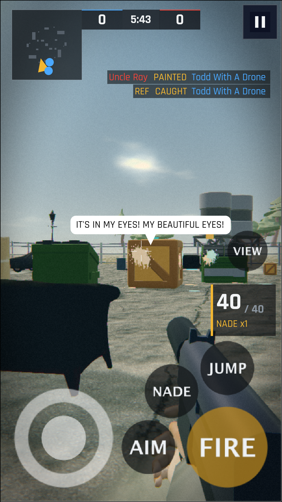
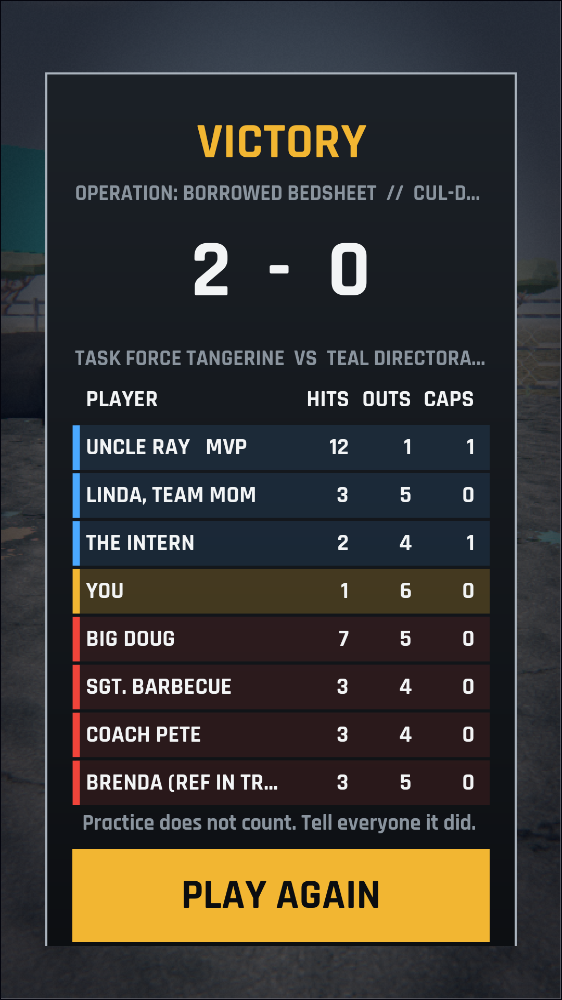

A party is a private lobby: a code, two rosters and a chat. The friends who join it play the next match together,
talk over WebRTC voice and trade emotes during it ("It bounced!", "REF!").

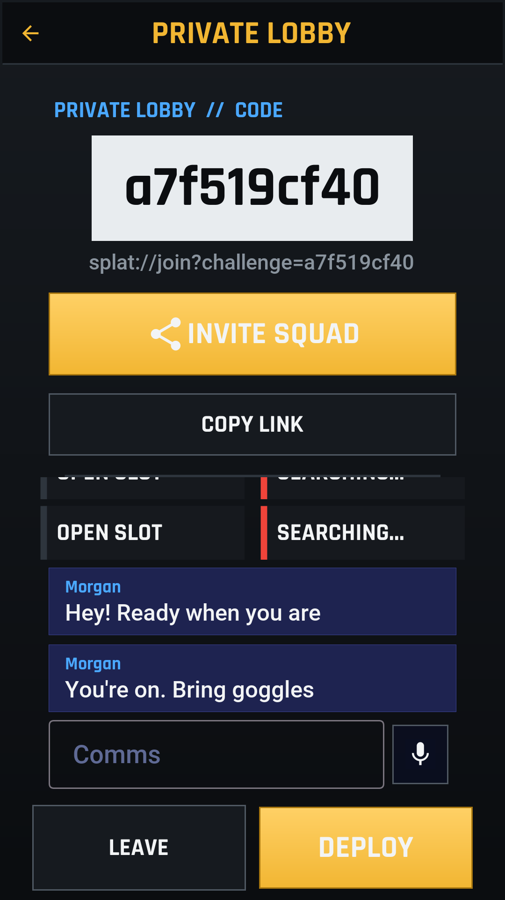
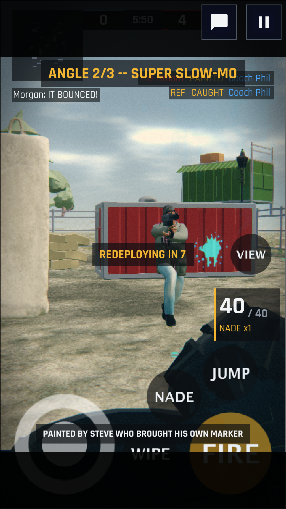

On a desktop the same app is a window, not a phone. The menus keep to a readable column,
small text is sized for a monitor instead of being scaled down from a phone, and the match
drops the touch controls for the keyboard and mouse, with a wider view and a fuller HUD.

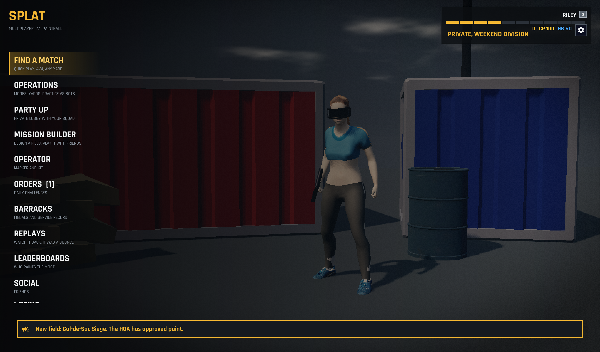
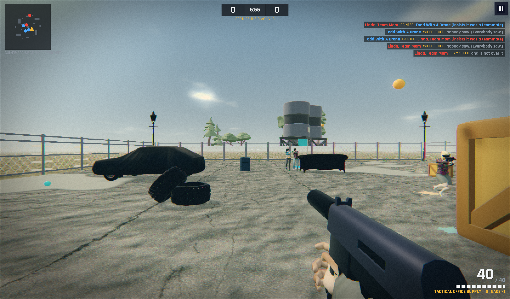
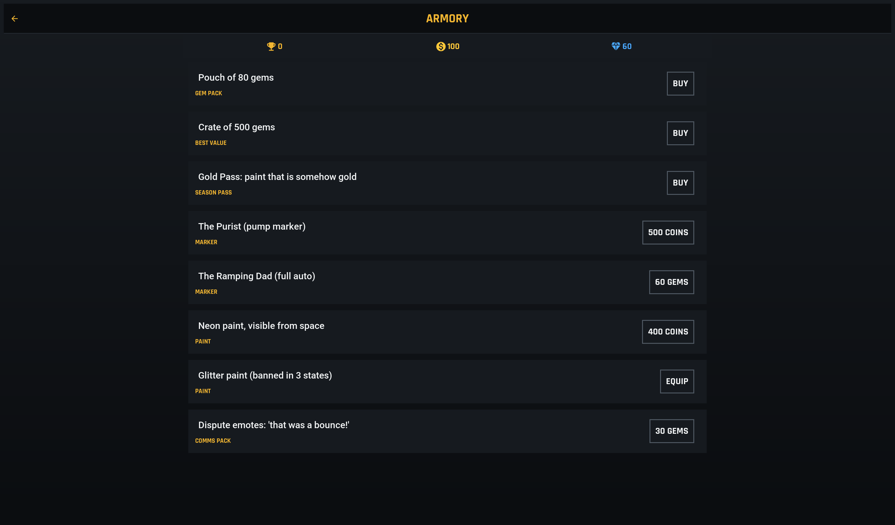

[[splat-modules]]
=== The modules

* `rules` is the game: a deterministic simulation in fixed-point integers with no
  dependencies. The app predicts with it, the server runs it as the authority and the
  replay viewer re-runs it.
* `shared` holds the REST interfaces and the objects they carry.
* `backend` is the server: accounts, matchmaking, the match rooms, results, the shop,
  social features and the admin API.
* `common` is the app. `play/` is the match itself, `ui/` the screens around it,
  `engage/` ads, analytics, push and the store, and `admin/` the operations console.

What every full-stack sample needs and none of them is about comes from the
<<app-kit,`cn1-app-kit`>> library: `Net`, the app's error handling around a REST call, and on the
server `Caller`, `Text` and the push senders.

[[splat-rules]]
=== The rules are data

The fields and markers are tables. A marker is a handful of numbers (time between
shots, muzzle speed, spread, hopper size, reload and how fast you move carrying it),
and rebalancing the game is editing one of them:

[source,java,role=cn1-no-try]
----
include::../../scripts/splat/rules/src/main/java/com/codenameone/examples/splat/rules/Catalog.java[tag=splat-markers,indent=0]
----

A field is a size, a base, a hill for the snack bar mode, the spawns, and boxes of
cover given by centre and size in decimetres. `mirror` places each box twice, once per
side, so a field is fair by construction:

[source,java,role=cn1-no-try]
----
include::../../scripts/splat/rules/src/main/java/com/codenameone/examples/splat/rules/Catalog.java[tag=splat-arena,indent=0]
----

A box's kind (`bunker`, `minivan`, `snackbar`) picks its colour and shape in the
client; the rules only see its extent. Change any of these and run
`mvn -pl rules test`: the golden replays report which recorded matches no longer end
the same way. Bump `RulesVersion.ID` when you change the rules themselves, so old
replays aren't judged by new rules.

[[splat-field]]
=== Drawing the field

`ArenaView` is a `GameView`. It builds the field from the arena's boxes when it starts,
keeps a pool of paintballs and paint splats, and places the camera at the player's eyes
on every frame. It tells the HUD what happened through one small interface, once per
drawn frame and once per event:

[source,java,role=cn1-no-try]
----
include::../../scripts/splat/common/src/main/java/com/codenameone/examples/splat/play/ArenaView.java[tag=splat-arena-view,indent=0]
----

The simulation runs at a fixed 30 ticks a second, whatever the frame rate, and the
view draws between the last two ticks:

[source,java,role=cn1-no-try]
----
include::../../scripts/splat/common/src/main/java/com/codenameone/examples/splat/play/ArenaView.java[tag=splat-fixed-tick,indent=0]
----

The look is the engine's, not a texture pack's: haze that thins with height,
an open sky with clouds and the sun, shadows from the props and trees, and a
colour grade with bloom on the paint. It is a dozen lines at the start of the
view, and the menu backdrop uses the same calls with dusk colours:

[source,java,role=cn1-no-try]
----
include::../../scripts/splat/common/src/main/java/com/codenameone/examples/splat/play/ArenaView.java[tag=splat-atmosphere,indent=0]
----

What ticks the match is a `Driver`. Practice, an online match and a replay are three
drivers behind the same view and the same screen:

[source,java,role=cn1-no-try]
----
include::../../scripts/splat/common/src/main/java/com/codenameone/examples/splat/play/Driver.java[tag=splat-driver,indent=0]
----

The HUD is a plain component layered over the view, so it's styled from `theme.css`
and respects the safe area like any other screen. On a phone it is compact -- a
small minimap, a two line killfeed, the hopper in one tab -- and on a desktop or
tablet it shows everything. It steps aside entirely for the briefing and the
result card, so nothing in a match ever draws over a menu:

[source,java,role=cn1-no-try]
----
include::../../scripts/splat/common/src/main/java/com/codenameone/examples/splat/ui/MatchForm.java[tag=splat-match-form,indent=0]
----

[[splat-prediction]]
=== The server referees, the phone predicts

An online match is a room on the server. It collects each player's newest input, steps
the match, and every second tick sends a snapshot of the whole state with the newest
input it has applied for that player:

[source,java,role=cn1-no-try]
----
include::../../scripts/splat/backend/src/main/java/com/codenameone/examples/splat/game/MatchRoom.java[tag=splat-match-room,indent=0]
----

The phone doesn't wait for the snapshots. It applies its own input at once, and when a
snapshot arrives it puts the match back where the server says it is and plays the
inputs the server hasn't seen yet on top of it again:

[source,java,role=cn1-no-try]
----
include::../../scripts/splat/common/src/main/java/com/codenameone/examples/splat/play/OnlineDriver.java[tag=splat-prediction,indent=0]
----

[[splat-lag-comp]]
==== Making up for lag

Every input carries the tick the player was looking at. When it reaches the server a
few ticks later, the ball is flown forward the ticks it lost on the way:

[source,java,role=cn1-no-try]
----
include::../../scripts/splat/rules/src/main/java/com/codenameone/examples/splat/rules/Match.java[tag=splat-lag-comp,indent=0]
----

The cap keeps a player with a very slow connection from painting people around corners.
The match test plays a full party match and checks that the server's result replays to
the same paints:

[source,java,role=cn1-no-try]
----
include::../../scripts/splat/backend/src/test/java/com/codenameone/examples/splat/game/OnlineMatchTest.java[tag=splat-match-test,indent=0]
----

[[splat-parties]]
=== Parties, voice and replays

The lobby is a socket to the server, shared by the party code, the chat and the start
of the match:

[source,java,role=cn1-no-try]
----
include::../../scripts/splat/common/src/main/java/com/codenameone/examples/splat/ui/MatchLobby.java[tag=splat-lobby,indent=0]
----

Voice goes peer to peer over WebRTC, with the server passing only the offers and
answers:

[source,java,role=cn1-no-try]
----
include::../../scripts/splat/common/src/main/java/com/codenameone/examples/splat/play/Voice.java[tag=splat-voice,indent=0]
----

A replay is the seed and the human inputs, nothing more. The bots aren't in the file:
they think inside the rules, so they make the same choices again. The replay screen
follows any player, pauses, plays at double speed and skips ahead.

=== The Mission Builder

Players build fields of their own. The editor shows one half of the field from above;
the other half is that half turned around, built by the same `Arena.Builder.mirror` the
built-in yards use, so a player-made field is fair by construction. A `Mission` in the
rules module holds the props, spawns, flag, mode and briefing, travels as JSON, and is
checked by `Mission.problem()` on the phone and again on the server before it is
stored:

[source,java,role=cn1-no-try]
----
include::../../scripts/splat/common/src/main/java/com/codenameone/examples/splat/ui/MissionEditor.java[tag=splat-mission-editor,indent=0]
----

Play-testing registers the draft as an arena and starts a practice match on it, so the
bots, the briefing and the camera see it as any other yard. Publishing stores it under a
code the server assigns, and the published list shows your missions and your friends'.
A mission is played online as the level `m-<code>:<MODE>`: before the server opens a
lobby for such a level it loads the mission and registers it, and from there the match,
the replay and the results are the same as for a built-in yard.

[[splat-ops]]
=== Engagement, moderation and the console

Results, trophies, coins and the season are settled on the server:

[source,java,role=cn1-no-try]
----
include::../../scripts/splat/backend/src/main/java/com/codenameone/examples/splat/game/Results.java[tag=splat-results,indent=0]
----

The server also watches for what a modified client would do. A client that sends
inputs faster than the match ticks, or keeps turning faster than a wrist can, raises a
flag. A marker can't fire faster than its definition allows, because the server's rules
are the ones that fire it:

[source,java,role=cn1-no-try]
----
include::../../scripts/splat/backend/src/main/java/com/codenameone/examples/splat/admin/Flags.java[tag=splat-flags,indent=0]
----

Flags land in the operations console, where an admin can warn, mute, suspend or ban,
and every action goes to the audit log:

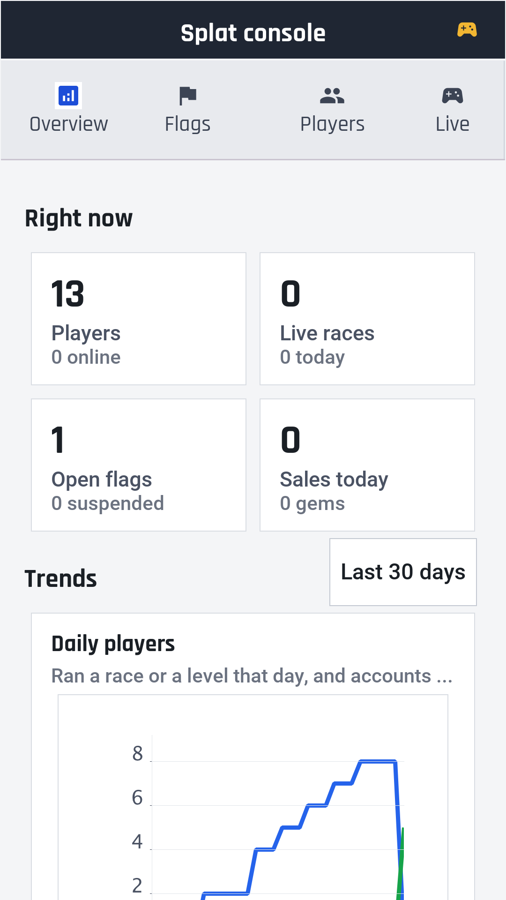

[source,java,role=cn1-no-try]
----
include::../../scripts/splat/backend/src/main/java/com/codenameone/examples/splat/admin/Moderation.java[tag=splat-moderation,indent=0]
----

The engagement tools (campaign links, invitations, the home screen spotlight, pushes
to an audience and scheduled pipelines) are the ones
<<skirmish-implementors-guide,the Skirmish chapter>> walks through step by step, and they
work in Splat unchanged.

[[splat-reskin]]
=== Making it yours

* *Fields*: add an `Arena.Builder` to `Catalog.ARENAS`. The mission list, the server's
  playlist and the bots pick it up at once. Give a new box kind a colour in
  `ArenaView`.
* *Markers*: add a `MarkerDef`, then sell it in the backend's shop `Catalog`. The
  shipped markers are side-grades, not upgrades: the pump hits harder at range and the
  ramping marker sprays.
* *Characters*: there are no model files. `ArenaView` builds every player from
  primitives in the team colour, and `Portraits` paints the same figure flat for the
  menus.
* *The jokes*: the briefings are in `Mode`, the killfeed's excuses in `Hud`, and the
  emotes in `MatchForm`.
* *The look*: every colour is a variable at the top of `theme.css`:
+
[source,css]
----
include::../../scripts/splat/common/src/main/css/theme.css[tag=splat-palette,indent=0]
----
* *Store, ads and push*: the product ids are in `AppConfig`, and the receipt validator
  is chosen in `Services`:
+
[source,java,role=cn1-no-try]
----
include::../../scripts/splat/common/src/main/java/com/codenameone/examples/splat/AppConfig.java[tag=splat-monetization-ids,indent=0]
----
+
[source,java,role=cn1-no-try]
----
include::../../scripts/splat/backend/src/main/java/com/codenameone/examples/splat/Services.java[tag=splat-receipt-choice,indent=0]
----
