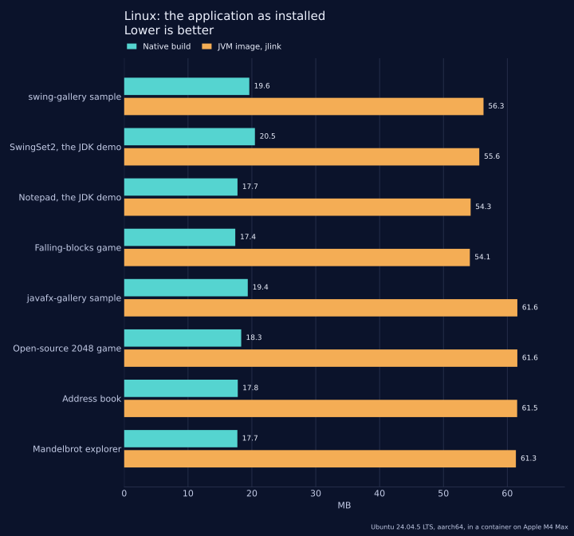
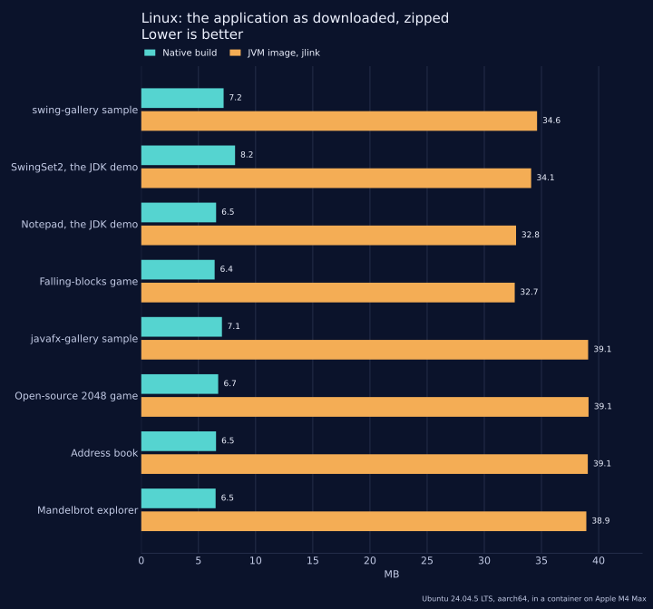
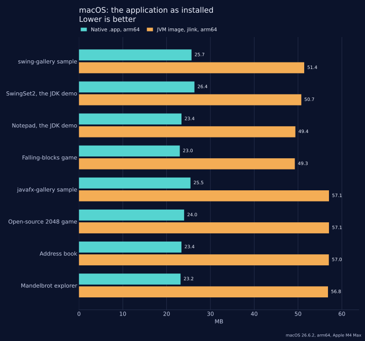
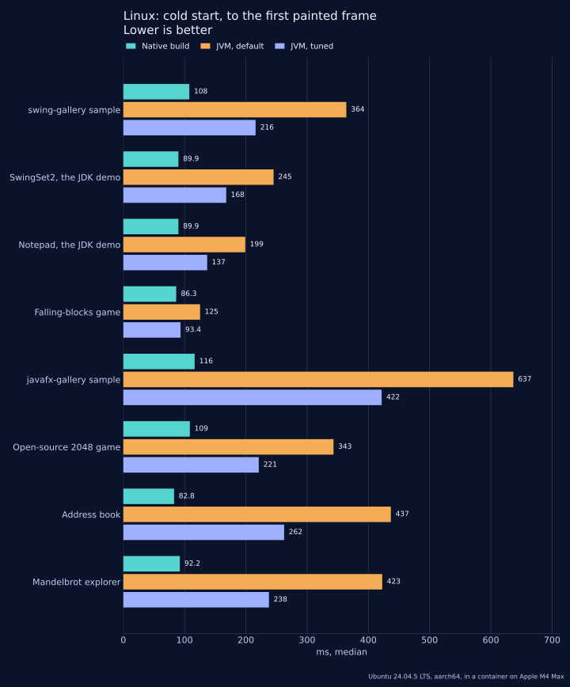
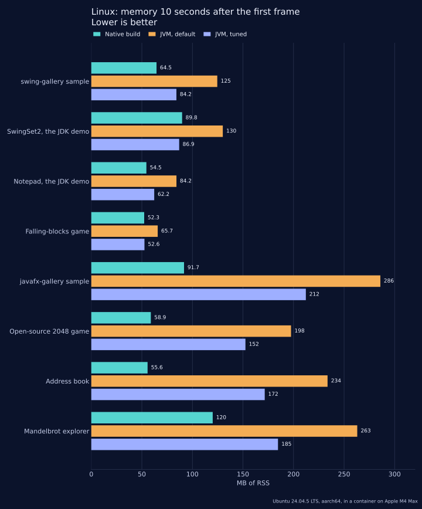

// Written by desktop-compat-benchmarks.py from measured results. Change the results and run it again;
// an edit made here is lost. Desktop-Interop.asciidoc includes this file once, whole.

.Linux: the distributed application (MB)
[cols="<3,<1,>1,>1,>1,>1,>1,>1,>1",options="header"]
|===
|Application |Toolkit |`jlink` image |`jlink` image, zipped |`jpackage` image, zipped |Native build |Native build, zipped |JVM image / native build |JVM zip / native zip

|`swing-gallery` sample |Swing |56.3 |34.6 |34.8 |19.6 |7.2 |2.9x |4.8x

|SwingSet2, the JDK demo |Swing |55.6 |34.1 |34.2 |20.5 |8.2 |2.7x |4.2x

|Notepad, the JDK demo |Swing |54.3 |32.8 |32.9 |17.7 |6.5 |3.1x |5.0x

|Falling-blocks game |Swing |54.1 |32.7 |32.8 |17.4 |6.4 |3.1x |5.1x

|`javafx-gallery` sample |JavaFX |61.6 |39.1 |39.2 |19.4 |7.1 |3.2x |5.5x

|Open-source 2048 game |JavaFX |61.6 |39.1 |39.3 |18.3 |6.7 |3.4x |5.8x

|Address book |JavaFX |61.5 |39.1 |39.2 |17.8 |6.5 |3.5x |6.0x

|Mandelbrot explorer |JavaFX |61.3 |38.9 |39.0 |17.7 |6.5 |3.5x |6.0x
|===

The `jlink` image is the application with the smallest Java runtime that runs it: the application's jars and the modules `jlink` found it to need. The native build is one executable file with nothing beside it. Both rely on the desktop libraries of the system, X11 and, for the native build and for JavaFX, GTK; neither column counts them.

Against the `jlink` image as installed the native build is smaller in 8 applications, of the 8 measured. Its best result is 3.5x for Mandelbrot explorer (17.7 MB against 61.3 MB).

Against the zipped `jlink` image the native build is smaller in 8 applications, of the 8 measured. Its best result is 6.0x for Mandelbrot explorer (6.5 MB against 38.9 MB).

.macOS: the distributed application (MB)
[cols="<3,>1,>1,>1,>1,>1,>1,>1",options="header"]
|===
|Application |`jlink` image, arm64 |`jlink` image, zipped |Native `.app`, arm64 |Native `.app`, zipped |Universal `.app` |JVM image / native `.app` |JVM zip / native zip

|`swing-gallery` sample |51.4 |32.5 |25.7 |8.7 |49.6 |2.0x |3.7x

|SwingSet2, the JDK demo |50.7 |32.0 |26.4 |9.8 |49.5 |1.9x |3.3x

|Notepad, the JDK demo |49.4 |30.7 |23.4 |8.0 |44.9 |2.1x |3.9x

|Falling-blocks game |49.3 |30.6 |23.0 |7.8 |44.2 |2.1x |3.9x

|`javafx-gallery` sample |57.1 |37.1 |25.5 |8.6 |49.2 |2.2x |4.3x

|Open-source 2048 game |57.1 |37.1 |24.0 |8.1 |46.0 |2.4x |4.6x

|Address book |57.0 |37.0 |23.4 |7.9 |45.0 |2.4x |4.7x

|Mandelbrot explorer |56.8 |36.9 |23.2 |7.9 |44.6 |2.5x |4.7x
|===

Both sides are built for arm64: the `jlink` image holds the arm64 runtime, and the native `.app` is the bundle with the arm64 slice of its executable only. The builder's default output is universal, with an x86_64 slice beside it; its size is in the last size column.

Against the `jlink` image as installed the native build is smaller in 8 applications, of the 8 measured. Its best result is 2.5x for Mandelbrot explorer (23.2 MB against 56.8 MB).

Against the zipped `jlink` image the native build is smaller in 8 applications, of the 8 measured. Its best result is 4.7x for Mandelbrot explorer (7.9 MB against 36.9 MB).

.iOS and Android: the distributed application (MB)
[cols="<3,>2,>2,>2,>2,>2,>2",options="header"]
|===
|Application |iOS `.app` |iOS `.app`, zipped |iOS executable, stripped |Android APK |APK, unpacked |Of which dex

|`swing-gallery` sample |28.1 |9.4 |18.2 |3.0 |5.8 |3.9

|SwingSet2, the JDK demo |28.7 |10.5 |17.6 |4.4 |7.2 |3.8

|Notepad, the JDK demo |25.6 |8.7 |16.3 |2.9 |5.5 |3.5

|Falling-blocks game |25.1 |8.6 |16.1 |2.8 |5.3 |3.4

|`javafx-gallery` sample |27.8 |9.3 |18.0 |3.1 |5.9 |4.0

|Open-source 2048 game |26.1 |8.9 |16.7 |3.1 |6.0 |3.8

|Address book |25.4 |8.6 |16.5 |3.0 |5.8 |3.9

|Mandelbrot explorer |25.3 |8.6 |16.3 |2.9 |5.5 |3.6
|===

.How much of the toolkit layer an application keeps
[cols="<3,<2,>1,>1,>1",options="header"]
|===
|Application |Toolkit |Classes in the layer |Classes in the native build |Kept

|`swing-gallery` sample |Swing and AWT |1039 |737 |71%

|SwingSet2, the JDK demo |Swing and AWT |1039 |587 |56%

|Notepad, the JDK demo |Swing and AWT |1039 |566 |54%

|Falling-blocks game |Swing and AWT |1039 |538 |52%

|`javafx-gallery` sample |JavaFX |901 |688 |76%

|Open-source 2048 game |JavaFX |894 |413 |46%

|Address book |JavaFX |896 |461 |51%

|Mandelbrot explorer |JavaFX |896 |442 |49%
|===

.Linux: warm start, from process start to the first painted frame (ms, median with the range)
[cols="<3,>2,>2,>2,>2,>2",options="header"]
|===
|Application |JVM, default |JVM, tuned |Native build |Default / native |Tuned / native

|`swing-gallery` sample |326 (316-336) |194 (193-195) |96 (40-104) |3.4x |2.0x

|SwingSet2, the JDK demo |220 (205-221) |145 (144-157) |56 (54-84) |3.9x |2.6x

|Notepad, the JDK demo |175 (170-187) |123 (107-134) |55 (54-77) |3.2x |2.2x

|Falling-blocks game |102 (101-119) |70 (69-72) |74 (54-102) |1.4x |0.9x

|`javafx-gallery` sample |603 (589-617) |408 (386-428) |100 (97-110) |6.0x |4.1x

|Open-source 2048 game |307 (271-326) |190 (160-205) |77 (44-100) |4.0x |2.5x

|Address book |407 (389-452) |238 (233-266) |74 (56-88) |5.5x |3.2x

|Mandelbrot explorer |392 (373-424) |214 (202-231) |86 (76-94) |4.6x |2.5x
|===

Against the default JVM the native build is quicker in 8 applications, of the 8 measured. Its best result is 6.0x for `javafx-gallery` sample (100 ms against 603 ms).

Against the tuned JVM the native build is quicker in 7 applications and slower in 1 application, of the 8 measured. Its best result is 4.1x for `javafx-gallery` sample (100 ms against 408 ms). Its worst is 0.9x for Falling-blocks game (74 ms against 70 ms).

.Linux: cold start, from process start to the first painted frame (ms, median with the range)
[cols="<3,>2,>2,>2,>2,>2",options="header"]
|===
|Application |JVM, default |JVM, tuned |Native build |Default / native |Tuned / native

|`swing-gallery` sample |364 (358-382) |216 (212-236) |108 (97-117) |3.4x |2.0x

|SwingSet2, the JDK demo |245 (229-255) |168 (151-180) |90 (86-95) |2.7x |1.9x

|Notepad, the JDK demo |199 (195-210) |137 (126-150) |90 (63-92) |2.2x |1.5x

|Falling-blocks game |125 (124-140) |93 (91-99) |86 (65-90) |1.5x |1.1x

|`javafx-gallery` sample |637 (631-654) |422 (415-432) |116 (109-120) |5.5x |3.6x

|Open-source 2048 game |343 (308-355) |221 (206-226) |109 (107-128) |3.2x |2.0x

|Address book |437 (428-477) |262 (258-269) |83 (63-88) |5.3x |3.2x

|Mandelbrot explorer |423 (363-428) |238 (196-240) |92 (92-96) |4.6x |2.6x
|===

Against the default JVM the native build is quicker in 8 applications, of the 8 measured. Its best result is 5.5x for `javafx-gallery` sample (116 ms against 637 ms).

Against the tuned JVM the native build is quicker in 8 applications, of the 8 measured. Its best result is 3.6x for `javafx-gallery` sample (116 ms against 422 ms).

.Linux: memory 10 seconds after the first frame (MB, RSS / PSS)
[cols="<3,>2,>2,>2,>2,>2",options="header"]
|===
|Application |JVM, default |JVM, tuned |Native build |Default RSS / native |Tuned RSS / native

|`swing-gallery` sample |124.6 / 119.1 |84.2 / 78.6 |64.5 / 56.4 |1.9x |1.3x

|SwingSet2, the JDK demo |130.1 / 126.0 |86.9 / 82.8 |89.8 / 81.3 |1.4x |1.0x

|Notepad, the JDK demo |84.2 / 80.2 |62.2 / 58.2 |54.5 / 47.0 |1.5x |1.1x

|Falling-blocks game |65.7 / 61.8 |52.6 / 48.6 |52.3 / 45.4 |1.3x |1.0x

|`javafx-gallery` sample |285.9 / 258.1 |212.2 / 184.5 |91.7 / 83.3 |3.1x |2.3x

|Open-source 2048 game |197.5 / 171.7 |152.4 / 126.6 |58.9 / 51.8 |3.4x |2.6x

|Address book |233.6 / 207.4 |171.5 / 145.2 |55.6 / 48.3 |4.2x |3.1x

|Mandelbrot explorer |263.0 / 236.0 |184.6 / 157.6 |120.1 / 112.3 |2.2x |1.5x
|===

Against the default JVM the native build is smaller in 8 applications, of the 8 measured. Its best result is 4.2x for Address book (55.6 MB against 233.6 MB).

Against the tuned JVM the native build is smaller in 6 applications and within 5% of it in 2 applications, of the 8 measured. Its best result is 3.1x for Address book (55.6 MB against 171.5 MB).

.Linux: memory after the scripted interaction (MB, RSS / PSS)
[cols="<3,>2,>2,>2,>2,>2",options="header"]
|===
|Application |JVM, default |JVM, tuned |Native build |Default RSS / native |Tuned RSS / native

|`swing-gallery` sample |118.4 / 112.9 |86.0 / 80.5 |90.8 / 81.8 |1.3x |0.9x

|SwingSet2, the JDK demo |130.8 / 126.8 |87.0 / 83.0 |92.8 / 84.3 |1.4x |0.9x

|Notepad, the JDK demo |91.0 / 87.0 |63.5 / 59.4 |58.2 / 50.6 |1.6x |1.1x

|Falling-blocks game |68.3 / 64.4 |53.8 / 49.9 |54.3 / 47.4 |1.3x |1.0x

|`javafx-gallery` sample |293.8 / 266.0 |213.3 / 185.5 |109.4 / 99.7 |2.7x |1.9x

|Open-source 2048 game |208.3 / 182.4 |155.7 / 129.8 |100.0 / 93.0 |2.1x |1.6x

|Address book |245.8 / 219.5 |172.6 / 146.3 |57.2 / 49.8 |4.3x |3.0x

|Mandelbrot explorer |293.4 / 266.3 |197.6 / 170.6 |172.2 / 164.5 |1.7x |1.1x
|===

Against the default JVM the native build is smaller in 8 applications, of the 8 measured. Its best result is 4.3x for Address book (57.2 MB against 245.8 MB).

Against the tuned JVM the native build is smaller in 5 applications, larger in 2 applications and within 5% of it in 1 application, of the 8 measured. Its best result is 3.0x for Address book (57.2 MB against 172.6 MB). Its worst is 0.9x for SwingSet2, the JDK demo (92.8 MB against 87.0 MB).

.Linux: peak RSS over a whole session (MB)
[cols="<3,>2,>2,>2,>2,>2,>2",options="header"]
|===
|Application |JVM, default |JVM, tuned |Native build |Default / native |Tuned / native |Tuned `-Xmx` (MB)

|`swing-gallery` sample |128.5 |88.0 |90.1 |1.4x |1.0x |8

|SwingSet2, the JDK demo |130.9 |87.2 |92.5 |1.4x |0.9x |24

|Notepad, the JDK demo |92.9 |64.0 |57.7 |1.6x |1.1x |8

|Falling-blocks game |70.3 |54.2 |53.9 |1.3x |1.0x |8

|`javafx-gallery` sample |296.7 |215.8 |108.8 |2.7x |2.0x |48

|Open-source 2048 game |211.5 |158.6 |125.5 |1.7x |1.3x |8

|Address book |248.6 |175.3 |56.7 |4.4x |3.1x |48

|Mandelbrot explorer |296.1 |200.2 |340.5 |0.9x |0.6x |48
|===

.Linux: CPU while idle (share of one core)
[cols="<3,>2,>2,>2",options="header"]
|===
|Application |JVM, default |JVM, tuned |Native build

|`swing-gallery` sample |0.0% |0.0% |0.2%

|SwingSet2, the JDK demo |0.2% |0.0% |1.6%

|Notepad, the JDK demo |0.2% |0.0% |0.0%

|Falling-blocks game |1.0% |0.8% |0.6%

|`javafx-gallery` sample |25.4% |27.1% |4.7%

|Open-source 2048 game |3.9% |2.5% |4.8%

|Address book |0.6% |0.4% |0.0%

|Mandelbrot explorer |2.2% |1.8% |0.2%
|===

Of the 8 native builds, 5 idle at or under 1% of a core. Above it: SwingSet2, the JDK demo (1.6%), `javafx-gallery` sample (4.7%), Open-source 2048 game (4.8%).

.Where the figures were measured
* *Linux*: Ubuntu 24.04.5 LTS, aarch64, 4 CPUs, 7.7 GB of memory, in a container, hosted on Apple M4 Max. The display is a virtual framebuffer, Xvfb, of 1280 by 800 pixels. GTK 3.24.41. Each display has had one GTK program on it before the measured application starts, as a desktop session has: the first GTK program on a display loads a GL driver to choose its visuals, and no later one does. OpenJFX 23.0.2 for the JavaFX baselines.
* *Tuned JVM flags*: `-XX:+UseSerialGC -Xss256k -XX:TieredStopAtLevel=1 -XX:SharedArchiveFile=app.jsa`, and the `-Xmx` of the table above.
* *macOS, iOS and Android sizes*: macOS 26.6.2, Apple M4 Max, Xcode 27.0.
