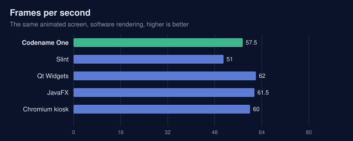
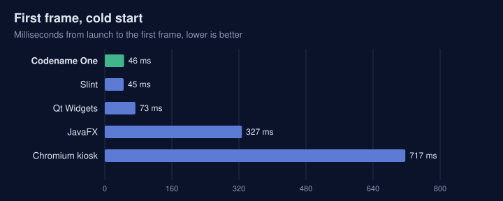
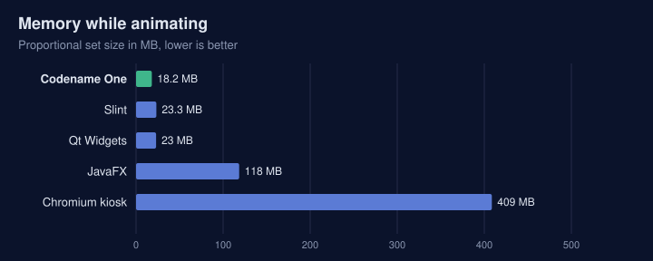
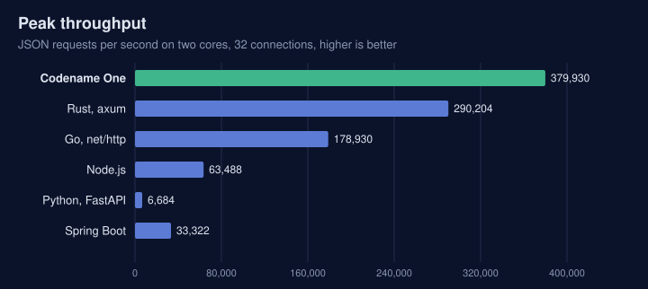
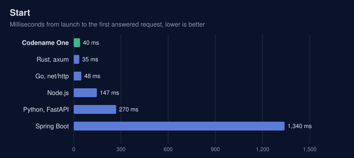
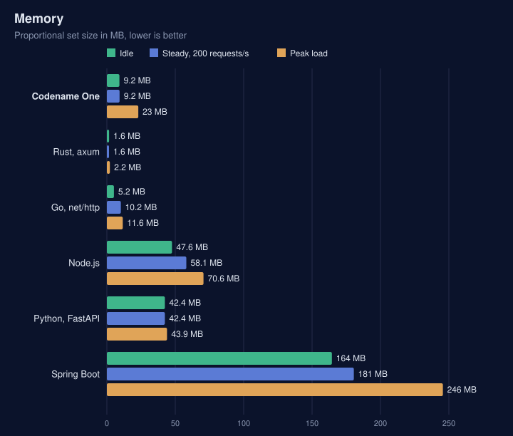

// Measured with scripts/embedded/bench (run.sh); Embedded-Linux.asciidoc includes this file once, whole.
// Replace the numbers only with a new run of that harness, and keep the host note in step.

=== Compared with the alternatives

The same workload ran in each framework: an 800 by 480 pixel gauge (a filled arc that
sweeps, a needle and a bold percentage) redrawn for every frame, capped at 60 frames
per second, rendered in software into memory. Each ran three times for ten seconds,
from a cold start and then a warm one, in the same Debian bookworm arm64 container on
an Apple silicon host. The table shows the median. A board is slower than that host
and its storage is slower still, so read the columns against each other rather than
as a board's figures.

.The gauge workload, software rendering, 800 by 480 (median of three runs)
[cols="<2,>1,>1,>1,>1,>1,>1,>1",options="header"]
|===
|Framework |First frame, cold (ms) |First frame, warm (ms) |Frames per second |CPU (%) |Memory, PSS (MB) |Memory, private (MB) |Files mapped (MB)

|Codename One |46 |53 |57 |6 |18 |17 |15 (15 files)
|Slint 1.8, software renderer |45 |103 |51 |2 |23 |22 |4.3 (6 files)
|Qt 6.4 Widgets, raster engine |73 |100 |62 |6 |23 |22 |73 (51 files)
|JavaFX 26, software pipeline |327 |468 |62 |32 to 42 |116 |115 |102 (44 files)
|Chromium kiosk, canvas |717 |419 |60 |50 or more |398 |224 |378 (149 files)
|===

* *First frame* is the wall-clock time from starting the process to the end of the
  first frame drawn. A *cold* start follows dropping the kernel's page cache, so the
  executable and every library, plugin and font it uses are read from storage again,
  as on the first start after boot. A *warm* start follows straight after a cold one.
  Below about 100 ms the two differ by less than the run-to-run noise.
* *Memory, PSS* (proportional set size) counts every page the process maps, shared
  library pages divided among the processes sharing them, so shared libraries are
  included. *Private* counts only the pages no other process shares: heap, stacks
  and written data. Both are read from `/proc/<pid>/smaps_rollup` mid-run, and for
  Chromium summed over its whole tree of processes.
* *Files mapped* is every distinct file the process has mapped mid-run, counted once
  at its full size: the executable, every shared library including the C library,
  plugins loaded at run time, fonts and locale data. That's what has to be on the
  device for the application to run, whether the board image already carries
  it. Codename One's executable is 7.7 MB of it; the rest is the C library, FreeType,
  libpng, libjpeg, libdrm, libepoxy and the font. OpenSSL and libcurl are loaded only
  when an application first uses them, and this one doesn't. Qt's executable is 0.1 MB of 73;
  the rest is Qt Core, Gui and Widgets, their dependencies and the platform plugins.
* *Codename One draws more*: its form has a title bar, a button, a slider and a
  label around the gauge; the others draw only the gauge.
* *JavaFX* runs on a JDK 25 runtime cut down with `jlink` to the modules it uses, with
  the Headless glass platform JavaFX 26 introduced and Prism's software pipeline. That
  is the same rendering path as a board without a GPU, minus the display. Gluon does
  not publish its embedded (Monocle) builds, so this is the closest public build.
  Its CPU includes the JIT compiler warming up, which is why it varies between runs.
* *Chromium's* CPU covers its start-up as well, an upper bound.
* *Slint* missed frames under the harness's 16 ms pacing loop, not for lack of CPU.

Codename One and Slint start fastest, Codename One uses the least memory, Slint
needs the least on disk, and the three native toolkits land close together in frame
rate and CPU. Codename One and Slint need far less on disk than Qt. JavaFX, the other
way to put a Java UI on a board, needs about six times Codename One's memory and
seven times its disk, and a kiosk browser about twenty times both.

The table leaves out flutter-pi and Android (AOSP): flutter-pi needs an OpenGL ES
GPU and AOSP needs a board support package, so neither runs in this harness.

.What each option offers
[cols="<2,<2,<2,<2,<2,<2,<2",options="header"]
|===
| |Codename One |Qt / Boot2Qt |Slint |flutter-pi |Chromium kiosk |AOSP

|Language |Java, Kotlin |C++, QML |Rust, C++, JavaScript, Python, `.slint` |Dart |HTML, JavaScript |Java, Kotlin
|Runtime on the device |None: one native executable |Qt libraries |Small native library |Flutter engine |Browser |Android runtime
|Needs a GPU |No |No (raster), yes for Qt Quick |No |Yes |No, but slow without one |Yes
|Display without X11 or Wayland |DRM/KMS, fbdev |`eglfs`, `linuxfb` |`linuxkms` |DRM/KMS |Through Ozone |SurfaceFlinger
|Same code on iOS and Android |Yes |Yes |Not as a primary target |Yes |As a web application |Android only
|GPIO, I2C, SPI, serial, CAN in the API |Yes (`com.codename1.hardware`) |Serial and CAN modules; GPIO through the OS |No |Through plugins |No |Through vendor HALs
|Simulator with virtual hardware |Yes |No |No |No |No |Emulator
|Headless server on the same codebase |Yes (the backend) |Qt Core, HTTP server module |No |No |No |No
|Yocto and Buildroot integration |Layer and package |Yes (meta-qt6, Boot2Qt) |Yes (meta-slint) |Community recipes |Yes |Not applicable
|Licence |GPL 2 with Classpath exception |LGPL 3, GPL or commercial |GPL 3, royalty-free or commercial |BSD 3-clause |BSD 3-clause |Apache 2.0
|===

=== Without a display

A gateway or sensor hub has no screen, so the GUI comparison says little about it.
The same small JSON service ran in each runtime: `GET /json` answering a short object.
The server was pinned to two cores, a small board's share, and the load generator
(`oha`) ran on the remaining cores. Each runtime ran four rounds, from a cold start
and then a warm one, in the same Debian bookworm arm64 container. The first round
pages the container image in and is left out, so the table shows the median of the
other six runs.

* *Start* is the time from launch to the first answered request.
* *Idle* is the proportional set size (PSS) two seconds later, with no requests.
* *Steady* is a constant 200 requests per second for ten seconds. It gives the CPU
  used over that time and the memory at its end.
* *Peak* is as many requests as 32 connections can drive in ten seconds.

.A JSON service, two cores (median of six runs)
[cols="<2,>1,>1,>1,>1,>1,>1,>1",options="header"]
|===
|Runtime |Start (ms) |Idle PSS (MB) |Steady CPU (%) |Steady PSS (MB) |Peak (requests/s) |Peak p99 (ms) |Disk mapped (MB)

|Codename One backend |40 |9.2 |3.1 |9.2 |379,900 |0.22 |21 (34 files)
|Rust, axum |35 |1.6 |3.2 |1.6 |290,200 |0.25 |3.3 (5 files)
|Go, net/http |48 |5.2 |8.3 |10.2 |178,900 |0.59 |5.2 (1 file)
|Node.js, http |147 |48 |11 |58 |63,500 |1.1 |90 (19 files)
|Python, FastAPI and uvicorn |270 |42 |22 |42 |6,700 |11 |21 (30 files)
|Spring Boot 3.5, JDK 21 |1,340 |164 |16 |181 |33,300 |3.3 |183 (20 files)
|===

Codename One starts as fast as the compiled runtimes and serves the most requests of
any of them: 1.3 times Rust's peak and 2.1 times Go's, at the lowest p99, with a
steady-load CPU the same as Rust's. Like Rust's, the server makes two system calls
per request, one read and one write, and a request allocates nothing but the object
the handler returns. Rust and Go use less memory: a Codename One process grows to
about 23 MB at peak load, against Go's 12 MB and Rust's 2 MB. Against the managed
runtimes, it starts 33 times faster than Spring Boot, uses an eighteenth of its
memory and serves over 11 times its peak.

Every change to the backend runtime or the translator reruns this comparison in continuous integration, against Rust and Go on an arm64 machine. The build fails if Codename One's peak throughput falls below Rust's, if its latency, start or CPU falls too far behind, if its memory passes 12 MB idle or 32 MB at peak, or if a request allocates anything beyond the object its handler returns.
